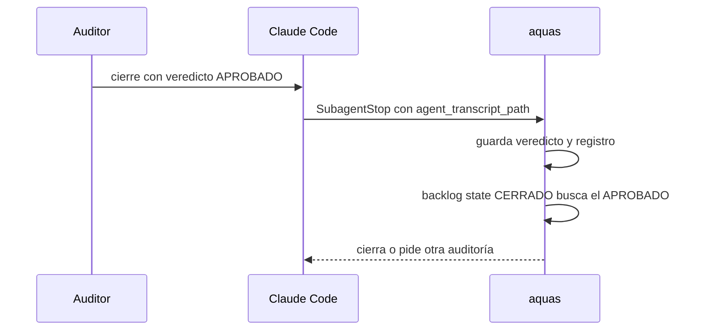

# S004 · Veredicto del auditor comprobado contra su registro

[Inicio](../../README.md) › [E000](../README.md) › [F008](README.md) › S004

Este [slice](../../glosario.md#slice) hace que un veredicto APROBADO valga solo si el auditor lo escribió.

## En una frase

Un slice no cierra si su APROBADO no está en el registro del auditor, después del verde.

## Para qué existe

**El problema.** D000077: la ficha guarda el veredicto del auditor como un dato más. Quien escriba ese dato finge un APROBADO.

**Por qué importa.** El auditor es la revisión independiente antes del cierre. Si se puede fingir, el [agente](../../glosario.md#agente) se aprueba a sí mismo.

**La solución.** El [hook](../../glosario.md#hook) guarda la ruta del registro del auditor junto al veredicto. Al cerrar, `aquas` busca ahí el APROBADO de ese slice.

**Origen.** Auditoría general del 2026-10-30, hallazgo G1. Sigue a S002, que hizo lo mismo con el «apruebo».

**Límite.** El registro lo escribe Claude Code fuera del repo. Es determinista solo con el aislamiento de Bash de S003. En Windows nativo es una segunda barrera, probabilística (D000079). Un registro borrado por antigüedad anula el veredicto; se audita otra vez. Si hay dos registros de auditor, se puede citar el del APROBADO y callar otro posterior. El veredicto no prueba qué código vio el auditor; eso lo da la huella.

**Contrato.**

| Regla | Valor |
|---|---|
| Qué guarda el hook | el veredicto, más `registro`: el `agent_transcript_path` que Claude Code entrega en `SubagentStop` |
| Registro válido | archivo `.jsonl` dentro de `~/.claude/projects/` (o de `CLAUDE_CONFIG_DIR/projects/`), fuera del repo |
| Línea válida | `type` `assistant` y `attributionAgent` `auditor`; texto o mensaje de `SubagentHandback` |
| Veredicto atado | el último cierre de ese slice en el registro dice APROBADO, con `timestamp` posterior al verde |
| Dónde se comprueba | al pasar el slice a CERRADO |
| Respuesta si falla | error que nombra la causa y pide otra auditoría |
| Veredictos viejos | sin `registro` no valen; se audita otra vez |
| Alcance | `internal/backlog/**`, `cmd/aquas/**`, `docs/**`, más `gobierno/config/dependencias.json` para la arista `internal/backlog → internal/encargo` |

**Casos borde.**

| Categoría | Aplica | Prueba o motivo |
|---|---|---|
| cada tipo de ficha | no | solo los slices llevan veredicto del auditor |
| cada estado de origen | no | se comprueba en un único paso: EN_CURSO a CERRADO |
| padre e hijo, activo y archivado | no | el veredicto es del slice; la feature no lo hereda ni lo cede |
| entrada ausente, vacía, mal escrita o duplicada | sí | sin `registro`, ruta fuera de projects, dentro del repo, archivo ausente, línea rota, otro id: `TestVeredictoConRegistroDelAuditor` |
| choque con otro control | sí | APROBADO anterior al verde no vale; la huella del código sigue mandando: `TestVeredictoConRegistroDelAuditor` |
| quién habla: humano, agente o herramienta | sí | texto del orquestador, de otro tipo de agente o línea de usuario no cuenta: `TestVeredictoConRegistroDelAuditor` |
| fallo a mitad de camino | sí | APROBADO seguido de un CON_HALLAZGOS en el mismo registro no cierra: `TestVeredictoConRegistroDelAuditor` |

## Analogía

Piensa en **un acta de inspección**.

- Antes, bastaba con que la carpeta dijera «aprobado».
- Ahora, se compara con el acta firmada por el inspector.

Límite de la analogía: si alguien entra al archivo del inspector, también falsifica el acta. Eso lo impide el aislamiento (S003).

## Diagrama

## Ejemplo de punta a punta

continúa: [EJ-E000-F008](README.md#EJ-E000-F008)

1. El agente escribe en la ficha un APROBADO con un registro inventado.
2. `aquas backlog state CERRADO` busca el veredicto en ese registro y no lo halla.
3. El slice no cierra; el error pide otra auditoría.

## Paso a paso

1. Rojo de la prueba.
2. El hook guarda `registro` con el veredicto.
3. `veredictoVigente` comprueba el registro antes que fechas y huella.

## Cómo se usa

- No se usa: actúa sola al cerrar cada slice.

## Contrato y evidencia

<!-- GENERADO por aquas desde trabajo/: no editar a mano; `aquas compile` lo rehace. -->

| Prueba | Valida | Rojo cuando | Verde cuando | Rojo | Verde |
|---|---|---|---|---|---|
| `TestVeredictoConRegistroDelAuditor` | valida que el cierre exige el APROBADO en el registro del auditor | rojo cuando un APROBADO sin registro deja cerrar | verde cuando solo cierra con el APROBADO del auditor después del verde | 2026-11-01 | 2026-11-01 |

### Código

| Archivo | Función | Parámetros | Qué hace |
|---|---|---|---|
| [cmd/aquas/main.go](../../../cmd/aquas/main.go) | `main` | `()` | main despacha el subcomando de aquas (compilar, verificar, backlog, hooks…) y sale con su código. |
| [cmd/aquas/main.go](../../../cmd/aquas/main.go) | `hook` | `(raiz string)` | hook: exit 0 = nada que reportar; exit 2 = stderr se muestra a Claude. |
| [cmd/aquas/main.go](../../../cmd/aquas/main.go) | `compilarSettings` | `(w io.Writer)` | compilarSettings regenera .claude/settings.json; sin entorno declarado no inventa uno. |
| [cmd/aquas/main.go](../../../cmd/aquas/main.go) | `reportar` | `(w io.Writer, inf compilador.Informe)` | reportar imprime qué derivados escribió la compilación, o que todo estaba al día. |
| [cmd/aquas/main.go](../../../cmd/aquas/main.go) | `listar` | `(titulo string, problemas []string)` | listar imprime en stderr un título y cada problema en su viñeta. |
| [cmd/aquas/main.go](../../../cmd/aquas/main.go) | `lista` | `(xs []string) string` | lista une los textos con comas, o «—» si no hay ninguno. |
| [cmd/aquas/main.go](../../../cmd/aquas/main.go) | `fallar` | `(codigo int, err error)` | fallar imprime el error en stderr y termina con el código dado. |
| [cmd/aquas/main.go](../../../cmd/aquas/main.go) | `revisarAislamiento` | `() (fallo, aviso string)` | revisarAislamiento: fallo para el gate y aviso para el arranque (E000/F008/S003, D000079). |
| [cmd/aquas/main.go](../../../cmd/aquas/main.go) | `memoriaCLI` | `(raiz string, args []string)` | memoriaCLI: `ver` imprime la memoria; `fijar campo=valor…` la actualiza y la sella. |
| [cmd/aquas/main.go](../../../cmd/aquas/main.go) | `memoriaArchivada` | `(raiz, id string) error` | memoriaArchivada: CERRADO exige el archivo de memoria del slice, apunte o no la memoria a él (E001/F002/S009, X01). |
| [cmd/aquas/main.go](../../../cmd/aquas/main.go) | `focoEnBacklog` | `(raiz string, f memoria.Foco) error` | focoEnBacklog: la memoria solo fija el slice que el backlog tiene en curso (S003). |
| [cmd/aquas/main.go](../../../cmd/aquas/main.go) | `backlogCLI` | `(raiz string, args []string)` | backlogCLI: nuevo \\| ver [id] \\| tabla \\| prioridad \\| estado \\| siguiente \\| pruebas \\| rojo \\| verde. |
| [cmd/aquas/main.go](../../../cmd/aquas/main.go) | `gateDefectos` | `(raiz string) (frena []string, aviso string)` | gateDefectos (E001/F017/S005): lo que el gate dice del registro de defectos. Prueba nombrada que ya no existe |
| [cmd/aquas/main.go](../../../cmd/aquas/main.go) | `turnoCLI` | `(raiz string, args []string)` | turnoCLI: auditoría de turnos (E001/F002/S001). Lee el JSON del hook por stdin. No imprime nada |
| [cmd/aquas/main.go](../../../cmd/aquas/main.go) | `retroCLI` | `(raiz string, args []string) (backlog.Retro, error)` | retroCLI (E001/F018/S002): cerrar fichas=A,B motivo=…; cada clave una vez. |
| [cmd/aquas/main.go](../../../cmd/aquas/main.go) | `defectoCLI` | `(raiz string, args []string) error` | defectoCLI: nuevo \\| ocurre \\| arreglar \\| ver (E001/F004/S001; arreglar: E000/F007/S003). |
| [cmd/aquas/main.go](../../../cmd/aquas/main.go) | `versionBinario` | `() string` | versionBinario: versión del módulo con que se compiló el binario (= versión del gobierno embebido). |
| [cmd/aquas/main.go](../../../cmd/aquas/main.go) | `registrarCierre` | `(raiz, tipo, transcript, primera, resultado string)` | registrarCierre (E001/F004/S005, D000068) anota cada llamada del gancho cierre-agente en .tmp/hooks/cierre-agente.jsonl. |
| [cmd/aquas/main.go](../../../cmd/aquas/main.go) | `entornoHijo` | `(raiz string)` | entornoHijo (E003/F001/S003) declara el entorno del hijo, como aquas init en la central: |
| [gobierno/config/dependencias.json](../../../gobierno/config/dependencias.json) | — | — | — |
| [internal/backlog/auditoria.go](../../../internal/backlog/auditoria.go) | `AnotarAuditoria` | `(raiz, id, veredicto, registro string, ahora time.Time) error` | AnotarAuditoria anota el veredicto del auditor y su registro en la ficha de un slice EN_CURSO; gana el último. |
| [internal/backlog/auditoria.go](../../../internal/backlog/auditoria.go) | `veredictoVigente` | `(raiz string, f Ficha) error` | veredictoVigente: CERRADO de un slice exige el último veredicto APROBADO, posterior al verde y sobre el mismo código. |
| [internal/backlog/auditoria.go](../../../internal/backlog/auditoria.go) | `derefHuella` | `(h *map[string]string) map[string]string` | derefHuella: la huella apuntada, o nil si no hay. |
| [internal/backlog/auditoria.go](../../../internal/backlog/auditoria.go) | `veredictoRespaldado` | `(raiz, id, registro string, verde time.Time) error` | veredictoRespaldado (E000/F008/S004, D000077): el último cierre de ese slice que el auditor escribió en su |
| [internal/backlog/auditoria.go](../../../internal/backlog/auditoria.go) | `ultimoVeredicto` | `(ruta, id string) (string, time.Time, error)` | ultimoVeredicto: veredicto y hora del último cierre de ese id en las líneas de asistente del auditor |
| [internal/backlog/respaldo.go](../../../internal/backlog/respaldo.go) | `carpetaRegistros` | `() (string, error)` | carpetaRegistros: <CLAUDE_CONFIG_DIR o ~/.claude>/projects, donde Claude Code guarda los registros de sesión. |
| [internal/backlog/respaldo.go](../../../internal/backlog/respaldo.go) | `bajo` | `(padre, hija string) bool` | bajo: la ruta real hija queda dentro de la ruta real padre. |
| [internal/backlog/respaldo.go](../../../internal/backlog/respaldo.go) | `real` | `(p string) (string, error)` | real: ruta absoluta sin enlaces; si no existe, error. |
| [internal/backlog/respaldo.go](../../../internal/backlog/respaldo.go) | `respaldada` | `(raiz, id string, a *Aprobacion) error` | respaldada: nil si a.Mensaje aprueba justo ese id (con «con push» solo si a.Push) y está como mensaje humano |
| [internal/backlog/respaldo.go](../../../internal/backlog/respaldo.go) | `registroValido` | `(raiz, ruta string) (string, error)` | registroValido: la ruta real de un registro de Claude Code, si es un .jsonl de la carpeta de registros y queda |
| [internal/backlog/respaldo.go](../../../internal/backlog/respaldo.go) | `UltimoMensajeHumano` | `(ruta string) (string, error)` | UltimoMensajeHumano (E000/F010/S001): texto del mensaje que abrió el turno, si lo escribió el humano; "" si no. |
| [internal/backlog/respaldo.go](../../../internal/backlog/respaldo.go) | `TextoHumano` | `(tipo, origen string, contenido json.RawMessage) string` | TextoHumano (E000/F010/X01): texto de una línea de usuario con origen humano, sin marcas de agente; "" si no lo |
| [internal/backlog/respaldo.go](../../../internal/backlog/respaldo.go) | `deAgente` | `(t string) bool` | deAgente: el texto trae alguna marca de mensaje de agente. |
| [internal/backlog/respaldo.go](../../../internal/backlog/respaldo.go) | `mensajeHumano` | `(ruta, mensaje string) (bool, error)` | mensajeHumano: alguna línea de usuario con origen humano trae ese texto exacto; un mensaje guardado con 300 |
| [internal/backlog/respaldo.go](../../../internal/backlog/respaldo.go) | `textoUsuario` | `(c json.RawMessage) string` | textoUsuario: contenido como texto, o la unión de sus bloques «text»; otros bloques (tool_result) no cuentan. |
| [internal/backlog/respaldo.go](../../../internal/backlog/respaldo.go) | `IDAprobado` | `(prompt string) (string, bool)` | IDAprobado: id de la PRIMERA línea no vacía si es «apruebo <id>»; una línea que termina en «?» es pregunta. |
| [internal/backlog/rojo.go](../../../internal/backlog/rojo.go) | `EsNombrePrueba` | `(s string) bool` | EsNombrePrueba: s tiene el formato ./paquete:TestNombre de las fichas (E001/F017/S005 lo reusa en los defectos). |
| [internal/backlog/rojo.go](../../../internal/backlog/rojo.go) | `problemaPrueba` | `(p Prueba, libre bool) string` | problemaPrueba: por qué una prueba de la ficha está mal escrita ("" si está bien). |
| [internal/backlog/rojo.go](../../../internal/backlog/rojo.go) | `listaPruebasDe` | `(raiz string, xs []string) ([]Prueba, error)` | listaPruebasDe: listaPruebas con la forma de nombre que pide el repo (pruebas.json o go test). |
| [internal/backlog/rojo.go](../../../internal/backlog/rojo.go) | `listaPruebas` | `(xs []string, libre bool) ([]Prueba, error)` | listaPruebas convierte "./paquete:TestNombre=intención" en pruebas válidas, sin repetidas. |
| [internal/backlog/rojo.go](../../../internal/backlog/rojo.go) | `corriendo` | `(f Ficha) bool` | corriendo: la ficha está EN_CURSO o VERIFICANDO. |
| [internal/backlog/rojo.go](../../../internal/backlog/rojo.go) | `sliceEnCurso` | `(act map[string]Ficha) (string, bool)` | sliceEnCurso: el primer slice EN_CURSO o VERIFICANDO entre las activas, por id. |
| [internal/backlog/rojo.go](../../../internal/backlog/rojo.go) | `SliceEnCurso` | `(raiz string) (string, bool, error)` | SliceEnCurso: el único slice EN_CURSO o VERIFICANDO, si hay. |
| [internal/backlog/rojo.go](../../../internal/backlog/rojo.go) | `Pruebas` | `(raiz, id string, lista []string) (Ficha, error)` | Pruebas fija las pruebas de la ficha; cambiarlas borra rojo y verde. |
| [internal/backlog/rojo.go](../../../internal/backlog/rojo.go) | `corrible` | `(raiz, id string) (Ficha, error)` | corrible: ficha activa con pruebas; un slice además debe estar en curso. |
| [internal/backlog/rojo.go](../../../internal/backlog/rojo.go) | `Rojo` | `(raiz, id string, ahora time.Time) (Ficha, error)` | Rojo corre cada prueba sola con `go test -json`; exige que cada una falle por sí misma. |
| [internal/backlog/rojo.go](../../../internal/backlog/rojo.go) | `rojoHeredado` | `(raiz string, f Ficha) *Registro` | rojoHeredado (X02): rojo que un slice cerrado de la feature registró para todas sus pruebas |
| [internal/backlog/rojo.go](../../../internal/backlog/rojo.go) | `Verde` | `(raiz, id string, ahora time.Time) (Ficha, error)` | Verde corre las pruebas juntas tras el rojo; exige que todas pasen. |
| [internal/backlog/rojo.go](../../../internal/backlog/rojo.go) | `resultado.motivo` | `(siPasa string) string` | motivo: texto que explica el resultado de una prueba; siPasa se usa cuando pasó. |
| [internal/backlog/rojo.go](../../../internal/backlog/rojo.go) | `correr` | `(raiz string, ps []Prueba) (map[string]resultado, error)` | correr: `go test -json -count=1 -run ^(A\\|B)$ ./paquete` por paquete; resultado por prueba. |
| [internal/backlog/rojo.go](../../../internal/backlog/rojo.go) | `motivoDelFallo` | `(ls []string) string` | motivoDelFallo: la última línea «archivo.go:N: …» (la que hizo fallar); si no hay, la primera. |
| [internal/backlog/rojo.go](../../../internal/backlog/rojo.go) | `head` | `(raiz string) string` | head: commit actual del repo, o "" fuera de Git. |
| [internal/backlog/rojo.go](../../../internal/backlog/rojo.go) | `cierre` | `(raiz string, f Ficha) error` | cierre: CERRADO exige pruebas, rojo, verde y, si el verde trae huella, el mismo código Go. |
| [internal/backlog/rojo.go](../../../internal/backlog/rojo.go) | `problemasRojoVerde` | `(rel string, f Ficha, libre bool) []string` | problemasRojoVerde: chequeos del gate sobre pruebas, rojo y verde de una ficha. |
| [internal/backlog/rojo.go](../../../internal/backlog/rojo.go) | `Detalle` | `(f Ficha) string` | Detalle: pruebas con su intención, y rojo y verde, para `ver <id>`, `pruebas`, `rojo` y `verde`. |

<!-- /GENERADO -->

## Navegación

- ↑ Subir: [F008](README.md)
