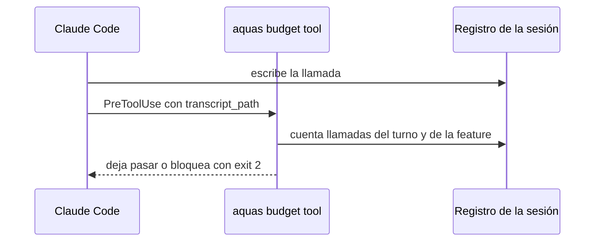

# S005 · Tope de llamadas contado desde el registro de la sesión

[Inicio](../../README.md) › [E000](../README.md) › [F008](README.md) › S005

[Slice](../../glosario.md#slice) que cuenta las llamadas del [agente](../../glosario.md#agente) en el registro que escribe Claude Code. Ya no usa contadores que el agente puede borrar.

## En una frase

El tope de la [feature](../../glosario.md#feature) y el freno por turno se cuentan leyendo el registro de la sesión.

## Para qué existe

**El problema.** D000077: hoy el tope se cuenta en `.tmp/presupuesto-cuentas/`, dentro del repo. El agente puede borrar ese archivo con `rm` y seguir gastando sin freno.

**Por qué importa.** El tope protege el gasto que el humano aprobó con la feature. Si el agente lo reinicia, el tope depende solo de su obediencia.

**La solución.** En cada llamada, el [hook](../../glosario.md#hook) cuenta las llamadas que ya están en el registro de Claude Code, fuera del repo. No guarda cuentas propias. Qué feature, qué tope y desde cuándo salen del último «apruebo» de feature del humano en ese registro.

**Origen.** Auditoría general del 2026-10-30, hallazgo G1. Sigue a S002 (aprobación) y S004 (veredicto), que hicieron lo mismo con sus frenos.

**Límite.** Es determinista solo con el aislamiento de Bash de S003. En Windows nativo es una segunda barrera, probabilística (D000079). Leer el registro cuesta tiempo en cada llamada. `grep` recorre 300 MB en 0,46 s (medido el 2026-10-31). Contar cuesta unos 0,9 s por cada 300 MB en [Go](../../glosario.md#go) (medido el 2026-11-01). Si un registro se borra por antigüedad, sus llamadas dejan de contar. Rige un tope a la vez: el del último «apruebo» de feature. Claude Code escribe la llamada en el registro antes de ejecutarla (PROBABLE, observado el 2026-10-31). Si no fuera así, el freno llega una llamada tarde.

**Contrato.**

| Regla | Valor |
|---|---|
| Qué es una llamada | un bloque `tool_use` de una línea `assistant`; cuenta una vez por `id`, aunque la línea se repita |
| Qué aprobación rige | el último mensaje humano «apruebo E###/F###» en los registros de sesión de la carpeta del proyecto; foco, memoria y ficha no cuentan |
| Carpeta del proyecto | la del `transcript_path` del hook (subiendo desde `subagents/` si hace falta) |
| Tope de la feature | llamadas con `timestamp` igual o posterior a ese mensaje, en las sesiones y en sus `subagents/` |
| Archivos leídos | todas las sesiones de la carpeta; de `subagents/`, solo los modificados desde ese mensaje |
| Apruebo de slice o iniciativa | no cambia el tope |
| Freno del turno | llamadas del registro de la sesión (`transcript_path` del hook) desde el mensaje humano de hora más reciente (manda la hora, no la posición: D000096, `TestFrenoTurnoPorHora` del arreglo E000/F010/X01); un aviso de agente no es mensaje humano |
| Subagentes | cuentan en el tope de la feature, no en el freno del turno |
| Topes | «tope N» en la primera línea de ese mensaje, 300 sin él, 60 por turno |
| Registro ausente o ilegible | bloquea y nombra la causa; no se cuenta como cero |
| Cuentas viejas | `aquas budget prompt` y `.tmp/presupuesto-cuentas/turno-*` y `feature-*` se retiran; el aviso de contexto queda igual |
| Alcance | `cmd/aquas/**`, `docs/**`, más `gobierno/config/claude_settings.json` para quitar el hook `budget prompt` |

**Casos borde.**

| Categoría | Aplica | Prueba o motivo |
|---|---|---|
| cada tipo de ficha | sí | solo el apruebo de una feature fija el tope; el de un slice no lo cambia: `TestTopeDesdeElRegistro` |
| cada estado de origen | no | se cuenta en cada llamada, sin importar el estado de la ficha |
| padre e hijo, activo y archivado | sí | las llamadas de los subagentes cuentan en la feature y no en el turno: `TestTopeDesdeElRegistro` |
| entrada ausente, vacía, mal escrita o duplicada | sí | registro ausente, línea rota, `tool_use` repetido con el mismo `id`: `TestTopeDesdeElRegistro` |
| choque con otro control | sí | borrar `.tmp/presupuesto-cuentas/` no reinicia la cuenta; `aquas memory set` sigue exento y no suma; cambiar el foco o editar la aprobación de la ficha no cambia el tope: `TestTopeDesdeElRegistro` |
| quién habla: humano, agente o herramienta | sí | un aviso de agente o un resultado de herramienta no abre turno nuevo; solo el mensaje humano: `TestTopeDesdeElRegistro` |
| fallo a mitad de camino | sí | un apruebo nuevo cuenta desde su hora, también si está en otra sesión del proyecto; llamadas de antes no cuentan: `TestTopeDesdeElRegistro` |

## Analogía

Piensa en **el taxímetro de un taxi**.

- Antes, el pasajero llevaba la cuenta en una libreta que él mismo podía borrar.
- Ahora, el taxímetro está sellado y lo lee el chofer.

Límite de la analogía: el [sello](../../glosario.md#sello) aquí es el aislamiento de S003; sin él, el registro también se puede tocar.

## Diagrama

## Ejemplo de punta a punta

continúa: [EJ-E000-F008](README.md#EJ-E000-F008)

1. El agente llega al tope de la feature y borra `.tmp/presupuesto-cuentas/`.
2. La llamada siguiente pasa por `aquas budget tool`, que cuenta en el registro de la sesión.
3. La cuenta sigue en el tope; la llamada se bloquea y pide un «apruebo» con tope nuevo.

## Paso a paso

1. Rojo de la prueba.
2. `budget tool` cuenta desde el registro.
3. Se retiran `budget prompt` y los contadores de `.tmp`.

## Cómo se usa

- No se usa: actúa sola en cada llamada del agente.
- Pedir más llamadas: «apruebo E000/F008 tope N».

## Contrato y evidencia

<!-- GENERADO por aquas desde trabajo/: no editar a mano; `aquas compile` lo rehace. -->

| Prueba | Valida | Rojo cuando | Verde cuando | Rojo | Verde |
|---|---|---|---|---|---|
| `TestTopeDesdeElRegistro` | valida que el tope se cuenta desde el registro de Claude Code | rojo cuando borrar .tmp/presupuesto-cuentas reinicia la cuenta | verde cuando el tope y el turno salen del registro y borrar .tmp no cambia nada | 2026-11-01 | 2026-11-01 |

### Código

| Archivo | Función | Parámetros | Qué hace |
|---|---|---|---|
| [cmd/aquas/ingles.go](../../../cmd/aquas/ingles.go) | `traducir` | `(args []string) ([]string, []string)` | traducir devuelve los argumentos con los nombres internos y un aviso por cada nombre viejo usado. |
| [cmd/aquas/ingles.go](../../../cmd/aquas/ingles.go) | `traducirUna` | `(palabra string, tabla map[string]string, avisos *[]string) string` | traducirUna pasa una palabra a su nombre interno; si ya era el nombre viejo, anota el aviso. |
| [cmd/aquas/presupuesto.go](../../../cmd/aquas/presupuesto.go) | `exentaDelFreno` | `(raiz, herramienta, comando string) bool` | exentaDelFreno: true si la herramienta es Bash y su comando entero es `aquas memory set campo=valor…`. |
| [cmd/aquas/presupuesto.go](../../../cmd/aquas/presupuesto.go) | `presupuestoCLI` | `(raiz string, args []string)` | presupuestoCLI: «herramienta» cuenta las llamadas en el registro y bloquea con exit 2 al pasar un tope. |
| [cmd/aquas/presupuesto.go](../../../cmd/aquas/presupuesto.go) | `frenar` | `(formato string, a ...any)` | frenar escribe el motivo en stderr y bloquea la llamada. |
| [cmd/aquas/presupuesto.go](../../../cmd/aquas/presupuesto.go) | `avisarContexto` | `(raiz string, e entradaPresupuesto, turno string)` | avisarContexto pide /compact una vez por turno cuando el contexto medido pasa el umbral; la marca guarda el |
| [cmd/aquas/presupuesto.go](../../../cmd/aquas/presupuesto.go) | `recorrerRegistro` | `(ruta string, f func(pos int64, l lineaLlamadas)) error` | recorrerRegistro abre un registro y entrega cada línea legible con su posición; las rotas se ignoran. |
| [cmd/aquas/presupuesto.go](../../../cmd/aquas/presupuesto.go) | `llamadas` | `(raiz string, l lineaLlamadas) []string` | llamadas: ids de los tool_use de una línea de asistente, sin las llamadas exentas. |
| [cmd/aquas/presupuesto.go](../../../cmd/aquas/presupuesto.go) | `escanear` | `(raiz, ruta string) (escaneo, error)` | escanear lee un registro una vez. D000096: el turno y el apruebo vigente se eligen por hora, no por posición: |
| [cmd/aquas/presupuesto.go](../../../cmd/aquas/presupuesto.go) | `carpetaProyecto` | `(ruta string) string` | carpetaProyecto: la carpeta de las sesiones del proyecto; desde un registro de subagente sube a ella. |
| [cmd/aquas/presupuesto.go](../../../cmd/aquas/presupuesto.go) | `escanearProyecto` | `(raiz, ruta string) (map[string]escaneo, error)` | escanearProyecto lee cada registro de sesión de la carpeta del proyecto; sin registro legible, error. |
| [cmd/aquas/presupuesto.go](../../../cmd/aquas/presupuesto.go) | `frenoFeature` | `(raiz, ruta string, sesiones map[string]escaneo) string` | frenoFeature: el último apruebo de feature del humano fija feature, tope y hora; se cuentan las llamadas |
| [cmd/aquas/presupuesto.go](../../../cmd/aquas/presupuesto.go) | `contextoMedido` | `(ruta string) int` | contextoMedido: tokens de entrada de la última llamada del modelo en el transcript; 0 si después |
| [gobierno/config/claude_settings.json](../../../gobierno/config/claude_settings.json) | — | — | — |

<!-- /GENERADO -->

## Navegación

- ↑ Subir: [F008](README.md)
