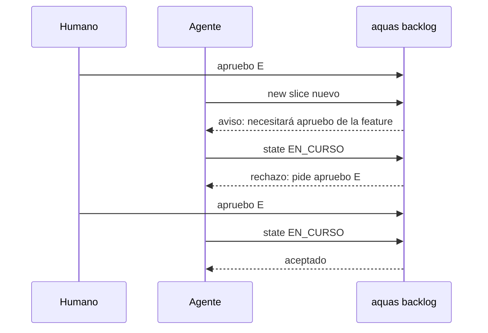

# S006 · Slice nuevo de una feature aprobada pide apruebo de la feature

[Inicio](../../README.md) › [E000](../README.md) › [F008](README.md) › S006

[Slice](../../glosario.md#slice) que hace que el programa pida al humano el apruebo de la [feature](../../glosario.md#feature), no el de cada slice.

## En una frase

Si el apruebo de la feature no cubre un slice, el rechazo pide «apruebo» de la feature otra vez. `backlog new` lo avisa al crearlo.

## Para qué existe

**El problema.** D000084: el apruebo de una feature guarda una foto de los slices que existen en ese momento. Un slice creado después queda fuera. Hoy el rechazo pide «apruebo» de ese slice cuando la feature tiene un solo slice abierto. En F008 el humano aprobó unas 8 veces en vez de una.

**Por qué importa.** El humano quiere aprobar features, no slices. Cada apruebo de más le quita tiempo y atención.

**La solución.** Si el padre del slice tiene aprobación, el rechazo pide siempre «apruebo» de la feature con su «con push». `backlog new` avisa al crear un slice en una feature aprobada.

**Origen.** Reclamo del humano el 2026-11-01. D000085: frenar la creación del slice lo dejaría sin poder aprobarse, porque la foto se toma al aprobar.

**Límite.** Un apruebo nuevo de la feature reinicia la cuenta del tope de llamadas (S005). El humano aún puede escribir «apruebo» de un slice; sigue valiendo.

**Contrato.**

| Regla | Valor |
|---|---|
| Feature aprobada, slice fuera de su foto | el rechazo pide «apruebo E###/F###», con «con push» si la aprobación anterior lo tenía; nunca «apruebo» del slice |
| Feature sin aprobar | igual que hoy: dos o más slices abiertos piden la feature; uno solo pide el slice |
| Aviso al crear | `backlog new` de un slice cuya feature tiene aprobación imprime «… ya está aprobada; este slice necesitará «apruebo E###/F###» otra vez» |
| Creación | no se frena: el slice se crea igual |
| Alcance | `internal/backlog/**`, `cmd/aquas/**`, `docs/**` |

**Casos borde.**

| Categoría | Aplica | Prueba o motivo |
|---|---|---|
| cada tipo de ficha | sí | solo un slice recibe aviso y rechazo; crear una feature o una iniciativa no avisa; `aquas backlog new` imprime el aviso: `TestSliceNuevoPideFeature`, `TestAvisoAlCrearSlice` |
| cada estado de origen | no | el rechazo ya existe desde cualquier estado; solo cambia su texto |
| padre e hijo, activo y archivado | sí | slice en la foto avanza; slice fuera de la foto pide la feature: `TestSliceNuevoPideFeature` |
| entrada ausente, vacía, mal escrita o duplicada | no | `backlog new` ya valida sus campos; este slice no agrega entradas |
| choque con otro control | sí | la aprobación propia vigente del slice sigue valiendo primero: `TestSliceNuevoPideFeature` |
| quién habla: humano, agente o herramienta | no | el apruebo lo registra el hook del mensaje humano, sin cambios aquí |
| fallo a mitad de camino | sí | tras «apruebo» nuevo de la feature, la foto incluye el slice y avanza: `TestSliceNuevoPideFeature` |

## Analogía

Piensa en **un presupuesto de obra firmado**.

- Si aparece un trabajo nuevo, se firma de nuevo el presupuesto completo, no cada trabajo suelto.

Límite de la analogía: aquí la firma nueva también reinicia el contador de gasto.

## Diagrama

## Ejemplo de punta a punta

continúa: [EJ-E000-F008](README.md#EJ-E000-F008)

1. El humano escribe «apruebo E000/F008 con push»; la foto guarda S001 a S005.
2. El [agente](../../glosario.md#agente) crea S006: `backlog new` avisa que la feature ya está aprobada.
3. `backlog state E000/F008/S006 EN_CURSO` se rechaza y pide «apruebo E000/F008 con push».
4. El humano lo escribe; la foto nueva incluye S006 y avanza.

## Paso a paso

1. `aprobada` mira si el padre del slice tiene aprobación.
2. Si la tiene y la foto no cubre el slice, el rechazo pide la feature.
3. El comando `backlog new` imprime el aviso cuando el padre tiene aprobación.

## Cómo se usa

- No se usa: actúa en el rechazo de EN_CURSO y rojo, y al crear un slice.
- Aprobar todo de una vez: «apruebo E###/F### con push».

## Contrato y evidencia

<!-- GENERADO por aquas desde trabajo/: no editar a mano; `aquas compile` lo rehace. -->

| Prueba | Valida | Rojo cuando | Verde cuando | Rojo | Verde |
|---|---|---|---|---|---|
| `TestSliceNuevoPideFeature` | valida que un slice fuera de la foto pide apruebo de la feature | rojo cuando el rechazo pide apruebo del slice | verde cuando pide apruebo de la feature y backlog new lo avisa | 2026-11-01 | 2026-11-01 |
| `TestAvisoAlCrearSlice` | valida que aquas backlog new imprime el aviso en una feature aprobada | rojo cuando la salida no trae el aviso | verde cuando avisa con la feature aprobada y calla sin aprobar | 2026-11-01 | 2026-11-01 |

### Código

| Archivo | Función | Parámetros | Qué hace |
|---|---|---|---|
| [cmd/aquas/main.go](../../../cmd/aquas/main.go) | `main` | `()` | main despacha el subcomando de aquas (compilar, verificar, backlog, hooks…) y sale con su código. |
| [cmd/aquas/main.go](../../../cmd/aquas/main.go) | `contextoParaClaude` | `(texto string)` | contextoParaClaude (E000/F013/S002): aviso que el gancho PostToolUse entrega a Claude sin frenar (additionalContext, salida 0). |
| [cmd/aquas/main.go](../../../cmd/aquas/main.go) | `hook` | `(raiz string)` | hook: exit 0 = nada que reportar o aviso en additionalContext; exit 2 = stderr se muestra a Claude como freno. |
| [cmd/aquas/main.go](../../../cmd/aquas/main.go) | `compilarSettings` | `(w io.Writer)` | compilarSettings regenera .claude/settings.json; sin entorno declarado no inventa uno. |
| [cmd/aquas/main.go](../../../cmd/aquas/main.go) | `reportar` | `(w io.Writer, inf compilador.Informe)` | reportar imprime qué derivados escribió la compilación, o que todo estaba al día. |
| [cmd/aquas/main.go](../../../cmd/aquas/main.go) | `listar` | `(titulo string, problemas []string)` | listar imprime en stderr un título y cada problema en su viñeta. |
| [cmd/aquas/main.go](../../../cmd/aquas/main.go) | `lista` | `(xs []string) string` | lista une los textos con comas, o «—» si no hay ninguno. |
| [cmd/aquas/main.go](../../../cmd/aquas/main.go) | `fallar` | `(codigo int, err error)` | fallar imprime el error en stderr y termina con el código dado. |
| [cmd/aquas/main.go](../../../cmd/aquas/main.go) | `avisarWiki` | `(avisos []string)` | avisarWiki (E000/F013/S001): imprime los avisos de estilo de la wiki; no cambian el resultado del gate. |
| [cmd/aquas/main.go](../../../cmd/aquas/main.go) | `revisarAislamiento` | `() (fallo, aviso string)` | revisarAislamiento: fallo para el gate y aviso para el arranque (E000/F008/S003, D000079). |
| [cmd/aquas/main.go](../../../cmd/aquas/main.go) | `memoriaCLI` | `(raiz string, args []string)` | memoriaCLI: `ver` imprime la memoria; `fijar campo=valor…` la actualiza y la sella. |
| [cmd/aquas/main.go](../../../cmd/aquas/main.go) | `memoriaArchivada` | `(raiz, id string) error` | memoriaArchivada: CERRADO exige el archivo de memoria del slice, apunte o no la memoria a él (E001/F002/S009, X01). |
| [cmd/aquas/main.go](../../../cmd/aquas/main.go) | `focoEnBacklog` | `(raiz string, f memoria.Foco) error` | focoEnBacklog: la memoria solo fija el slice que el backlog tiene en curso (S003). |
| [cmd/aquas/main.go](../../../cmd/aquas/main.go) | `backlogCLI` | `(raiz string, args []string)` | backlogCLI: nuevo \\| ver [id] \\| tabla \\| prioridad \\| estado \\| siguiente \\| pruebas \\| rojo \\| verde. |
| [cmd/aquas/main.go](../../../cmd/aquas/main.go) | `gateDefectos` | `(raiz string) (frena []string, aviso string)` | gateDefectos (E001/F017/S005): lo que el gate dice del registro de defectos. Prueba nombrada que ya no existe |
| [cmd/aquas/main.go](../../../cmd/aquas/main.go) | `turnoCLI` | `(raiz string, args []string)` | turnoCLI: auditoría de turnos (E001/F002/S001). Lee el JSON del hook por stdin. No imprime nada |
| [cmd/aquas/main.go](../../../cmd/aquas/main.go) | `retroCLI` | `(raiz string, args []string) (backlog.Retro, error)` | retroCLI (E001/F018/S002): cerrar fichas=A,B motivo=…; cada clave una vez. |
| [cmd/aquas/main.go](../../../cmd/aquas/main.go) | `defectoCLI` | `(raiz string, args []string) error` | defectoCLI: nuevo \\| ocurre \\| arreglar \\| ver (E001/F004/S001; arreglar: E000/F007/S003). |
| [cmd/aquas/main.go](../../../cmd/aquas/main.go) | `versionBinario` | `() string` | versionBinario: versión del módulo con que se compiló el binario (= versión del gobierno embebido). |
| [cmd/aquas/main.go](../../../cmd/aquas/main.go) | `versionControl` | `() string` | versionControl (E003/F006/S002, hallazgo A2.1): versión con la que deciden los controles del hijo. |
| [cmd/aquas/main.go](../../../cmd/aquas/main.go) | `registrarCierre` | `(raiz, tipo, transcript, primera, resultado string)` | registrarCierre (E001/F004/S005, D000068) anota cada llamada del gancho cierre-agente en .tmp/hooks/cierre-agente.jsonl. |
| [cmd/aquas/main.go](../../../cmd/aquas/main.go) | `esUpdate` | `(datos []byte) bool` | esUpdate (E003/F006/S001): la entrada de la guardia es una orden Bash que es exactamente `aquas update` (PowerShell lo frena la guardia siempre). |
| [cmd/aquas/main.go](../../../cmd/aquas/main.go) | `entornoHijo` | `(raiz string)` | entornoHijo (E003/F001/S003) declara el entorno del hijo, como aquas init en la central: |
| [cmd/aquas/main.go](../../../cmd/aquas/main.go) | `pideAyuda` | `(args []string) bool` | pideAyuda (E000/F015/S002): algún argumento es exactamente --help o -h; un valor como motivo=--help no cuenta. |
| [internal/backlog/aprobacion.go](../../../internal/backlog/aprobacion.go) | `seccionContrato` | `(texto string) (string, bool)` | seccionContrato: texto de «## Para qué existe» de la página, sin los bloques GENERADO de aquas. |
| [internal/backlog/aprobacion.go](../../../internal/backlog/aprobacion.go) | `Huella` | `(raiz string, f Ficha) (string, error)` | Huella: SHA-256 de las pruebas, el alcance (con sus ampliaciones) y la sección «Para qué existe» de la página. |
| [internal/backlog/aprobacion.go](../../../internal/backlog/aprobacion.go) | `contratoCompleto` | `(raiz, id string) error` | contratoCompleto (E000/F014/S001, hallazgo A1): la página del slice existe y su «Para qué existe» no trae |
| [internal/backlog/aprobacion.go](../../../internal/backlog/aprobacion.go) | `Aprobar` | `(raiz, id, mensaje, registro string, ahora time.Time) (Ficha, error)` | Aprobar registra la aprobación del contrato de un slice o de una feature (con la foto de sus slices) con la huella |
| [internal/backlog/aprobacion.go](../../../internal/backlog/aprobacion.go) | `aprobada` | `(raiz string, f Ficha) error` | aprobada: nil si el slice puede avanzar (EN_CURSO, rojo, verde, cierre); si no, el paso que falta. |
| [internal/backlog/aprobacion.go](../../../internal/backlog/aprobacion.go) | `abiertos` | `(raiz, feature string) int` | abiertos (E001/F015/X01): slices activos (ni CERRADO ni CANCELADO) de la feature; error de lectura = 0. |
| [internal/backlog/aprobacion.go](../../../internal/backlog/aprobacion.go) | `cubiertaPorFeature` | `(raiz string, p, f Ficha, aprobadas []Prueba) error` | cubiertaPorFeature (E001/F015/S001): el slice avanza si el contrato de su feature no cambió y cada prueba |
| [internal/backlog/aprobacion.go](../../../internal/backlog/aprobacion.go) | `AvisoFeatureAprobada` | `(raiz string, f Ficha) string` | AvisoFeatureAprobada: aviso al crear un slice cuya feature ya está aprobada; "" si no aplica. |
| [internal/backlog/aprobacion.go](../../../internal/backlog/aprobacion.go) | `pideFeature` | `(p Ficha) string` | pideFeature: el apruebo de la feature que hay que pedir, con «con push» si la aprobación anterior lo tenía. |

<!-- /GENERADO -->

## Navegación

- ↑ Subir: [F008](README.md)
