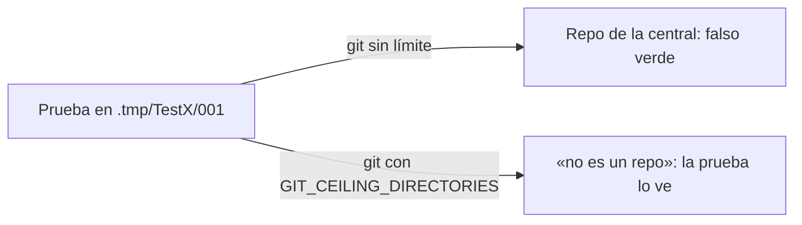
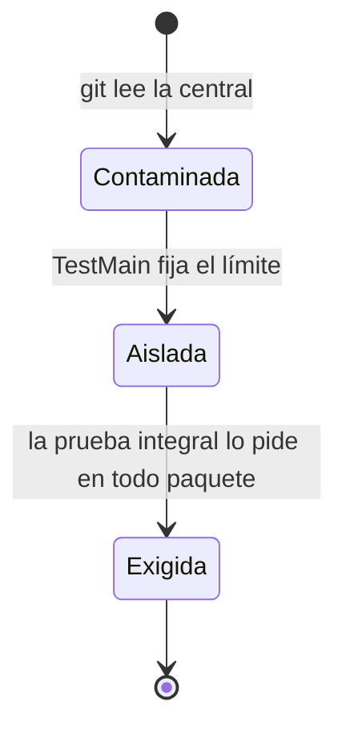

# F009 · Pruebas aisladas del repo de la central

[Inicio](../../README.md) › [E000](../README.md) › F009

[Feature](../../glosario.md#feature) que impide que una prueba lea, sin querer, el git del repo de la central.

## En una frase

Una prueba que corre git en su carpeta temporal ve solo esa carpeta, nunca el repo que la contiene.

## Para qué existe

**El problema.** D000050: las carpetas temporales de las pruebas viven en `.tmp/`, dentro del repo de la central. Si la prueba no hace `git init`, git sube de carpeta y lee el repo de la central. Así una prueba puede pasar por datos que no son suyos: un falso verde.

**Por qué importa.** Un verde falso hace creer que un control funciona cuando no se probó. Todo el gobierno se apoya en esos verdes.

**La solución.** Cada paquete con pruebas fija `GIT_CEILING_DIRECTORIES` en la carpeta temporal. Git deja de subir más allá. Una prueba integral rechaza un paquete con pruebas sin ese límite.

**Origen.** D000050, registrado en el turno T000489. Va segundo en el orden recomendado que aprobó el humano el 2026-10-31.

## Analogía

Piensa en **un laboratorio con muestras selladas**.

- Si una muestra se contamina con el aire del edificio, el análisis da un resultado que no es suyo.
- El [sello](../../glosario.md#sello) obliga a que cada muestra traiga lo suyo.

Límite de la analogía: aquí el sello es una variable de entorno de git, no un frasco.

## Diagrama

Estados de una prueba con git:

| Slice | Qué entrega |
|---|---|
| [S001 Git de las pruebas no sube a la central](S001.md) | Límite de git en cada paquete que lo usa en pruebas, más la prueba que lo exige |

## Ejemplo de punta a punta

continúa: [EJ-E000](../README.md#EJ-E000)

1. Una prueba crea `.tmp/TestX/001` y corre `git log` sin `git init`.
2. Hoy git responde con el historial de la central y la prueba pasa (VERIFICADO el 2026-11-01).
3. Con el límite, git responde «not a git repository» y la prueba tiene que preparar su propio repo.

## Paso a paso

1. Git de las pruebas no sube a la central (S001).

## Cómo se usa

- No se usa: actúa solo al correr las pruebas.
- Paquete nuevo con pruebas: agregar `TestMain` con el límite; la prueba integral lo exige.

## Contrato y evidencia

**Objetivo.** Ninguna prueba ve el git de la central.

Prueba integral: `TestPruebasNoVenLaCentral` (todo paquete con pruebas fija `GIT_CEILING_DIRECTORIES` en su `TestMain`).

Pruebas de los [slices](../../glosario.md#slice): `TestGitNoSubeALaCentral`.

## Navegación

<!-- GENERADO por aquas desde trabajo/: no editar a mano; `aquas compile` lo rehace. -->

| Hijo | Qué es | Estado |
|---|---|---|
| [S001](S001.md) | Fija GIT_CEILING_DIRECTORIES en las pruebas que corren git | Hecho |

<!-- /GENERADO -->

- ↑ Subir: [E000](../README.md)
