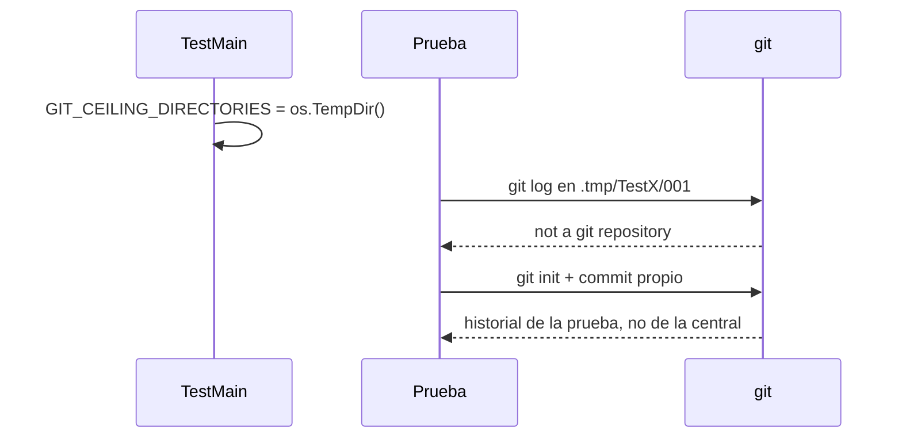

# S001 · Git de las pruebas no sube a la central

[Inicio](../../README.md) › [E000](../README.md) › [F009](README.md) › S001

[Slice](../../glosario.md#slice) que pone un límite a git en las pruebas para que no lea el repo de la central.

## En una frase

Cada paquete con pruebas fija `GIT_CEILING_DIRECTORIES` en la carpeta temporal.

## Para qué existe

**El problema.** D000050: `sello_test.go` cierra un slice en una carpeta temporal sin `git init`. Como esa carpeta está dentro de la central, `git log` lee el historial de la central y la prueba pasa por error.

**Por qué importa.** Ese verde no prueba nada. Igual puede pasar en cualquier prueba que use git.

**La solución.** Un `TestMain` en cada paquete con pruebas fija `GIT_CEILING_DIRECTORIES` en `os.TempDir()`. Las pruebas que necesitan git hacen su propio `git init`. `codigoTocado` acepta un repo sin [commits](../../glosario.md#commit) y devuelve la lista vacía.

**Origen.** D000050. Comprobado el 2026-11-01: sin límite, `git rev-parse --show-toplevel` en `.tmp/…` da la central; con el límite, «not a git repository».

**Límite.** Solo cubre `go test`. Un programa que corra git fuera de las pruebas no cambia.

**Contrato.**

| Regla | Valor |
|---|---|
| Paquetes | todo paquete con pruebas: git corre directo o desde el código que la prueba llama (A1, hallazgo 1) |
| Límite | `TestMain` fija `GIT_CEILING_DIRECTORIES` en `os.TempDir()` antes de `m.Run()` |
| Repo sin commits | `codigoTocado` devuelve lista vacía, sin error |
| Pruebas que necesitan git | hacen su propio `git init`; las que fallen al poner el límite se arreglan aquí |
| Prevención | prueba integral: paquete con pruebas sin `GIT_CEILING_DIRECTORIES` en su `TestMain` → falla; `testdata/` no cuenta |
| Alcance | `internal/**`, `cmd/aquas/**`, `docs/**` |

**Casos borde.**

| Categoría | Aplica | Prueba o motivo |
|---|---|---|
| cada tipo de ficha | no | el límite es de las pruebas, no de las fichas |
| cada estado de origen | no | no cambia estados |
| padre e hijo, activo y archivado | no | no toca fichas |
| entrada ausente, vacía, mal escrita o duplicada | sí | carpeta sin repo (git no halla repo y `codigoTocado` da error) y repo sin commits (lista vacía): `TestGitNoSubeALaCentral` |
| choque con otro control | sí | el sello y el cierre corren en un repo propio sin leer la central: `TestSelloSinCommitBaseExigeArbol`, `TestCerrarSliceDePuntaAPunta` |
| quién habla: humano, agente o herramienta | no | solo corre en `go test` |
| fallo a mitad de camino | sí | paquete nuevo con pruebas y sin límite, también si git corre desde el código probado: `TestPruebasNoVenLaCentral` |

## Analogía

Piensa en **un techo sobre cada prueba**.

- Sin techo, git sube de piso en piso hasta encontrar un repo: el de la central.
- Con techo, se queda en el piso de la prueba.

Límite de la analogía: el techo solo existe mientras corre `go test`.

## Diagrama

## Ejemplo de punta a punta

continúa: [EJ-E000-F009](README.md#EJ-E000-F009)

1. `TestMain` de `internal/backlog` fija el límite.
2. La prueba del [sello](../../glosario.md#sello) corre en su carpeta temporal y hace `git init`.
3. `codigoTocado` lee solo los commits de esa carpeta.

## Paso a paso

1. Agregar `TestMain` con el límite en cada paquete con pruebas.
2. `codigoTocado` acepta un repo sin commits.
3. Arreglar las pruebas que dependían del git de la central.
4. Prueba integral que exige el límite.

## Cómo se usa

- No se usa: actúa al correr `go test`.

## Contrato y evidencia

<!-- GENERADO por aquas desde trabajo/: no editar a mano; `aquas compile` lo rehace. -->

| Prueba | Valida | Rojo cuando | Verde cuando | Rojo | Verde |
|---|---|---|---|---|---|
| `TestGitNoSubeALaCentral` | valida que git en una carpeta temporal no ve la central | rojo cuando git rev-parse en la carpeta temporal da la central | verde cuando da not a git repository y codigoTocado acepta repo sin commits | 2026-11-01 | 2026-11-01 |
| `TestPruebasNoVenLaCentral` | valida que todo paquete con git en pruebas fija GIT_CEILING_DIRECTORIES | rojo cuando un paquete con git en pruebas no fija el límite | verde cuando todos lo fijan | 2026-11-01 | 2026-11-01 |

### Código

| Archivo | Función | Parámetros | Qué hace |
|---|---|---|---|
| [internal/backlog/codigo.go](../../../internal/backlog/codigo.go) | `codigoTocado` | `(raiz, id string, sinCommit bool) ([]string, error)` | codigoTocado: .go de producción en cmd/ e internal/ que tocaron los commits del slice y, si sinCommit, los cambios pendientes (E001/F008/S005). |
| [internal/backlog/codigo.go](../../../internal/backlog/codigo.go) | `soloProduccion` | `(log []string) []string` | soloProduccion: .go de cmd/ e internal/ sin pruebas y archivos de configuración (settings, .githooks, gobierno/config sin sellos), sin repetir y ordenados. |
| [internal/backlog/codigo.go](../../../internal/backlog/codigo.go) | `Codigo` | `(raiz, id string, commits []string) (Ficha, error)` | Codigo recalcula y guarda el código tocado de un slice desde los commits que nombran su ID y los commits dados. |

<!-- /GENERADO -->

## Navegación

- ↑ Subir: [F009](README.md)
