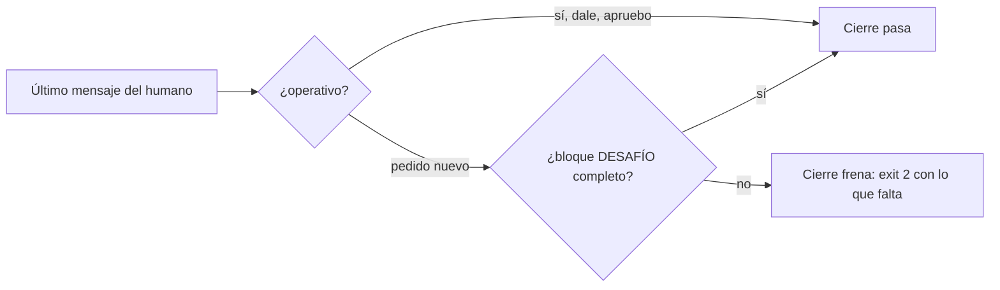
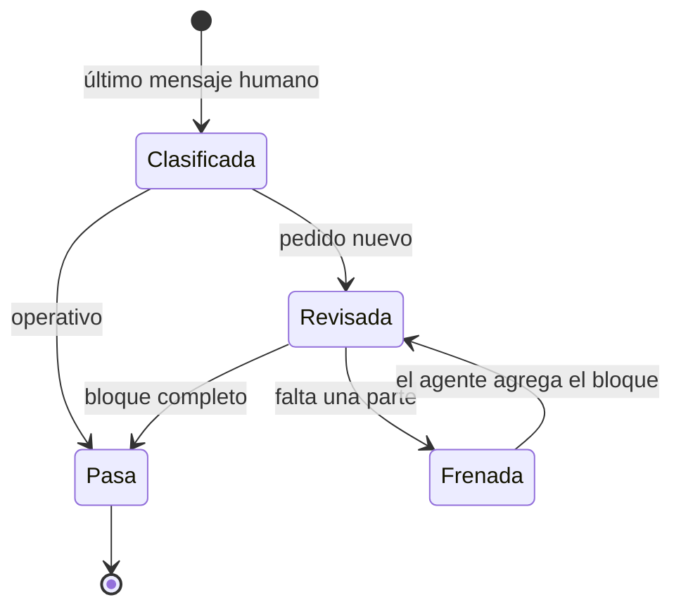

# F010 · Gate del desafío en pedidos nuevos

[Inicio](../../README.md) › [E000](../README.md) › F010

[Feature](../../glosario.md#feature) que hace cumplir por programa la regla DESAFÍO del [orquestador](../../glosario.md#orquestador).

## En una frase

Ante un pedido nuevo, una respuesta sin bloque DESAFÍO completo frena el cierre del turno.

## Para qué existe

**El problema.** El 2026-11-02 el humano pidió un orquestador asesor. Antes de un pedido nuevo: supuestos, contraargumentos, riesgos e investigación. La regla quedó escrita en el [canónico](../../glosario.md#canónico) del orquestador. Una regla solo escrita se olvida: el modelo la cumple a veces.

**Por qué importa.** Sin desafío, el [agente](../../glosario.md#agente) ejecuta pedidos con supuestos ocultos y el humano descubre los riesgos tarde, cuando cuestan más.

**La solución.** El gancho de cierre (`aquas proposal`) lee el último mensaje que escribió el humano en el turno. Si es un pedido nuevo, exige en la respuesta un bloque `DESAFÍO` con Supuestos, Contraargumentos, Riesgos y Recomendación. Un pedido operativo («sí», «dale», «apruebo X») pasa sin bloque.

**Origen.** Decisión humana 2026-11-02: aplicar las recomendaciones de proporcionalidad y [gate](../../glosario.md#gate).

**Límite.** Distinguir pedido nuevo de operativo es una heurística por palabras: control probabilístico. Puede frenar de más un mensaje operativo largo o dejar pasar uno nuevo muy corto. Comprueba el formato del bloque, no su calidad; la calidad es criterio humano.

## Analogía

Piensa en **la lista de verificación antes de despegar**.

- El piloto sabe volar, pero la lista obliga a mirar lo que se olvida con prisa.
- La lista no vuela el avión: solo frena el despegue si falta un punto.

Límite de la analogía: aquí la lista no sabe si el punto se revisó bien, solo si está.

## Diagrama

Estados de una respuesta en el cierre:

| Slice | Qué entrega |
|---|---|
| [S001 Cierre exige DESAFÍO en pedido nuevo](S001.md) | Revisión del bloque en el gancho de cierre, con la clasificación del mensaje |

## Ejemplo de punta a punta

continúa: [EJ-E000](../README.md#EJ-E000)

1. El humano escribe «quiero que el [backlog](../../glosario.md#backlog) tenga etiquetas».
2. El agente responde sin bloque DESAFÍO.
3. El cierre frena: «pedido nuevo sin DESAFÍO: faltan Supuestos, Contraargumentos, Riesgos, Recomendación».
4. El agente agrega el bloque y el cierre pasa. Luego el humano escribe «dale» y la respuesta pasa sin bloque.

## Paso a paso

1. Clasificar el último mensaje humano.
2. Exigir el bloque solo en pedido nuevo.

## Cómo se usa

- No se usa a mano: corre en cada cierre de turno.

## Contrato y evidencia

**Objetivo.** Ningún pedido nuevo recibe respuesta sin bloque DESAFÍO completo.

Prueba integral: `TestDesafioEnPedidoNuevo` (el gancho de cierre real frena un pedido nuevo sin bloque y deja pasar «dale»).

Pruebas de los [slices](../../glosario.md#slice): `TestRevisarDesafio`.

Pruebas del arreglo X01 (turno por hora y palabras medidas): `TestFrenoTurnoPorHora`, `TestOperativoConPalabrasMedidas`.

## Navegación

<!-- GENERADO por aquas desde trabajo/: no editar a mano; `aquas compile` lo rehace. -->

| Hijo | Qué es | Estado |
|---|---|---|
| [S001](S001.md) | el gancho de cierre frena un pedido nuevo cuya respuesta no trae DESAFÍO | Hecho |

### Arreglos

| Arreglo | Qué arregla | Por qué | Pruebas | Fecha | Rojo | Verde |
|---|---|---|---|---|---|---|
| X01 | Turno humano leído por hora | D000096 y decisión humana 2026-11-02: el freno toma un turno viejo y palabras operativas reales frenaban de más | `TestFrenoTurnoPorHora`, `TestOperativoConPalabrasMedidas` | 2026-11-02 | 2026-11-02 | 2026-11-02 |

<!-- /GENERADO -->

- ↑ Subir: [E000](../README.md)
