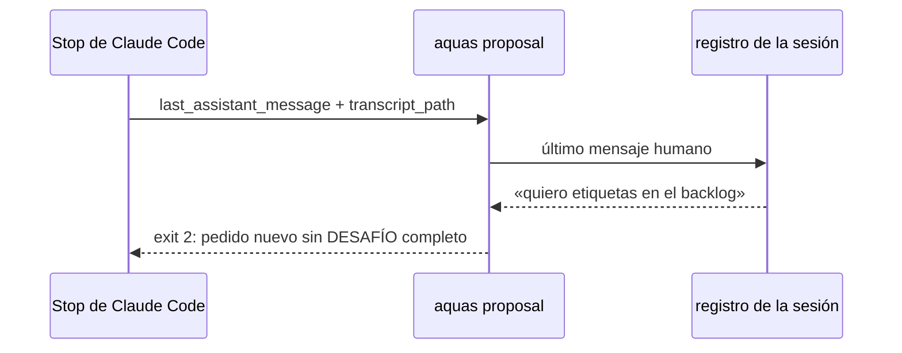

# S001 · Cierre exige DESAFÍO en pedido nuevo

[Inicio](../../README.md) › [E000](../README.md) › [F010](README.md) › S001

[Slice](../../glosario.md#slice) que agrega al gancho de cierre la revisión del bloque DESAFÍO.

## En una frase

`aquas proposal` lee el último mensaje humano del registro. Ante un pedido nuevo sin DESAFÍO completo, sale 2 con lo que falta.

## Para qué existe

**El problema.** La regla DESAFÍO del [orquestador](../../glosario.md#orquestador) solo está escrita. Nada frena una respuesta a un pedido nuevo que ejecuta sin desafiar.

**Por qué importa.** Es la diferencia entre un asesor y un asistente: los supuestos y riesgos se ven antes de gastar trabajo.

**La solución.** El gancho de cierre ya revisa PROPUESTA, insights y fallos. Suma una revisión más: clasifica el último mensaje humano y, si es pedido nuevo, exige el bloque.

**Origen.** E000/F010, decisión humana 2026-11-02.

**Contrato.**

| Regla | Valor |
|---|---|
| Mensaje humano | el que abre el turno: la línea `type: user` con origen de hora más reciente en el registro (`transcript_path`). Manda la hora, no la posición (D000096) |
| Turno de agente | si esa línea es de un agente (`peer`, `task-notification` o marca de agente), no se revisa |
| Operativo | 6 palabras o menos y alguna de: sí, si, dale, ok, sigue, continúa, listo, hazlo, aplica, recomendado, aprobado, sube (estas tres, arreglo X01); o su primera palabra es «apruebo» («Apruebo», «apruebo.» y «apruebo X» cuentan) |
| Pedido nuevo | todo mensaje humano que no es operativo |
| Bloque | una línea que empieza con `DESAFÍO` (admite `#`, `*`, `>` o viñeta `-` delante), y después las palabras Supuestos, Contraargumentos, Riesgos y Recomendación |
| Contraargumentos | no se cuentan: «sin objeción real» vale (la regla prohíbe rellenar) |
| Frena | exit 2 con «pedido nuevo sin DESAFÍO completo: falta …» |
| Corrección | turno que sigue a un freno del cierre (`stop_hook_active`) no se revisa: evita el bucle |
| Orden | DESAFÍO es la primera revisión del cierre; así su freno no queda tapado por otro |
| Sin registro | registro ausente o ilegible, o sin mensaje humano → no se revisa (turnos de agentes y herramientas) |
| Clase | control probabilístico en la clasificación; determinista en el formato del bloque |
| Errores conocidos | frena de más un operativo corto sin palabra de la lista; deja pasar un pedido corto con una («Aplica las recomendaciones») |
| Tasa medida | registro de esta sesión, 2026-11-02: de 874 mensajes clasificados nuevos, 224 tienen 6 palabras o menos. Los más frecuentes: «lo recomendado» 83, «aprobado» 14, «sube» 14. Las aprobaciones sueltas ya se corrigieron |
| Alcance | `internal/propuesta/**`, `internal/backlog/respaldo.go`, `cmd/aquas/**`, `docs/**` |

**Casos borde.**

| Categoría | Aplica | Prueba o motivo |
|---|---|---|
| cada tipo de ficha | no | el gancho revisa mensajes, no fichas |
| cada estado de origen | no | no hay estados: cada cierre se revisa solo |
| padre e hijo, activo y archivado | no | la revisión no lee el backlog |
| entrada ausente, vacía, mal escrita o duplicada | sí | registro ausente, mensaje vacío, bloque con una palabra de menos y con «sin objeción real»: `TestRevisarDesafio` |
| choque con otro control | sí | la corrección tras un freno no se vuelve a frenar, y con dos fallas DESAFÍO frena primero: `TestRevisarDesafio`, `TestDesafioEnPedidoNuevo` |
| quién habla: humano, agente o herramienta | sí | turno abierto por un aviso de subagente o de tarea no se revisa; un resultado de herramienta no abre turno: `TestRevisarDesafio` |
| fallo a mitad de camino | sí | registro con una línea rota: se salta la línea, no se cae: `TestRevisarDesafio` |

## Analogía

Piensa en **el portero que pide la invitación solo en la fiesta privada**.

- A los de la casa que entran y salen no les pide nada.
- Al invitado nuevo sí, y sin invitación no pasa.

Límite de la analogía: el portero reconoce caras; aquí la clasificación es por palabras y puede fallar.

## Diagrama

## Ejemplo de punta a punta

continúa: [EJ-E000-F010](README.md#EJ-E000-F010)

1. El humano escribe «quiero etiquetas en el [backlog](../../glosario.md#backlog)».
2. La respuesta no trae `DESAFÍO`; el cierre sale 2 y nombra lo que falta.
3. El [agente](../../glosario.md#agente) responde con el bloque; el cierre pasa.

## Paso a paso

1. Leer el último mensaje humano del registro.
2. Clasificar operativo o pedido nuevo.
3. En pedido nuevo, revisar el bloque y frenar si falta algo.

## Cómo se usa

- Corre solo en cada cierre de turno.

## Contrato y evidencia

<!-- GENERADO por aquas desde trabajo/: no editar a mano; `aquas compile` lo rehace. -->

| Prueba | Valida | Rojo cuando | Verde cuando | Rojo | Verde |
|---|---|---|---|---|---|
| `TestRevisarDesafio` | valida que pedido nuevo sin DESAFÍO frena y operativo pasa | rojo cuando un pedido nuevo sin bloque pasa o un dale frena | verde cuando solo el pedido nuevo sin bloque completo frena | 2026-11-02 | 2026-11-02 |

### Código

| Archivo | Función | Parámetros | Qué hace |
|---|---|---|---|
| [cmd/aquas/main.go](../../../cmd/aquas/main.go) | `main` | `()` | main despacha el subcomando de aquas (compilar, verificar, backlog, hooks…) y sale con su código. |
| [cmd/aquas/main.go](../../../cmd/aquas/main.go) | `hook` | `(raiz string)` | hook: exit 0 = nada que reportar; exit 2 = stderr se muestra a Claude. |
| [cmd/aquas/main.go](../../../cmd/aquas/main.go) | `compilarSettings` | `(w io.Writer)` | compilarSettings regenera .claude/settings.json; sin entorno declarado no inventa uno. |
| [cmd/aquas/main.go](../../../cmd/aquas/main.go) | `reportar` | `(w io.Writer, inf compilador.Informe)` | reportar imprime qué derivados escribió la compilación, o que todo estaba al día. |
| [cmd/aquas/main.go](../../../cmd/aquas/main.go) | `listar` | `(titulo string, problemas []string)` | listar imprime en stderr un título y cada problema en su viñeta. |
| [cmd/aquas/main.go](../../../cmd/aquas/main.go) | `lista` | `(xs []string) string` | lista une los textos con comas, o «—» si no hay ninguno. |
| [cmd/aquas/main.go](../../../cmd/aquas/main.go) | `fallar` | `(codigo int, err error)` | fallar imprime el error en stderr y termina con el código dado. |
| [cmd/aquas/main.go](../../../cmd/aquas/main.go) | `revisarAislamiento` | `() (fallo, aviso string)` | revisarAislamiento: fallo para el gate y aviso para el arranque (E000/F008/S003, D000079). |
| [cmd/aquas/main.go](../../../cmd/aquas/main.go) | `memoriaCLI` | `(raiz string, args []string)` | memoriaCLI: `ver` imprime la memoria; `fijar campo=valor…` la actualiza y la sella. |
| [cmd/aquas/main.go](../../../cmd/aquas/main.go) | `memoriaArchivada` | `(raiz, id string) error` | memoriaArchivada: CERRADO exige el archivo de memoria del slice, apunte o no la memoria a él (E001/F002/S009, X01). |
| [cmd/aquas/main.go](../../../cmd/aquas/main.go) | `focoEnBacklog` | `(raiz string, f memoria.Foco) error` | focoEnBacklog: la memoria solo fija el slice que el backlog tiene en curso (S003). |
| [cmd/aquas/main.go](../../../cmd/aquas/main.go) | `backlogCLI` | `(raiz string, args []string)` | backlogCLI: nuevo \\| ver [id] \\| tabla \\| prioridad \\| estado \\| siguiente \\| pruebas \\| rojo \\| verde. |
| [cmd/aquas/main.go](../../../cmd/aquas/main.go) | `gateDefectos` | `(raiz string) (frena []string, aviso string)` | gateDefectos (E001/F017/S005): lo que el gate dice del registro de defectos. Prueba nombrada que ya no existe |
| [cmd/aquas/main.go](../../../cmd/aquas/main.go) | `turnoCLI` | `(raiz string, args []string)` | turnoCLI: auditoría de turnos (E001/F002/S001). Lee el JSON del hook por stdin. No imprime nada |
| [cmd/aquas/main.go](../../../cmd/aquas/main.go) | `defectoCLI` | `(raiz string, args []string) error` | defectoCLI: nuevo \\| ocurre \\| arreglar \\| ver (E001/F004/S001; arreglar: E000/F007/S003). |
| [cmd/aquas/main.go](../../../cmd/aquas/main.go) | `versionBinario` | `() string` | versionBinario: versión del módulo con que se compiló el binario (= versión del gobierno embebido). |
| [cmd/aquas/main.go](../../../cmd/aquas/main.go) | `registrarCierre` | `(raiz, tipo, transcript, primera, resultado string)` | registrarCierre (E001/F004/S005, D000068) anota cada llamada del gancho cierre-agente en .tmp/hooks/cierre-agente.jsonl. |
| [cmd/aquas/main.go](../../../cmd/aquas/main.go) | `entornoHijo` | `(raiz string)` | entornoHijo (E003/F001/S003) declara el entorno del hijo, como aquas init en la central: |
| [gobierno/config/dependencias.json](../../../gobierno/config/dependencias.json) | — | — | — |
| [internal/backlog/respaldo.go](../../../internal/backlog/respaldo.go) | `carpetaRegistros` | `() (string, error)` | carpetaRegistros: <CLAUDE_CONFIG_DIR o ~/.claude>/projects, donde Claude Code guarda los registros de sesión. |
| [internal/backlog/respaldo.go](../../../internal/backlog/respaldo.go) | `bajo` | `(padre, hija string) bool` | bajo: la ruta real hija queda dentro de la ruta real padre. |
| [internal/backlog/respaldo.go](../../../internal/backlog/respaldo.go) | `real` | `(p string) (string, error)` | real: ruta absoluta sin enlaces; si no existe, error. |
| [internal/backlog/respaldo.go](../../../internal/backlog/respaldo.go) | `respaldada` | `(raiz, id string, a *Aprobacion) error` | respaldada: nil si a.Mensaje aprueba justo ese id (con «con push» solo si a.Push) y está como mensaje humano |
| [internal/backlog/respaldo.go](../../../internal/backlog/respaldo.go) | `registroValido` | `(raiz, ruta string) (string, error)` | registroValido: la ruta real de un registro de Claude Code, si es un .jsonl de la carpeta de registros y queda |
| [internal/backlog/respaldo.go](../../../internal/backlog/respaldo.go) | `UltimoMensajeHumano` | `(ruta string) (string, error)` | UltimoMensajeHumano (E000/F010/S001): texto del mensaje que abrió el turno, si lo escribió el humano; "" si no. |
| [internal/backlog/respaldo.go](../../../internal/backlog/respaldo.go) | `TextoHumano` | `(tipo, origen string, contenido json.RawMessage) string` | TextoHumano (E000/F010/X01): texto de una línea de usuario con origen humano, sin marcas de agente; "" si no lo |
| [internal/backlog/respaldo.go](../../../internal/backlog/respaldo.go) | `deAgente` | `(t string) bool` | deAgente: el texto trae alguna marca de mensaje de agente. |
| [internal/backlog/respaldo.go](../../../internal/backlog/respaldo.go) | `mensajeHumano` | `(ruta, mensaje string) (bool, error)` | mensajeHumano: alguna línea de usuario con origen humano trae ese texto exacto; un mensaje guardado con 300 |
| [internal/backlog/respaldo.go](../../../internal/backlog/respaldo.go) | `textoUsuario` | `(c json.RawMessage) string` | textoUsuario: contenido como texto, o la unión de sus bloques «text»; otros bloques (tool_result) no cuentan. |
| [internal/backlog/respaldo.go](../../../internal/backlog/respaldo.go) | `IDAprobado` | `(prompt string) (string, bool)` | IDAprobado: id de la PRIMERA línea no vacía si es «apruebo <id>»; una línea que termina en «?» es pregunta. |
| [internal/propuesta/desafio.go](../../../internal/propuesta/desafio.go) | `Operativo` | `(msg string) bool` | Operativo: «apruebo …», o 6 palabras o menos con alguna palabra operativa. Heurística: control probabilístico. |
| [internal/propuesta/desafio.go](../../../internal/propuesta/desafio.go) | `RevisarDesafio` | `(registro, respuesta string, activo bool) string` | RevisarDesafio (E000/F010/S001): si el último mensaje humano del registro es un pedido nuevo, la respuesta debe |

<!-- /GENERADO -->

## Navegación

- ↑ Subir: [F010](README.md)
