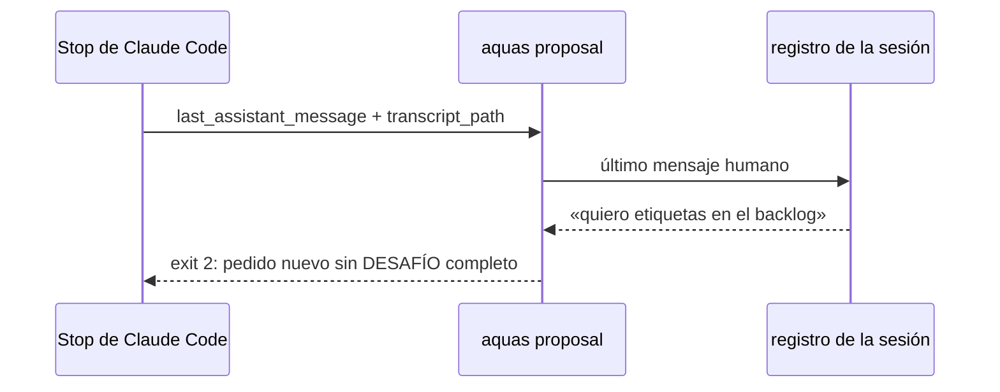

# S001 · Cierre exige DESAFÍO en pedido nuevo

[Inicio](../../README.md) › [E000](../README.md) › [F010](README.md) › S001

[Slice](../../glosario.md#slice) que agrega al gancho de cierre la revisión del bloque DESAFÍO.

## En una frase

`aquas proposal` lee el último mensaje humano del registro. Ante un pedido nuevo sin DESAFÍO completo, sale 2 con lo que falta.

## Para qué existe

**El problema.** La regla DESAFÍO del [orquestador](../../glosario.md#orquestador) solo está escrita. Nada frena una respuesta a un pedido nuevo que ejecuta sin desafiar.

**Por qué importa.** Es la diferencia entre un asesor y un asistente: los supuestos y riesgos se ven antes de gastar trabajo.

**La solución.** El gancho de cierre ya revisa PROPUESTA, insights y fallos. Suma una revisión más: clasifica el último mensaje humano y, si es pedido nuevo, exige el bloque.

**Origen.** E000/F010, decisión humana 2026-11-02.

**Contrato.**

| Regla | Valor |
|---|---|
| Mensaje humano | el último del registro (`transcript_path`) con `type: user` y origen humano; se lee con el lector que ya respalda las aprobaciones |
| Operativo | 6 palabras o menos y alguna de: sí, si, dale, ok, sigue, continúa, listo, hazlo, aplica; o empieza con «apruebo » |
| Pedido nuevo | todo mensaje humano que no es operativo |
| Bloque | una línea que empieza con `DESAFÍO`, y después las palabras Supuestos, Contraargumentos, Riesgos y Recomendación |
| Contraargumentos | no se cuentan: «sin objeción real» vale (la regla prohíbe rellenar) |
| Frena | exit 2 con «pedido nuevo sin DESAFÍO completo: falta …» |
| Corrección | turno que sigue a un freno del cierre (`stop_hook_active`) no se revisa: evita el bucle |
| Sin registro | registro ausente o ilegible, o sin mensaje humano → no se revisa (turnos de agentes y herramientas) |
| Clase | control probabilístico en la clasificación; determinista en el formato del bloque |
| Alcance | `internal/propuesta/**`, `internal/backlog/respaldo.go`, `cmd/aquas/**`, `docs/**` |

**Casos borde.**

| Categoría | Aplica | Prueba o motivo |
|---|---|---|
| cada tipo de ficha | no | el gancho revisa mensajes, no fichas |
| cada estado de origen | no | no hay estados: cada cierre se revisa solo |
| padre e hijo, activo y archivado | no | la revisión no lee el backlog |
| entrada ausente, vacía, mal escrita o duplicada | sí | registro ausente, mensaje vacío, bloque con una palabra de menos y con «sin objeción real»: `TestRevisarDesafio` |
| choque con otro control | sí | la corrección tras otro freno del cierre no se vuelve a frenar: `TestRevisarDesafio` |
| quién habla: humano, agente o herramienta | sí | solo cuenta el mensaje de origen humano; un aviso de subagente o un resultado de herramienta no: `TestRevisarDesafio` |
| fallo a mitad de camino | sí | registro con una línea rota: se salta la línea, no se cae: `TestRevisarDesafio` |

## Analogía

Piensa en **el portero que pide la invitación solo en la fiesta privada**.

- A los de la casa que entran y salen no les pide nada.
- Al invitado nuevo sí, y sin invitación no pasa.

Límite de la analogía: el portero reconoce caras; aquí la clasificación es por palabras y puede fallar.

## Diagrama

## Ejemplo de punta a punta

continúa: [EJ-E000-F010](README.md#EJ-E000-F010)

1. El humano escribe «quiero etiquetas en el [backlog](../../glosario.md#backlog)».
2. La respuesta no trae `DESAFÍO`; el cierre sale 2 y nombra lo que falta.
3. El [agente](../../glosario.md#agente) responde con el bloque; el cierre pasa.

## Paso a paso

1. Leer el último mensaje humano del registro.
2. Clasificar operativo o pedido nuevo.
3. En pedido nuevo, revisar el bloque y frenar si falta algo.

## Cómo se usa

- Corre solo en cada cierre de turno.

## Contrato y evidencia

<!-- GENERADO por aquas desde trabajo/: no editar a mano; `aquas compile` lo rehace. -->

| Prueba | Valida | Rojo cuando | Verde cuando | Rojo | Verde |
|---|---|---|---|---|---|
| `TestRevisarDesafio` | valida que pedido nuevo sin DESAFÍO frena y operativo pasa | rojo cuando un pedido nuevo sin bloque pasa o un dale frena | verde cuando solo el pedido nuevo sin bloque completo frena | — | — |

<!-- /GENERADO -->

## Navegación

- ↑ Subir: [F010](README.md)
