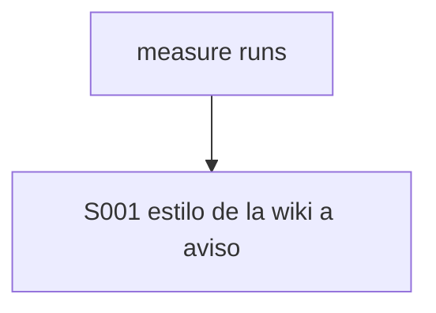
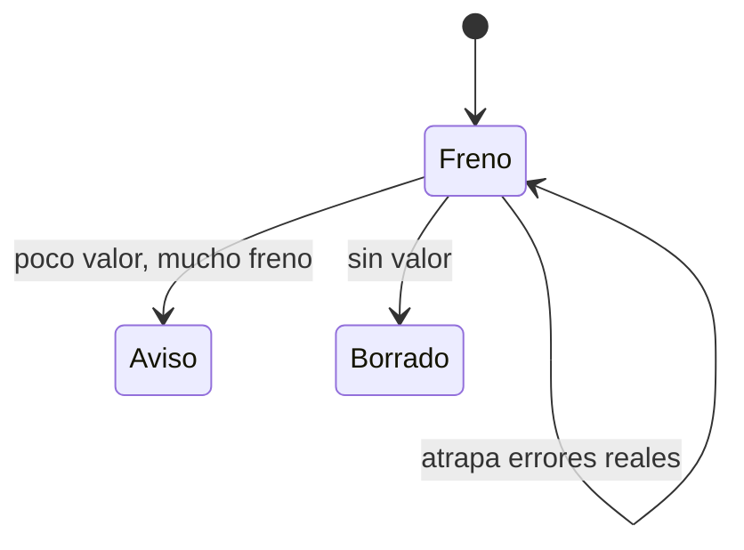

# F013 · Poda del gobierno con datos

[Inicio](../../README.md) › [E000](../README.md) › F013

[Feature](../../glosario.md#feature) que mide cada control y lo deja como freno, aviso, autocorrección o lo borra.

## En una frase

Menos frenos de forma, los mismos frenos que atrapan errores reales.

## Para qué existe

**El problema.** El gobierno frena más de lo que deja hacer. La mayoría de los frenos del [gate](../../glosario.md#gate) son de estilo.

**La solución.** Un [slice](../../glosario.md#slice) por decisión de poda. Los siguientes salen de la revisión completa del código.

| Slice | Qué hace |
|---|---|
| [S001](S001.md) | estilo de la wiki pasa a aviso |
| [S002](S002.md) | gancho de oración larga al guardar avisa |
| [S003](S003.md) | aprobación con respuesta corta y tras compact |
| [S004](S004.md) | sello omite menciones desde código Go |

**Origen.** Pedido del humano del 2026-11-04: congelar features nuevas hasta terminar la poda.

## Analogía

Piensa en **podar un árbol**.

- Se cortan las ramas que dan sombra y no fruto.

Límite de la analogía: aquí cada rama es un control, medido con datos.

## Diagrama

## Ejemplo de punta a punta

continúa: [EJ-E000](../README.md#EJ-E000)

1. `aquas measure runs` muestra qué control frena más.
2. Un slice baja ese control a aviso.
3. El gate frena menos y sigue atrapando errores reales.

## Paso a paso

1. S001.

## Cómo se usa

- `aquas verify`, como hoy.

## Contrato y evidencia

**Objetivo.** Cada control queda como freno, aviso, autocorrección o borrado, con su medida.

Prueba integral: `TestEstiloSoloAvisa`.

## Navegación

<!-- GENERADO por aquas desde trabajo/: no editar a mano; `aquas compile` lo rehace. -->

| Hijo | Qué es | Estado |
|---|---|---|
| [S001](S001.md) | Oración de más de 20 palabras y primera mención sin enlace al glosario avisan en vez de frenar. | Hecho |
| [S002](S002.md) | al guardar en docs/, la oración larga avisa al agente sin frenarlo | Hecho |
| [S003](S003.md) | «sí», «dale» o «ejecútalo» aprueban la línea apruebo que el agente propuso; sobrevive a compact | Planeado |
| [S004](S004.md) | el sello deja de pedir pruebas y código que solo nombran una ruta tocada | Planeado |

<!-- /GENERADO -->

- ↑ Subir: [E000](../README.md)
