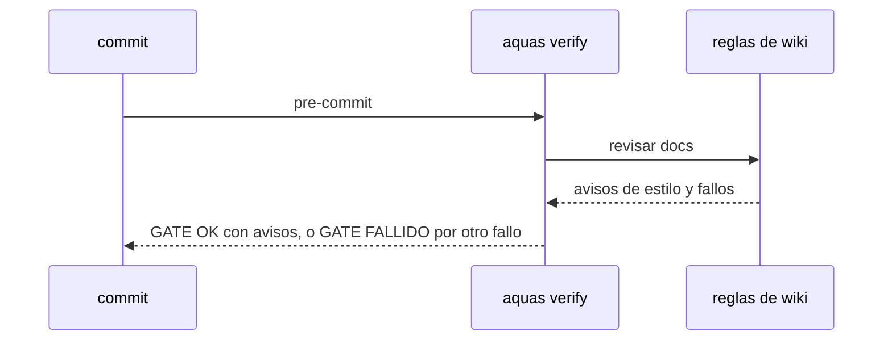

# S001 · Estilo de la wiki pasa a aviso

[Inicio](../../README.md) › [E000](../README.md) › [F013](README.md) › S001

[Slice](../../glosario.md#slice) que deja de frenar el [gate](../../glosario.md#gate) por estilo de la [wiki](../../glosario.md#wiki).

## En una frase

Oración de más de 20 palabras y primera mención sin enlace al glosario avisan; ya no hacen caer el gate.

## Para qué existe

**El problema.** En una sesión, el gate cayó 699 de 2401 veces. Las dos causas principales fueron estas reglas: 151 y 150 frenos.

**Por qué importa.** Son reglas de forma. Frenan el trabajo y no atrapan defectos de código.

**La solución.** Las dos reglas siguen corriendo, pero su resultado sale como aviso, igual que los avisos de defectos de hoy.

**Origen.** Decisión del humano del 2026-11-04: poda del gobierno con datos (`aquas measure runs`).

**Contrato.**

| Regla | Valor |
|---|---|
| Oración de más de 20 palabras | aviso con ruta y línea; el gate pasa |
| Primera mención sin enlace al glosario | aviso con ruta y término; el gate pasa |
| Resto de la wiki | sin cambios: siguen frenando |
| Hijos | igual que la central |
| Alcance | `internal/wiki/**`, `cmd/aquas/**`, `docs/**` |

**Casos borde.**

| Categoría | Aplica | Prueba o motivo |
|---|---|---|
| cada tipo de ficha | sí | página de slice, de feature y de iniciativa: `TestOracionLargaAvisa` |
| cada estado de origen | no | la wiki no depende del estado de la ficha para estas reglas |
| padre e hijo, activo y archivado | sí | en el hijo también avisa: `TestOracionLargaAvisa` |
| entrada ausente, vacía, mal escrita o duplicada | sí | página vacía y término repetido: `TestOracionLargaAvisa` |
| choque con otro control | sí | otro fallo de wiki en la misma página sigue frenando: `TestOracionLargaAvisa` |
| quién habla: humano, agente o herramienta | no | el gate corre igual para todos |
| fallo a mitad de camino | no | la revisión es de solo lectura |

## Analogía

Piensa en **un corrector de estilo**.

- Marca la frase larga en rojo, pero no detiene la imprenta.
- La imprenta solo para por errores de contenido.

Límite de la analogía: aquí la imprenta es el [commit](../../glosario.md#commit).

## Diagrama

## Ejemplo de punta a punta

continúa: [EJ-E000-F013](README.md#EJ-E000-F013)

1. Una página trae una oración de 25 palabras.
2. `aquas verify` imprime el aviso con ruta y línea.
3. El gate dice `GATE OK` y el commit entra.

## Paso a paso

1. Rojo de `TestOracionLargaAvisa`.
2. Las dos reglas pasan a la lista de avisos; verde.

## Cómo se usa

- `aquas verify`, como hoy; los avisos salen antes de `GATE OK`.

## Contrato y evidencia

<!-- GENERADO por aquas desde trabajo/: no editar a mano; `aquas compile` lo rehace. -->

| Prueba | Valida | Rojo cuando | Verde cuando | Rojo | Verde |
|---|---|---|---|---|---|
| `TestOracionLargaAvisa` | valida que oración larga y enlace faltante avisan sin frenar | rojo cuando el gate cae por ellos | verde cuando el gate pasa y lista el aviso | — | — |

<!-- /GENERADO -->

## Navegación

- ↑ Subir: [F013](README.md)
