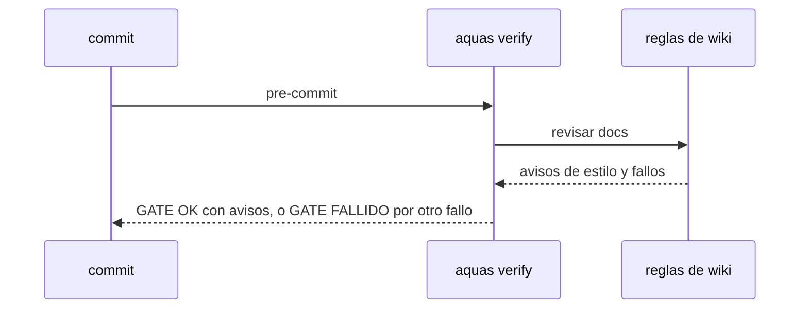

# S001 · Estilo de la wiki pasa a aviso

[Inicio](../../README.md) › [E000](../README.md) › [F013](README.md) › S001

[Slice](../../glosario.md#slice) que deja de frenar el [gate](../../glosario.md#gate) por estilo de la [wiki](../../glosario.md#wiki).

## En una frase

Oración de más de 20 palabras y primera mención sin enlace al glosario avisan; ya no hacen caer el gate.

## Para qué existe

**El problema.** En una sesión, el gate cayó 699 de 2401 veces. Las dos causas principales fueron estas reglas: 151 y 150 frenos.

**Por qué importa.** Son reglas de forma. Frenan el trabajo y no atrapan defectos de código.

**La solución.** Las dos reglas siguen corriendo, pero su resultado sale como aviso, igual que los avisos de defectos de hoy.

**Origen.** Decisión del humano del 2026-11-04: poda del gobierno con datos (`aquas measure runs`).

**Contrato.**

| Regla | Valor |
|---|---|
| Oración de más de 20 palabras | aviso con ruta y línea; el gate pasa |
| Primera mención sin enlace al glosario | aviso con ruta y término; el gate pasa |
| Resto de la wiki | sin cambios: siguen frenando |
| Hijos | igual que la central |
| Alcance | `internal/wiki/**`, `cmd/aquas/**`, `docs/**` |

**Casos borde.**

| Categoría | Aplica | Prueba o motivo |
|---|---|---|
| cada tipo de ficha | sí | página de slice, de feature y de iniciativa: `TestOracionLargaAvisa` |
| cada estado de origen | no | la wiki no depende del estado de la ficha para estas reglas |
| padre e hijo, activo y archivado | sí | en el hijo `aquas verify` muestra el aviso: `TestVerifyHijoEstiloAvisa` |
| entrada ausente, vacía, mal escrita o duplicada | sí | página vacía, término repetido y variante del término: `TestOracionLargaAvisa`, `TestAvisosGlosario` |
| choque con otro control | sí | otro fallo de wiki en la misma página sigue frenando: `TestOracionLargaAvisa` |
| quién habla: humano, agente o herramienta | no | el gate corre igual para todos |
| fallo a mitad de camino | no | la revisión es de solo lectura |

## Analogía

Piensa en **un corrector de estilo**.

- Marca la frase larga en rojo, pero no detiene la imprenta.
- La imprenta solo para por errores de contenido.

Límite de la analogía: aquí la imprenta es el [commit](../../glosario.md#commit).

## Diagrama

## Ejemplo de punta a punta

continúa: [EJ-E000-F013](README.md#EJ-E000-F013)

1. Una página trae una oración de 25 palabras.
2. `aquas verify` imprime el aviso con ruta y línea.
3. El gate dice `GATE OK` y el commit entra.

## Paso a paso

1. Rojo de `TestOracionLargaAvisa`, `TestAvisosGlosario`, `TestOracionLargaEsAviso` y `TestVerifyHijoEstiloAvisa`.
2. Las dos reglas pasan a la lista de avisos; `aquas verify` los imprime como «Aviso · wiki:»; verde.

## Cómo se usa

- `aquas verify`, como hoy; los avisos salen antes de `GATE OK`.

## Contrato y evidencia

<!-- GENERADO por aquas desde trabajo/: no editar a mano; `aquas compile` lo rehace. -->

| Prueba | Valida | Rojo cuando | Verde cuando | Rojo | Verde |
|---|---|---|---|---|---|
| `TestOracionLargaAvisa` | valida que oración larga y enlace faltante avisan sin frenar | rojo cuando el gate cae por ellos | verde cuando el gate pasa y lista el aviso | 2026-11-04 | 2026-11-04 |
| `TestAvisosGlosario` | valida que cada variante de término sin enlace avisa | rojo cuando alguna frena o no avisa | verde cuando todas avisan sin problemas | 2026-11-04 | 2026-11-04 |
| `TestOracionLargaEsAviso` | valida que la oración larga es aviso | rojo cuando frena | verde cuando avisa sin problemas | 2026-11-04 | 2026-11-04 |
| `TestVerifyHijoEstiloAvisa` | valida que verify del hijo muestra la oración larga como aviso | rojo cuando sale como fallo o no sale | verde cuando sale una vez como «Aviso · wiki:» | 2026-11-04 | 2026-11-04 |

### Código

| Archivo | Función | Parámetros | Qué hace |
|---|---|---|---|
| [cmd/aquas/main.go](../../../cmd/aquas/main.go) | `main` | `()` | main despacha el subcomando de aquas (compilar, verificar, backlog, hooks…) y sale con su código. |
| [cmd/aquas/main.go](../../../cmd/aquas/main.go) | `hook` | `(raiz string)` | hook: exit 0 = nada que reportar; exit 2 = stderr se muestra a Claude. |
| [cmd/aquas/main.go](../../../cmd/aquas/main.go) | `compilarSettings` | `(w io.Writer)` | compilarSettings regenera .claude/settings.json; sin entorno declarado no inventa uno. |
| [cmd/aquas/main.go](../../../cmd/aquas/main.go) | `reportar` | `(w io.Writer, inf compilador.Informe)` | reportar imprime qué derivados escribió la compilación, o que todo estaba al día. |
| [cmd/aquas/main.go](../../../cmd/aquas/main.go) | `listar` | `(titulo string, problemas []string)` | listar imprime en stderr un título y cada problema en su viñeta. |
| [cmd/aquas/main.go](../../../cmd/aquas/main.go) | `lista` | `(xs []string) string` | lista une los textos con comas, o «—» si no hay ninguno. |
| [cmd/aquas/main.go](../../../cmd/aquas/main.go) | `fallar` | `(codigo int, err error)` | fallar imprime el error en stderr y termina con el código dado. |
| [cmd/aquas/main.go](../../../cmd/aquas/main.go) | `avisarWiki` | `(avisos []string)` | avisarWiki (E000/F013/S001): imprime los avisos de estilo de la wiki; no cambian el resultado del gate. |
| [cmd/aquas/main.go](../../../cmd/aquas/main.go) | `revisarAislamiento` | `() (fallo, aviso string)` | revisarAislamiento: fallo para el gate y aviso para el arranque (E000/F008/S003, D000079). |
| [cmd/aquas/main.go](../../../cmd/aquas/main.go) | `memoriaCLI` | `(raiz string, args []string)` | memoriaCLI: `ver` imprime la memoria; `fijar campo=valor…` la actualiza y la sella. |
| [cmd/aquas/main.go](../../../cmd/aquas/main.go) | `memoriaArchivada` | `(raiz, id string) error` | memoriaArchivada: CERRADO exige el archivo de memoria del slice, apunte o no la memoria a él (E001/F002/S009, X01). |
| [cmd/aquas/main.go](../../../cmd/aquas/main.go) | `focoEnBacklog` | `(raiz string, f memoria.Foco) error` | focoEnBacklog: la memoria solo fija el slice que el backlog tiene en curso (S003). |
| [cmd/aquas/main.go](../../../cmd/aquas/main.go) | `backlogCLI` | `(raiz string, args []string)` | backlogCLI: nuevo \\| ver [id] \\| tabla \\| prioridad \\| estado \\| siguiente \\| pruebas \\| rojo \\| verde. |
| [cmd/aquas/main.go](../../../cmd/aquas/main.go) | `gateDefectos` | `(raiz string) (frena []string, aviso string)` | gateDefectos (E001/F017/S005): lo que el gate dice del registro de defectos. Prueba nombrada que ya no existe |
| [cmd/aquas/main.go](../../../cmd/aquas/main.go) | `turnoCLI` | `(raiz string, args []string)` | turnoCLI: auditoría de turnos (E001/F002/S001). Lee el JSON del hook por stdin. No imprime nada |
| [cmd/aquas/main.go](../../../cmd/aquas/main.go) | `retroCLI` | `(raiz string, args []string) (backlog.Retro, error)` | retroCLI (E001/F018/S002): cerrar fichas=A,B motivo=…; cada clave una vez. |
| [cmd/aquas/main.go](../../../cmd/aquas/main.go) | `defectoCLI` | `(raiz string, args []string) error` | defectoCLI: nuevo \\| ocurre \\| arreglar \\| ver (E001/F004/S001; arreglar: E000/F007/S003). |
| [cmd/aquas/main.go](../../../cmd/aquas/main.go) | `versionBinario` | `() string` | versionBinario: versión del módulo con que se compiló el binario (= versión del gobierno embebido). |
| [cmd/aquas/main.go](../../../cmd/aquas/main.go) | `versionControl` | `() string` | versionControl (E003/F006/S002, hallazgo A2.1): versión con la que deciden los controles del hijo. |
| [cmd/aquas/main.go](../../../cmd/aquas/main.go) | `registrarCierre` | `(raiz, tipo, transcript, primera, resultado string)` | registrarCierre (E001/F004/S005, D000068) anota cada llamada del gancho cierre-agente en .tmp/hooks/cierre-agente.jsonl. |
| [cmd/aquas/main.go](../../../cmd/aquas/main.go) | `esUpdate` | `(datos []byte) bool` | esUpdate (E003/F006/S001): la entrada de la guardia es una orden Bash que es exactamente `aquas update` (PowerShell lo frena la guardia siempre). |
| [cmd/aquas/main.go](../../../cmd/aquas/main.go) | `entornoHijo` | `(raiz string)` | entornoHijo (E003/F001/S003) declara el entorno del hijo, como aquas init en la central: |
| [internal/wiki/legibilidad.go](../../../internal/wiki/legibilidad.go) | `Silabas` | `(palabra string) int` | Silabas cuenta las sílabas de una palabra en español por núcleos vocálicos, |
| [internal/wiki/legibilidad.go](../../../internal/wiki/legibilidad.go) | `esVocalLetra` | `(r rune) bool` | esVocalLetra: la runa es vocal castellana, con o sin tilde. |
| [internal/wiki/legibilidad.go](../../../internal/wiki/legibilidad.go) | `hiato` | `(a, b rune) bool` | hiato: las dos vocales seguidas se cuentan como sílabas separadas. |
| [internal/wiki/legibilidad.go](../../../internal/wiki/legibilidad.go) | `oraciones` | `(lineas []string) [][]string` | oraciones parte la prosa en oraciones de palabras. Línea vacía o ítem de lista |
| [internal/wiki/legibilidad.go](../../../internal/wiki/legibilidad.go) | `palabrasDe` | `(texto string) []string` | palabrasDe: palabras de un texto de prosa, sin enlaces ni HTML. |
| [internal/wiki/legibilidad.go](../../../internal/wiki/legibilidad.go) | `sinAbierto` | `(s, siguiente string) string` | sinAbierto quita del final de s una etiqueta HTML o un enlace que cierra en la línea siguiente: |
| [internal/wiki/legibilidad.go](../../../internal/wiki/legibilidad.go) | `oracionesConLinea` | `(lineas []string, nums []int) ([][]string, []int)` | oracionesConLinea (E000/F006/S004): como oraciones, y además la línea donde empieza cada una, |
| [internal/wiki/legibilidad.go](../../../internal/wiki/legibilidad.go) | `Perspicuidad` | `(ors [][]string) float64` | Perspicuidad calcula el índice Szigriszt-Pazos; 0 si no hay palabras. |
| [internal/wiki/legibilidad.go](../../../internal/wiki/legibilidad.go) | `revisarLegibilidad` | `(pg *pagina) []string` | revisarLegibilidad: problema si la prosa es difícil de leer (INFLESZ). Las oraciones largas solo avisan (E000/F013/S001). |
| [internal/wiki/legibilidad.go](../../../internal/wiki/legibilidad.go) | `largas` | `(pg *pagina) []string` | largas: un aviso por oración de más de MaxPalabrasOracion, con la línea donde empieza. |
| [internal/wiki/legibilidad.go](../../../internal/wiki/legibilidad.go) | `OracionesLargas` | `(raiz, rel string) ([]string, error)` | OracionesLargas (E000/F006/S004): avisos de oración larga de una página de docs/, para el hook al guardar. |
| [internal/wiki/legibilidad.go](../../../internal/wiki/legibilidad.go) | `coma` | `(x float64) string` | coma formatea un número con un decimal y coma decimal. |
| [internal/wiki/wiki.go](../../../internal/wiki/wiki.go) | `Verificar` | `(raiz string) ([]string, error)` | Verificar devuelve los problemas de la wiki bajo raiz/docs; vacío = gate OK. Sin los avisos de estilo. |
| [internal/wiki/wiki.go](../../../internal/wiki/wiki.go) | `VerificarConAvisos` | `(raiz string) (problemas, avisos []string, err error)` | VerificarConAvisos (E000/F013/S001): problemas frenan; avisos de estilo (oración larga, término sin enlace) no. |
| [internal/wiki/wiki.go](../../../internal/wiki/wiki.go) | `relativa` | `(raiz, p string) string` | relativa: ruta de p respecto de la raíz, con barras «/». |
| [internal/wiki/wiki.go](../../../internal/wiki/wiki.go) | `clasificar` | `(rel string) *pagina` | clasificar asigna nivel, padre e id de ejemplo según la ruta; nil = fuera del árbol. |
| [internal/wiki/wiki.go](../../../internal/wiki/wiki.go) | `pagina.agregarProsa` | `(texto string, linea int)` | agregarProsa suma una entrada de prosa con su línea en el archivo (E000/F006/S004). |
| [internal/wiki/wiki.go](../../../internal/wiki/wiki.go) | `analizar` | `(raiz string, pg *pagina) error` | analizar lee la página: secciones H2, diagramas, anclas (id HTML y títulos) y enlaces fuera de código. |
| [internal/wiki/wiki.go](../../../internal/wiki/wiki.go) | `slug` | `(s string) string` | slug al estilo GitHub/VS Code: minúsculas, letras/dígitos/-/_ se conservan, espacio → guion. |
| [internal/wiki/wiki.go](../../../internal/wiki/wiki.go) | `pagina.seccion` | `(titulo string) *seccion` | seccion busca una sección de la página por su título; nil si no está. |
| [internal/wiki/wiki.go](../../../internal/wiki/wiki.go) | `revisarSecciones` | `(pg *pagina) []string` | revisarSecciones: faltan secciones fijas o están fuera de orden. |
| [internal/wiki/wiki.go](../../../internal/wiki/wiki.go) | `revisarDiagramas` | `(pg *pagina) []string` | revisarDiagramas: la sección Diagrama trae el Mermaid que pide su nivel. |
| [internal/wiki/wiki.go](../../../internal/wiki/wiki.go) | `revisarEjemplo` | `(pg *pagina, paginas map[string]*pagina) []string` | revisarEjemplo: el ejemplo lleva su ancla EJ- y encadena con el del padre. |
| [internal/wiki/wiki.go](../../../internal/wiki/wiki.go) | `revisarNavegacion` | `(pg *pagina, hijos []string) []string` | revisarNavegacion: hay ↑ Subir y un enlace Abajo a cada hija. |
| [internal/wiki/wiki.go](../../../internal/wiki/wiki.go) | `revisarEnlaces` | `(raiz string, pg *pagina, anclas map[string]map[string]bool) []string` | revisarEnlaces: cada enlace interno apunta a un archivo y ancla que existen. |
| [internal/wiki/wiki.go](../../../internal/wiki/wiki.go) | `revisarAlcance` | `(paginas map[string]*pagina, orden []string) []string` | revisarAlcance: toda página del árbol debe alcanzarse desde docs/README.md siguiendo enlaces. |
| [internal/wiki/wiki.go](../../../internal/wiki/wiki.go) | `resolver` | `(desde, destino string) (string, string)` | resolver convierte un destino relativo a la página en ruta relativa a la raíz + fragmento. |

<!-- /GENERADO -->

## Navegación

- ↑ Subir: [F013](README.md)
