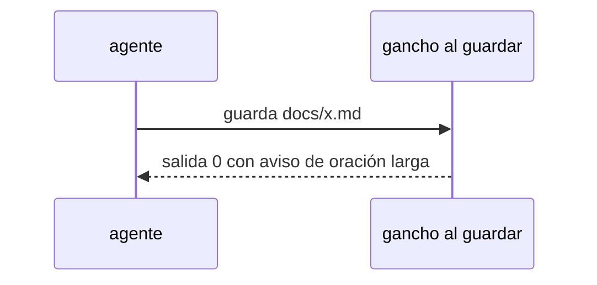

# S002 · Gancho de oración larga avisa

[Inicio](../../README.md) › [E000](../README.md) › [F013](README.md) › S002

[Slice](../../glosario.md#slice) que deja de frenar al [agente](../../glosario.md#agente) cuando guarda una página con una oración larga.

## En una frase

Al guardar en `docs/`, la oración larga y los enlaces agregados llegan al agente como aviso; ya no cortan su trabajo.

## Para qué existe

**El problema.** El gancho que revisa cada página al guardarla sale con código 2. Claude Code lo trata como freno y el agente rehace la página.

**Por qué importa.** S001 ya bajó esa regla a aviso en el [gate](../../glosario.md#gate). El gancho sigue frenando por lo mismo.

**La solución.** El gancho sale con código 0 y entrega el aviso como contexto para el agente.

**Origen.** Poda del humano del 2026-11-04, recorte 1.

**Contrato.**

| Regla | Valor |
|---|---|
| Oración de más de 20 palabras al guardar | aviso con ruta y línea; salida 0 |
| Enlace al glosario que el gancho agrega solo | lo agrega como hoy y avisa «relee el archivo»; salida 0 |
| Página fuera de `docs/` | sin cambios: el gancho no la mira |
| Alcance | `cmd/aquas/**`, `internal/wiki/**`, `docs/**` |

**Casos borde.**

| Categoría | Aplica | Prueba o motivo |
|---|---|---|
| cada tipo de ficha | sí | página de slice y glosario: `TestGanchoOracionAvisa` |
| cada estado de origen | no | el gancho no lee el estado de la ficha |
| padre e hijo, activo y archivado | no | el gancho `hook` es solo de la central: `gobierno/config/herencia.json` lo marca `central` y el hijo corre `aquas build` al guardar |
| entrada ausente, vacía, mal escrita o duplicada | sí | página sin oraciones largas no avisa: `TestGanchoOracionAvisa` |
| choque con otro control | sí | el enlazado del glosario sigue agregando enlaces, ahora con salida 0: `TestGanchoOracionAvisa` |
| quién habla: humano, agente o herramienta | no | solo lo dispara la herramienta Write o Edit del agente |
| fallo a mitad de camino | no | el gancho solo lee la página |

## Analogía

Piensa en **un corrector que anota en el margen**.

- Marca la frase larga, pero deja seguir escribiendo.

Límite de la analogía: aquí el margen es el contexto que recibe el agente.

## Diagrama

## Ejemplo de punta a punta

continúa: [EJ-E000-F013](README.md#EJ-E000-F013)

1. El agente guarda una página con una oración de 23 palabras.
2. El gancho sale con código 0 y el agente ve el aviso con la línea.
3. El agente sigue con su tarea.

## Paso a paso

1. Rojo de `TestGanchoOracionAvisa`.
2. El gancho sale con 0 y pasa el aviso como contexto; verde.

Fuente: la [referencia de hooks](https://code.claude.com/docs/en/hooks) de Claude Code, consultada el 2026-11-04. Un PostToolUse que devuelve `hookSpecificOutput.additionalContext` suma ese texto al contexto de Claude junto al resultado de la herramienta.

## Cómo se usa

- Nada nuevo: el gancho corre solo al guardar.

## Contrato y evidencia

<!-- GENERADO por aquas desde trabajo/: no editar a mano; `aquas compile` lo rehace. -->

| Prueba | Valida | Rojo cuando | Verde cuando | Rojo | Verde |
|---|---|---|---|---|---|
| `TestGanchoOracionAvisa` | valida que el gancho al guardar avisa la oración larga sin frenar | rojo cuando sale con código 2 | verde cuando sale 0 y el aviso llega al agente | 2026-11-04 | 2026-11-04 |

### Código

| Archivo | Función | Parámetros | Qué hace |
|---|---|---|---|
| [cmd/aquas/main.go](../../../cmd/aquas/main.go) | `main` | `()` | main despacha el subcomando de aquas (compilar, verificar, backlog, hooks…) y sale con su código. |
| [cmd/aquas/main.go](../../../cmd/aquas/main.go) | `contextoParaClaude` | `(texto string)` | contextoParaClaude (E000/F013/S002): aviso que el gancho PostToolUse entrega a Claude sin frenar (additionalContext, salida 0). |
| [cmd/aquas/main.go](../../../cmd/aquas/main.go) | `hook` | `(raiz string)` | hook: exit 0 = nada que reportar o aviso en additionalContext; exit 2 = stderr se muestra a Claude como freno. |
| [cmd/aquas/main.go](../../../cmd/aquas/main.go) | `compilarSettings` | `(w io.Writer)` | compilarSettings regenera .claude/settings.json; sin entorno declarado no inventa uno. |
| [cmd/aquas/main.go](../../../cmd/aquas/main.go) | `reportar` | `(w io.Writer, inf compilador.Informe)` | reportar imprime qué derivados escribió la compilación, o que todo estaba al día. |
| [cmd/aquas/main.go](../../../cmd/aquas/main.go) | `listar` | `(titulo string, problemas []string)` | listar imprime en stderr un título y cada problema en su viñeta. |
| [cmd/aquas/main.go](../../../cmd/aquas/main.go) | `lista` | `(xs []string) string` | lista une los textos con comas, o «—» si no hay ninguno. |
| [cmd/aquas/main.go](../../../cmd/aquas/main.go) | `fallar` | `(codigo int, err error)` | fallar imprime el error en stderr y termina con el código dado. |
| [cmd/aquas/main.go](../../../cmd/aquas/main.go) | `avisarWiki` | `(avisos []string)` | avisarWiki (E000/F013/S001): imprime los avisos de estilo de la wiki; no cambian el resultado del gate. |
| [cmd/aquas/main.go](../../../cmd/aquas/main.go) | `revisarAislamiento` | `() (fallo, aviso string)` | revisarAislamiento: fallo para el gate y aviso para el arranque (E000/F008/S003, D000079). |
| [cmd/aquas/main.go](../../../cmd/aquas/main.go) | `memoriaCLI` | `(raiz string, args []string)` | memoriaCLI: `ver` imprime la memoria; `fijar campo=valor…` la actualiza y la sella. |
| [cmd/aquas/main.go](../../../cmd/aquas/main.go) | `memoriaArchivada` | `(raiz, id string) error` | memoriaArchivada: CERRADO exige el archivo de memoria del slice, apunte o no la memoria a él (E001/F002/S009, X01). |
| [cmd/aquas/main.go](../../../cmd/aquas/main.go) | `focoEnBacklog` | `(raiz string, f memoria.Foco) error` | focoEnBacklog: la memoria solo fija el slice que el backlog tiene en curso (S003). |
| [cmd/aquas/main.go](../../../cmd/aquas/main.go) | `backlogCLI` | `(raiz string, args []string)` | backlogCLI: nuevo \\| ver [id] \\| tabla \\| prioridad \\| estado \\| siguiente \\| pruebas \\| rojo \\| verde. |
| [cmd/aquas/main.go](../../../cmd/aquas/main.go) | `gateDefectos` | `(raiz string) (frena []string, aviso string)` | gateDefectos (E001/F017/S005): lo que el gate dice del registro de defectos. Prueba nombrada que ya no existe |
| [cmd/aquas/main.go](../../../cmd/aquas/main.go) | `turnoCLI` | `(raiz string, args []string)` | turnoCLI: auditoría de turnos (E001/F002/S001). Lee el JSON del hook por stdin. No imprime nada |
| [cmd/aquas/main.go](../../../cmd/aquas/main.go) | `retroCLI` | `(raiz string, args []string) (backlog.Retro, error)` | retroCLI (E001/F018/S002): cerrar fichas=A,B motivo=…; cada clave una vez. |
| [cmd/aquas/main.go](../../../cmd/aquas/main.go) | `defectoCLI` | `(raiz string, args []string) error` | defectoCLI: nuevo \\| ocurre \\| arreglar \\| ver (E001/F004/S001; arreglar: E000/F007/S003). |
| [cmd/aquas/main.go](../../../cmd/aquas/main.go) | `versionBinario` | `() string` | versionBinario: versión del módulo con que se compiló el binario (= versión del gobierno embebido). |
| [cmd/aquas/main.go](../../../cmd/aquas/main.go) | `versionControl` | `() string` | versionControl (E003/F006/S002, hallazgo A2.1): versión con la que deciden los controles del hijo. |
| [cmd/aquas/main.go](../../../cmd/aquas/main.go) | `registrarCierre` | `(raiz, tipo, transcript, primera, resultado string)` | registrarCierre (E001/F004/S005, D000068) anota cada llamada del gancho cierre-agente en .tmp/hooks/cierre-agente.jsonl. |
| [cmd/aquas/main.go](../../../cmd/aquas/main.go) | `esUpdate` | `(datos []byte) bool` | esUpdate (E003/F006/S001): la entrada de la guardia es una orden Bash que es exactamente `aquas update` (PowerShell lo frena la guardia siempre). |
| [cmd/aquas/main.go](../../../cmd/aquas/main.go) | `entornoHijo` | `(raiz string)` | entornoHijo (E003/F001/S003) declara el entorno del hijo, como aquas init en la central: |

<!-- /GENERADO -->

## Navegación

- ↑ Subir: [F013](README.md)
