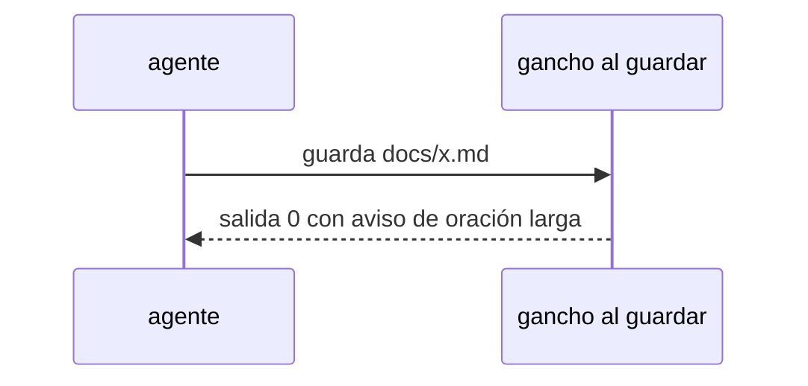

# S002 · Gancho de oración larga avisa

[Inicio](../../README.md) › [E000](../README.md) › [F013](README.md) › S002

[Slice](../../glosario.md#slice) que deja de frenar al [agente](../../glosario.md#agente) cuando guarda una página con una oración larga.

## En una frase

Al guardar en `docs/`, la oración larga y los enlaces agregados llegan al agente como aviso; ya no cortan su trabajo.

## Para qué existe

**El problema.** El gancho que revisa cada página al guardarla sale con código 2. Claude Code lo trata como freno y el agente rehace la página.

**Por qué importa.** S001 ya bajó esa regla a aviso en el [gate](../../glosario.md#gate). El gancho sigue frenando por lo mismo.

**La solución.** El gancho sale con código 0 y entrega el aviso como contexto para el agente.

**Origen.** Poda del humano del 2026-11-04, recorte 1.

**Contrato.**

| Regla | Valor |
|---|---|
| Oración de más de 20 palabras al guardar | aviso con ruta y línea; salida 0 |
| Enlace al glosario que el gancho agrega solo | lo agrega como hoy y avisa «relee el archivo»; salida 0 |
| Página fuera de `docs/` | sin cambios: el gancho no la mira |
| Alcance | `cmd/aquas/**`, `internal/wiki/**`, `docs/**` |

**Casos borde.**

| Categoría | Aplica | Prueba o motivo |
|---|---|---|
| cada tipo de ficha | sí | página de slice y glosario: `TestGanchoOracionAvisa` |
| cada estado de origen | no | el gancho no lee el estado de la ficha |
| padre e hijo, activo y archivado | sí | en el hijo el gancho es el mismo binario: `TestGanchoOracionAvisa` |
| entrada ausente, vacía, mal escrita o duplicada | sí | página sin oraciones largas no avisa: `TestGanchoOracionAvisa` |
| choque con otro control | sí | el enlazado del glosario sigue agregando enlaces, ahora con salida 0: `TestGanchoOracionAvisa` |
| quién habla: humano, agente o herramienta | no | solo lo dispara la herramienta Write o Edit del agente |
| fallo a mitad de camino | no | el gancho solo lee la página |

## Analogía

Piensa en **un corrector que anota en el margen**.

- Marca la frase larga, pero deja seguir escribiendo.

Límite de la analogía: aquí el margen es el contexto que recibe el agente.

## Diagrama

## Ejemplo de punta a punta

continúa: [EJ-E000-F013](README.md#EJ-E000-F013)

1. El agente guarda una página con una oración de 23 palabras.
2. El gancho sale con código 0 y el agente ve el aviso con la línea.
3. El agente sigue con su tarea.

## Paso a paso

1. Rojo de `TestGanchoOracionAvisa`.
2. El gancho sale con 0 y pasa el aviso como contexto; verde.

## Cómo se usa

- Nada nuevo: el gancho corre solo al guardar.

## Contrato y evidencia

<!-- GENERADO por aquas desde trabajo/: no editar a mano; `aquas compile` lo rehace. -->

| Prueba | Valida | Rojo cuando | Verde cuando | Rojo | Verde |
|---|---|---|---|---|---|
| `TestGanchoOracionAvisa` | valida que el gancho al guardar avisa la oración larga sin frenar | rojo cuando sale con código 2 | verde cuando sale 0 y el aviso llega al agente | — | — |

<!-- /GENERADO -->

## Navegación

- ↑ Subir: [F013](README.md)
