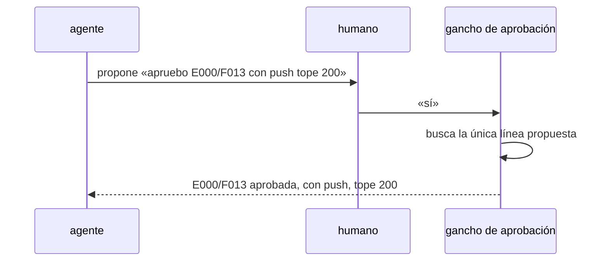

# S003 · Aprobación corta y tras compact

[Inicio](../../README.md) › [E000](../README.md) › [F013](README.md) › S003

[Slice](../../glosario.md#slice) que deja aprobar con una respuesta corta y que la aprobación no se pierda al compactar.

## En una frase

Si el [agente](../../glosario.md#agente) propone «apruebo X con push tope N», el humano responde «sí» y queda aprobado.

## Para qué existe

**El problema.** Hoy la aprobación exige la línea exacta. Tras un `/compact`, una aprobación ya dada no se encuentra y el humano debe repetirla.

**Por qué importa.** Es el freno que más molesta al humano. No protege nada: el humano ya vio la línea propuesta.

**La solución.** Dos cambios:
- Una respuesta corta aprueba la línea que el agente propuso en su último mensaje.
- La aprobación busca el mensaje humano también en el registro anterior al compact.

**Origen.** Poda del humano del 2026-11-04, recorte 2.

**Contrato.**

| Regla | Valor |
|---|---|
| Respuestas cortas que aprueban | «sí», «si», «dale», «ejecútalo», «ejecuta», «apruebo», «ok»; solas o con signo final |
| Qué aprueban | la única línea `apruebo <id> …` del último mensaje del agente, con su «con push» y su «tope N» |
| Último mensaje sin esa línea, o con dos | la respuesta corta no aprueba nada |
| Respuesta larga que no es la línea exacta | no aprueba |
| Tras `/compact` | la aprobación dada antes sigue valiendo |
| Alcance | `cmd/aquas/**`, `internal/backlog/**`, `docs/**` |

**Casos borde.**

| Categoría | Aplica | Prueba o motivo |
|---|---|---|
| cada tipo de ficha | sí | feature y slice: `TestAprobacionCorta` |
| cada estado de origen | no | la aprobación no depende del estado; lo exige `state` como hoy |
| padre e hijo, activo y archivado | sí | en el hijo corre el mismo gancho: `TestAprobacionCorta` |
| entrada ausente, vacía, mal escrita o duplicada | sí | sin propuesta, dos propuestas y «sí» con más texto: `TestAprobacionCorta` |
| choque con otro control | sí | el tope propuesto llega al presupuesto: `TestAprobacionCorta` |
| quién habla: humano, agente o herramienta | sí | un «sí» escrito por el agente o una herramienta no aprueba: `TestAprobacionCorta` |
| fallo a mitad de camino | sí | registro anterior al compact ilegible: pide la línea otra vez, `TestAprobacionCorta` |

## Analogía

Piensa en **firmar un formulario que ya te llenaron**.

- No reescribes el formulario; firmas el que tienes delante.

Límite de la analogía: si hay dos formularios, no vale la firma.

## Diagrama

## Ejemplo de punta a punta

continúa: [EJ-E000-F013](README.md#EJ-E000-F013)

1. El agente termina su mensaje con «apruebo E000/F013 con push tope 200».
2. El humano responde «dale».
3. La [feature](../../glosario.md#feature) queda aprobada; tras un `/compact`, sigue aprobada.

## Paso a paso

1. Rojo de `TestAprobacionCorta`.
2. Respuesta corta y búsqueda en el registro anterior; verde.

## Cómo se usa

- El humano responde «sí» a una propuesta de aprobación.

## Contrato y evidencia

<!-- GENERADO por aquas desde trabajo/: no editar a mano; `aquas compile` lo rehace. -->

| Prueba | Valida | Rojo cuando | Verde cuando | Rojo | Verde |
|---|---|---|---|---|---|
| `TestAprobacionCorta` | valida que una respuesta corta aprueba la línea propuesta y que la aprobación sobrevive a compact | rojo cuando pide repetir la línea | verde cuando la ficha queda aprobada con el id y tope propuestos | — | — |

<!-- /GENERADO -->

## Navegación

- ↑ Subir: [F013](README.md)
