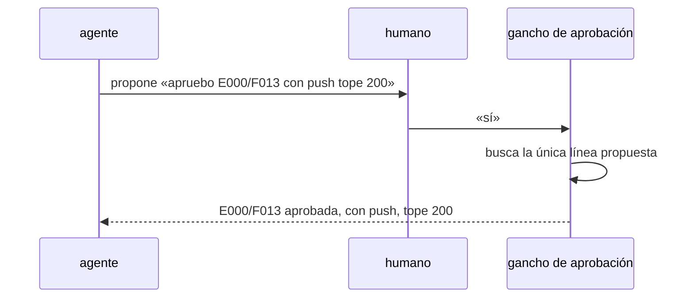

# S003 · Aprobación corta y tras compact

[Inicio](../../README.md) › [E000](../README.md) › [F013](README.md) › S003

[Slice](../../glosario.md#slice) que deja aprobar con una respuesta corta y que un apruebo en cola no se pierda.

## En una frase

Si el [agente](../../glosario.md#agente) propone «apruebo X con push tope N», el humano responde «sí» y queda aprobado.

## Para qué existe

**El problema.** Hoy la aprobación exige la línea exacta. Además, un «apruebo» escrito mientras el agente trabaja queda en cola. Claude Code lo guarda en el registro como adjunto, no como mensaje del humano. El control no lo encuentra y pide repetirlo.

**Por qué importa.** Es el freno que más molesta al humano. No protege nada: el humano ya vio la línea propuesta.

**La solución.** Dos cambios:
- Una respuesta corta aprueba la línea que el agente propuso en su último mensaje.
- El control cuenta como mensaje del humano el mensaje en cola.

**Origen.** Poda del humano del 2026-11-04, recorte 2.

**Contrato.**

| Regla | Valor |
|---|---|
| Respuestas cortas que aprueban | «sí», «si», «dale», «ejecútalo», «ejecuta», «apruebo», «ok»; solas o con signo final |
| Qué aprueban | la única línea `apruebo <id> …` que el agente escribió desde el último mensaje del humano, sola en su línea o sola en el campo «¿Qué necesito de ti?» (comillas o código alrededor valen), con su «con push» y su «tope N»; con otro texto en la línea no es propuesta |
| Turno del agente sin esa línea, con dos distintas o con una línea que nombra dos | la respuesta corta no aprueba nada |
| Respuesta larga que no es la línea exacta | no aprueba |
| Mensaje en cola (escrito mientras el agente trabaja) | aprueba igual, y su tope llega al presupuesto |
| Causa del fallo del 2026-11-04 | VERIFICADA: el gancho registró el apruebo de las 17:03; el registro lo guardó como adjunto `queued_command` |
| Alcance | `cmd/aquas/**`, `internal/backlog/**`, `docs/**` |

**Casos borde.**

| Categoría | Aplica | Prueba o motivo |
|---|---|---|
| cada tipo de ficha | sí | feature y slice: `TestAprobacionCorta` |
| cada estado de origen | no | la aprobación no depende del estado; lo exige `state` como hoy |
| padre e hijo, activo y archivado | no | el gancho `approval` y el presupuesto son el mismo código en central e hijo (`gobierno/config/herencia.json`: todos); no hay rama por hijo |
| entrada ausente, vacía, mal escrita o duplicada | sí | sin propuesta, dos propuestas y «sí» con más texto: `TestAprobacionCorta` |
| choque con otro control | sí | el tope propuesto llega al presupuesto y el slice arranca con la aprobación de la feature: `TestAprobacionCorta` |
| quién habla: humano, agente o herramienta | sí | un «sí» escrito por el agente o una herramienta no aprueba: `TestAprobacionCorta` |
| fallo a mitad de camino | sí | registro sin el mensaje: pide la línea otra vez, `TestAprobacionCorta` |

## Analogía

Piensa en **firmar un formulario que ya te llenaron**.

- No reescribes el formulario; firmas el que tienes delante.

Límite de la analogía: si hay dos formularios, no vale la firma.

## Diagrama

## Ejemplo de punta a punta

continúa: [EJ-E000-F013](README.md#EJ-E000-F013)

1. El agente termina su mensaje con «apruebo E000/F013 con push tope 200».
2. El humano responde «dale».
3. La [feature](../../glosario.md#feature) queda aprobada, con push y tope 200.

## Paso a paso

1. Rojo de `TestAprobacionCorta`.
2. Respuesta corta y mensaje en cola; verde.

## Cómo se usa

- El humano responde «sí» a una propuesta de aprobación.

## Contrato y evidencia

<!-- GENERADO por aquas desde trabajo/: no editar a mano; `aquas compile` lo rehace. -->

| Prueba | Valida | Rojo cuando | Verde cuando | Rojo | Verde |
|---|---|---|---|---|---|
| `TestAprobacionCorta` | valida que una respuesta corta aprueba la línea propuesta y que la aprobación sobrevive a compact | rojo cuando pide repetir la línea | verde cuando la ficha queda aprobada con el id y tope propuestos | 2026-11-05 | 2026-11-05 |

### Código

| Archivo | Función | Parámetros | Qué hace |
|---|---|---|---|
| [cmd/aquas/aprobacion.go](../../../cmd/aquas/aprobacion.go) | `aprobacionCLI` | `(raiz string)` | aprobacionCLI: solo un evento UserPromptSubmit cuenta como mensaje del humano. PreToolUse, PostToolUse, |
| [cmd/aquas/presupuesto.go](../../../cmd/aquas/presupuesto.go) | `leerTope` | `(primera string, ap *apruebo)` | leerTope: «tope 25M» o «tope 25 M» → tokens ponderados; «tope 900» solo, o seguido de «con» o «y» → llamadas (el viejo). |
| [cmd/aquas/presupuesto.go](../../../cmd/aquas/presupuesto.go) | `pesoVeinteavos` | `(u usoRespuesta) int64` | pesoVeinteavos: el usage de una respuesta ponderado por precio, en veinteavos de token para no usar decimales. |
| [cmd/aquas/presupuesto.go](../../../cmd/aquas/presupuesto.go) | `millones` | `(n int64) string` | millones: 15000000 → «15M»; 15000001 → «15,0M». |
| [cmd/aquas/presupuesto.go](../../../cmd/aquas/presupuesto.go) | `avisarVuelta` | `(e entradaPresupuesto) string` | avisarVuelta: desde la vuelta 3 de auditoría de un slice, pide barrer el slice por el mismo tipo de hueco (D000106). |
| [cmd/aquas/presupuesto.go](../../../cmd/aquas/presupuesto.go) | `rutaComparableEn` | `(goos, r string) string` | rutaComparableEn: la ruta limpia con «/»; en Windows la forma Git Bash «/d/…» pasa a «D:/…» (A2.4; sistema dado: E000/F007/S001). |
| [cmd/aquas/presupuesto.go](../../../cmd/aquas/presupuesto.go) | `exentaDelFreno` | `(raiz, herramienta, comando string) bool` | exentaDelFreno: true si el comando Bash entero es `aquas memory set …` o `aquas defect new\\|occur …`. |
| [cmd/aquas/presupuesto.go](../../../cmd/aquas/presupuesto.go) | `rutasIguales` | `(goos, a, b string) bool` | rutasIguales (E000/F007/S001, hallazgos L1 y L2; no confundir con entorno.mismaRuta, que no entiende «/d/…»): misma carpeta según el sistema; mayúsculas iguales solo en Windows. |
| [cmd/aquas/presupuesto.go](../../../cmd/aquas/presupuesto.go) | `exentaDelFrenoEn` | `(goos, raiz, herramienta, comando string) bool` | exentaDelFrenoEn: exentaDelFreno para un sistema dado (E000/F007/S001). |
| [cmd/aquas/presupuesto.go](../../../cmd/aquas/presupuesto.go) | `ordenDeCierre` | `(raiz, herramienta, comando string) bool` | ordenDeCierre (E001/F019/S003): true si el comando Bash entero es una orden de cierre de reCierre. |
| [cmd/aquas/presupuesto.go](../../../cmd/aquas/presupuesto.go) | `ordenEnteraEn` | `(goos, raiz, herramienta, comando string, re *regexp.Regexp) bool` | ordenEnteraEn: el comando Bash entero cumple la lista blanca re; el `cd` solo vale a la raíz y un binario entre |
| [cmd/aquas/presupuesto.go](../../../cmd/aquas/presupuesto.go) | `presupuestoCLI` | `(raiz string, args []string)` | presupuestoCLI: «herramienta» cuenta el gasto en el registro (tokens ponderados o llamadas, E001/F019/S001) y bloquea con exit 2 al pasar un tope. |
| [cmd/aquas/presupuesto.go](../../../cmd/aquas/presupuesto.go) | `marcaDir` | `(raiz string) string` | marcaDir: carpeta de las marcas de aviso; borrarlas repite un aviso, no quita un freno. |
| [cmd/aquas/presupuesto.go](../../../cmd/aquas/presupuesto.go) | `avisarGasto` | `(raiz string, c *cuentaFeature) string` | avisarGasto: aviso al cruzar el 50% o el 80% del tope, una vez por umbral y apruebo. La marca guarda la hora del |
| [cmd/aquas/presupuesto.go](../../../cmd/aquas/presupuesto.go) | `frenar` | `(formato string, a ...any)` | frenar escribe el motivo en stderr y bloquea la llamada. |
| [cmd/aquas/presupuesto.go](../../../cmd/aquas/presupuesto.go) | `avisarContexto` | `(raiz string, e entradaPresupuesto, turno string) string` | avisarContexto pide /compact una vez por turno cuando el contexto medido pasa el umbral; la marca guarda el |
| [cmd/aquas/presupuesto.go](../../../cmd/aquas/presupuesto.go) | `recorrerRegistro` | `(ruta string, f func(pos int64, l lineaLlamadas)) error` | recorrerRegistro abre un registro y entrega cada línea legible con su posición; las rotas se ignoran. |
| [cmd/aquas/presupuesto.go](../../../cmd/aquas/presupuesto.go) | `llamadas` | `(raiz string, l lineaLlamadas) []string` | llamadas: ids de los tool_use de una línea de asistente, sin las llamadas exentas. |
| [cmd/aquas/presupuesto.go](../../../cmd/aquas/presupuesto.go) | `escanear` | `(raiz, ruta string) (escaneo, error)` | escanear lee un registro una vez. D000096: el turno y el apruebo vigente se eligen por hora, no por posición: |
| [cmd/aquas/presupuesto.go](../../../cmd/aquas/presupuesto.go) | `carpetaProyecto` | `(ruta string) string` | carpetaProyecto: la carpeta de las sesiones del proyecto; desde un registro de subagente sube a ella. |
| [cmd/aquas/presupuesto.go](../../../cmd/aquas/presupuesto.go) | `escanearProyecto` | `(raiz, ruta string) (map[string]escaneo, error)` | escanearProyecto lee cada registro de sesión de la carpeta del proyecto; sin registro legible, error. |
| [cmd/aquas/presupuesto.go](../../../cmd/aquas/presupuesto.go) | `featureCerrada` | `(raiz, id string) bool` | featureCerrada (E001/F017/S001, D000091): true solo si la feature y todos sus slices (al menos uno) están en CERRADO. |
| [cmd/aquas/presupuesto.go](../../../cmd/aquas/presupuesto.go) | `frenoFeature` | `(raiz, ruta string, sesiones map[string]escaneo) (msg string, cuenta *cuentaFeature)` | frenoFeature: el último apruebo de feature del humano fija feature, tope y hora; se cuentan los tokens ponderados |
| [cmd/aquas/presupuesto.go](../../../cmd/aquas/presupuesto.go) | `frenoTurno` | `(raiz, ruta string, sesiones map[string]escaneo) string` | frenoTurno (E001/F019/S004): último recurso contra bucles. Suma las llamadas distintas y los tokens ponderados del |
| [cmd/aquas/presupuesto.go](../../../cmd/aquas/presupuesto.go) | `contextoMedido` | `(ruta string) int` | contextoMedido: tokens de entrada de la última llamada del modelo en el transcript; 0 si después |
| [internal/backlog/corta.go](../../../internal/backlog/corta.go) | `lineaPropuesta` | `(l string) string` | lineaPropuesta: la línea como propuesta, sola en su línea o sola en el campo de pedido del cierre, con comillas, |
| [internal/backlog/corta.go](../../../internal/backlog/corta.go) | `PropuestaAprobada` | `(respuesta, agente string) string` | PropuestaAprobada: si respuesta es corta, la única propuesta distinta del texto del agente; si no, "". |
| [internal/backlog/corta.go](../../../internal/backlog/corta.go) | `Turno.Linea` | `(tipo, origen string, contenido json.RawMessage, adj Adjunto) string` | Linea: el texto que vale como mensaje del humano en esta línea, o "" si no es del humano. Una línea de usuario |
| [internal/backlog/corta.go](../../../internal/backlog/corta.go) | `recorrer` | `(ruta string, f func(vale string)) (*Turno, error)` | recorrer pasa por Turno cada línea humana o del agente con «apruebo»; del resto del agente solo se cuenta la línea. |
| [internal/backlog/corta.go](../../../internal/backlog/corta.go) | `Resolver` | `(ruta, prompt string) string` | Resolver: lo que vale el prompt con que el humano abre el turno (hook UserPromptSubmit): la propuesta del agente |
| [internal/backlog/respaldo.go](../../../internal/backlog/respaldo.go) | `carpetaRegistros` | `() (string, error)` | carpetaRegistros: <CLAUDE_CONFIG_DIR o ~/.claude>/projects, donde Claude Code guarda los registros de sesión. |
| [internal/backlog/respaldo.go](../../../internal/backlog/respaldo.go) | `bajo` | `(padre, hija string) bool` | bajo: la ruta real hija queda dentro de la ruta real padre. |
| [internal/backlog/respaldo.go](../../../internal/backlog/respaldo.go) | `real` | `(p string) (string, error)` | real: ruta absoluta sin enlaces; si no existe, error. |
| [internal/backlog/respaldo.go](../../../internal/backlog/respaldo.go) | `respaldada` | `(raiz, id string, a *Aprobacion) error` | respaldada: nil si a.Mensaje aprueba justo ese id (con «con push» solo si a.Push) y está como mensaje humano |
| [internal/backlog/respaldo.go](../../../internal/backlog/respaldo.go) | `registroValido` | `(raiz, ruta string) (string, error)` | registroValido: la ruta real de un registro de Claude Code, si es un .jsonl de la carpeta de registros y queda |
| [internal/backlog/respaldo.go](../../../internal/backlog/respaldo.go) | `UltimoMensajeHumano` | `(ruta string) (string, error)` | UltimoMensajeHumano (E000/F010/S001): texto del mensaje que abrió el turno, si lo escribió el humano; "" si no. |
| [internal/backlog/respaldo.go](../../../internal/backlog/respaldo.go) | `TextoHumano` | `(tipo, origen string, contenido json.RawMessage) string` | TextoHumano (E000/F010/X01): texto de una línea de usuario con origen humano, sin marcas de agente; "" si no lo |
| [internal/backlog/respaldo.go](../../../internal/backlog/respaldo.go) | `deAgente` | `(t string) bool` | deAgente: el texto trae alguna marca de mensaje de agente. |
| [internal/backlog/respaldo.go](../../../internal/backlog/respaldo.go) | `mensajeHumano` | `(ruta, mensaje string) (bool, error)` | mensajeHumano: algún mensaje del humano vale ese texto exacto (Turno: línea de usuario de origen humano, mensaje |
| [internal/backlog/respaldo.go](../../../internal/backlog/respaldo.go) | `textoUsuario` | `(c json.RawMessage) string` | textoUsuario: contenido como texto, o la unión de sus bloques «text»; otros bloques (tool_result) no cuentan. |
| [internal/backlog/respaldo.go](../../../internal/backlog/respaldo.go) | `IDAprobado` | `(prompt string) (string, bool)` | IDAprobado: id de la PRIMERA línea no vacía si es «apruebo <id>»; una línea que termina en «?» es pregunta. |

<!-- /GENERADO -->

## Navegación

- ↑ Subir: [F013](README.md)
