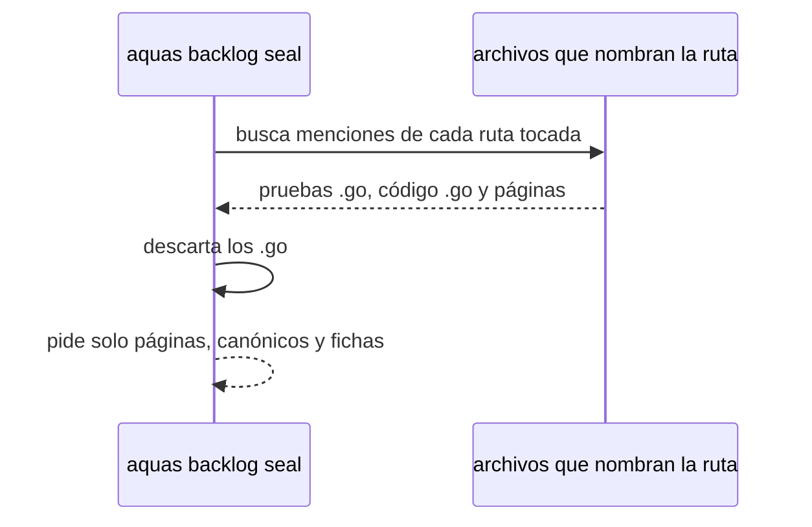

# S004 · Sello solo pide lo que puede cambiar

[Inicio](../../README.md) › [E000](../README.md) › [F013](README.md) › S004

[Slice](../../glosario.md#slice) que recorta la lista del [sello](../../glosario.md#sello) a lo que un humano lee.

## En una frase

El sello deja de pedir confirmación por pruebas y código [Go](../../glosario.md#go) que solo nombran una ruta tocada.

## Para qué existe

**El problema.** El sello de S001 pidió 53 confirmaciones. 51 fueron «sin cambio», casi todas pruebas que nombran una ruta.

**Por qué importa.** Las pruebas y el código ya los vigila `go test`. Confirmarlos a mano no atrapa nada.

**La solución.** El sello omite menciones e importaciones que vienen de archivos `.go`. Sigue pidiendo páginas, [canónicos](../../glosario.md#canónico) y fichas.

**Origen.** Poda del humano del 2026-11-04, recorte 4.

**Contrato.**

| Regla | Valor |
|---|---|
| Mención o importación desde un `.go` | no se pide |
| Página de slice, feature e iniciativa | se pide como hoy |
| Mención desde `docs/**`, canónicos o compilados | se pide como hoy |
| Fichas padre | se piden como hoy |
| Alcance | `internal/backlog/**`, `cmd/aquas/**`, `docs/**` |

**Casos borde.**

| Categoría | Aplica | Prueba o motivo |
|---|---|---|
| cada tipo de ficha | sí | slice y arreglo: `TestSelloSinMenciones` |
| cada estado de origen | no | el sello corre igual en cualquier estado |
| padre e hijo, activo y archivado | sí | las fichas padre siguen en la lista: `TestSelloSinMenciones` |
| entrada ausente, vacía, mal escrita o duplicada | sí | archivo `.go` que nombra y página que nombra la misma ruta: `TestSelloSinMenciones` |
| choque con otro control | no | `go test` sigue cubriendo el código; el sello no lo reemplazaba |
| quién habla: humano, agente o herramienta | no | el sello solo lo corre el agente |
| fallo a mitad de camino | no | la lista se calcula antes de pedir nada |

## Analogía

Piensa en **una lista de revisión antes de entregar**.

- Sobran las casillas que ya revisa una máquina.

Límite de la analogía: la máquina aquí es `go test`.

## Diagrama

## Ejemplo de punta a punta

continúa: [EJ-E000-F013](README.md#EJ-E000-F013)

1. Un slice toca `cmd/aquas/main.go`.
2. Diez pruebas lo nombran; el sello no las pide.
3. `docs/ref/compilador.md` lo nombra; el sello lo pide.

## Paso a paso

1. Rojo de `TestSelloSinMenciones`.
2. Filtro por extensión del archivo que nombra; verde.

## Cómo se usa

- `aquas backlog seal <id>`, como hoy, con una lista más corta.

## Contrato y evidencia

<!-- GENERADO por aquas desde trabajo/: no editar a mano; `aquas compile` lo rehace. -->

| Prueba | Valida | Rojo cuando | Verde cuando | Rojo | Verde |
|---|---|---|---|---|---|
| `TestSelloSinMenciones` | valida que el sello omite menciones desde pruebas y código Go | rojo cuando las pide | verde cuando solo pide páginas y canónicos | — | — |

<!-- /GENERADO -->

## Navegación

- ↑ Subir: [F013](README.md)
