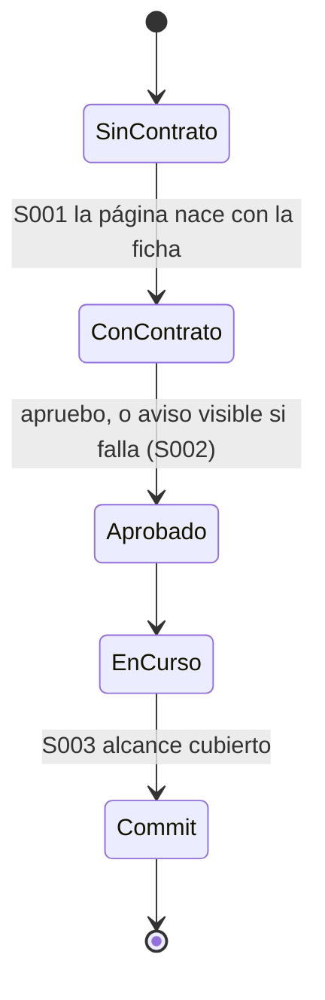
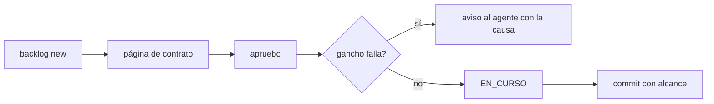

# F014 · Controles sin huecos

[Inicio](../../README.md) › [E000](../README.md) › F014

[Feature](../../glosario.md#feature) que cierra los tres huecos por los que un hijo perdió aprobaciones y trabajó por fuera de aquas.

## En una frase

Ningún [slice](../../glosario.md#slice) sin contrato, ningún gancho mudo y ningún [commit](../../glosario.md#commit) de código fuera de un slice en curso.

## Para qué existe

**El problema.** En el hijo silicon-saint-learning-platform el humano aprobó tres veces y nada quedó guardado. El gancho falló con código 1 y nadie lo vio. El [agente](../../glosario.md#agente) siguió y commiteó código de slices en LISTO.

**Por qué importa.** Un control que falla en silencio enseña al [agente](../../glosario.md#agente) a esquivar el gobierno.

**La solución.** Tres controles deterministas, uno por hueco:

| Slice | Hueco que cierra |
|---|---|
| [S001](S001.md) | slice sin página de contrato |
| [S002](S002.md) | gancho que falla mudo |
| [S003](S003.md) | commit de código sin slice en curso |

**Origen.** Pedido del humano del 2026-11-05; defecto D000125.

## Analogía

Piensa en **una alarma sin pilas**.

- Está instalada, pero no suena cuando hace falta.

Límite de la analogía: aquí la prueba del [gate](../../glosario.md#gate) revisa las pilas de cada alarma.

## Diagrama

## Ejemplo de punta a punta

continúa: [EJ-E000](../README.md#EJ-E000)

1. El agente crea un slice: su página nace con el contrato.
2. El humano aprueba; si algo falla, el agente lo ve con la causa.
3. Un commit con código fuera del slice en curso se rechaza nombrando la ruta.

## Paso a paso

1. Rojo de `TestControlesSinHuecos`.
2. S001, S002 y S003 en ese orden.

## Cómo se usa

- Nada nuevo: los controles corren solos en `backlog new`, en cada gancho y en el [pre-commit](../../glosario.md#pre-commit).

## Contrato y evidencia

**Objetivo.** Los tres huecos del hijo quedan cerrados de punta a punta.

Prueba integral: `TestControlesSinHuecos`.

## Navegación

<!-- GENERADO por aquas desde trabajo/: no editar a mano; `aquas compile` lo rehace. -->

| Hijo | Qué es | Estado |
|---|---|---|
| [S001](S001.md) | backlog new de un slice crea su página de contrato si falta, con la sección Para qué existe. | Hecho |
| [S002](S002.md) | Todo fallo de un gancho llega al agente con su causa; el gate prueba cada gancho. | Hecho |
| [S003](S003.md) | El pre-commit rechaza código que no cubre el alcance de un slice en curso. | Hecho |

<!-- /GENERADO -->

- ↑ Subir: [E000](../README.md)
