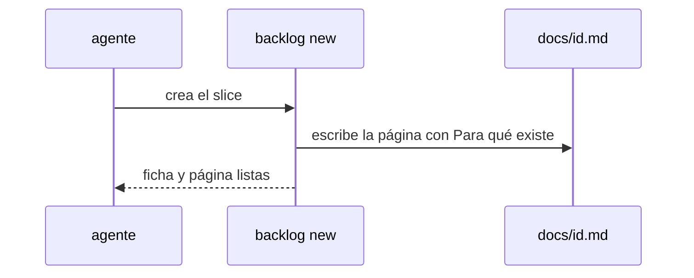

# S001 · Slice nace con contrato

[Inicio](../../README.md) › [E000](../README.md) › [F014](README.md) › S001

[Slice](../../glosario.md#slice) que impide que exista un slice sin su página de contrato.

## En una frase

`aquas backlog new` de un slice crea su página con la sección «Para qué existe» si no existe.

## Para qué existe

**El problema.** El hijo creó slices sin página. La aprobación busca el contrato en la página y falló.

**Por qué importa.** El estado inválido se descubría recién al aprobar, cuando el humano ya había escrito su línea.

**La solución.** La página nace junto con la ficha. Ese estado inválido deja de existir.

**Origen.** D000125, humano 2026-11-05.

**Contrato.**

| Regla | Valor |
|---|---|
| Slice nuevo sin página | `backlog new` crea `docs/<id>.md` con título, «Para qué existe» (motivo y qué hace) y navegación |
| Slice nuevo con página ya escrita | no la toca |
| Apruebo justo después de crear | se registra |
| Alcance | `cmd/aquas/**`, `internal/backlog/**`, `docs/**` |

**Casos borde.**

| Categoría | Aplica | Prueba o motivo |
|---|---|---|
| cada tipo de ficha | sí | slice crea página; feature e iniciativa no cambian: `TestSliceNaceConContrato` |
| cada estado de origen | no | la ficha nace siempre en BORRADOR |
| padre e hijo, activo y archivado | sí | en un hijo instalado también nace: `TestSliceNaceConContrato` |
| entrada ausente, vacía, mal escrita o duplicada | sí | página ya existente no se pisa: `TestSliceNaceConContrato` |
| choque con otro control | sí | el gate wiki acepta la página nacida: `TestSliceNaceConContrato` |
| quién habla: humano, agente o herramienta | no | `backlog new` es una orden; quien la lance da igual |
| fallo a mitad de camino | sí | si no puede escribir la página, la ficha no se crea: `TestSliceNaceConContrato` |

## Analogía

Piensa en **un formulario que se imprime con su casilla de firma**.

- No hay formulario sin casilla.

Límite de la analogía: el contenido del contrato lo escribe el [agente](../../glosario.md#agente) después.

## Diagrama

## Ejemplo de punta a punta

continúa: [EJ-E000-F014](README.md#EJ-E000-F014)

1. El agente corre `aquas backlog new id=E001/F002/S001 …`.
2. Aparece `docs/E001/F002/S001.md` con su contrato inicial.
3. El humano aprueba y la aprobación queda guardada.

## Paso a paso

1. Rojo de `TestSliceNaceConContrato`.
2. `backlog new` escribe la página; verde.

## Cómo se usa

- Nada nuevo: la página aparece sola.

## Contrato y evidencia

<!-- GENERADO por aquas desde trabajo/: no editar a mano; `aquas compile` lo rehace. -->

| Prueba | Valida | Rojo cuando | Verde cuando | Rojo | Verde |
|---|---|---|---|---|---|
| `TestSliceNaceConContrato` | valida que todo slice nuevo tiene su página de contrato | rojo cuando backlog new deja un slice sin página | verde cuando la página existe con Para qué existe y el apruebo se registra | — | — |

<!-- /GENERADO -->

## Navegación

- ↑ Subir: [F014](README.md)
