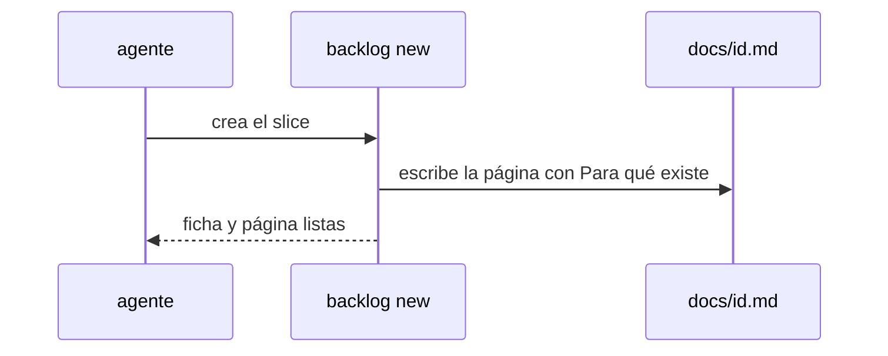

# S001 · Slice nace con contrato

[Inicio](../../README.md) › [E000](../README.md) › [F014](README.md) › S001

[Slice](../../glosario.md#slice) que impide que exista un slice sin su página de contrato.

## En una frase

`aquas backlog new` de un slice crea su página con la sección «Para qué existe» si no existe.

## Para qué existe

**El problema.** El hijo creó slices sin página. La aprobación busca el contrato en la página y falló.

**Por qué importa.** El estado inválido se descubría recién al aprobar, cuando el humano ya había escrito su línea.

**La solución.** La página nace junto con la ficha. Ese estado inválido deja de existir.

**Origen.** D000125, humano 2026-11-05.

**Contrato.**

| Regla | Valor |
|---|---|
| Slice nuevo sin página | `backlog new` crea `docs/<id>.md` con título, «Para qué existe» (motivo y qué hace) y navegación |
| Slice nuevo con página ya escrita | no la toca |
| Contrato o casos borde con filas `PENDIENTE:` | el apruebo del slice, o de su feature, no se registra y nombra la página |
| Contrato completo | el apruebo se registra |
| Alcance | `cmd/aquas/**`, `internal/backlog/**`, `docs/**` |

**Casos borde.**

| Categoría | Aplica | Prueba o motivo |
|---|---|---|
| cada tipo de ficha | sí | slice crea página; feature e iniciativa no cambian: `TestSliceNaceConContrato` |
| cada estado de origen | no | la ficha nace siempre en BORRADOR |
| padre e hijo, activo y archivado | sí | en un hijo instalado también nace: `TestSliceNaceConContrato` |
| entrada ausente, vacía, mal escrita o duplicada | sí | página ya existente no se pisa: `TestSliceNaceConContrato` |
| choque con otro control | sí | tras `aquas compile` el gate wiki acepta la página nacida, y la aprobación rechaza sus filas PENDIENTE: `TestSliceNaceConContrato` |
| quién habla: humano, agente o herramienta | no | `backlog new` es una orden; quien la lance da igual |
| fallo a mitad de camino | sí | si no puede escribir la página, la ficha no se crea; si falla la ficha tras la página, un nuevo `backlog new` reutiliza la página: `TestSliceNaceConContrato` |

## Analogía

Piensa en **un formulario que se imprime con su casilla de firma**.

- No hay formulario sin casilla.

Límite de la analogía: el contenido del contrato lo escribe el [agente](../../glosario.md#agente) después.

## Diagrama

## Ejemplo de punta a punta

continúa: [EJ-E000-F014](README.md#EJ-E000-F014)

1. El agente corre `aquas backlog new id=E001/F002/S001 …`.
2. Aparece `docs/E001/F002/S001.md` con su contrato inicial.
3. El humano aprueba y la aprobación queda guardada.

## Paso a paso

1. Rojo de `TestSliceNaceConContrato`.
2. `backlog new` escribe la página; verde.

## Cómo se usa

- La página aparece sola con `aquas backlog new`.
- Después corre `aquas compile`: agrega el bloque de pruebas y deja la página lista para el [gate](../../glosario.md#gate).
- Las filas «PENDIENTE» del contrato y de los casos borde se completan antes del rojo.

## Contrato y evidencia

<!-- GENERADO por aquas desde trabajo/: no editar a mano; `aquas compile` lo rehace. -->

| Prueba | Valida | Rojo cuando | Verde cuando | Rojo | Verde |
|---|---|---|---|---|---|
| `TestSliceNaceConContrato` | valida que todo slice nuevo tiene su página de contrato | rojo cuando backlog new deja un slice sin página | verde cuando la página existe con Para qué existe y el apruebo se registra | 2026-11-05 | 2026-11-05 |

### Código

| Archivo | Función | Parámetros | Qué hace |
|---|---|---|---|
| [internal/backlog/aprobacion.go](../../../internal/backlog/aprobacion.go) | `seccionContrato` | `(texto string) (string, bool)` | seccionContrato: texto de «## Para qué existe» de la página, sin los bloques GENERADO de aquas. |
| [internal/backlog/aprobacion.go](../../../internal/backlog/aprobacion.go) | `Huella` | `(raiz string, f Ficha) (string, error)` | Huella: SHA-256 de las pruebas, el alcance (con sus ampliaciones) y la sección «Para qué existe» de la página. |
| [internal/backlog/aprobacion.go](../../../internal/backlog/aprobacion.go) | `contratoCompleto` | `(raiz, id string) error` | contratoCompleto (E000/F014/S001, hallazgo A1): la página del slice existe y su «Para qué existe» no trae |
| [internal/backlog/aprobacion.go](../../../internal/backlog/aprobacion.go) | `Aprobar` | `(raiz, id, mensaje, registro string, ahora time.Time) (Ficha, error)` | Aprobar registra la aprobación del contrato de un slice o de una feature (con la foto de sus slices) con la huella |
| [internal/backlog/aprobacion.go](../../../internal/backlog/aprobacion.go) | `aprobada` | `(raiz string, f Ficha) error` | aprobada: nil si el slice puede avanzar (EN_CURSO, rojo, verde, cierre); si no, el paso que falta. |
| [internal/backlog/aprobacion.go](../../../internal/backlog/aprobacion.go) | `abiertos` | `(raiz, feature string) int` | abiertos (E001/F015/X01): slices activos (ni CERRADO ni CANCELADO) de la feature; error de lectura = 0. |
| [internal/backlog/aprobacion.go](../../../internal/backlog/aprobacion.go) | `cubiertaPorFeature` | `(raiz string, p, f Ficha, aprobadas []Prueba) error` | cubiertaPorFeature (E001/F015/S001): el slice avanza si el contrato de su feature no cambió y cada prueba |
| [internal/backlog/aprobacion.go](../../../internal/backlog/aprobacion.go) | `AvisoFeatureAprobada` | `(raiz string, f Ficha) string` | AvisoFeatureAprobada: aviso al crear un slice cuya feature ya está aprobada; "" si no aplica. |
| [internal/backlog/aprobacion.go](../../../internal/backlog/aprobacion.go) | `pideFeature` | `(p Ficha) string` | pideFeature: el apruebo de la feature que hay que pedir, con «con push» si la aprobación anterior lo tenía. |
| [internal/backlog/backlog.go](../../../internal/backlog/backlog.go) | `terminal` | `(estado string) bool` | terminal: el estado ya no cambia (CERRADO o CANCELADO). |
| [internal/backlog/backlog.go](../../../internal/backlog/backlog.go) | `esta` | `(xs []string, x string) bool` | esta: x figura en la lista. |
| [internal/backlog/backlog.go](../../../internal/backlog/backlog.go) | `tipoYPadre` | `(id string) (tipo, padre string)` | tipoYPadre deriva del id: E001 → iniciativa; E001/F002 → feature de E001; E001/F002/S002 → slice. |
| [internal/backlog/backlog.go](../../../internal/backlog/backlog.go) | `nombre` | `(id string) string` | nombre: archivo JSON de una ficha, con «/» del ID cambiadas por «-». |
| [internal/backlog/backlog.go](../../../internal/backlog/backlog.go) | `todas` | `(raiz string) (act, arc map[string]Ficha, err error)` | todas lee activo y archivo. Una ficha ilegible es error: Validar la detalla. |
| [internal/backlog/backlog.go](../../../internal/backlog/backlog.go) | `Todas` | `(raiz string) ([]Ficha, error)` | Todas: las fichas de activo y archivo, ordenadas por id. Para quien solo lee (wiki, E001/F002/S010). |
| [internal/backlog/backlog.go](../../../internal/backlog/backlog.go) | `leer` | `(ruta string) (Ficha, error)` | leer carga una ficha desde su archivo JSON. |
| [internal/backlog/backlog.go](../../../internal/backlog/backlog.go) | `escribir` | `(raiz, dir string, f Ficha) error` | escribir guarda la ficha como JSON en trabajo/<dir>/, con listas vacías en vez de null. |
| [internal/backlog/backlog.go](../../../internal/backlog/backlog.go) | `Nuevo` | `(raiz string, campos []string) (Ficha, error)` | Nuevo crea una ficha desde campos id=… titulo=… que_hace=… prioridad=… motivo=… relacion=… [bloqueado_por=A,B]. |
| [internal/backlog/backlog.go](../../../internal/backlog/backlog.go) | `Ver` | `(raiz, id string) (Ficha, bool, error)` | Ver busca la ficha en activo y luego en archivo. |
| [internal/backlog/backlog.go](../../../internal/backlog/backlog.go) | `activa` | `(raiz, id string) (Ficha, error)` | activa: la ficha a cambiar; una archivada no cambia. |
| [internal/backlog/backlog.go](../../../internal/backlog/backlog.go) | `Prioridad` | `(raiz, id, prioridad, motivo string) (Ficha, error)` | Prioridad cambia la prioridad; el motivo es obligatorio. |
| [internal/backlog/backlog.go](../../../internal/backlog/backlog.go) | `Estado` | `(raiz, id, estado string) (Ficha, error)` | Estado cambia el estado. CERRADO o CANCELADO mueve la ficha al archivo. |
| [internal/backlog/backlog.go](../../../internal/backlog/backlog.go) | `sinHijosActivos` | `(act map[string]Ficha, f Ficha) error` | sinHijosActivos: cerrar o cancelar una feature o iniciativa exige sus hijos directos ya archivados. |
| [internal/backlog/backlog.go](../../../internal/backlog/backlog.go) | `ordenar` | `(fs []Ficha, arc map[string]Ficha)` | orden de `siguiente`: en curso → desbloqueado → prioridad → secuencia → id. |
| [internal/backlog/backlog.go](../../../internal/backlog/backlog.go) | `Activas` | `(raiz string) ([]Ficha, error)` | Activas: slices en el orden de `siguiente`; después iniciativas y features por secuencia. |
| [internal/backlog/backlog.go](../../../internal/backlog/backlog.go) | `Siguiente` | `(raiz string) (Ficha, bool, error)` | Siguiente: el primer slice del orden fijo que esté en curso o desbloqueado. |
| [internal/backlog/backlog.go](../../../internal/backlog/backlog.go) | `sinDefinir` | `(act map[string]Ficha) (Ficha, bool)` | sinDefinir (E001/F002/S008, regla del humano 2026-10-21): iniciativa o feature activa sin hijos |
| [internal/backlog/backlog.go](../../../internal/backlog/backlog.go) | `Definir` | `(raiz string, f Ficha) string` | Definir: qué hacer con lo que `siguiente` saca sin definir; "" para un slice. |
| [internal/backlog/backlog.go](../../../internal/backlog/backlog.go) | `libre` | `(f Ficha, arc map[string]Ficha) bool` | libre: no está BLOQUEADO y cada bloqueador ya terminó (archivado: CERRADO o CANCELADO). |
| [internal/backlog/backlog.go](../../../internal/backlog/backlog.go) | `Validar` | `(raiz string) []string` | Validar: problemas de las fichas en disco (gate). Sin carpeta trabajo/ no hay problemas. |
| [internal/backlog/backlog.go](../../../internal/backlog/backlog.go) | `Texto` | `(f Ficha) string` | Texto: una línea por ficha, para el agente. |
| [internal/backlog/pagina_nace.go](../../../internal/backlog/pagina_nace.go) | `paginaNace` | `(raiz string, f Ficha) error` | paginaNace escribe docs/<E>/<F>/<S>.md de un slice nuevo si no existe; feature e iniciativa no cambian. |
| [internal/backlog/pagina_nace.go](../../../internal/backlog/pagina_nace.go) | `paginaInicial` | `(f Ficha) string` | paginaInicial: esqueleto que pasa el gate wiki; el agente completa el contrato y los casos borde antes del rojo. |

<!-- /GENERADO -->

## Navegación

- ↑ Subir: [F014](README.md)
