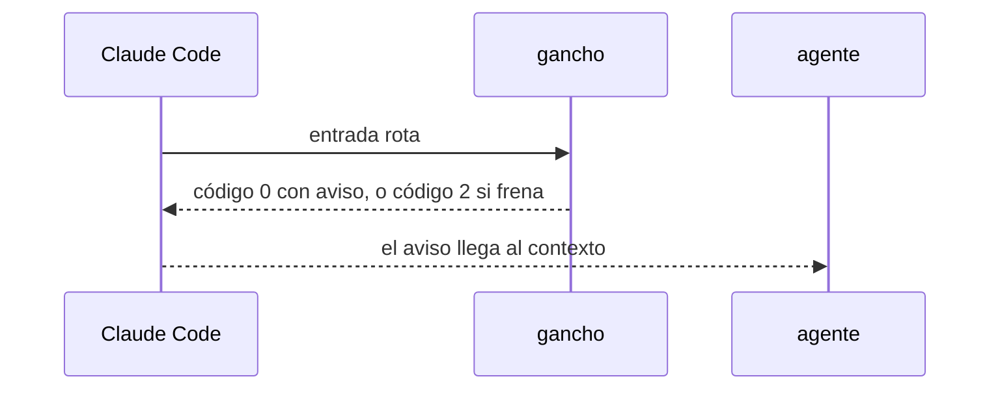

# S002 · Ganchos nunca mudos

[Inicio](../../README.md) › [E000](../README.md) › [F014](README.md) › S002

[Slice](../../glosario.md#slice) que obliga a cada gancho a mostrar su fallo.

## En una frase

Si un gancho falla, el [agente](../../glosario.md#agente) lo ve con su causa; el [gate](../../glosario.md#gate) lo comprueba gancho por gancho.

## Para qué existe

**El problema.** El gancho de aprobación salió con código 1. Claude Code trata ese código como error no bloqueante y no lo muestra.

**Por qué importa.** El humano y el agente creyeron la aprobación dada. El agente inventó causas falsas durante tres turnos.

**La solución.** Un fallo de gancho que no frena sale con código 0 y el aviso en el contexto del agente. Una prueba recorre todos los ganchos de `gobierno/config/claude_settings.json` con entrada rota.

**Origen.** D000125, humano 2026-11-05.

Fuente: la [referencia de hooks](https://code.claude.com/docs/en/hooks) de Claude Code, consultada el 2026-11-04. Código 0 con `additionalContext` suma texto al contexto; código 2 frena; otro código solo se ve en modo detallado.

**Contrato.**

| Regla | Valor |
|---|---|
| Aprobación que no se puede guardar | código 0 y aviso al agente: «aprobación NO registrada: causa» |
| Cualquier gancho con entrada rota | código 0 con aviso, o código 2 si ese gancho frena; nunca código 1 |
| Gancho nuevo en la configuración | entra solo a la prueba |
| Alcance | `cmd/aquas/**`, `docs/**` |

**Casos borde.**

| Categoría | Aplica | Prueba o motivo |
|---|---|---|
| cada tipo de ficha | sí | aprobación de slice y de feature que fallan avisan: `TestGanchosNuncaMudos` |
| cada estado de origen | no | el aviso no depende del estado de la ficha |
| padre e hijo, activo y archivado | sí | los ganchos que viajan al hijo son los mismos: `TestGanchosNuncaMudos` |
| entrada ausente, vacía, mal escrita o duplicada | sí | JSON roto y entrada vacía en cada gancho: `TestGanchosNuncaMudos` |
| choque con otro control | sí | los frenos que hoy salen con 2 siguen frenando: `TestGanchosNuncaMudos` |
| quién habla: humano, agente o herramienta | no | el gancho lo lanza Claude Code |
| fallo a mitad de camino | sí | ficha ilegible al aprobar: avisa: `TestGanchosNuncaMudos` |

## Analogía

Piensa en **una alarma con prueba de pilas**.

- Cada alarma se dispara a propósito y tiene que sonar.

Límite de la analogía: aquí la prueba corre en cada gate.

## Diagrama

## Ejemplo de punta a punta

continúa: [EJ-E000-F014](README.md#EJ-E000-F014)

1. El humano escribe «apruebo E001/F002/S001» y falta algo.
2. El agente recibe «aprobación NO registrada: falta la página…».
3. El agente lo arregla y pide la línea otra vez.

## Paso a paso

1. Rojo de `TestGanchosNuncaMudos`.
2. Cada salida con código 1 pasa a aviso o a freno; verde.

## Cómo se usa

- Nada nuevo: el aviso llega solo.

## Contrato y evidencia

<!-- GENERADO por aquas desde trabajo/: no editar a mano; `aquas compile` lo rehace. -->

| Prueba | Valida | Rojo cuando | Verde cuando | Rojo | Verde |
|---|---|---|---|---|---|
| `TestGanchosNuncaMudos` | valida que ningún gancho falla en silencio | rojo cuando un gancho sale con exit 1 y solo stderr | verde cuando cada gancho con entrada rota avisa al agente o frena con exit 2 | — | — |

<!-- /GENERADO -->

## Navegación

- ↑ Subir: [F014](README.md)
