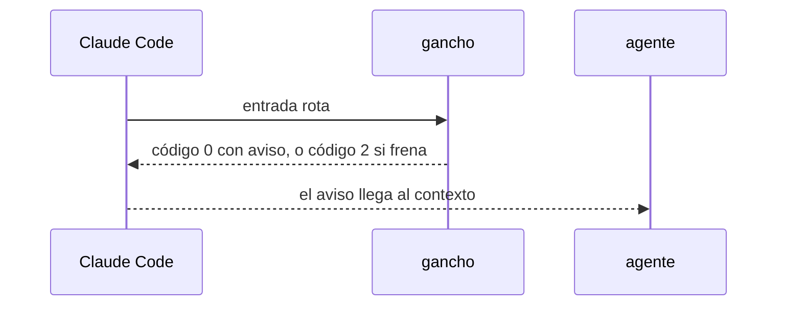

# S002 · Ganchos nunca mudos

[Inicio](../../README.md) › [E000](../README.md) › [F014](README.md) › S002

[Slice](../../glosario.md#slice) que obliga a cada gancho a mostrar su fallo.

## En una frase

Si un gancho falla, el [agente](../../glosario.md#agente) lo ve con su causa; el [gate](../../glosario.md#gate) lo comprueba gancho por gancho.

## Para qué existe

**El problema.** El gancho de aprobación salió con código 1. Claude Code trata ese código como error no bloqueante y no lo muestra.

**Por qué importa.** El humano y el agente creyeron la aprobación dada. El agente inventó causas falsas durante tres turnos.

**La solución.** Un fallo de gancho que no frena sale con código 0 y el aviso en el contexto del agente. Una prueba recorre todos los ganchos de `gobierno/config/claude_settings.json` con entrada rota.

**Origen.** D000125, humano 2026-11-05.

Fuente: la [referencia de hooks](https://code.claude.com/docs/en/hooks) de Claude Code, consultada el 2026-11-04. Código 0 con `additionalContext` suma texto al contexto; código 2 frena; otro código solo se ve en modo detallado.

**Contrato.**

| Regla | Valor |
|---|---|
| Aprobación que no se puede guardar | código 0 y aviso al agente: «aprobación NO registrada: causa» |
| Cualquier gancho con entrada rota | código 0 con aviso, o código 2 si ese gancho frena; nunca código 1 |
| Gancho que sale con código 0 y escribe en stderr | ese texto viaja como `systemMessage`, porque Claude Code no muestra el stderr de un código 0 |
| Guardia que falla | código 2 con la causa: falla cerrada |
| Quién ve el aviso | el humano siempre (`systemMessage`); el agente también en UserPromptSubmit, SessionStart, PreToolUse y PostToolUse (`additionalContext`); en Stop y SubagentStop, solo el humano |
| Ficha ilegible al aprobar | avisa con la causa; antes se ignoraba en silencio |
| Cómo | aquas, lanzado como gancho, se corre a sí mismo como proceso hijo y traduce su salida |
| Gancho nuevo en la configuración | entra solo a la prueba |
| Alcance | `cmd/aquas/**`, `docs/**` |

**Casos borde.**

| Categoría | Aplica | Prueba o motivo |
|---|---|---|
| cada tipo de ficha | sí | aprobación de slice y de feature que fallan avisan: `TestGanchosNuncaMudos` |
| cada estado de origen | no | el aviso no depende del estado de la ficha |
| padre e hijo, activo y archivado | sí | los ganchos que viajan al hijo son los mismos: `TestGanchosNuncaMudos` |
| entrada ausente, vacía, mal escrita o duplicada | sí | JSON roto y entrada vacía en cada gancho: `TestGanchosNuncaMudos` |
| choque con otro control | sí | los frenos que hoy salen con 2 siguen frenando: `TestGanchosNuncaMudos` |
| quién habla: humano, agente o herramienta | no | el gancho lo lanza Claude Code |
| fallo a mitad de camino | sí | ficha ilegible al aprobar: avisa: `TestGanchosNuncaMudos` |

## Analogía

Piensa en **una alarma con prueba de pilas**.

- Cada alarma se dispara a propósito y tiene que sonar.

Límite de la analogía: aquí la prueba corre en cada gate.

## Diagrama

## Ejemplo de punta a punta

continúa: [EJ-E000-F014](README.md#EJ-E000-F014)

1. El humano escribe «apruebo E001/F002/S001» y falta algo.
2. El agente recibe «aprobación NO registrada: falta la página…».
3. El agente lo arregla y pide la línea otra vez.

## Paso a paso

1. Rojo de `TestGanchosNuncaMudos`.
2. Cada salida con código 1 pasa a aviso o a freno; verde.

## Cómo se usa

- Nada nuevo: el aviso llega solo.

## Contrato y evidencia

<!-- GENERADO por aquas desde trabajo/: no editar a mano; `aquas compile` lo rehace. -->

| Prueba | Valida | Rojo cuando | Verde cuando | Rojo | Verde |
|---|---|---|---|---|---|
| `TestGanchosNuncaMudos` | valida que ningún gancho falla en silencio | rojo cuando un gancho sale con exit 1 y solo stderr | verde cuando cada gancho con entrada rota avisa al agente o frena con exit 2 | 2026-11-05 | 2026-11-05 |

### Código

| Archivo | Función | Parámetros | Qué hace |
|---|---|---|---|
| [cmd/aquas/aprobacion.go](../../../cmd/aquas/aprobacion.go) | `aprobacionCLI` | `(raiz string)` | aprobacionCLI: solo un evento UserPromptSubmit cuenta como mensaje del humano. PreToolUse, PostToolUse, |
| [cmd/aquas/gancho_mudo.go](../../../cmd/aquas/gancho_mudo.go) | `claveGancho` | `(args []string) string` | claveGancho: la orden de gancho que nombran los argumentos internos, o "". |
| [cmd/aquas/gancho_mudo.go](../../../cmd/aquas/gancho_mudo.go) | `eventoGancho` | `(args []string) (string, bool)` | eventoGancho: evento de Claude Code de la orden; false si no es un gancho. |
| [cmd/aquas/gancho_mudo.go](../../../cmd/aquas/gancho_mudo.go) | `nuncaMudo` | `(args, originales []string)` | nuncaMudo: si args es una orden de gancho, la corre como proceso hijo, traduce su salida y termina el proceso. |
| [cmd/aquas/gancho_mudo.go](../../../cmd/aquas/gancho_mudo.go) | `conAviso` | `(clave string, out []byte, stderr string) []byte` | conAviso: con exit 0 el stderr no lo ve nadie; si trae algo, viaja como systemMessage junto a la salida del hijo. |
| [cmd/aquas/gancho_mudo.go](../../../cmd/aquas/gancho_mudo.go) | `causa` | `(stderr string, codigo int) string` | causa: líneas de stderr del hijo sin el prefijo «aquas:» ni el aviso de nombre viejo. |
| [cmd/aquas/gancho_mudo.go](../../../cmd/aquas/gancho_mudo.go) | `avisarGancho` | `(clave string, err error)` | avisarGancho: el fallo llega a quien corresponde y el proceso termina con 0 (aviso) o 2 (freno). |
| [cmd/aquas/gancho_mudo.go](../../../cmd/aquas/gancho_mudo.go) | `fallaGancho` | `(clave string, err error) (int, string, string)` | fallaGancho: código, stdout y stderr del fallo de un gancho; 2 con la causa si frena, 0 con aviso si no. |
| [cmd/aquas/main.go](../../../cmd/aquas/main.go) | `main` | `()` | main despacha el subcomando de aquas (compilar, verificar, backlog, hooks…) y sale con su código. |
| [cmd/aquas/main.go](../../../cmd/aquas/main.go) | `contextoParaClaude` | `(texto string)` | contextoParaClaude (E000/F013/S002): aviso que el gancho PostToolUse entrega a Claude sin frenar (additionalContext, salida 0). |
| [cmd/aquas/main.go](../../../cmd/aquas/main.go) | `hook` | `(raiz string)` | hook: exit 0 = nada que reportar o aviso en additionalContext; exit 2 = stderr se muestra a Claude como freno. |
| [cmd/aquas/main.go](../../../cmd/aquas/main.go) | `compilarSettings` | `(w io.Writer)` | compilarSettings regenera .claude/settings.json; sin entorno declarado no inventa uno. |
| [cmd/aquas/main.go](../../../cmd/aquas/main.go) | `reportar` | `(w io.Writer, inf compilador.Informe)` | reportar imprime qué derivados escribió la compilación, o que todo estaba al día. |
| [cmd/aquas/main.go](../../../cmd/aquas/main.go) | `listar` | `(titulo string, problemas []string)` | listar imprime en stderr un título y cada problema en su viñeta. |
| [cmd/aquas/main.go](../../../cmd/aquas/main.go) | `lista` | `(xs []string) string` | lista une los textos con comas, o «—» si no hay ninguno. |
| [cmd/aquas/main.go](../../../cmd/aquas/main.go) | `fallar` | `(codigo int, err error)` | fallar imprime el error en stderr y termina con el código dado. |
| [cmd/aquas/main.go](../../../cmd/aquas/main.go) | `avisarWiki` | `(avisos []string)` | avisarWiki (E000/F013/S001): imprime los avisos de estilo de la wiki; no cambian el resultado del gate. |
| [cmd/aquas/main.go](../../../cmd/aquas/main.go) | `revisarAislamiento` | `() (fallo, aviso string)` | revisarAislamiento: fallo para el gate y aviso para el arranque (E000/F008/S003, D000079). |
| [cmd/aquas/main.go](../../../cmd/aquas/main.go) | `memoriaCLI` | `(raiz string, args []string)` | memoriaCLI: `ver` imprime la memoria; `fijar campo=valor…` la actualiza y la sella. |
| [cmd/aquas/main.go](../../../cmd/aquas/main.go) | `memoriaArchivada` | `(raiz, id string) error` | memoriaArchivada: CERRADO exige el archivo de memoria del slice, apunte o no la memoria a él (E001/F002/S009, X01). |
| [cmd/aquas/main.go](../../../cmd/aquas/main.go) | `focoEnBacklog` | `(raiz string, f memoria.Foco) error` | focoEnBacklog: la memoria solo fija el slice que el backlog tiene en curso (S003). |
| [cmd/aquas/main.go](../../../cmd/aquas/main.go) | `backlogCLI` | `(raiz string, args []string)` | backlogCLI: nuevo \\| ver [id] \\| tabla \\| prioridad \\| estado \\| siguiente \\| pruebas \\| rojo \\| verde. |
| [cmd/aquas/main.go](../../../cmd/aquas/main.go) | `gateDefectos` | `(raiz string) (frena []string, aviso string)` | gateDefectos (E001/F017/S005): lo que el gate dice del registro de defectos. Prueba nombrada que ya no existe |
| [cmd/aquas/main.go](../../../cmd/aquas/main.go) | `turnoCLI` | `(raiz string, args []string)` | turnoCLI: auditoría de turnos (E001/F002/S001). Lee el JSON del hook por stdin. No imprime nada |
| [cmd/aquas/main.go](../../../cmd/aquas/main.go) | `retroCLI` | `(raiz string, args []string) (backlog.Retro, error)` | retroCLI (E001/F018/S002): cerrar fichas=A,B motivo=…; cada clave una vez. |
| [cmd/aquas/main.go](../../../cmd/aquas/main.go) | `defectoCLI` | `(raiz string, args []string) error` | defectoCLI: nuevo \\| ocurre \\| arreglar \\| ver (E001/F004/S001; arreglar: E000/F007/S003). |
| [cmd/aquas/main.go](../../../cmd/aquas/main.go) | `versionBinario` | `() string` | versionBinario: versión del módulo con que se compiló el binario (= versión del gobierno embebido). |
| [cmd/aquas/main.go](../../../cmd/aquas/main.go) | `versionControl` | `() string` | versionControl (E003/F006/S002, hallazgo A2.1): versión con la que deciden los controles del hijo. |
| [cmd/aquas/main.go](../../../cmd/aquas/main.go) | `registrarCierre` | `(raiz, tipo, transcript, primera, resultado string)` | registrarCierre (E001/F004/S005, D000068) anota cada llamada del gancho cierre-agente en .tmp/hooks/cierre-agente.jsonl. |
| [cmd/aquas/main.go](../../../cmd/aquas/main.go) | `esUpdate` | `(datos []byte) bool` | esUpdate (E003/F006/S001): la entrada de la guardia es una orden Bash que es exactamente `aquas update` (PowerShell lo frena la guardia siempre). |
| [cmd/aquas/main.go](../../../cmd/aquas/main.go) | `entornoHijo` | `(raiz string)` | entornoHijo (E003/F001/S003) declara el entorno del hijo, como aquas init en la central: |

<!-- /GENERADO -->

## Navegación

- ↑ Subir: [F014](README.md)
