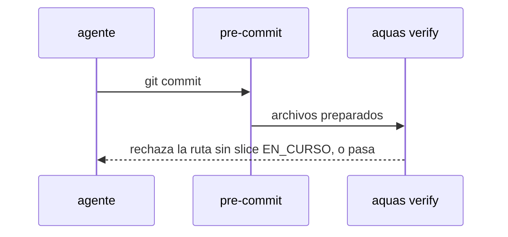

# S003 · Commit exige slice en curso

[Inicio](../../README.md) › [E000](../README.md) › [F014](README.md) › S003

[Slice](../../glosario.md#slice) que impide commitear código fuera de un slice en curso.

## En una frase

El [pre-commit](../../glosario.md#pre-commit) rechaza archivos de código que no cubre el alcance de un slice EN_CURSO.

## Para qué existe

**El problema.** La guardia solo mira el alcance cuando hay un slice EN_CURSO. Con el slice en LISTO, el [agente](../../glosario.md#agente) del hijo escribió código y lo commiteó.

**Por qué importa.** El trabajo quedó por fuera del gobierno: sin rojo, sin verde y sin auditor registrados.

**La solución.** El pre-commit (`aquas verify` con archivos preparados) exige que cada archivo de código preparado esté en el alcance de un slice EN_CURSO.

**Origen.** Humano 2026-11-05; informe del hijo, [commit](../../glosario.md#commit) 5c8bcbe.

**Contrato.**

| Regla | Valor |
|---|---|
| Archivo de código preparado sin slice EN_CURSO que lo cubra | rechaza el commit nombrando la ruta |
| Archivo dentro del alcance de un slice EN_CURSO | pasa |
| Archivos de gobierno (`docs/`, `trabajo/`, `registro/`, `.aquas/`, `.claude/`, `gobierno/`, `CLAUDE.md`, `.githooks/`) | no se exigen |
| Sin archivos preparados (gate a mano) | no cambia nada |
| Slice que se cierra en este mismo commit, o recibe un arreglo (`backlog fix`): su ficha entra o cambia en `trabajo/archivo/`, CERRADO y con auditoría APROBADO | su alcance también cubre: así el cierre y el arreglo no se frenan; una ficha CERRADO sin auditoría APROBADO no abre el paso; un arreglo nuevo abre el paso solo con su rojo y su verde registrados |
| Ficha que estaba en el último commit y no se puede leer | no cubre: falla cerrado |
| Conocido, fuera de este slice | un arreglo no pide apruebo del humano; queda como propuesta aparte |
| `README.md` raíz | no se exige: es la portada que pide el gate de portadas |
| Archivos borrados | también se revisan |
| Conocido, aceptado por este contrato | `.githooks/`, `.claude/` y `gobierno/config/` cuentan como código en `codigo.go` y aquí quedan exentos |
| Git que no se puede leer | el gate lo dice y frena |
| Dónde corre | al principio de `aquas verify`, en la central y en el hijo, antes de que otro chequeo corte |
| Fuera de alcance | `git commit --no-verify` o cambiar `core.hooksPath` se saltan el pre-commit; queda como propuesta aparte |
| Alcance | `cmd/aquas/**`, `internal/**`, `docs/**` |

**Casos borde.**

| Categoría | Aplica | Prueba o motivo |
|---|---|---|
| cada tipo de ficha | sí | el alcance que cuenta es el del slice; feature e iniciativa no tienen: `TestCommitExigeSliceEnCurso` |
| cada estado de origen | sí | slice en LISTO o CERRADO no cubre: `TestCommitExigeSliceEnCurso` |
| padre e hijo, activo y archivado | sí | el hijo corre el mismo `aquas verify` en su pre-commit: `TestCommitExigeSliceEnCurso` |
| entrada ausente, vacía, mal escrita o duplicada | sí | sin archivos preparados no cambia nada: `TestCommitExigeSliceEnCurso` |
| choque con otro control | sí | los archivos de gobierno siguen sin exigir slice: `TestCommitExigeSliceEnCurso` |
| quién habla: humano, agente o herramienta | no | el pre-commit corre igual para cualquiera |
| fallo a mitad de camino | sí | sin git legible, el gate lo dice y frena: `TestCommitExigeSliceEnCurso` |

## Analogía

Piensa en **una obra con permiso**.

- No se levanta una pared sin el permiso de esa pared.

Límite de la analogía: los planos (docs y [backlog](../../glosario.md#backlog)) no piden permiso.

## Diagrama

## Ejemplo de punta a punta

continúa: [EJ-E000-F014](README.md#EJ-E000-F014)

1. El agente prepara `src/verificador/validez.ts` con su slice en LISTO.
2. El commit se rechaza: «src/verificador/validez.ts: ningún slice EN_CURSO lo cubre».
3. Con el slice aprobado y en curso, el commit pasa.

## Paso a paso

1. Rojo de `TestCommitExigeSliceEnCurso`.
2. `aquas verify` revisa los archivos preparados; verde.

## Cómo se usa

- Nada nuevo: corre en cada commit.

## Contrato y evidencia

<!-- GENERADO por aquas desde trabajo/: no editar a mano; `aquas compile` lo rehace. -->

| Prueba | Valida | Rojo cuando | Verde cuando | Rojo | Verde |
|---|---|---|---|---|---|
| `TestCommitExigeSliceEnCurso` | valida que no se commitea código fuera de un slice en curso | rojo cuando un commit con código pasa sin slice EN_CURSO que lo cubra | verde cuando se rechaza nombrando la ruta y pasa con el alcance declarado | 2026-11-05 | 2026-11-05 |

### Código

| Archivo | Función | Parámetros | Qué hace |
|---|---|---|---|
| [cmd/aquas/main.go](../../../cmd/aquas/main.go) | `main` | `()` | main despacha el subcomando de aquas (compilar, verificar, backlog, hooks…) y sale con su código. |
| [cmd/aquas/main.go](../../../cmd/aquas/main.go) | `contextoParaClaude` | `(texto string)` | contextoParaClaude (E000/F013/S002): aviso que el gancho PostToolUse entrega a Claude sin frenar (additionalContext, salida 0). |
| [cmd/aquas/main.go](../../../cmd/aquas/main.go) | `hook` | `(raiz string)` | hook: exit 0 = nada que reportar o aviso en additionalContext; exit 2 = stderr se muestra a Claude como freno. |
| [cmd/aquas/main.go](../../../cmd/aquas/main.go) | `compilarSettings` | `(w io.Writer)` | compilarSettings regenera .claude/settings.json; sin entorno declarado no inventa uno. |
| [cmd/aquas/main.go](../../../cmd/aquas/main.go) | `reportar` | `(w io.Writer, inf compilador.Informe)` | reportar imprime qué derivados escribió la compilación, o que todo estaba al día. |
| [cmd/aquas/main.go](../../../cmd/aquas/main.go) | `listar` | `(titulo string, problemas []string)` | listar imprime en stderr un título y cada problema en su viñeta. |
| [cmd/aquas/main.go](../../../cmd/aquas/main.go) | `lista` | `(xs []string) string` | lista une los textos con comas, o «—» si no hay ninguno. |
| [cmd/aquas/main.go](../../../cmd/aquas/main.go) | `fallar` | `(codigo int, err error)` | fallar imprime el error en stderr y termina con el código dado. |
| [cmd/aquas/main.go](../../../cmd/aquas/main.go) | `avisarWiki` | `(avisos []string)` | avisarWiki (E000/F013/S001): imprime los avisos de estilo de la wiki; no cambian el resultado del gate. |
| [cmd/aquas/main.go](../../../cmd/aquas/main.go) | `revisarAislamiento` | `() (fallo, aviso string)` | revisarAislamiento: fallo para el gate y aviso para el arranque (E000/F008/S003, D000079). |
| [cmd/aquas/main.go](../../../cmd/aquas/main.go) | `memoriaCLI` | `(raiz string, args []string)` | memoriaCLI: `ver` imprime la memoria; `fijar campo=valor…` la actualiza y la sella. |
| [cmd/aquas/main.go](../../../cmd/aquas/main.go) | `memoriaArchivada` | `(raiz, id string) error` | memoriaArchivada: CERRADO exige el archivo de memoria del slice, apunte o no la memoria a él (E001/F002/S009, X01). |
| [cmd/aquas/main.go](../../../cmd/aquas/main.go) | `focoEnBacklog` | `(raiz string, f memoria.Foco) error` | focoEnBacklog: la memoria solo fija el slice que el backlog tiene en curso (S003). |
| [cmd/aquas/main.go](../../../cmd/aquas/main.go) | `backlogCLI` | `(raiz string, args []string)` | backlogCLI: nuevo \\| ver [id] \\| tabla \\| prioridad \\| estado \\| siguiente \\| pruebas \\| rojo \\| verde. |
| [cmd/aquas/main.go](../../../cmd/aquas/main.go) | `gateDefectos` | `(raiz string) (frena []string, aviso string)` | gateDefectos (E001/F017/S005): lo que el gate dice del registro de defectos. Prueba nombrada que ya no existe |
| [cmd/aquas/main.go](../../../cmd/aquas/main.go) | `turnoCLI` | `(raiz string, args []string)` | turnoCLI: auditoría de turnos (E001/F002/S001). Lee el JSON del hook por stdin. No imprime nada |
| [cmd/aquas/main.go](../../../cmd/aquas/main.go) | `retroCLI` | `(raiz string, args []string) (backlog.Retro, error)` | retroCLI (E001/F018/S002): cerrar fichas=A,B motivo=…; cada clave una vez. |
| [cmd/aquas/main.go](../../../cmd/aquas/main.go) | `defectoCLI` | `(raiz string, args []string) error` | defectoCLI: nuevo \\| ocurre \\| arreglar \\| ver (E001/F004/S001; arreglar: E000/F007/S003). |
| [cmd/aquas/main.go](../../../cmd/aquas/main.go) | `versionBinario` | `() string` | versionBinario: versión del módulo con que se compiló el binario (= versión del gobierno embebido). |
| [cmd/aquas/main.go](../../../cmd/aquas/main.go) | `versionControl` | `() string` | versionControl (E003/F006/S002, hallazgo A2.1): versión con la que deciden los controles del hijo. |
| [cmd/aquas/main.go](../../../cmd/aquas/main.go) | `registrarCierre` | `(raiz, tipo, transcript, primera, resultado string)` | registrarCierre (E001/F004/S005, D000068) anota cada llamada del gancho cierre-agente en .tmp/hooks/cierre-agente.jsonl. |
| [cmd/aquas/main.go](../../../cmd/aquas/main.go) | `esUpdate` | `(datos []byte) bool` | esUpdate (E003/F006/S001): la entrada de la guardia es una orden Bash que es exactamente `aquas update` (PowerShell lo frena la guardia siempre). |
| [cmd/aquas/main.go](../../../cmd/aquas/main.go) | `entornoHijo` | `(raiz string)` | entornoHijo (E003/F001/S003) declara el entorno del hijo, como aquas init en la central: |
| [internal/backlog/commit_alcance.go](../../../internal/backlog/commit_alcance.go) | `esGobierno` | `(raiz, rel string) bool` | esGobierno: rel es de gobierno (o CLAUDE.md, o un derivado que escribe aquas). |
| [internal/backlog/commit_alcance.go](../../../internal/backlog/commit_alcance.go) | `enHEAD` | `(raiz, rel string) (Ficha, bool, error)` | enHEAD: la ficha tal como está en el último commit; false si no estaba (entra nueva en este commit). |
| [internal/backlog/commit_alcance.go](../../../internal/backlog/commit_alcance.go) | `arregloProbado` | `(f Ficha, previos int) bool` | arregloProbado: el último arreglo nuevo tiene rojo y verde propios (A3.1): un `backlog fix` sin prueba no abre el paso. |
| [internal/backlog/commit_alcance.go](../../../internal/backlog/commit_alcance.go) | `CommitSinSlice` | `(raiz string) []string` | CommitSinSlice: problemas de los archivos preparados para commit; nada sin repo git o sin archivos preparados. |

<!-- /GENERADO -->

## Navegación

- ↑ Subir: [F014](README.md)
