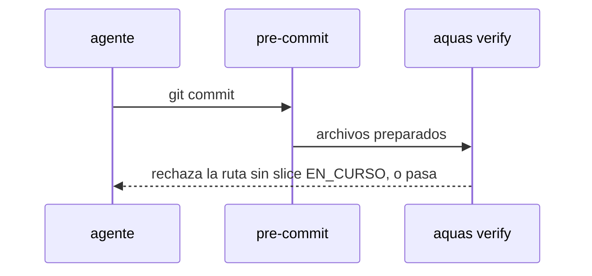

# S003 · Commit exige slice en curso

[Inicio](../../README.md) › [E000](../README.md) › [F014](README.md) › S003

[Slice](../../glosario.md#slice) que impide commitear código fuera de un slice en curso.

## En una frase

El [pre-commit](../../glosario.md#pre-commit) rechaza archivos de código que no cubre el alcance de un slice EN_CURSO.

## Para qué existe

**El problema.** La guardia solo mira el alcance cuando hay un slice EN_CURSO. Con el slice en LISTO, el [agente](../../glosario.md#agente) del hijo escribió código y lo commiteó.

**Por qué importa.** El trabajo quedó por fuera del gobierno: sin rojo, sin verde y sin auditor registrados.

**La solución.** El pre-commit (`aquas verify` con archivos preparados) exige que cada archivo de código preparado esté en el alcance de un slice EN_CURSO.

**Origen.** Humano 2026-11-05; informe del hijo, [commit](../../glosario.md#commit) 5c8bcbe.

**Contrato.**

| Regla | Valor |
|---|---|
| Archivo de código preparado sin slice EN_CURSO que lo cubra | rechaza el commit nombrando la ruta |
| Archivo dentro del alcance de un slice EN_CURSO | pasa |
| Archivos de gobierno (`docs/`, `trabajo/`, `registro/`, `.aquas/`, `.claude/`, `gobierno/`, `CLAUDE.md`, `.githooks/`) | no se exigen |
| Sin archivos preparados (gate a mano) | no cambia nada |
| Alcance | `cmd/aquas/**`, `internal/**`, `docs/**` |

**Casos borde.**

| Categoría | Aplica | Prueba o motivo |
|---|---|---|
| cada tipo de ficha | sí | el alcance que cuenta es el del slice; feature e iniciativa no tienen: `TestCommitExigeSliceEnCurso` |
| cada estado de origen | sí | slice en LISTO o CERRADO no cubre: `TestCommitExigeSliceEnCurso` |
| padre e hijo, activo y archivado | sí | el hijo corre el mismo `aquas verify` en su pre-commit: `TestCommitExigeSliceEnCurso` |
| entrada ausente, vacía, mal escrita o duplicada | sí | sin archivos preparados no cambia nada: `TestCommitExigeSliceEnCurso` |
| choque con otro control | sí | los archivos de gobierno siguen sin exigir slice: `TestCommitExigeSliceEnCurso` |
| quién habla: humano, agente o herramienta | no | el pre-commit corre igual para cualquiera |
| fallo a mitad de camino | sí | sin git legible, el gate lo dice y frena: `TestCommitExigeSliceEnCurso` |

## Analogía

Piensa en **una obra con permiso**.

- No se levanta una pared sin el permiso de esa pared.

Límite de la analogía: los planos (docs y [backlog](../../glosario.md#backlog)) no piden permiso.

## Diagrama

## Ejemplo de punta a punta

continúa: [EJ-E000-F014](README.md#EJ-E000-F014)

1. El agente prepara `src/verificador/validez.ts` con su slice en LISTO.
2. El commit se rechaza: «src/verificador/validez.ts: ningún slice EN_CURSO lo cubre».
3. Con el slice aprobado y en curso, el commit pasa.

## Paso a paso

1. Rojo de `TestCommitExigeSliceEnCurso`.
2. `aquas verify` revisa los archivos preparados; verde.

## Cómo se usa

- Nada nuevo: corre en cada commit.

## Contrato y evidencia

<!-- GENERADO por aquas desde trabajo/: no editar a mano; `aquas compile` lo rehace. -->

| Prueba | Valida | Rojo cuando | Verde cuando | Rojo | Verde |
|---|---|---|---|---|---|
| `TestCommitExigeSliceEnCurso` | valida que no se commitea código fuera de un slice en curso | rojo cuando un commit con código pasa sin slice EN_CURSO que lo cubra | verde cuando se rechaza nombrando la ruta y pasa con el alcance declarado | — | — |

<!-- /GENERADO -->

## Navegación

- ↑ Subir: [F014](README.md)
