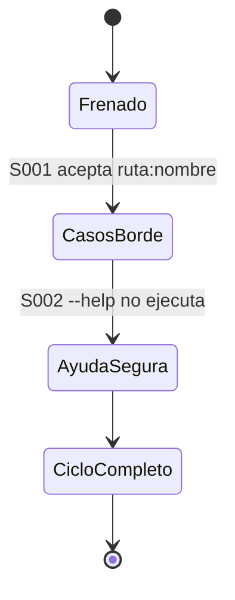
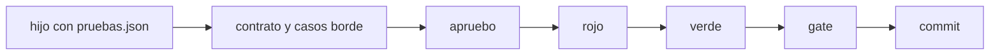

# F015 · Hijos sin Go

[Inicio](../../README.md) › [E000](../README.md) › F015

[Feature](../../glosario.md#feature) que quita los supuestos de [Go](../../glosario.md#go) que frenan a un hijo con otro stack.

## En una frase

Un hijo TypeScript, Python o sin código recorre el ciclo completo de aquas igual que uno en Go.

## Para qué existe

**El problema.** El hijo silicon-saint-learning-platform (TypeScript) no puede commitear: el [gate](../../glosario.md#gate) de casos borde solo acepta nombres `Test…` de Go (D000127). Además, `--help` ejecuta la orden en vez de mostrar la ayuda.

**Por qué importa.** El gobierno frena trabajo legítimo. El [agente](../../glosario.md#agente) del hijo aprende a esquivar controles.

**La solución.** Dos arreglos y una prueba integral en un hijo sin Go:

| Slice | Qué arregla |
|---|---|
| [S001](S001.md) | casos borde y contrato aceptan pruebas `ruta:nombre` de la ficha |
| [S002](S002.md) | `--help` y `-h` muestran el uso sin ejecutar |

**Origen.** Pedido del humano del 2026-11-05; defecto D000127.

## Analogía

Piensa en **una aduana que solo lee pasaportes de un país**.

- El viajero trae papeles válidos, pero el lector no los reconoce.

Límite de la analogía: aquí los papeles son los nombres de prueba que la ficha ya registró.

## Diagrama

## Ejemplo de punta a punta

continúa: [EJ-E000](../README.md#EJ-E000)

1. El hijo declara `src/verificador/validez.test.ts:rechaza_vacio` en su ficha.
2. La tabla de casos borde cita ese nombre; el gate lo acepta.
3. `aquas backlog --help` muestra el uso; nada se escribe.

## Paso a paso

1. Rojo de `TestHijoSinGoCicloCompleto`.
2. S001 y S002 en ese orden.

## Cómo se usa

- Nada nuevo: el hijo nombra sus pruebas `ruta:nombre` en la ficha y en las tablas.

## Contrato y evidencia

**Objetivo.** Un hijo sin Go recorre contrato, casos borde, aprobación, rojo, verde y gate sin choques.

Prueba integral: `TestHijoSinGoCicloCompleto`.

## Navegación

<!-- GENERADO por aquas desde trabajo/: no editar a mano; `aquas compile` lo rehace. -->

| Hijo | Qué es | Estado |
|---|---|---|
| [S001](S001.md) | La tabla de casos borde acepta los nombres ruta:nombre de la ficha cuando el hijo declara pruebas.json. | Planeado |
| [S002](S002.md) | Una orden con --help o -h muestra su uso y no escribe nada. | Planeado |

<!-- /GENERADO -->

- ↑ Subir: [E000](../README.md)
