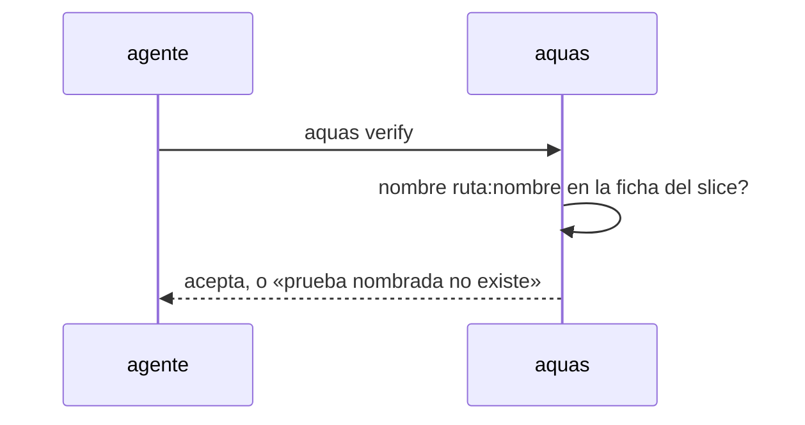

# S001 · Casos borde aceptan pruebas de cualquier stack

[Inicio](../../README.md) › [E000](../README.md) › [F015](README.md) › S001

La tabla de casos borde acepta los nombres ruta:nombre de la ficha cuando el hijo declara pruebas.json.

## En una frase

La tabla de casos borde acepta los nombres ruta:nombre de la ficha cuando el hijo declara pruebas.json.

## Para qué existe

**El problema.** D000127: el gate solo reconoce nombres `Test…` de [Go](../../glosario.md#go); un hijo TypeScript no puede commitear

**La solución.** La tabla de casos borde acepta los nombres ruta:nombre de la ficha cuando el hijo declara pruebas.json.

**Contrato.**

| Regla | Valor |
|---|---|
| Repo con `gobierno/config/pruebas.json` | casos borde y contrato aceptan, entre acentos graves, un nombre `ruta:nombre` que la ficha del slice declara |
| Nombre `ruta:nombre` que la ficha no declara | se rechaza: «prueba nombrada no existe» |
| Ficha con rojo ya registrado | el nombre sigue valiendo si la ficha lo declara: es su contrato registrado |
| Repo sin `pruebas.json` | sin cambio: solo `Test…` de Go |
| Alcance | `internal/wiki/**`, `cmd/aquas/**`, `docs/**` |

**Casos borde.**

| Categoría | Aplica | Prueba o motivo |
|---|---|---|
| cada tipo de ficha | no | casos borde solo existen en páginas de slice |
| cada estado de origen | sí | ficha sin rojo y con rojo aceptan su nombre: `TestCasosBordeSinGo` |
| padre e hijo, activo y archivado | sí | la central sin pruebas.json sigue exigiendo `Test…`: `TestCasosBordeSinGo` |
| entrada ausente, vacía, mal escrita o duplicada | sí | nombre inventado o mal formado se rechaza: `TestCasosBordeSinGo` |
| choque con otro control | sí | sin pruebas.json la regla de Go sigue igual: `TestCasosBordeSinGo` |
| quién habla: humano, agente o herramienta | no | el gate corre igual para cualquiera |
| fallo a mitad de camino | sí | ficha ilegible: el nombre no se acepta y el gate frena: `TestCasosBordeSinGo` |

## Analogía

Piensa en **un lector que solo conoce un idioma**.

- Le enseñamos a leer los nombres que la ficha ya registró.

Límite de la analogía: no aprende nombres inventados.

## Diagrama

## Ejemplo de punta a punta

continúa: [EJ-E000-F015](README.md#EJ-E000-F015)

1. La ficha declara `src/a.test.ts:rechaza_vacio`.
2. La tabla cita `src/a.test.ts:rechaza_vacio`; el gate pasa.
3. La tabla cita `src/a.test.ts:inventada`; el gate frena.

## Paso a paso

1. Rojo de `TestCasosBordeSinGo`.
2. Regla de nombres en `internal/wiki`; verde.

## Cómo se usa

- En el hijo, citar la prueba con su nombre completo de la ficha.

## Contrato y evidencia

<!-- GENERADO por aquas desde trabajo/: no editar a mano; `aquas compile` lo rehace. -->

| Prueba | Valida | Rojo cuando | Verde cuando | Rojo | Verde |
|---|---|---|---|---|---|
| `TestCasosBordeSinGo` | valida que casos borde y contrato aceptan pruebas ruta:nombre de la ficha | rojo cuando un nombre ruta:nombre de la ficha se rechaza | verde cuando se acepta y un nombre inventado se sigue rechazando | 2026-11-05 | 2026-11-05 |

### Código

| Archivo | Función | Parámetros | Qué hace |
|---|---|---|---|
| [internal/backlog/pruebas.go](../../../internal/backlog/pruebas.go) | `formato` | `(libre bool) string` | formato: cómo se escribe una prueba, según haya plantilla (libre) o go test. |
| [internal/backlog/pruebas.go](../../../internal/backlog/pruebas.go) | `formatoDe` | `(raiz string) string` | formatoDe: formato del repo; con pruebas.json roto muestra el de go test (el error sale al correr). |
| [internal/backlog/pruebas.go](../../../internal/backlog/pruebas.go) | `rutaPeligrosa` | `(prueba string) bool` | rutaPeligrosa (hallazgos A1.6 y A2.2): ruta o nombre que empieza con «-» (sería una opción del corredor), |
| [internal/backlog/pruebas.go](../../../internal/backlog/pruebas.go) | `plantilla` | `(raiz string) (string, error)` | plantilla: el comando de pruebas.json, o "" si el repo no lo tiene (se usa go test). |
| [internal/backlog/pruebas.go](../../../internal/backlog/pruebas.go) | `correrPlantilla` | `(raiz, cmd string, ps []Prueba) (map[string]resultado, error)` | correrPlantilla corre la plantilla con sh, una prueba a la vez, en la raíz del repo. |
| [internal/backlog/pruebas.go](../../../internal/backlog/pruebas.go) | `ultimas` | `(s string, n int) string` | ultimas: las últimas n líneas no vacías, unidas en una. |
| [internal/wiki/casos_borde.go](../../../internal/wiki/casos_borde.go) | `citadas` | `(raiz, texto string) [][]string` | citadas: pruebas nombradas en el texto; con pruebas.json, también los nombres ruta:nombre. |
| [internal/wiki/casos_borde.go](../../../internal/wiki/casos_borde.go) | `declarada` | `(raiz, rel, n string) bool` | declarada (E000/F015/S001): la ficha del slice de la página rel declara la prueba n con su nombre completo. |
| [internal/wiki/casos_borde.go](../../../internal/wiki/casos_borde.go) | `revisarCasosBorde` | `(raiz, rel string, enCodigo map[string]string) []string` | revisarCasosBorde: problemas de la tabla «Casos borde» de la página rel; nada si no es un slice con ficha activa. |
| [internal/wiki/casos_borde.go](../../../internal/wiki/casos_borde.go) | `filasCasosBorde` | `(contenido string) (string, [][3]string, bool)` | filasCasosBorde: encabezado y celdas [categoría, aplica, texto] de la tabla que sigue a la marca; false si no hay marca. |
| [internal/wiki/casos_borde.go](../../../internal/wiki/casos_borde.go) | `celdasTabla` | `(linea string) []string` | celdasTabla parte una fila Markdown por «\\|» sin escapar y recorta cada celda. |
| [internal/wiki/casos_borde.go](../../../internal/wiki/casos_borde.go) | `lineaDeMarca` | `(lineas []string) int` | lineaDeMarca: índice de la marca fuera de bloques de código y comentarios HTML; -1 si no está. |

<!-- /GENERADO -->

## Navegación

- ↑ Subir: [F015](README.md)
