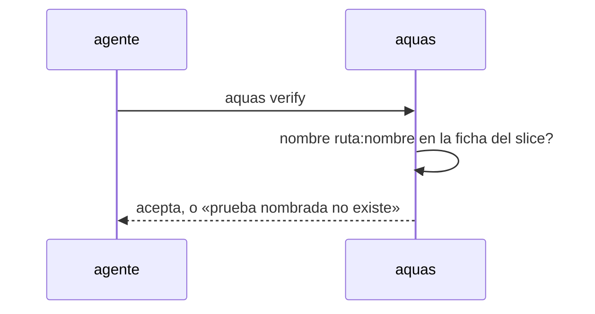

# S001 · Casos borde aceptan pruebas de cualquier stack

[Inicio](../../README.md) › [E000](../README.md) › [F015](README.md) › S001

La tabla de casos borde acepta los nombres ruta:nombre de la ficha cuando el hijo declara pruebas.json.

## En una frase

La tabla de casos borde acepta los nombres ruta:nombre de la ficha cuando el hijo declara pruebas.json.

## Para qué existe

**El problema.** D000127: el gate solo reconoce nombres `Test…` de [Go](../../glosario.md#go); un hijo TypeScript no puede commitear

**La solución.** La tabla de casos borde acepta los nombres ruta:nombre de la ficha cuando el hijo declara pruebas.json.

**Contrato.**

| Regla | Valor |
|---|---|
| Repo con `gobierno/config/pruebas.json` | casos borde y contrato aceptan, entre acentos graves, un nombre `ruta:nombre` que la ficha del slice declara |
| Nombre `ruta:nombre` que la ficha no declara | se rechaza: «prueba nombrada no existe» |
| Ficha archivada o con rojo | el nombre sigue valiendo si la ficha lo declara: es su contrato registrado |
| Repo sin `pruebas.json` | sin cambio: solo `Test…` de Go |
| Alcance | `internal/wiki/**`, `cmd/aquas/**`, `docs/**` |

**Casos borde.**

| Categoría | Aplica | Prueba o motivo |
|---|---|---|
| cada tipo de ficha | no | casos borde solo existen en páginas de slice |
| cada estado de origen | sí | ficha sin rojo, con rojo y archivada aceptan su nombre: `TestCasosBordeSinGo` |
| padre e hijo, activo y archivado | sí | la central sin pruebas.json sigue exigiendo `Test…`: `TestCasosBordeSinGo` |
| entrada ausente, vacía, mal escrita o duplicada | sí | nombre inventado o mal formado se rechaza: `TestCasosBordeSinGo` |
| choque con otro control | sí | la tabla de contrato y la de casos borde usan la misma regla: `TestCasosBordeSinGo` |
| quién habla: humano, agente o herramienta | no | el gate corre igual para cualquiera |
| fallo a mitad de camino | sí | ficha ilegible: el nombre no se acepta, falla cerrado: `TestCasosBordeSinGo` |

## Analogía

Piensa en **un lector que solo conoce un idioma**.

- Le enseñamos a leer los nombres que la ficha ya registró.

Límite de la analogía: no aprende nombres inventados.

## Diagrama

## Ejemplo de punta a punta

continúa: [EJ-E000-F015](README.md#EJ-E000-F015)

1. La ficha declara `src/a.test.ts:rechaza_vacio`.
2. La tabla cita `src/a.test.ts:rechaza_vacio`; el gate pasa.
3. La tabla cita `src/a.test.ts:inventada`; el gate frena.

## Paso a paso

1. Rojo de `TestCasosBordeSinGo`.
2. Regla de nombres en `internal/wiki`; verde.

## Cómo se usa

- En el hijo, citar la prueba con su nombre completo de la ficha.

## Contrato y evidencia

<!-- GENERADO por aquas desde trabajo/: no editar a mano; `aquas compile` lo rehace. -->

| Prueba | Valida | Rojo cuando | Verde cuando | Rojo | Verde |
|---|---|---|---|---|---|
| `TestCasosBordeSinGo` | valida que casos borde y contrato aceptan pruebas ruta:nombre de la ficha | rojo cuando un nombre ruta:nombre de la ficha se rechaza | verde cuando se acepta y un nombre inventado se sigue rechazando | — | — |

<!-- /GENERADO -->

## Navegación

- ↑ Subir: [F015](README.md)
