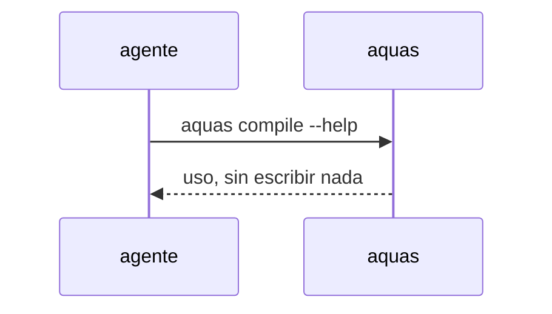

# S002 · Ayuda no ejecuta la orden

[Inicio](../../README.md) › [E000](../README.md) › [F015](README.md) › S002

Una orden con --help o -h muestra el uso general, avisa que no se ejecutó y no escribe nada.

## En una frase

Una orden con --help o -h muestra el uso general, avisa que no se ejecutó y no escribe nada.

## Para qué existe

**El problema.** El [agente](../../glosario.md#agente) auditor del hijo corrió `aquas compile --help` y compiló de verdad.

**La solución.** Una orden con --help o -h muestra el uso general, avisa que no se ejecutó y no escribe nada.

**Contrato.**

| Regla | Valor |
|---|---|
| `--help` o `-h` en cualquier posición de los argumentos | imprime el uso general y avisa «no se ejecutó»; sale 0 y no escribe nada |
| Argumento que solo contiene «help» como valor (`motivo=help`) | no cuenta como ayuda |
| Alcance | `cmd/aquas/**`, `docs/**` |

**Casos borde.**

| Categoría | Aplica | Prueba o motivo |
|---|---|---|
| cada tipo de ficha | no | la ayuda no toca fichas |
| cada estado de origen | no | la ayuda no depende del estado del backlog |
| padre e hijo, activo y archivado | sí | en un hijo con pruebas.json tampoco ejecuta: `TestHijoSinGoCicloCompleto` |
| entrada ausente, vacía, mal escrita o duplicada | sí | `-h` repetido o tras otros argumentos: `TestAyudaNoEjecuta` |
| choque con otro control | sí | `compile --help` responde «no se ejecutó» en vez de compilar: `TestAyudaNoEjecuta` |
| quién habla: humano, agente o herramienta | no | la ayuda responde igual a cualquiera |
| fallo a mitad de camino | sí | el repo queda idéntico tras la ayuda: `TestAyudaNoEjecuta` |

## Analogía

Piensa en **preguntar cómo funciona un botón**.

- Preguntar no debe apretarlo.

Límite de la analogía: aquí el botón escribe archivos.

## Diagrama

## Ejemplo de punta a punta

continúa: [EJ-E000-F015](README.md#EJ-E000-F015)

1. El agente corre `aquas compile --help`.
2. Ve el uso; ningún archivo cambia.

## Paso a paso

1. Rojo de `TestAyudaNoEjecuta`.
2. `main` revisa la ayuda (`pideAyuda`) antes de traducir y despachar; verde.

## Cómo se usa

- `aquas <orden> --help`.

## Contrato y evidencia

<!-- GENERADO por aquas desde trabajo/: no editar a mano; `aquas compile` lo rehace. -->

| Prueba | Valida | Rojo cuando | Verde cuando | Rojo | Verde |
|---|---|---|---|---|---|
| `TestAyudaNoEjecuta` | valida que --help y -h no ejecutan la orden | rojo cuando una orden con --help escribe archivos | verde cuando solo muestra el uso y el repo queda igual | 2026-11-05 | 2026-11-05 |

### Código

| Archivo | Función | Parámetros | Qué hace |
|---|---|---|---|
| [cmd/aquas/main.go](../../../cmd/aquas/main.go) | `main` | `()` | main despacha el subcomando de aquas (compilar, verificar, backlog, hooks…) y sale con su código. |
| [cmd/aquas/main.go](../../../cmd/aquas/main.go) | `contextoParaClaude` | `(texto string)` | contextoParaClaude (E000/F013/S002): aviso que el gancho PostToolUse entrega a Claude sin frenar (additionalContext, salida 0). |
| [cmd/aquas/main.go](../../../cmd/aquas/main.go) | `hook` | `(raiz string)` | hook: exit 0 = nada que reportar o aviso en additionalContext; exit 2 = stderr se muestra a Claude como freno. |
| [cmd/aquas/main.go](../../../cmd/aquas/main.go) | `compilarSettings` | `(w io.Writer)` | compilarSettings regenera .claude/settings.json; sin entorno declarado no inventa uno. |
| [cmd/aquas/main.go](../../../cmd/aquas/main.go) | `reportar` | `(w io.Writer, inf compilador.Informe)` | reportar imprime qué derivados escribió la compilación, o que todo estaba al día. |
| [cmd/aquas/main.go](../../../cmd/aquas/main.go) | `listar` | `(titulo string, problemas []string)` | listar imprime en stderr un título y cada problema en su viñeta. |
| [cmd/aquas/main.go](../../../cmd/aquas/main.go) | `lista` | `(xs []string) string` | lista une los textos con comas, o «—» si no hay ninguno. |
| [cmd/aquas/main.go](../../../cmd/aquas/main.go) | `fallar` | `(codigo int, err error)` | fallar imprime el error en stderr y termina con el código dado. |
| [cmd/aquas/main.go](../../../cmd/aquas/main.go) | `avisarWiki` | `(avisos []string)` | avisarWiki (E000/F013/S001): imprime los avisos de estilo de la wiki; no cambian el resultado del gate. |
| [cmd/aquas/main.go](../../../cmd/aquas/main.go) | `revisarAislamiento` | `() (fallo, aviso string)` | revisarAislamiento: fallo para el gate y aviso para el arranque (E000/F008/S003, D000079). |
| [cmd/aquas/main.go](../../../cmd/aquas/main.go) | `memoriaCLI` | `(raiz string, args []string)` | memoriaCLI: `ver` imprime la memoria; `fijar campo=valor…` la actualiza y la sella. |
| [cmd/aquas/main.go](../../../cmd/aquas/main.go) | `memoriaArchivada` | `(raiz, id string) error` | memoriaArchivada: CERRADO exige el archivo de memoria del slice, apunte o no la memoria a él (E001/F002/S009, X01). |
| [cmd/aquas/main.go](../../../cmd/aquas/main.go) | `focoEnBacklog` | `(raiz string, f memoria.Foco) error` | focoEnBacklog: la memoria solo fija el slice que el backlog tiene en curso (S003). |
| [cmd/aquas/main.go](../../../cmd/aquas/main.go) | `backlogCLI` | `(raiz string, args []string)` | backlogCLI: nuevo \\| ver [id] \\| tabla \\| prioridad \\| estado \\| siguiente \\| pruebas \\| rojo \\| verde. |
| [cmd/aquas/main.go](../../../cmd/aquas/main.go) | `gateDefectos` | `(raiz string) (frena []string, aviso string)` | gateDefectos (E001/F017/S005): lo que el gate dice del registro de defectos. Prueba nombrada que ya no existe |
| [cmd/aquas/main.go](../../../cmd/aquas/main.go) | `turnoCLI` | `(raiz string, args []string)` | turnoCLI: auditoría de turnos (E001/F002/S001). Lee el JSON del hook por stdin. No imprime nada |
| [cmd/aquas/main.go](../../../cmd/aquas/main.go) | `retroCLI` | `(raiz string, args []string) (backlog.Retro, error)` | retroCLI (E001/F018/S002): cerrar fichas=A,B motivo=…; cada clave una vez. |
| [cmd/aquas/main.go](../../../cmd/aquas/main.go) | `defectoCLI` | `(raiz string, args []string) error` | defectoCLI: nuevo \\| ocurre \\| arreglar \\| ver (E001/F004/S001; arreglar: E000/F007/S003). |
| [cmd/aquas/main.go](../../../cmd/aquas/main.go) | `versionBinario` | `() string` | versionBinario: versión del módulo con que se compiló el binario (= versión del gobierno embebido). |
| [cmd/aquas/main.go](../../../cmd/aquas/main.go) | `versionControl` | `() string` | versionControl (E003/F006/S002, hallazgo A2.1): versión con la que deciden los controles del hijo. |
| [cmd/aquas/main.go](../../../cmd/aquas/main.go) | `registrarCierre` | `(raiz, tipo, transcript, primera, resultado string)` | registrarCierre (E001/F004/S005, D000068) anota cada llamada del gancho cierre-agente en .tmp/hooks/cierre-agente.jsonl. |
| [cmd/aquas/main.go](../../../cmd/aquas/main.go) | `esUpdate` | `(datos []byte) bool` | esUpdate (E003/F006/S001): la entrada de la guardia es una orden Bash que es exactamente `aquas update` (PowerShell lo frena la guardia siempre). |
| [cmd/aquas/main.go](../../../cmd/aquas/main.go) | `entornoHijo` | `(raiz string)` | entornoHijo (E003/F001/S003) declara el entorno del hijo, como aquas init en la central: |
| [cmd/aquas/main.go](../../../cmd/aquas/main.go) | `pideAyuda` | `(args []string) bool` | pideAyuda (E000/F015/S002): algún argumento es exactamente --help o -h; un valor como motivo=--help no cuenta. |

<!-- /GENERADO -->

## Navegación

- ↑ Subir: [F015](README.md)
