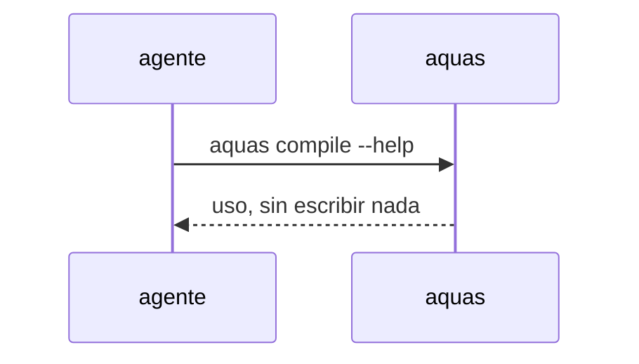

# S002 · Ayuda no ejecuta la orden

[Inicio](../../README.md) › [E000](../README.md) › [F015](README.md) › S002

Una orden con --help o -h muestra su uso y no escribe nada.

## En una frase

Una orden con --help o -h muestra su uso y no escribe nada.

## Para qué existe

**El problema.** El [agente](../../glosario.md#agente) auditor del hijo corrió `aquas compile --help` y compiló de verdad.

**La solución.** Una orden con --help o -h muestra su uso y no escribe nada.

**Contrato.**

| Regla | Valor |
|---|---|
| `--help` o `-h` en cualquier posición de los argumentos | imprime el uso de la orden, sale 0 y no escribe nada |
| `aquas` sin orden | imprime el uso general |
| Argumento que solo contiene «help» como valor (`motivo=help`) | no cuenta como ayuda |
| Alcance | `cmd/aquas/**`, `docs/**` |

**Casos borde.**

| Categoría | Aplica | Prueba o motivo |
|---|---|---|
| cada tipo de ficha | no | la ayuda no toca fichas |
| cada estado de origen | no | la ayuda no depende del estado del backlog |
| padre e hijo, activo y archivado | sí | en un hijo con pruebas.json tampoco ejecuta: `TestAyudaNoEjecuta` |
| entrada ausente, vacía, mal escrita o duplicada | sí | `-h` repetido o tras otros argumentos: `TestAyudaNoEjecuta` |
| choque con otro control | sí | `compile --help` no recompila ni sella: `TestAyudaNoEjecuta` |
| quién habla: humano, agente o herramienta | no | la ayuda responde igual a cualquiera |
| fallo a mitad de camino | sí | el repo queda idéntico tras la ayuda: `TestAyudaNoEjecuta` |

## Analogía

Piensa en **preguntar cómo funciona un botón**.

- Preguntar no debe apretarlo.

Límite de la analogía: aquí el botón escribe archivos.

## Diagrama

## Ejemplo de punta a punta

continúa: [EJ-E000-F015](README.md#EJ-E000-F015)

1. El agente corre `aquas compile --help`.
2. Ve el uso; ningún archivo cambia.

## Paso a paso

1. Rojo de `TestAyudaNoEjecuta`.
2. `main` revisa la ayuda antes de despachar; verde.

## Cómo se usa

- `aquas <orden> --help`.

## Contrato y evidencia

<!-- GENERADO por aquas desde trabajo/: no editar a mano; `aquas compile` lo rehace. -->

| Prueba | Valida | Rojo cuando | Verde cuando | Rojo | Verde |
|---|---|---|---|---|---|
| `TestAyudaNoEjecuta` | valida que --help y -h no ejecutan la orden | rojo cuando una orden con --help escribe archivos | verde cuando solo muestra el uso y el repo queda igual | — | — |

<!-- /GENERADO -->

## Navegación

- ↑ Subir: [F015](README.md)
