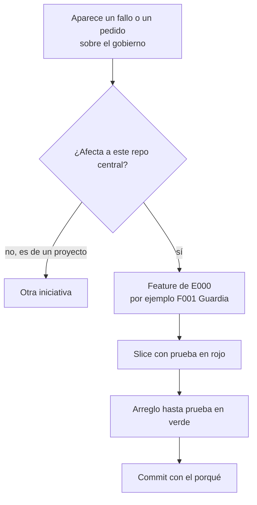
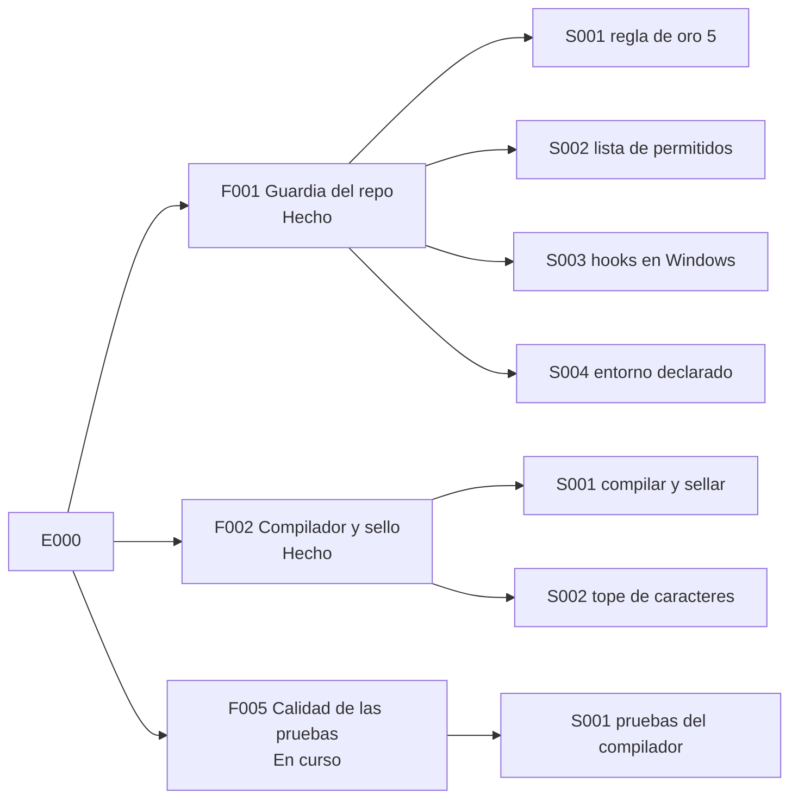

# E000 · Mantenimiento del gobierno

[Inicio](../README.md) › E000

[Iniciativa](../glosario.md#iniciativa) para cuidar **este repositorio central**: sus reglas, sus controles y sus herramientas. Los proyectos hijos no usan E000.

## En una frase

Aquí van los arreglos y mejoras que protegen al propio libro de reglas.

## Para qué existe

**El problema.** Las reglas también fallan. Un control puede tener un hueco, o un programa puede dejar de arrancar sin avisar. Si esos arreglos no tienen un lugar, se pierden entre las demás tareas.

**La solución.** E000 junta todo el mantenimiento del gobierno. Usa el mismo árbol que el resto: iniciativa → [feature](../glosario.md#feature) → [slice](../glosario.md#slice). Cada arreglo queda con su prueba y su [commit](../glosario.md#commit).

Qué entra en E000:

- un hueco en un control, como la guardia que no vigilaba PowerShell;
- un fallo del arnés, como un [hook](../glosario.md#hook) que no arranca;
- una regla nueva que protege al repositorio.

Qué no entra: el trabajo de un proyecto hijo. Ese va en su propia iniciativa.

## Analogía

Piensa en el **taller de mantenimiento de un edificio**.

- Los vecinos hacen su vida en los pisos: son las otras iniciativas.
- El taller arregla cerraduras, tuberías y ascensores del propio edificio.
- Cada arreglo queda anotado en la bitácora del taller.

Límite de la analogía: en el edificio, el taller espera a que algo se rompa. Aquí también se agregan controles nuevos antes de que haya un daño.

## Diagrama

Cómo llega un arreglo a E000.

Estado de sus features:

| Feature | Qué hace | Estado |
|---|---|---|
| [F001 Guardia del repo](F001/README.md) | Impide escribir fuera del repositorio | Hecho |
| [F002 Compilador y sello](F002/README.md) | Genera, sella y pone tope a los archivos de reglas | Hecho |
| [F005 Calidad de las pruebas](F005/README.md) | Pruebas que fallan cuando se rompe su regla | En curso |

## Ejemplo de punta a punta

**Situación.** Jesús escribe: «que no puedas escribir nada fuera de este repositorio».

1. **Clasificación.** Es trabajo y protege al propio repositorio. Va a E000.
2. **Feature.** Abre F001 Guardia del repo.
3. **Slice.** El primero es S001: un programa que revisa cada escritura antes de que ocurra.
4. **Rojo.** Se escriben pruebas con comandos que escriben fuera. Sin el programa, fallan.
5. **Verde.** Se programa la guardia y las pruebas pasan.
6. **Sorpresa.** Días después, Jesús prueba `echo x > "$NOEXISTE"` y el comando pasa. La guardia no corría.
7. **Nuevo slice.** El fallo no se esconde: se vuelve otro slice de la misma feature, con su arreglo y su prueba.

Las páginas de abajo siguen este ejemplo.

## Paso a paso

Qué hace el [agente](../glosario.md#agente) con un fallo del gobierno:

1. Lo arregla antes de seguir con otra cosa, para que no crezca.
2. Lo ubica en una feature de E000, nueva o existente.
3. Escribe la prueba que demuestra el fallo y la ve fallar.
4. Arregla hasta que la prueba pase.
5. Corre el [gate](../glosario.md#gate) completo y hace commit.

## Cómo se usa

- La lista de tareas vive en las fichas de `trabajo/`; se ve con `aquas backlog ver`. El diseño y las decisiones siguen en [E001_GOBIERNO_DEL_TRABAJO.md](../../gobierno/canonico/metodologias/E001_GOBIERNO_DEL_TRABAJO.md).
- Hoy esa lista se escribe a mano. Con F002 de E001 pasará a un archivo que lee la herramienta `aquas`.

## Contrato y evidencia

**Resultado esperado.** El gobierno de este repositorio se arregla con el mismo rigor que el resto: prueba, commit y página.

**Resultado logrado.** Dos features terminadas, con seis slices en total.

Decisiones de Jesús:

- E000 es solo para este repositorio central (2026-10-20).
- Un fallo se arregla antes de continuar, aunque cambie el orden del trabajo (2026-10-20).
- Las pruebas del [compilador](../glosario.md#compilador), anteriores al método, viven en E000/F002 (2026-10-20).

Prueba integral de la iniciativa: `go test ./...` más `go run ./cmd/aquas verificar`. Las dos pasaron en el commit `2c418d1`.

## Navegación

- ↑ Subir: [Inicio de la wiki](../README.md)
- Abajo: [F001 · Guardia del repo](F001/README.md)
- Abajo: [F002 · Compilador y sello](F002/README.md)
- Abajo: [F005 · Calidad de las pruebas](F005/README.md)
