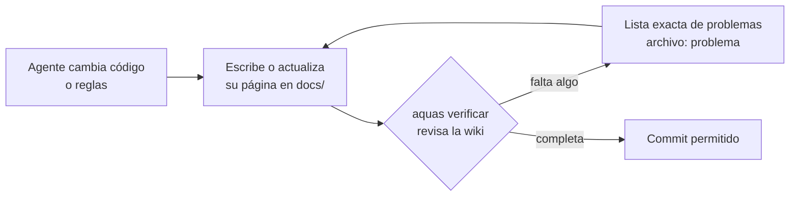
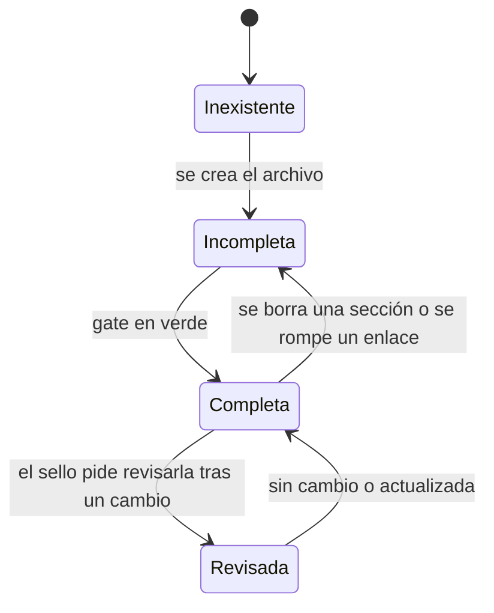

# F001 · Wiki + gate

Feature que obliga a explicar todo el repositorio en esta wiki, con un gate en Go que bloquea el commit si la wiki está incompleta.

## En una frase

Si construimos algo y no lo explicamos con dibujos y ejemplos, la máquina no nos deja guardar.

## Para qué existe

**El problema.** La documentación casi siempre se queda atrás. El agente programa, prueba y hace commit, pero olvida explicar. Pedirle «documenta» no basta: es una promesa, no un control.

**La solución.** Un gate revisa la wiki en cada `aquas verificar`, y por tanto en cada commit. Exige:

- cada página en su ruta fija: inicio, iniciativa, feature o slice;
- las mismas ocho secciones en el mismo orden;
- el diagrama que corresponde a cada nivel;
- un ejemplo que continúa el ejemplo de la página de arriba;
- enlaces que funcionan y páginas a las que se llega desde el inicio.

## Analogía

Piensa en un **álbum de figuritas**.

- Cada página del álbum tiene casillas fijas: foto, nombre, datos.
- No puedes decir «álbum completo» si falta una figurita.
- El gate es quien revisa casilla por casilla.

Límite de la analogía: el gate revisa que cada casilla **exista y tenga algo**. No sabe si el ejemplo es claro. Eso sigue siendo criterio humano.

## Diagrama

Proceso: qué pasa con la wiki en cada commit.

Estados de una página de la wiki:

Slices de esta feature:

| Slice | Qué entrega | Estado |
|---|---|---|
| [S001 Esqueleto + gate](S001.md) | Estructura, secciones, diagramas, ejemplos, enlaces | Hecho |
| S002 Glosario + legibilidad | Términos técnicos definidos y frases cortas | Pendiente |
| S003 Documentar lo existente | Constitución, compilador y comunicación | Pendiente |

## Ejemplo de punta a punta

continúa: [EJ-E001](../README.md#EJ-E001)

En la iniciativa, el pedido de Jesús fue: «quiero que la wiki avise si un enlace está roto». Aquí vemos qué hace la feature con ese pedido.

1. La feature F001 ya tenía su meta: «la wiki siempre completa y navegable».
2. El pedido cabe en el primer slice, S001, porque los enlaces son parte de la estructura.
3. Mientras S001 se construye, la página de prueba con `no-existe.md` está en estado **Incompleta**.
4. Cuando el gate funciona, ese enlace produce: `docs/…/S001.md: enlace roto → no-existe.md`.
5. Se arregla el enlace. La página pasa a **Completa** y el commit entra.
6. Un mes después, alguien renombra un archivo. El enlace vuelve a romperse y la página regresa a **Incompleta**. El gate lo detecta solo, sin que nadie lo recuerde.

## Paso a paso

Para agregar documentación de algo nuevo:

1. Ubica su nivel: iniciativa, feature o slice.
2. Crea su página en la ruta fija. Ejemplo: `docs/E001/F002/README.md`.
3. Escribe las ocho secciones en orden.
4. Agrega el diagrama del nivel.
5. En el ejemplo, pon el ancla propia y la línea `continúa:` hacia la página de arriba.
6. Enlaza la página nueva desde la «Navegación» de su página padre.
7. Ejecuta `go run ./cmd/aquas verificar` y corrige hasta ver «GATE OK».

## Cómo se usa

- Leer: abre `docs/README.md` en VS Code y pulsa Ctrl+Shift+V.
- Revisar: `go run ./cmd/aquas verificar`. Cada problema sale como `archivo: problema`.
- El pre-commit ejecuta lo mismo; no hace falta acordarse.

## Navegación

- ↑ Subir: [E001 · Gobierno del trabajo](../README.md)
- Abajo: [S001 · Esqueleto + gate](S001.md)
