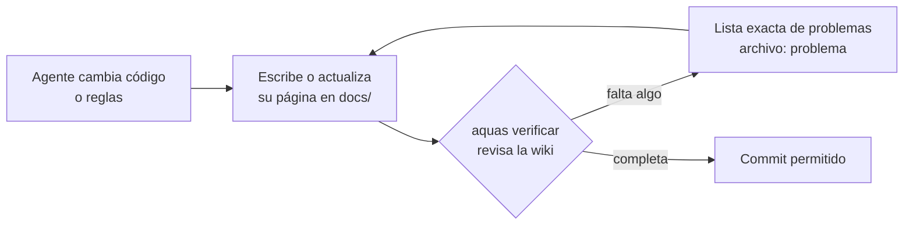
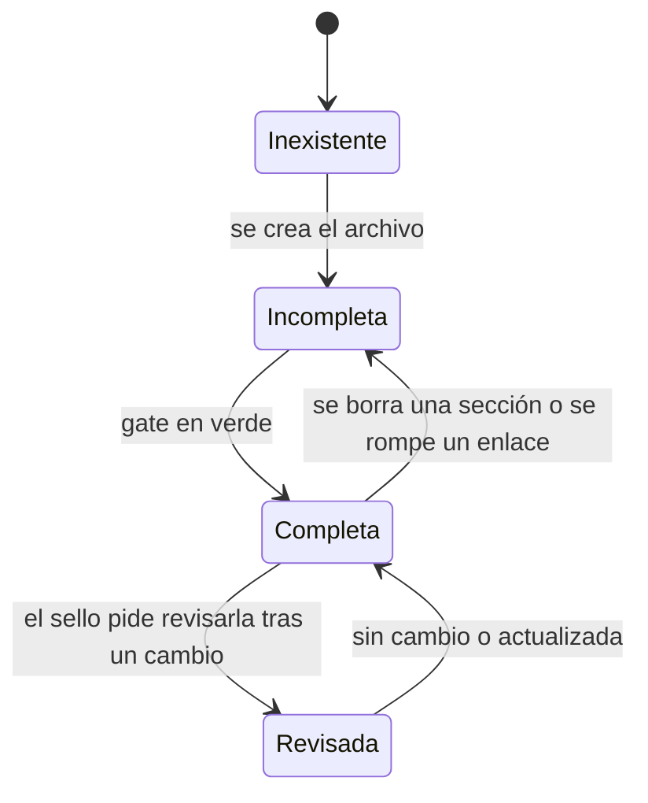
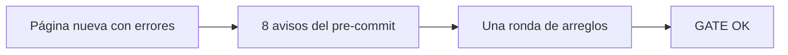

# F001 · Wiki + gate

[Inicio](../../README.md) › [E001](../README.md) › F001

[Feature](../../glosario.md#feature) que obliga a explicar todo el repositorio en esta [wiki](../../glosario.md#wiki). Un [gate](../../glosario.md#gate) en [Go](../../glosario.md#go) bloquea el [commit](../../glosario.md#commit) si la wiki está incompleta.

## En una frase

Si construimos algo y no lo explicamos con dibujos y ejemplos, la máquina no nos deja guardar.

## Para qué existe

**El problema.** La documentación casi siempre se queda atrás. El [agente](../../glosario.md#agente) programa, prueba y hace commit, pero olvida explicar. Pedirle «documenta» no basta: es una promesa, no un control.

**La solución.** Un gate revisa la wiki en cada `aquas verificar`, y por tanto en cada commit. Exige:

- cada página en su ruta fija: inicio, [iniciativa](../../glosario.md#iniciativa), feature o [slice](../../glosario.md#slice);
- las mismas ocho secciones en el mismo orden, más una en E, F y S;
- el diagrama que corresponde a cada nivel;
- un ejemplo que continúa el ejemplo de la página de arriba;
- enlaces que funcionan y páginas a las que se llega desde el inicio;
- prosa fácil de leer: índice 65 o más y oraciones de 20 palabras como máximo;
- cada término técnico enlazado a su entrada del glosario la primera vez que aparece;
- en iniciativas, features y slices: migas y la sección «Contrato y evidencia»;
- cada prueba del repo nombrada por su slice, y cada prueba nombrada existente en el código.

## Analogía

Piensa en un **álbum de figuritas**.

- Cada página del álbum tiene casillas fijas: foto, nombre, datos.
- No puedes decir «álbum completo» si falta una figurita.
- El gate es quien revisa casilla por casilla.

Límite de la analogía: el gate revisa que cada casilla **exista y tenga algo**. No sabe si el ejemplo es claro. Eso sigue siendo criterio humano.

## Diagrama

Proceso: qué pasa con la wiki en cada commit.

Estados de una página de la wiki:

Slices de esta feature:

| Slice | Qué entrega | Estado |
|---|---|---|
| [S001 Esqueleto + gate](S001.md) | Estructura, secciones, diagramas, ejemplos, enlaces | Hecho |
| [S002 Glosario + legibilidad](S002.md) | Términos técnicos definidos y frases cortas | Hecho |
| [S003 Documentar lo existente](S003.md) | Páginas de referencia en `docs/ref/` | Hecho |
| [S004 Contrato y evidencia](S004.md) | Sección 9, migas y pruebas con dueño | Hecho |

## Ejemplo de punta a punta

continúa: [EJ-E001](../README.md#EJ-E001)

En la iniciativa, el pedido de Jesús fue: «quiero que la wiki avise si un enlace está roto». Aquí vemos qué hace la feature con ese pedido.

1. La feature F001 ya tenía su meta: «la wiki siempre completa y navegable».
2. El pedido cabe en el primer slice, S001, porque los enlaces son parte de la estructura.
3. Mientras S001 se construye, la página de prueba con `no-existe.md` está en estado **Incompleta**.
4. Cuando el gate funciona, ese enlace produce: `docs/…/S001.md: enlace roto → no-existe.md`.
5. Se arregla el enlace. La página pasa a **Completa** y el commit entra.
6. Un mes después, alguien renombra un archivo. El enlace vuelve a romperse y la página regresa a **Incompleta**. El gate lo detecta solo, sin que nadie lo recuerde.

## Paso a paso

Para agregar documentación de algo nuevo:

1. Ubica su nivel: iniciativa, feature o slice.
2. Crea su página en la ruta fija. Ejemplo: `docs/E001/F002/README.md`.
3. Escribe las ocho secciones en orden.
4. Agrega el diagrama del nivel.
5. En el ejemplo, pon el [ancla](../../glosario.md#ancla) propia y la línea `continúa:` hacia la página de arriba.
6. Enlaza la página nueva desde la «Navegación» de su página padre.
7. Ejecuta `go run ./cmd/aquas verificar` y corrige hasta ver «GATE OK».

## Cómo se usa

- Leer: abre `docs/README.md` en VS Code y pulsa Ctrl+Shift+V.
- Revisar: `go run ./cmd/aquas verificar`. Cada problema sale como `archivo: problema`.
- El [pre-commit](../../glosario.md#pre-commit) ejecuta lo mismo; no hace falta acordarse.
- Límite: el gate revisa el tipo de cada diagrama, no si está bien escrito. Un diagrama roto pasa. Míralo en la vista previa antes de guardar.

## Contrato y evidencia

**Objetivo.** La wiki siempre completa, navegable y fácil de leer, y un gate que lo exige en cada commit.

**Por qué esos slices.** S001 da la estructura que todo lo demás usa. S002 mide si se lee fácil. S003 documenta lo que ya existía, para no dejar piezas sin explicar. S004 agrega el contrato y la evidencia de cada página.

Decisiones de Jesús:

- La wiki es para humanos: puede ser extensa y no usa Caveman.
- El manual de `docs/ref/` explica cómo funciona algo; las páginas E, F y S son contrato y evidencia (2026-10-20).
- Cada prueba del repo la nombra algún slice (2026-10-20).

**Prueba integral.**

- Escenario: se escribió una página nueva siguiendo solo esta wiki, con errores típicos de quien llega.
- Resultado: el pre-commit la frenó con ocho avisos y bastó una ronda de arreglos.
- También: se rompieron a propósito un ancla y una sección de S001, y el gate detectó las dos. Un diagrama roto pasó: es el límite conocido.
- Commit: `cdf1567`.

| Slice | Estado |
|---|---|
| S001 Esqueleto + gate | Hecho |
| S002 Glosario + legibilidad | Hecho |
| S003 Documentar lo existente | Hecho |
| S004 Contrato y evidencia | Hecho |

## Navegación

<!-- GENERADO por aquas desde trabajo/: no editar a mano; `aquas compilar` lo rehace. -->

| Hijo | Qué es | Estado |
|---|---|---|
| [S001](S001.md) | Esqueleto y gate de estructura | Hecho |
| [S002](S002.md) | Glosario y legibilidad | Hecho |
| [S003](S003.md) | Referencia de lo existente | Hecho |
| [S004](S004.md) | Contrato, evidencia y migas | Hecho |

<!-- /GENERADO -->

- ↑ Subir: [E001 · Gobierno del trabajo](../README.md)
- Abajo: [S001 · Esqueleto + gate](S001.md)
- Abajo: [S002 · Glosario + legibilidad](S002.md)
- Abajo: [S003 · Documentar lo existente](S003.md)
- Abajo: [S004 · Contrato y evidencia](S004.md)
