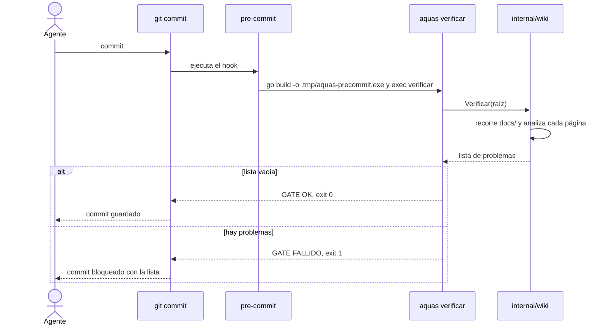
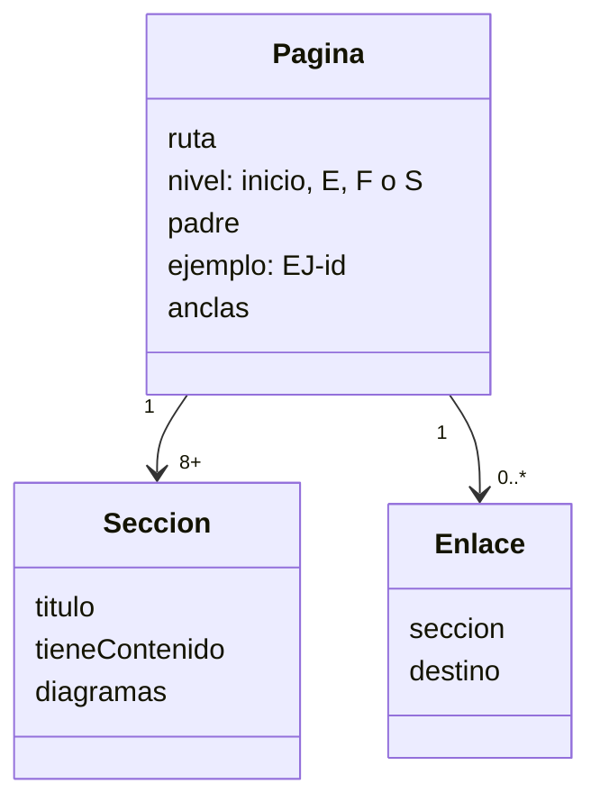
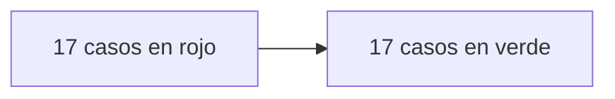

# S001 · Esqueleto de la wiki + gate

[Inicio](../../README.md) › [E001](../README.md) › [F001](README.md) › S001

[Slice](../../glosario.md#slice) que crea el árbol de la [wiki](../../glosario.md#wiki) y el programa en [Go](../../glosario.md#go) que lo revisa. Revisa estructura, secciones, diagramas, ejemplos y enlaces.

## En una frase

Un programa lee cada página de `docs/`, como un maestro que revisa un cuaderno, y anota cada cosa que falta.

## Para qué existe

**El problema.** Sin un revisor automático, la wiki se desordena. Aparecen páginas sin dibujo, enlaces que no llevan a ninguna parte y ejemplos sueltos.

**La solución.** El paquete Go [internal/wiki](../../../internal/wiki/wiki.go) revisa reglas fijas. Cada regla tiene una prueba que debe fallar y otra que debe pasar, en [wiki_test.go](../../../internal/wiki/wiki_test.go).

Contrato del slice:

| Campo | Valor |
|---|---|
| Objetivo | El gate rechaza una wiki incompleta y acepta una completa |
| Incluye | Rutas, secciones, diagramas por nivel, ejemplos encadenados, navegación, enlaces, anclas, alcance |
| Excluye | Glosario y legibilidad (S002); página obligatoria por entidad del backlog (llega con F002) |
| Prueba | `go test ./internal/wiki/` |
| Entrega | `aquas verificar` falla con la lista de problemas o dice «GATE OK» |

## Analogía

Piensa en un **maestro con una lista de chequeo**.

- Revisa cada cuaderno con la misma lista, sin saltarse ninguna línea.
- Si falta el dibujo, lo anota. Si una página dice «ver página 40» y el cuaderno tiene 30, lo anota.
- Al final entrega la lista completa, no solo el primer error.

Límite de la analogía: el maestro también juzga si el dibujo es bonito. El programa no: solo sabe si el dibujo existe y es del tipo correcto.

## Diagrama

Secuencia: qué pasa cuando alguien intenta hacer [commit](../../glosario.md#commit).

Datos: lo que el programa extrae de cada página.

## Ejemplo de punta a punta

continúa: [EJ-E001-F001](README.md#EJ-E001-F001)

En la [feature](../../glosario.md#feature) vimos que el enlace a `no-existe.md` deja la página **Incompleta**. Aquí vemos exactamente cómo lo detecta el programa.

1. Una página de prueba tiene esta línea en «Cómo se usa»: `Ver [x](no-existe.md).`
2. El programa encuentra el enlace con una expresión regular. Ignora los enlaces dentro de bloques de código.
3. Calcula la ruta: misma carpeta de la página + `no-existe.md`.
4. Pregunta al disco si ese archivo existe. No existe.
5. Anota: `docs/E001/F001/S001.md: enlace roto → no-existe.md`.
6. Sigue revisando el resto. Al final, `aquas verificar` imprime todo y sale con código 1.
7. El commit queda bloqueado.

La prueba real de este caso se llama `TestFallas/enlace_roto`. Antes de programar el [gate](../../glosario.md#gate), falló. Después, pasó.

## Paso a paso

Reglas que revisa el gate, con el mensaje que verás si fallan:

| Regla | Mensaje de ejemplo |
|---|---|
| Existe el inicio | `falta docs/README.md` |
| Ruta válida | `docs/notas.md: fuera del árbol` |
| Están las 8 secciones | `falta sección «Analogía»` |
| Ninguna sección vacía | `sección vacía «Cómo se usa»` |
| Secciones en orden fijo | `secciones fuera de orden` |
| Inicio y E tienen flujo | `falta diagrama flowchart` |
| F tiene flujo y estados | `falta diagrama stateDiagram` |
| S tiene datos o secuencia | `falta diagrama de datos o secuencia` |
| El ejemplo tiene su ancla | `falta ancla EJ-E001-F001` |
| F y S continúan al padre | `falta «continúa:»` o `continúa debe apuntar a…` |
| Navegación sube al padre | `Navegación sin ↑ Subir` |
| Navegación baja a cada hijo | `Navegación no enlaza docs/E001/F001/S002.md` |
| Enlaces a archivos existentes | `enlace roto → …` |
| Anclas existentes | `ancla inexistente → …` |
| Todo se alcanza desde el inicio | `inalcanzable desde docs/README.md` |

## Cómo se usa

- Revisar la wiki: `go build -o .tmp/aquas.exe ./cmd/aquas && ./.tmp/aquas.exe verificar`.
- Correr las pruebas del gate: `go test ./internal/wiki/`.
- Las [anclas](../../glosario.md#ancla) valen de dos formas: `` o el título de una sección, como `#para-qué-existe`.

## Contrato y evidencia

<!-- GENERADO por aquas desde trabajo/: no editar a mano; `aquas compilar` lo rehace. -->

| Prueba | Valida | Rojo cuando | Verde cuando | Rojo | Verde |
|---|---|---|---|---|---|
| — | ficha anterior al registro de pruebas | — | — | — | — |

### Código

| Archivo | Función | Parámetros | Qué hace |
|---|---|---|---|
| [cmd/aquas/main.go](../../../cmd/aquas/main.go) | `main` | `()` | main despacha el subcomando de aquas (compilar, verificar, backlog, hooks…) y sale con su código. |
| [cmd/aquas/main.go](../../../cmd/aquas/main.go) | `hook` | `(raiz string)` | hook: exit 0 = nada que reportar; exit 2 = stderr se muestra a Claude. |
| [cmd/aquas/main.go](../../../cmd/aquas/main.go) | `compilarSettings` | `(w io.Writer)` | compilarSettings regenera .claude/settings.json; sin entorno declarado no inventa uno. |
| [cmd/aquas/main.go](../../../cmd/aquas/main.go) | `reportar` | `(w io.Writer, inf compilador.Informe)` | reportar imprime qué derivados escribió la compilación, o que todo estaba al día. |
| [cmd/aquas/main.go](../../../cmd/aquas/main.go) | `listar` | `(titulo string, problemas []string)` | listar imprime en stderr un título y cada problema en su viñeta. |
| [cmd/aquas/main.go](../../../cmd/aquas/main.go) | `lista` | `(xs []string) string` | lista une los textos con comas, o «—» si no hay ninguno. |
| [cmd/aquas/main.go](../../../cmd/aquas/main.go) | `fallar` | `(codigo int, err error)` | fallar imprime el error en stderr y termina con el código dado. |
| [cmd/aquas/main.go](../../../cmd/aquas/main.go) | `memoriaCLI` | `(raiz string, args []string)` | memoriaCLI: `ver` imprime la memoria; `fijar campo=valor…` la actualiza y la sella. |
| [cmd/aquas/main.go](../../../cmd/aquas/main.go) | `memoriaArchivada` | `(raiz, id string) error` | memoriaArchivada: CERRADO exige el archivo de memoria del slice, apunte o no la memoria a él (E001/F002/S009, X01). |
| [cmd/aquas/main.go](../../../cmd/aquas/main.go) | `focoEnBacklog` | `(raiz string, f memoria.Foco) error` | focoEnBacklog: la memoria solo fija el slice que el backlog tiene en curso (S003). |
| [cmd/aquas/main.go](../../../cmd/aquas/main.go) | `backlogCLI` | `(raiz string, args []string)` | backlogCLI: nuevo \\| ver [id] \\| prioridad \\| estado \\| siguiente \\| pruebas \\| rojo \\| verde. |
| [cmd/aquas/main.go](../../../cmd/aquas/main.go) | `turnoCLI` | `(raiz string, args []string)` | turnoCLI: auditoría de turnos (E001/F002/S001). Lee el JSON del hook por stdin. No imprime nada |
| [cmd/aquas/main.go](../../../cmd/aquas/main.go) | `defectoCLI` | `(raiz string, args []string) error` | defectoCLI: nuevo \\| ocurre \\| ver (E001/F004/S001). |
| [cmd/aquas/main.go](../../../cmd/aquas/main.go) | `versionBinario` | `() string` | versionBinario: versión del módulo con que se compiló el binario (= versión del gobierno embebido). |
| [internal/wiki/wiki.go](../../../internal/wiki/wiki.go) | `Verificar` | `(raiz string) ([]string, error)` | Verificar devuelve los problemas de la wiki bajo raiz/docs; vacío = gate OK. |
| [internal/wiki/wiki.go](../../../internal/wiki/wiki.go) | `relativa` | `(raiz, p string) string` | relativa: ruta de p respecto de la raíz, con barras «/». |
| [internal/wiki/wiki.go](../../../internal/wiki/wiki.go) | `clasificar` | `(rel string) *pagina` | clasificar asigna nivel, padre e id de ejemplo según la ruta; nil = fuera del árbol. |
| [internal/wiki/wiki.go](../../../internal/wiki/wiki.go) | `analizar` | `(raiz string, pg *pagina) error` | analizar lee la página: secciones H2, diagramas, anclas (id HTML y títulos) y enlaces fuera de código. |
| [internal/wiki/wiki.go](../../../internal/wiki/wiki.go) | `slug` | `(s string) string` | slug al estilo GitHub/VS Code: minúsculas, letras/dígitos/-/_ se conservan, espacio → guion. |
| [internal/wiki/wiki.go](../../../internal/wiki/wiki.go) | `pagina.seccion` | `(titulo string) *seccion` | seccion busca una sección de la página por su título; nil si no está. |
| [internal/wiki/wiki.go](../../../internal/wiki/wiki.go) | `revisarSecciones` | `(pg *pagina) []string` | revisarSecciones: faltan secciones fijas o están fuera de orden. |
| [internal/wiki/wiki.go](../../../internal/wiki/wiki.go) | `revisarDiagramas` | `(pg *pagina) []string` | revisarDiagramas: la sección Diagrama trae el Mermaid que pide su nivel. |
| [internal/wiki/wiki.go](../../../internal/wiki/wiki.go) | `revisarEjemplo` | `(pg *pagina, paginas map[string]*pagina) []string` | revisarEjemplo: el ejemplo lleva su ancla EJ- y encadena con el del padre. |
| [internal/wiki/wiki.go](../../../internal/wiki/wiki.go) | `revisarNavegacion` | `(pg *pagina, hijos []string) []string` | revisarNavegacion: hay ↑ Subir y un enlace Abajo a cada hija. |
| [internal/wiki/wiki.go](../../../internal/wiki/wiki.go) | `revisarEnlaces` | `(raiz string, pg *pagina, anclas map[string]map[string]bool) []string` | revisarEnlaces: cada enlace interno apunta a un archivo y ancla que existen. |
| [internal/wiki/wiki.go](../../../internal/wiki/wiki.go) | `revisarAlcance` | `(paginas map[string]*pagina, orden []string) []string` | revisarAlcance: toda página del árbol debe alcanzarse desde docs/README.md siguiendo enlaces. |
| [internal/wiki/wiki.go](../../../internal/wiki/wiki.go) | `resolver` | `(desde, destino string) (string, string)` | resolver convierte un destino relativo a la página en ruta relativa a la raíz + fragmento. |

<!-- /GENERADO -->

Pruebas del slice, en `internal/wiki/wiki_test.go`:

| Prueba | Qué demuestra |
|---|---|
| `TestWikiValidaPasa` | Una wiki mínima completa pasa el gate |
| `TestEnlaceEnBloqueDeCodigoSeIgnora` | Un enlace dentro de código no se revisa |
| `TestAnclaPorTituloVale` | Un enlace a un título de la página cuenta como ancla |
| `TestFallas` | Cada error de estructura, diagrama, ejemplo o enlace da su aviso |

Rojo visto: sí. Los 17 casos de falla fallaron antes de programar el gate.

Commit: `0a83cb7`.

Decisión de Jesús: la wiki es obligatoria y la revisa un gate, no la buena voluntad.

## Navegación

- ↑ Subir: [F001 · Wiki + gate](README.md)
