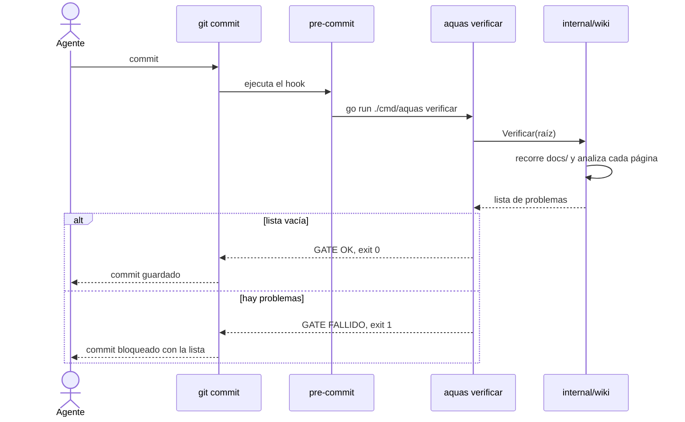
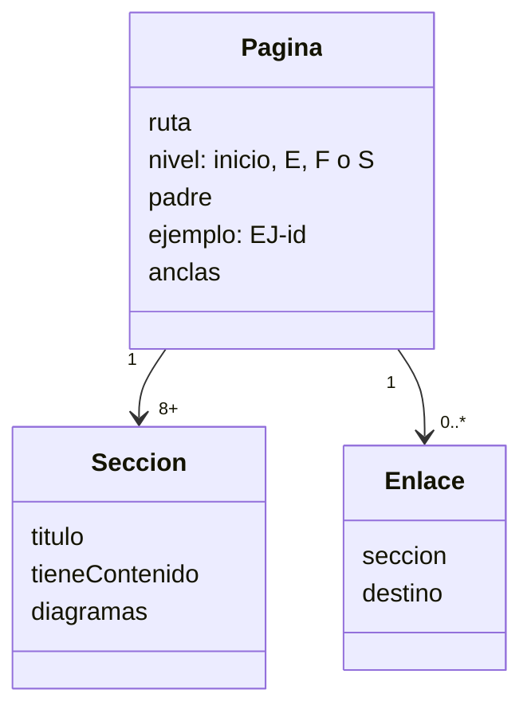
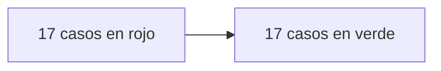

# S001 · Esqueleto de la wiki + gate

[Inicio](../../README.md) › [E001](../README.md) › [F001](README.md) › S001

[Slice](../../glosario.md#slice) que crea el árbol de la [wiki](../../glosario.md#wiki) y el programa en [Go](../../glosario.md#go) que lo revisa. Revisa estructura, secciones, diagramas, ejemplos y enlaces.

## En una frase

Un programa lee cada página de `docs/`, como un maestro que revisa un cuaderno, y anota cada cosa que falta.

## Para qué existe

**El problema.** Sin un revisor automático, la wiki se desordena. Aparecen páginas sin dibujo, enlaces que no llevan a ninguna parte y ejemplos sueltos.

**La solución.** El paquete Go [internal/wiki](../../../internal/wiki/wiki.go) revisa reglas fijas. Cada regla tiene una prueba que debe fallar y otra que debe pasar, en [wiki_test.go](../../../internal/wiki/wiki_test.go).

Contrato del slice:

| Campo | Valor |
|---|---|
| Objetivo | El gate rechaza una wiki incompleta y acepta una completa |
| Incluye | Rutas, secciones, diagramas por nivel, ejemplos encadenados, navegación, enlaces, anclas, alcance |
| Excluye | Glosario y legibilidad (S002); página obligatoria por entidad del backlog (llega con F002) |
| Prueba | `go test ./internal/wiki/` |
| Entrega | `aquas verificar` falla con la lista de problemas o dice «GATE OK» |

## Analogía

Piensa en un **maestro con una lista de chequeo**.

- Revisa cada cuaderno con la misma lista, sin saltarse ninguna línea.
- Si falta el dibujo, lo anota. Si una página dice «ver página 40» y el cuaderno tiene 30, lo anota.
- Al final entrega la lista completa, no solo el primer error.

Límite de la analogía: el maestro también juzga si el dibujo es bonito. El programa no: solo sabe si el dibujo existe y es del tipo correcto.

## Diagrama

Secuencia: qué pasa cuando alguien intenta hacer [commit](../../glosario.md#commit).

Datos: lo que el programa extrae de cada página.

## Ejemplo de punta a punta

continúa: [EJ-E001-F001](README.md#EJ-E001-F001)

En la [feature](../../glosario.md#feature) vimos que el enlace a `no-existe.md` deja la página **Incompleta**. Aquí vemos exactamente cómo lo detecta el programa.

1. Una página de prueba tiene esta línea en «Cómo se usa»: `Ver [x](no-existe.md).`
2. El programa encuentra el enlace con una expresión regular. Ignora los enlaces dentro de bloques de código.
3. Calcula la ruta: misma carpeta de la página + `no-existe.md`.
4. Pregunta al disco si ese archivo existe. No existe.
5. Anota: `docs/E001/F001/S001.md: enlace roto → no-existe.md`.
6. Sigue revisando el resto. Al final, `aquas verificar` imprime todo y sale con código 1.
7. El commit queda bloqueado.

La prueba real de este caso se llama `TestFallas/enlace_roto`. Antes de programar el [gate](../../glosario.md#gate), falló. Después, pasó.

## Paso a paso

Reglas que revisa el gate, con el mensaje que verás si fallan:

| Regla | Mensaje de ejemplo |
|---|---|
| Existe el inicio | `falta docs/README.md` |
| Ruta válida | `docs/notas.md: fuera del árbol` |
| Están las 8 secciones | `falta sección «Analogía»` |
| Ninguna sección vacía | `sección vacía «Cómo se usa»` |
| Secciones en orden fijo | `secciones fuera de orden` |
| Inicio y E tienen flujo | `falta diagrama flowchart` |
| F tiene flujo y estados | `falta diagrama stateDiagram` |
| S tiene datos o secuencia | `falta diagrama de datos o secuencia` |
| El ejemplo tiene su ancla | `falta ancla EJ-E001-F001` |
| F y S continúan al padre | `falta «continúa:»` o `continúa debe apuntar a…` |
| Navegación sube al padre | `Navegación sin ↑ Subir` |
| Navegación baja a cada hijo | `Navegación no enlaza docs/E001/F001/S002.md` |
| Enlaces a archivos existentes | `enlace roto → …` |
| Anclas existentes | `ancla inexistente → …` |
| Todo se alcanza desde el inicio | `inalcanzable desde docs/README.md` |

## Cómo se usa

- Revisar la wiki: `go run ./cmd/aquas verificar`.
- Correr las pruebas del gate: `go test ./internal/wiki/`.
- Las [anclas](../../glosario.md#ancla) valen de dos formas: `` o el título de una sección, como `#para-qué-existe`.

## Contrato y evidencia

Pruebas del slice, en `internal/wiki/wiki_test.go`:

| Prueba | Qué demuestra |
|---|---|
| `TestWikiValidaPasa` | Una wiki mínima completa pasa el gate |
| `TestEnlaceEnBloqueDeCodigoSeIgnora` | Un enlace dentro de código no se revisa |
| `TestAnclaPorTituloVale` | Un enlace a un título de la página cuenta como ancla |
| `TestFallas` | Cada error de estructura, diagrama, ejemplo o enlace da su aviso |

Rojo visto: sí. Los 17 casos de falla fallaron antes de programar el gate.

Commit: `0a83cb7`.

Decisión de Jesús: la wiki es obligatoria y la revisa un gate, no la buena voluntad.

## Navegación

- ↑ Subir: [F001 · Wiki + gate](README.md)
