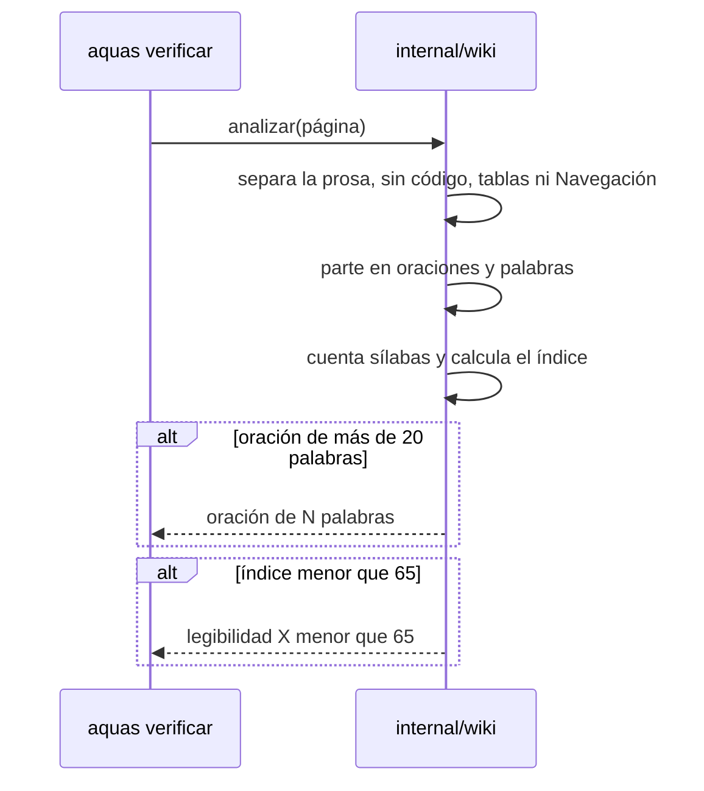
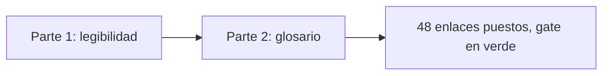

# S002 · Glosario + legibilidad

[Inicio](../../README.md) › [E001](../README.md) › [F001](README.md) › S002

[Slice](../../glosario.md#slice) que mide si la [wiki](../../glosario.md#wiki) se lee fácil. También revisa que cada palabra técnica lleve a su explicación en el [glosario](../../glosario.md).

## En una frase

Un programa cuenta sílabas, palabras y oraciones, y avisa si una página cuesta leerla.

## Para qué existe

**El problema.** Una página puede tener todas sus secciones y aun así ser difícil. Las oraciones largas y las palabras largas cansan.

**La solución.** El [gate](../../glosario.md#gate) mide cada página con una fórmula hecha para el español. Si la página queda difícil, bloquea el [commit](../../glosario.md#commit).

La fórmula se llama índice de perspicuidad de Szigriszt-Pazos:

`P = 206,835 − 62,3 × (sílabas ÷ palabras) − (palabras ÷ oraciones)`

La escala INFLESZ dice qué significa cada resultado:

| Índice | Grado | Ejemplo de texto |
|---|---|---|
| menos de 40 | Muy difícil | Textos universitarios |
| 40 a 54 | Algo difícil | Divulgación científica |
| 55 a 64 | Normal | Prensa general |
| 65 a 79 | Bastante fácil | Novelas populares |
| 80 o más | Muy fácil | Historietas |

Contrato del slice:

| Campo | Valor |
|---|---|
| Objetivo | Cada página llega a 65 o más, ninguna oración pasa de 20 palabras y cada término enlaza al glosario |
| Incluye | Conteo de sílabas, corte en oraciones, índice por página, tope por oración, glosario con ejemplo por término, enlace en la primera aparición |
| Excluye | Código, tablas, títulos, diagramas y Navegación |
| Límite | Una palabra técnica que nadie anotó en el glosario no se detecta: criterio humano |
| Prueba | `go test ./internal/wiki/` |

## Analogía

Piensa en una **balanza de mochilas** en la puerta del colegio.

- Cada palabra larga es un libro pesado.
- Cada oración larga es una mochila muy llena.
- Si la mochila pesa demasiado, no pasa.

Límite de la analogía: la balanza no sabe si los libros son buenos. La fórmula tampoco sabe si el texto es claro. Solo mide el peso.

## Diagrama

Secuencia: cómo se mide una página.

## Ejemplo de punta a punta

continúa: [EJ-E001-F001](README.md#EJ-E001-F001)

En la [feature](../../glosario.md#feature), el gate detectó un enlace roto. Ahora el mismo gate revisa cómo está escrita cada página.

1. Al activar esta regla, el gate revisó la wiki real.
2. Encontró seis oraciones largas. Una tenía 26 palabras: «Cada cosa que pides se anota, se parte en pedacitos…».
3. También encontró un error propio. En «**El problema.** Sin…», el punto quedaba pegado a la negrita y no cortaba.
4. Primero se escribió una prueba con ese caso. La prueba falló. Luego se arregló el programa y pasó.
5. Las seis oraciones se partieron en dos. El gate volvió a verde.

Luego llegó el glosario. Al activarlo, el gate pidió 48 enlaces en 5 páginas. Un script los puso y el gate confirmó cada uno. También apareció un falso aviso: «[Go](../../glosario.md#go)» dentro de `legibilidad.go`. Se probó en rojo y se corrigió.

Un cálculo pequeño: «El gato come pan.» tiene 4 palabras, 6 sílabas y 1 oración. El índice da 109,4: muy fácil.

## Paso a paso

Así cuenta el programa:

1. Quita el código, las tablas, los títulos y la Navegación.
2. De cada enlace, deja solo el texto que se ve.
3. Corta una oración en cada punto, pregunta o exclamación. También corta al final de cada párrafo o ítem.
4. Cuenta sílabas por grupos de vocales. Separa dos vocales fuertes, como en «le-er».
5. Separa también una vocal débil con tilde, como en «dí-a».
6. Calcula el índice con todas las oraciones de la página.

Así revisa el glosario:

1. Lee cada entrada `## término` de `docs/glosario.md`, con su línea `Variantes:` si la tiene.
2. Exige que cada entrada tenga definición y una línea `Ejemplo:`.
3. En cada página, busca la primera vez que aparece cada término, sin contar código ni nombres de archivo.
4. Esa primera vez debe ser un enlace a la entrada del término.

## Cómo se usa

- Revisar: `go build -o .tmp/aquas.exe ./cmd/aquas && ./.tmp/aquas.exe verificar`.
- Si sale «oración de N palabras», parte esa oración en dos.
- Si sale «legibilidad», usa palabras más cortas y oraciones más cortas.
- Si sale «primera aparición de…», copia el enlace que el mismo mensaje propone.
- Palabra técnica nueva: agrégala al glosario con definición y ejemplo.
- Límite: las palabras en inglés se cuentan con reglas del español. Un número cuenta como una sílaba. La medida es aproximada.
- Fuentes de la fórmula y la escala: comentario inicial de [legibilidad.go](../../../internal/wiki/legibilidad.go).

## Contrato y evidencia

<!-- GENERADO por aquas desde trabajo/: no editar a mano; `aquas compilar` lo rehace. -->

| Prueba | Valida | Rojo cuando | Verde cuando | Rojo | Verde |
|---|---|---|---|---|---|
| — | ficha anterior al registro de pruebas | — | — | — | — |

### Código

| Archivo | Función | Parámetros | Qué hace |
|---|---|---|---|
| [internal/wiki/glosario.go](../../../internal/wiki/glosario.go) | `terminos` | `(pg *pagina) []termino` | terminos extrae las entradas del glosario con sus formas (nombre + variantes). |
| [internal/wiki/glosario.go](../../../internal/wiki/glosario.go) | `revisarGlosario` | `(pg *pagina) []string` | revisarGlosario: cada término del glosario lleva definición y ejemplo. |
| [internal/wiki/glosario.go](../../../internal/wiki/glosario.go) | `revisarTerminos` | `(pg *pagina, ts []termino) []string` | revisarTerminos exige que la primera aparición en prosa de cada término enlace a su entrada. |
| [internal/wiki/glosario.go](../../../internal/wiki/glosario.go) | `faltantes` | `(pg *pagina, ts []termino) []falta` | faltantes: la detección que comparten el gate (revisarTerminos) y el arreglo (Enlazar). |
| [internal/wiki/glosario.go](../../../internal/wiki/glosario.go) | `relDesde` | `(desde, destino string) string` | relDesde da la ruta relativa de destino vista desde la carpeta de la página. |
| [internal/wiki/legibilidad.go](../../../internal/wiki/legibilidad.go) | `Silabas` | `(palabra string) int` | Silabas cuenta las sílabas de una palabra en español por núcleos vocálicos, |
| [internal/wiki/legibilidad.go](../../../internal/wiki/legibilidad.go) | `esVocalLetra` | `(r rune) bool` | esVocalLetra: la runa es vocal castellana, con o sin tilde. |
| [internal/wiki/legibilidad.go](../../../internal/wiki/legibilidad.go) | `hiato` | `(a, b rune) bool` | hiato: las dos vocales seguidas se cuentan como sílabas separadas. |
| [internal/wiki/legibilidad.go](../../../internal/wiki/legibilidad.go) | `oraciones` | `(lineas []string) [][]string` | oraciones parte la prosa en oraciones de palabras. Línea vacía o ítem de lista |
| [internal/wiki/legibilidad.go](../../../internal/wiki/legibilidad.go) | `palabrasDe` | `(texto string) []string` | palabrasDe: palabras de un texto de prosa, sin enlaces ni HTML. |
| [internal/wiki/legibilidad.go](../../../internal/wiki/legibilidad.go) | `sinAbierto` | `(s, siguiente string) string` | sinAbierto quita del final de s una etiqueta HTML o un enlace que cierra en la línea siguiente: |
| [internal/wiki/legibilidad.go](../../../internal/wiki/legibilidad.go) | `oracionesConLinea` | `(lineas []string, nums []int) ([][]string, []int)` | oracionesConLinea (E000/F006/S004): como oraciones, y además la línea donde empieza cada una, |
| [internal/wiki/legibilidad.go](../../../internal/wiki/legibilidad.go) | `Perspicuidad` | `(ors [][]string) float64` | Perspicuidad calcula el índice Szigriszt-Pazos; 0 si no hay palabras. |
| [internal/wiki/legibilidad.go](../../../internal/wiki/legibilidad.go) | `revisarLegibilidad` | `(pg *pagina) []string` | revisarLegibilidad: avisos por oraciones largas o prosa difícil de leer. |
| [internal/wiki/legibilidad.go](../../../internal/wiki/legibilidad.go) | `largas` | `(pg *pagina) []string` | largas: un aviso por oración de más de MaxPalabrasOracion, con la línea donde empieza. |
| [internal/wiki/legibilidad.go](../../../internal/wiki/legibilidad.go) | `OracionesLargas` | `(raiz, rel string) ([]string, error)` | OracionesLargas (E000/F006/S004): avisos de oración larga de una página de docs/, para el hook al guardar. |
| [internal/wiki/legibilidad.go](../../../internal/wiki/legibilidad.go) | `coma` | `(x float64) string` | coma formatea un número con un decimal y coma decimal. |
| [internal/wiki/wiki.go](../../../internal/wiki/wiki.go) | `Verificar` | `(raiz string) ([]string, error)` | Verificar devuelve los problemas de la wiki bajo raiz/docs; vacío = gate OK. |
| [internal/wiki/wiki.go](../../../internal/wiki/wiki.go) | `relativa` | `(raiz, p string) string` | relativa: ruta de p respecto de la raíz, con barras «/». |
| [internal/wiki/wiki.go](../../../internal/wiki/wiki.go) | `clasificar` | `(rel string) *pagina` | clasificar asigna nivel, padre e id de ejemplo según la ruta; nil = fuera del árbol. |
| [internal/wiki/wiki.go](../../../internal/wiki/wiki.go) | `pagina.agregarProsa` | `(texto string, linea int)` | agregarProsa suma una entrada de prosa con su línea en el archivo (E000/F006/S004). |
| [internal/wiki/wiki.go](../../../internal/wiki/wiki.go) | `analizar` | `(raiz string, pg *pagina) error` | analizar lee la página: secciones H2, diagramas, anclas (id HTML y títulos) y enlaces fuera de código. |
| [internal/wiki/wiki.go](../../../internal/wiki/wiki.go) | `slug` | `(s string) string` | slug al estilo GitHub/VS Code: minúsculas, letras/dígitos/-/_ se conservan, espacio → guion. |
| [internal/wiki/wiki.go](../../../internal/wiki/wiki.go) | `pagina.seccion` | `(titulo string) *seccion` | seccion busca una sección de la página por su título; nil si no está. |
| [internal/wiki/wiki.go](../../../internal/wiki/wiki.go) | `revisarSecciones` | `(pg *pagina) []string` | revisarSecciones: faltan secciones fijas o están fuera de orden. |
| [internal/wiki/wiki.go](../../../internal/wiki/wiki.go) | `revisarDiagramas` | `(pg *pagina) []string` | revisarDiagramas: la sección Diagrama trae el Mermaid que pide su nivel. |
| [internal/wiki/wiki.go](../../../internal/wiki/wiki.go) | `revisarEjemplo` | `(pg *pagina, paginas map[string]*pagina) []string` | revisarEjemplo: el ejemplo lleva su ancla EJ- y encadena con el del padre. |
| [internal/wiki/wiki.go](../../../internal/wiki/wiki.go) | `revisarNavegacion` | `(pg *pagina, hijos []string) []string` | revisarNavegacion: hay ↑ Subir y un enlace Abajo a cada hija. |
| [internal/wiki/wiki.go](../../../internal/wiki/wiki.go) | `revisarEnlaces` | `(raiz string, pg *pagina, anclas map[string]map[string]bool) []string` | revisarEnlaces: cada enlace interno apunta a un archivo y ancla que existen. |
| [internal/wiki/wiki.go](../../../internal/wiki/wiki.go) | `revisarAlcance` | `(paginas map[string]*pagina, orden []string) []string` | revisarAlcance: toda página del árbol debe alcanzarse desde docs/README.md siguiendo enlaces. |
| [internal/wiki/wiki.go](../../../internal/wiki/wiki.go) | `resolver` | `(desde, destino string) (string, string)` | resolver convierte un destino relativo a la página en ruta relativa a la raíz + fragmento. |

<!-- /GENERADO -->

Pruebas del slice:

| Prueba | Qué demuestra |
|---|---|
| `TestSilabas` | Cuenta bien las sílabas, con hiatos como «le-er» y «dí-a» |
| `TestPerspicuidad` | La fórmula da el número esperado |
| `TestOraciones` | Corta oraciones bien, también tras una negrita |
| `TestLegibilidadIgnoraCodigoTablasYNavegacion` | No mide código, tablas ni Navegación |
| `TestFallasLegibilidad` | Una página difícil o con oraciones largas da aviso |
| `TestGlosarioEnlazadoPasa` | Una página con sus términos enlazados pasa |
| `TestFallasGlosario` | Un término sin enlace o una entrada sin ejemplo dan aviso |
| `TestExtensionDeArchivoNoEsTermino` | «Go» dentro de `legibilidad.go` no cuenta como término |

Rojo visto: sí en los dos errores propios, el punto pegado a la negrita y el falso aviso de «Go». Del resto no quedó registro: NO CONFIRMADO.

Commits: `5428649` (legibilidad) y `2390223` (glosario).

Decisión de Jesús: piso 65 de la escala INFLESZ y 20 palabras por oración como máximo.

## Navegación

- ↑ Subir: [F001 · Wiki + gate](README.md)
