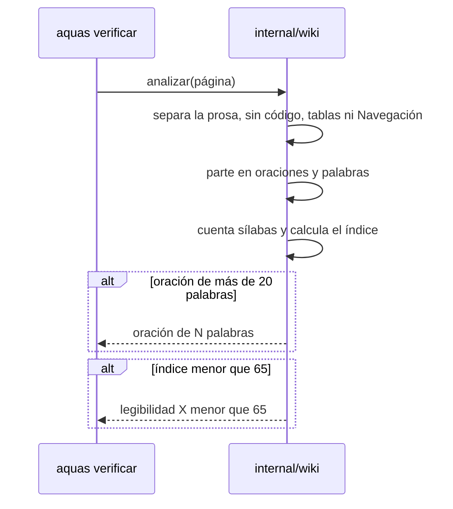

# S002 · Glosario + legibilidad

[Slice](../../glosario.md#slice) que mide si la [wiki](../../glosario.md#wiki) se lee fácil. También revisa que cada palabra técnica lleve a su explicación en el [glosario](../../glosario.md).

## En una frase

Un programa cuenta sílabas, palabras y oraciones, y avisa si una página cuesta leerla.

## Para qué existe

**El problema.** Una página puede tener todas sus secciones y aun así ser difícil. Las oraciones largas y las palabras largas cansan.

**La solución.** El [gate](../../glosario.md#gate) mide cada página con una fórmula hecha para el español. Si la página queda difícil, bloquea el [commit](../../glosario.md#commit).

La fórmula se llama índice de perspicuidad de Szigriszt-Pazos:

`P = 206,835 − 62,3 × (sílabas ÷ palabras) − (palabras ÷ oraciones)`

La escala INFLESZ dice qué significa cada resultado:

| Índice | Grado | Ejemplo de texto |
|---|---|---|
| menos de 40 | Muy difícil | Textos universitarios |
| 40 a 54 | Algo difícil | Divulgación científica |
| 55 a 64 | Normal | Prensa general |
| 65 a 79 | Bastante fácil | Novelas populares |
| 80 o más | Muy fácil | Historietas |

Contrato del slice:

| Campo | Valor |
|---|---|
| Objetivo | Cada página llega a 65 o más, ninguna oración pasa de 20 palabras y cada término enlaza al glosario |
| Incluye | Conteo de sílabas, corte en oraciones, índice por página, tope por oración, glosario con ejemplo por término, enlace en la primera aparición |
| Excluye | Código, tablas, títulos, diagramas y Navegación |
| Límite | Una palabra técnica que nadie anotó en el glosario no se detecta: criterio humano |
| Prueba | `go test ./internal/wiki/` |

## Analogía

Piensa en una **balanza de mochilas** en la puerta del colegio.

- Cada palabra larga es un libro pesado.
- Cada oración larga es una mochila muy llena.
- Si la mochila pesa demasiado, no pasa.

Límite de la analogía: la balanza no sabe si los libros son buenos. La fórmula tampoco sabe si el texto es claro. Solo mide el peso.

## Diagrama

Secuencia: cómo se mide una página.

## Ejemplo de punta a punta

continúa: [EJ-E001-F001](README.md#EJ-E001-F001)

En la [feature](../../glosario.md#feature), el gate detectó un enlace roto. Ahora el mismo gate revisa cómo está escrita cada página.

1. Al activar esta regla, el gate revisó la wiki real.
2. Encontró seis oraciones largas. Una tenía 26 palabras: «Cada cosa que pides se anota, se parte en pedacitos…».
3. También encontró un error propio. En «**El problema.** Sin…», el punto quedaba pegado a la negrita y no cortaba.
4. Primero se escribió una prueba con ese caso. La prueba falló. Luego se arregló el programa y pasó.
5. Las seis oraciones se partieron en dos. El gate volvió a verde.

Luego llegó el glosario. Al activarlo, el gate pidió 48 enlaces en 5 páginas. Un script los puso y el gate confirmó cada uno. También apareció un falso aviso: «[Go](../../glosario.md#go)» dentro de `legibilidad.go`. Se probó en rojo y se corrigió.

Un cálculo pequeño: «El gato come pan.» tiene 4 palabras, 6 sílabas y 1 oración. El índice da 109,4: muy fácil.

## Paso a paso

Así cuenta el programa:

1. Quita el código, las tablas, los títulos y la Navegación.
2. De cada enlace, deja solo el texto que se ve.
3. Corta una oración en cada punto, pregunta o exclamación. También corta al final de cada párrafo o ítem.
4. Cuenta sílabas por grupos de vocales. Separa dos vocales fuertes, como en «le-er».
5. Separa también una vocal débil con tilde, como en «dí-a».
6. Calcula el índice con todas las oraciones de la página.

Así revisa el glosario:

1. Lee cada entrada `## término` de `docs/glosario.md`, con su línea `Variantes:` si la tiene.
2. Exige que cada entrada tenga definición y una línea `Ejemplo:`.
3. En cada página, busca la primera vez que aparece cada término, sin contar código ni nombres de archivo.
4. Esa primera vez debe ser un enlace a la entrada del término.

## Cómo se usa

- Revisar: `go run ./cmd/aquas verificar`.
- Si sale «oración de N palabras», parte esa oración en dos.
- Si sale «legibilidad», usa palabras más cortas y oraciones más cortas.
- Si sale «primera aparición de…», copia el enlace que el mismo mensaje propone.
- Palabra técnica nueva: agrégala al glosario con definición y ejemplo.
- Límite: las palabras en inglés se cuentan con reglas del español. Un número cuenta como una sílaba. La medida es aproximada.
- Fuentes de la fórmula y la escala: comentario inicial de [legibilidad.go](../../../internal/wiki/legibilidad.go).

## Navegación

- ↑ Subir: [F001 · Wiki + gate](README.md)
