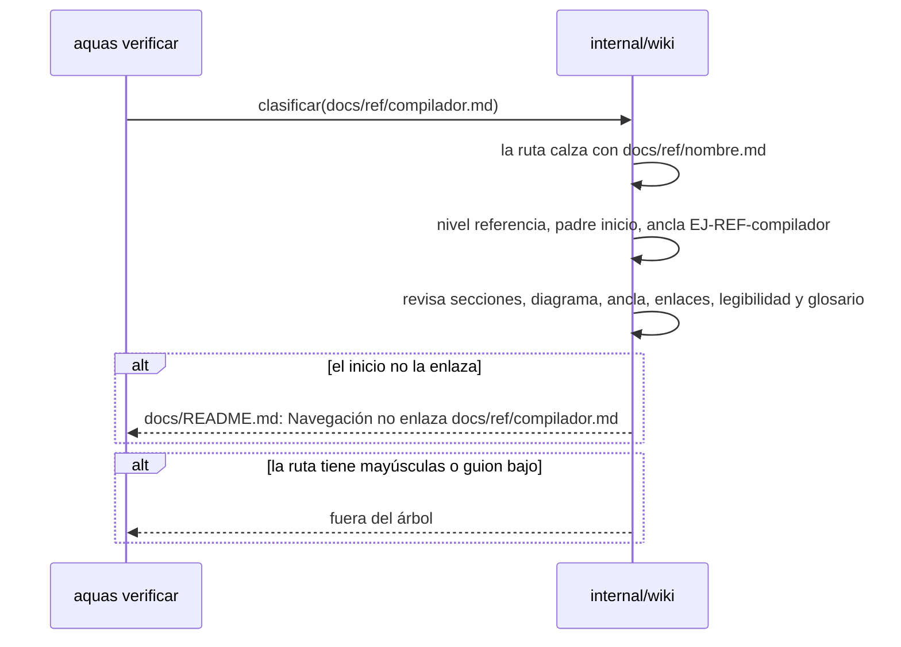
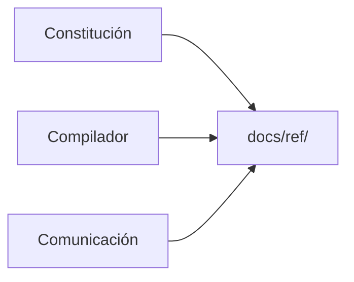

# S003 · Documentar lo existente

[Inicio](../../README.md) › [E001](../README.md) › [F001](README.md) › S003

[Slice](../../glosario.md#slice) que explica en la [wiki](../../glosario.md#wiki) las piezas que ya existían. Son tres: la constitución, el [compilador](../../glosario.md#compilador) y las reglas de comunicación.

## En una frase

Lo que ya estaba construido ahora también tiene su página, y el [gate](../../glosario.md#gate) la exige.

## Para qué existe

**El problema.** La wiki nació con la [iniciativa](../../glosario.md#iniciativa) E001. Pero la constitución y el compilador son anteriores. No eran una [feature](../../glosario.md#feature) ni un slice, así que no tenían dónde vivir.

**La solución.** Una carpeta nueva, `docs/ref/`, para páginas de referencia. El gate las trata como un nivel más del árbol.

Contrato del slice:

| Campo | Valor |
|---|---|
| Objetivo | Cada pieza existente tiene su página en `docs/ref/` y el gate la revisa |
| Incluye | Nivel «referencia» en el gate, páginas de constitución, compilador y comunicación |
| Excluye | El hook de usuario que revisa mensajes: vive fuera del repo |
| Límite | El gate no sabe si falta documentar una pieza. Exige que cada página esté bien, no que existan todas |
| Prueba | `go test ./internal/wiki/` |

Reglas de una página de referencia:

| Regla | Valor |
|---|---|
| Ruta | `docs/ref/<nombre>.md`, con minúsculas, dígitos y guiones |
| Secciones | Las mismas ocho, en el mismo orden |
| [Ancla](../../glosario.md#ancla) del ejemplo | `EJ-REF-<nombre>` |
| Diagrama | Al menos uno en Mermaid, de cualquier tipo |
| Ejemplo | No lleva «continúa:»; no cuelga del ejemplo de nadie |
| Navegación | ↑ Subir al inicio, y el inicio la enlaza |

## Analogía

Piensa en una **casa vieja** a la que le haces planos nuevos.

- Las habitaciones nuevas ya se construyen con plano.
- Pero la cocina y el baño estaban antes. También necesitan su plano.
- Ese plano no cuenta cómo se construyó la cocina. Cuenta cómo es y cómo se usa.

Límite de la analogía: aquí el inspector solo revisa los planos que existen. Si nadie dibuja el plano del garaje, nadie lo nota.

## Diagrama

Secuencia: cómo el gate reconoce una página de referencia.

## Ejemplo de punta a punta

continúa: [EJ-E001-F001](README.md#EJ-E001-F001)

En la feature, el gate aprendió a ver enlaces rotos. Ahora debe ver páginas que antes no tenían lugar.

1. Primero se escribieron ocho pruebas para el nivel nuevo. Siete fallaron con «fuera del árbol».
2. La octava ya pasaba: un nombre con mayúsculas debe seguir fuera. Es el caso de control.
3. Se agregó el nivel al gate. Las ocho pruebas pasaron.
4. Se escribieron las tres páginas. El gate pidió trece arreglos.
5. Seis venían de que el inicio aún no enlazaba las páginas. Siete eran términos sin enlace al glosario.
6. El glosario creció: «[agente](../../glosario.md#agente)», «[derivado](../../glosario.md#derivado)» y «[token](../../glosario.md#token)».
7. Tras los arreglos, el gate dio «GATE OK».

## Paso a paso

Para documentar una pieza que ya existe:

1. Elige un nombre corto en minúsculas, por ejemplo `compilador`.
2. Crea `docs/ref/compilador.md` con las ocho secciones.
3. En el ejemplo, pon ``. No pongas «continúa:».
4. Dibuja al menos un diagrama en [Mermaid](../../glosario.md#mermaid).
5. En Navegación, pon «↑ Subir» hacia `../README.md`.
6. En la Navegación del inicio, agrega el enlace a la página nueva.
7. Ejecuta `go run ./cmd/aquas verificar` hasta ver «GATE OK».

## Cómo se usa

- Páginas de este slice: [Constitución](../../ref/constitucion.md), [Compilador](../../ref/compilador.md) y [Comunicación](../../ref/comunicacion.md).
- Código del nivel nuevo: `reRef` y `nRef` en [wiki.go](../../../internal/wiki/wiki.go).
- Pruebas: [ref_test.go](../../../internal/wiki/ref_test.go).

## Contrato y evidencia

Pruebas del slice, en `internal/wiki/ref_test.go`:

| Prueba | Qué demuestra |
|---|---|
| `TestRefValidaPasa` | Una página de referencia completa pasa |
| `TestRefAceptaCualquierDiagrama` | En referencia vale cualquier tipo de diagrama |
| `TestFallasRef` | Sin ancla, sin diagrama o sin enlace desde el inicio da aviso |

Rojo visto: no quedó registrado. NO CONFIRMADO.

[Commit](../../glosario.md#commit): `c1d7218`.

Decisión de Jesús: lo que ya existía también se explica, con las mismas ocho secciones.

## Navegación

- ↑ Subir: [F001 · Wiki + gate](README.md)
