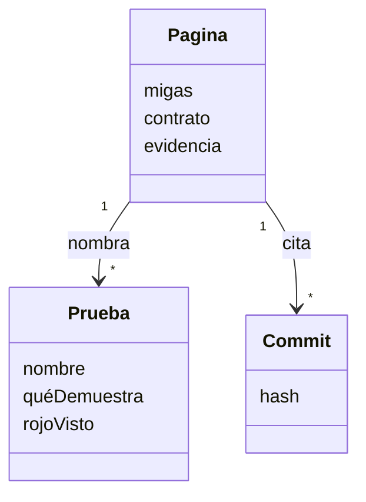
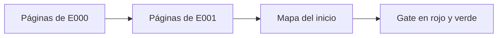

# S004 · Contrato y evidencia

[Inicio](../../README.md) › [E001](../README.md) › [F001](README.md) › S004

[Slice](../../glosario.md#slice) que suma a cada página lo pedido, lo logrado y sus pruebas.

## En una frase

Cada página dice qué prometimos, qué entregamos y qué prueba lo demuestra.

## Para qué existe

**El problema.** La [wiki](../../glosario.md#wiki) explicaba cómo funciona cada pieza, pero no qué se acordó. Para saber qué prueba respalda un slice había que buscar en los [commits](../../glosario.md#commit). Algunas pruebas no tenían dueño.

**La solución.** Tres cambios:

- Una sección «Contrato y evidencia» antes de la Navegación, en cada página E, F y S.
- Unas migas al principio de cada página: «Inicio › E › F › S».
- Una regla: cada prueba del repo la nombra algún slice, y cada prueba nombrada existe en el código.

Contrato del slice:

| Campo | Valor |
|---|---|
| Objetivo | Cada página E, F y S trae contrato, evidencia y migas, y un [gate](../../glosario.md#gate) lo exige |
| Incluye | Páginas de E000 y E001, mapa del inicio y el gate de sección 9, migas y trazabilidad |
| Excluye | Generar migas y mapa desde el backlog: llega con F002 |
| Prueba | `go test ./internal/wiki/` |

## Analogía

Piensa en la **etiqueta de un frasco de medicina**.

- La etiqueta dice qué contiene, para qué sirve y quién lo revisó.
- Sin etiqueta, el frasco puede estar bien, pero nadie lo puede comprobar.
- Las migas son la dirección del estante: farmacia › pasillo › repisa.

Límite de la analogía: la etiqueta de un frasco la pone la fábrica una vez. Aquí la evidencia crece con cada slice.

## Diagrama

Datos: qué une una página con sus pruebas.

## Ejemplo de punta a punta

continúa: [EJ-E001-F001](README.md#EJ-E001-F001)

En la [feature](../../glosario.md#feature), el [gate](../../glosario.md#gate) ya detectaba enlaces rotos. Ahora la pregunta es otra: ¿qué prueba demuestra que lo detecta?

1. Se abre la página de S001. La sección nueva nombra `TestFallas` y dice que se vio en rojo con 17 casos.
2. Se busca esa prueba en `internal/wiki/wiki_test.go`. Existe.
3. Al revisar todas las pruebas del repo, aparecen ocho del [compilador](../../glosario.md#compilador). Ninguna página las nombra.
4. Jesús decidió que vivan en E000/F002. Sus páginas las nombran.
5. Se enciende el gate. Ahora un `func Test…` sin slice dueño frena el commit.

## Paso a paso

Las tareas, en este orden:

1. Páginas de E000 con la sección nueva y migas.
2. Sección nueva y migas en las páginas de E001.
3. Mapa completo en el inicio.
4. El gate de sección 9, migas y trazabilidad, primero en rojo y luego en verde.

## Cómo se usa

- Al cerrar un slice, llena su sección «Contrato y evidencia».
- Pon las pruebas por nombre, qué demuestran, si se vio el rojo, commits y decisiones.
- Si no se sabe si se vio el rojo, escribe «NO CONFIRMADO». No lo supongas.
- Nombra cada prueba entre comillas invertidas, como `TestFallas`, dentro de esa sección.
- Si sale «migas ausentes o distintas», copia la línea que propone el mismo mensaje.
- Límite: el gate revisa que la sección exista y que las pruebas cuadren. No sabe si el contrato es honesto: criterio humano.

## Contrato y evidencia

<!-- GENERADO por aquas desde trabajo/: no editar a mano; `aquas compilar` lo rehace. -->

| Prueba | Valida | Rojo cuando | Verde cuando | Rojo | Verde |
|---|---|---|---|---|---|
| — | ficha anterior al registro de pruebas | — | — | — | — |

### Código

| Archivo | Función | Parámetros | Qué hace |
|---|---|---|---|
| [internal/wiki/contrato.go](../../../internal/wiki/contrato.go) | `seccionesDe` | `(n nivel) []string` | seccionesDe: orden fijo de secciones según el nivel de la página. |
| [internal/wiki/contrato.go](../../../internal/wiki/contrato.go) | `migasEsperadas` | `(pg *pagina) string` | migasEsperadas: migas «Inicio › E001 › F001», cada nivel con enlace relativo a la página. |
| [internal/wiki/contrato.go](../../../internal/wiki/contrato.go) | `revisarMigas` | `(pg *pagina) []string` | revisarMigas: aviso si las migas de pan no coinciden con la ruta de la página. |
| [internal/wiki/contrato.go](../../../internal/wiki/contrato.go) | `revisarTrazabilidad` | `(raiz string, paginas map[string]*pagina, orden []string) ([]string, error)` | revisarTrazabilidad cruza las pruebas nombradas en los slices con las func Test del repo. |
| [internal/wiki/contrato.go](../../../internal/wiki/contrato.go) | `integralesDe` | `(raiz, rel string) []string` | integralesDe: nombres de las func Test que declara la ficha de la feature de la página rel; ninguno si no hay ficha. |
| [internal/wiki/contrato.go](../../../internal/wiki/contrato.go) | `pruebasDelRepo` | `(raiz string) (map[string]string, error)` | pruebasDelRepo: nombre de cada func Test → archivo; salta carpetas ocultas (.git, .tmp). |
| [internal/wiki/wiki.go](../../../internal/wiki/wiki.go) | `Verificar` | `(raiz string) ([]string, error)` | Verificar devuelve los problemas de la wiki bajo raiz/docs; vacío = gate OK. |
| [internal/wiki/wiki.go](../../../internal/wiki/wiki.go) | `relativa` | `(raiz, p string) string` | relativa: ruta de p respecto de la raíz, con barras «/». |
| [internal/wiki/wiki.go](../../../internal/wiki/wiki.go) | `clasificar` | `(rel string) *pagina` | clasificar asigna nivel, padre e id de ejemplo según la ruta; nil = fuera del árbol. |
| [internal/wiki/wiki.go](../../../internal/wiki/wiki.go) | `analizar` | `(raiz string, pg *pagina) error` | analizar lee la página: secciones H2, diagramas, anclas (id HTML y títulos) y enlaces fuera de código. |
| [internal/wiki/wiki.go](../../../internal/wiki/wiki.go) | `slug` | `(s string) string` | slug al estilo GitHub/VS Code: minúsculas, letras/dígitos/-/_ se conservan, espacio → guion. |
| [internal/wiki/wiki.go](../../../internal/wiki/wiki.go) | `pagina.seccion` | `(titulo string) *seccion` | seccion busca una sección de la página por su título; nil si no está. |
| [internal/wiki/wiki.go](../../../internal/wiki/wiki.go) | `revisarSecciones` | `(pg *pagina) []string` | revisarSecciones: faltan secciones fijas o están fuera de orden. |
| [internal/wiki/wiki.go](../../../internal/wiki/wiki.go) | `revisarDiagramas` | `(pg *pagina) []string` | revisarDiagramas: la sección Diagrama trae el Mermaid que pide su nivel. |
| [internal/wiki/wiki.go](../../../internal/wiki/wiki.go) | `revisarEjemplo` | `(pg *pagina, paginas map[string]*pagina) []string` | revisarEjemplo: el ejemplo lleva su ancla EJ- y encadena con el del padre. |
| [internal/wiki/wiki.go](../../../internal/wiki/wiki.go) | `revisarNavegacion` | `(pg *pagina, hijos []string) []string` | revisarNavegacion: hay ↑ Subir y un enlace Abajo a cada hija. |
| [internal/wiki/wiki.go](../../../internal/wiki/wiki.go) | `revisarEnlaces` | `(raiz string, pg *pagina, anclas map[string]map[string]bool) []string` | revisarEnlaces: cada enlace interno apunta a un archivo y ancla que existen. |
| [internal/wiki/wiki.go](../../../internal/wiki/wiki.go) | `revisarAlcance` | `(paginas map[string]*pagina, orden []string) []string` | revisarAlcance: toda página del árbol debe alcanzarse desde docs/README.md siguiendo enlaces. |
| [internal/wiki/wiki.go](../../../internal/wiki/wiki.go) | `resolver` | `(desde, destino string) (string, string)` | resolver convierte un destino relativo a la página en ruta relativa a la raíz + fragmento. |

### Arreglos

| Arreglo | Qué arregla | Por qué | Pruebas | Fecha | Rojo | Verde |
|---|---|---|---|---|---|---|
| X01 | La integral de una feature tiene dueño en el README de su feature | D000025: la integral escrita primero no tenía página de slice donde vivir | `TestIntegralConDuenoEnSuFeature` | 2026-10-23 | 2026-10-23 | 2026-10-23 |

<!-- /GENERADO -->

Estado: hecho.

| Tarea | Estado |
|---|---|
| Páginas de E000 | Hecha, commit `b032b59` |
| Sección nueva y migas en E001 | Hecha, commit `084a3e2` |
| Dueño de las pruebas del compilador | Hecha, commit `fd6232d` |
| Mapa del inicio | Hecha, commit `6e9ee95` |
| Gate de sección 9, migas y trazabilidad | Hecha en el commit que cierra el slice |

Pruebas del slice, en `internal/wiki/contrato_test.go`:

| Prueba | Qué demuestra |
|---|---|
| `TestFallasContrato` | Ocho errores dan su aviso: sin sección, sección fuera de orden, migas ausentes o equivocadas, prueba fantasma, prueba sin dueño |
| `TestPruebaConDuenoPasa` | Una prueba nombrada por su slice pasa; las carpetas ocultas como `.tmp/` no cuentan |
| `TestInicioYRefSinContratoNiMigasPasan` | El inicio y las páginas de referencia no necesitan la sección ni las migas |

Rojo visto: sí. Los ocho casos de `TestFallasContrato` fallaron antes de programar el gate. Las dos pruebas que deben pasar ya pasaban, como se esperaba.

Al encender el gate sobre la wiki real, frenó tres pruebas sin dueño: las de este mismo slice. Esta tabla las nombra.

Decisiones de Jesús (2026-10-20):

- El manual de `docs/ref/` explica cómo funciona; las páginas E, F y S son contrato y evidencia.
- Las migas y el mapa se escriben a mano hasta F002; luego los genera `aquas`.
- Contenido primero y gate al final, para no bloquear el [pre-commit](../../glosario.md#pre-commit).

La integral de una feature tiene dueño en el README de su feature si su ficha la declara: `TestIntegralConDuenoEnSuFeature` (D000025).

## Navegación

- ↑ Subir: [F001 · Wiki + gate](README.md)
