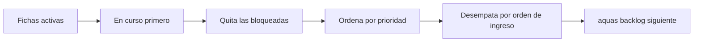
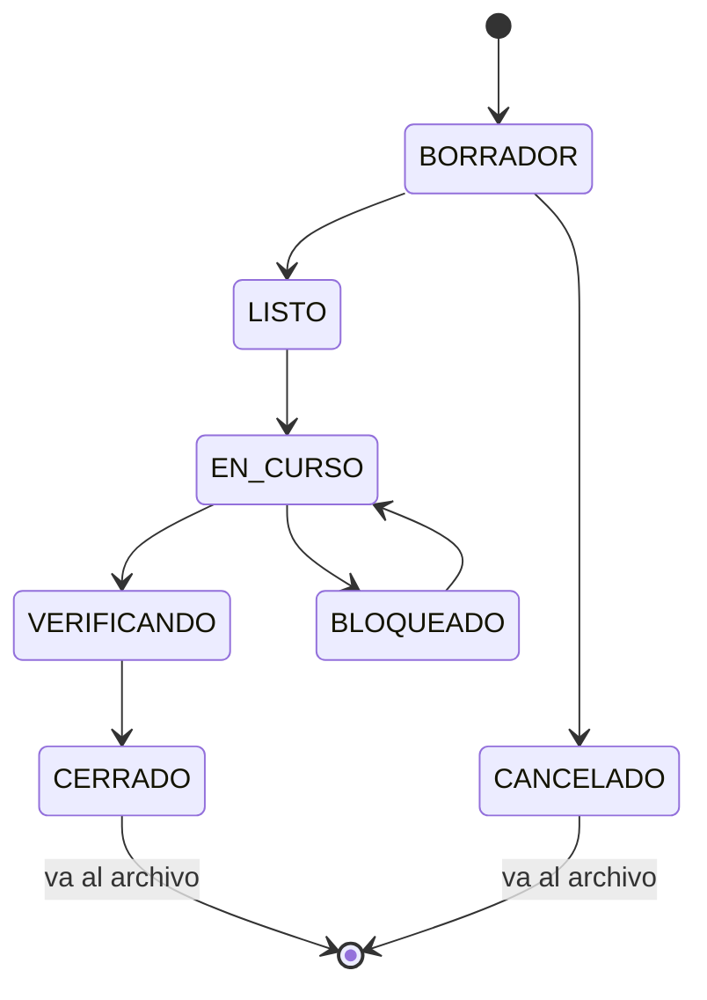
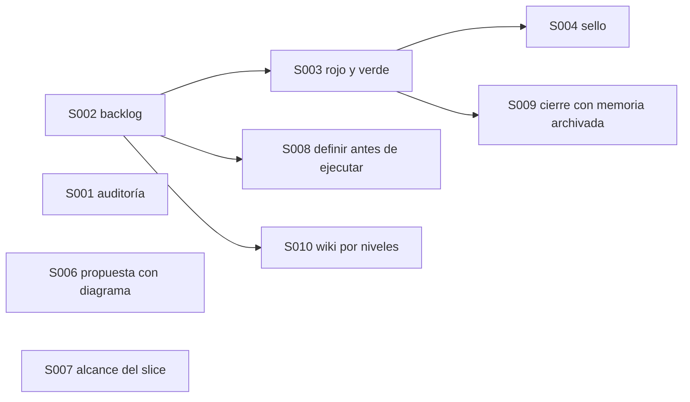

# F002 · Turnos, backlog y sello

[Inicio](../../README.md) › [E001](../README.md) › F002

[Feature](../../glosario.md#feature) que pasa el orden del trabajo a archivos que guarda `aquas`. Así el orden no depende de la memoria del [agente](../../glosario.md#agente).

## En una frase

La lista de tareas deja de estar en la cabeza del capataz y pasa a un tablero con fichas.

## Para qué existe

**El problema.** El [backlog](../../glosario.md#backlog) vivía en un texto largo del [canónico](../../glosario.md#canónico). El agente lo leía y decidía el orden a mano. Nada impedía que se saltara un paso o se equivocara de prioridad.

**La solución.** Un archivo JSON por elemento, que solo escribe `aquas`:

- Cada [iniciativa](../../glosario.md#iniciativa), feature y [slice](../../glosario.md#slice) tiene su ficha con estado y prioridad.
- `aquas backlog siguiente` dice qué toca, con un orden fijo.
- Lo cerrado pasa al archivo, y queda la traza.

## Analogía

Piensa en un **tablero de fichas** en una oficina.

- Cada tarea es una ficha con su prioridad escrita.
- Solo el encargado mueve fichas; nadie las tacha a mano.
- Las terminadas van a una caja, no a la basura.

Límite de la analogía: en el tablero cualquiera puede mover una ficha si nadie mira. Aquí la guardia bloquea que el agente edite los archivos a mano.

## Diagrama

Proceso: cómo se elige el siguiente trabajo.

Estados de una ficha:

Slices de esta feature:

| Slice | Qué entrega |
|---|---|
| [S001 Auditoría](S001.md) | Guardar cada pedido tal cual, con su respuesta |
| [S002 Backlog en JSON](S002.md) | Fichas en JSON, cinco comandos, guardia y migración |
| [S003 Rojo y verde](S003.md) | El slice no cierra sin prueba en rojo y luego en verde |
| [S004 Sello ](S004.md) | Lista de lo que hay que revisar al cerrar un slice |
| [S006 Propuesta con diagrama ](S006.md) | Un hook exige diagrama en cada propuesta |
| S008 Definir antes de ejecutar | `siguiente` pide definir lo que no tiene hijos antes de dar slices |
| [S009 Cerrar exige memoria archivada](S009.md) | Ningún slice cierra con su memoria sin archivar |
| S007 Alcance del slice | Solo se tocan archivos dentro del alcance del slice |
| [S010 Wiki por niveles](S010.md) | Cada página lista sus hijos directos, generados desde las fichas |

## Ejemplo de punta a punta

continúa: [EJ-E001](../README.md#EJ-E001)

En la iniciativa, el pedido de Jesús ya es trabajo. Ahora hay que ubicarlo en la cola.

1. El agente crea la ficha del slice con prioridad P1 y su motivo.
2. Pide `aquas backlog siguiente`.
3. `aquas` responde con el slice que toca, sin que el agente elija.
4. Al cerrar el slice, su ficha pasa al archivo.

## Paso a paso

1. S001: auditoría de turnos.
2. S002: backlog en JSON y sus comandos.
3. S003: rojo y verde del slice.
4. S004: [sello](../../glosario.md#sello) de cierre.
5. S005: cancelado; lo reemplaza S010.
6. S006: propuesta con diagrama.
7. S007: archivos solo dentro del alcance del slice.
8. S008: definir antes de ejecutar.
9. S009: cerrar exige memoria archivada.
10. S010: [wiki](../../glosario.md#wiki) por niveles, generada desde las fichas.

## Cómo se usa

- Ver lo activo: `go run ./cmd/aquas backlog ver`.
- Qué toca: `go run ./cmd/aquas backlog siguiente`.
- Los archivos viven en `trabajo/activo/` y `trabajo/archivo/`. No se editan a mano.

## Contrato y evidencia

Estado: en curso. El estado de cada slice está en la tabla de Navegación, generada desde las fichas.

Objetivo: que el orden y el estado del trabajo los guarde un programa, no el agente.

Por qué varios slices: cada uno se usa solo. El backlog sirve sin auditoría, y el rojo y verde sirve sin sello.

Orden: S002 va primero por prioridad. Jesús la fijó en P1 el 2026-10-21.

Dependencias entre slices. El estado no va aquí: está en la tabla generada de Navegación.

Prueba integral de la feature: `TestCerrarSliceDePuntaAPunta`, en `cmd/aquas/rojo_test.go`. Un slice nace con su prueba, ve su rojo y su verde, y se archiva. Hoy pasa en verde.

## Navegación

<!-- GENERADO por aquas desde trabajo/: no editar a mano; `aquas compilar` lo rehace. -->

| Hijo | Qué es | Estado |
|---|---|---|
| [S001](S001.md) | Auditoría de turnos | Hecho |
| [S002](S002.md) | Backlog en JSON | Hecho |
| [S003](S003.md) | Rojo y verde del slice | Hecho |
| [S004](S004.md) | Sello de cierre | Hecho |
| S005 | aquas ver | Cancelado |
| [S006](S006.md) | Propuesta con diagrama | Hecho |
| [S007](S007.md) | Archivos solo dentro del alcance del slice | Hecho |
| [S008](S008.md) | siguiente avisa features sin slices | Hecho |
| [S009](S009.md) | Cerrar exige memoria archivada | Hecho |
| [S010](S010.md) | Wiki por niveles generada desde las fichas | Hecho |
| S011 | La ficha dice qué hace | Planeado |
| S012 | Sello: nivel trabajo | Planeado |
| [S013](S013.md) | Sello sin commit base | Hecho |
| [S014](S014.md) | Sello sin ruido de derivados | Hecho |
| S015 | Sello rechaza el mismo motivo repetido en lote | Planeado |
| [S016](S016.md) | Insight PROPUESTO exige defecto registrado | Hecho |
| [S017](S017.md) | Padre no cierra con hijos abiertos | Hecho |
| [S018](S018.md) | Rojo heredado solo de slices cerrados | Hecho |
| S019 | Rojo de subtest guarda su motivo | Planeado |

### Arreglos

| Arreglo | Qué arregla | Por qué | Pruebas | Fecha | Rojo | Verde |
|---|---|---|---|---|---|---|
| X01 | Padre no cierra con hijos abiertos | D000030: E001/F010 cerró con S001 EN_CURSO; E001/F003 archivada con S003-S005 en BORRADOR | — | 2026-10-24 | — | — |

<!-- /GENERADO -->

- ↑ Subir: [E001 · Gobierno del trabajo](../README.md)
- Abajo: [S002 · Backlog en JSON](S002.md)
- Abajo: [S003 · Rojo y verde](S003.md)
- Abajo: [S009 · Cerrar exige memoria archivada](S009.md)
- Abajo: [S016 · Insight PROPUESTO exige defecto registrado](S016.md)
