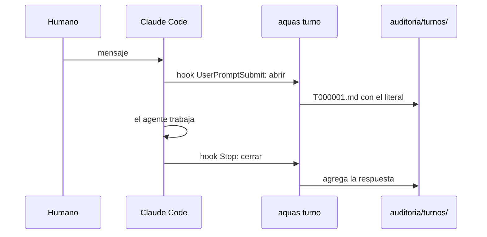

# S001 · Auditoría de turnos

[Inicio](../../README.md) › [E001](../README.md) › [F002](README.md) › S001

[Slice](../../glosario.md#slice) que guarda cada turno: tu mensaje tal cual y la respuesta del [agente](../../glosario.md#agente). Lo escriben dos [hooks](../../glosario.md#hook), no el agente.

## En una frase

Cada mensaje tuyo queda guardado con su respuesta, sin que el agente pueda cambiarlo.

## Para qué existe

**El problema.** Lo que pediste se perdía. Solo quedaba lo que el agente entendió, y eso puede estar mal. No había forma de comparar lo pedido con lo hecho.

**La solución.** Un turno es un mensaje tuyo más la respuesta del agente. Al llegar tu mensaje, un hook abre un archivo del turno con el texto exacto. Al terminar, otro hook agrega la respuesta. El agente no escribe ahí: la guardia lo bloquea.

Contrato del slice:

| Campo | Valor |
|---|---|
| Objetivo | Guardar el literal y la respuesta de cada turno, sin pasar por el agente |
| Incluye | `aquas turno abrir`, `aquas turno cerrar`, sus dos hooks, guardia de `auditoria/` |
| Excluye | El pedido refinado, la diferencia entre lo pedido y lo hecho, y los turnos de los workers |
| Prueba | `go test ./internal/turno/ ./internal/guardia/ ./internal/entorno/ ./cmd/aquas/` |

Decisión del [canónico](../../glosario.md#canónico) E001: la carpeta `auditoria/` queda fuera de Git. Todo se guarda, sensible o no, y el respaldo lo haces tú.

## Analogía

Piensa en la **caja negra de un avión**.

- Graba lo que se dijo en cabina, palabra por palabra.
- El piloto no puede editarla.

Límite de la analogía: aquí no hay accidente que esperar. El registro sirve para comparar lo pedido con lo hecho cuando haga falta.

## Diagrama

Secuencia de un turno:

## Ejemplo de punta a punta

continúa: [EJ-E001-F002](README.md#EJ-E001-F002)

Escribes «haz X» con un bloque de código dentro.

1. El hook de entrada crea `auditoria/turnos/2026-10/T000001.md`.
2. El archivo trae tu texto exacto, dentro de una cerca más larga que tus propias comillas invertidas.
3. Termina el turno y el hook de cierre agrega la respuesta.
4. Si otro hook frena el cierre, el cierre se repite. Gana la última respuesta, sin duplicarse.

## Paso a paso

1. Leer en la documentación oficial qué recibe cada hook. VERIFICADO el 2026-10-21 en `code.claude.com/docs/en/hooks`.
2. Escribir las siete pruebas y verlas en rojo con un paquete vacío.
3. Escribir `internal/turno/turno.go`: numeración, archivo del turno y estado por sesión.
4. Cablear el CLI, la plantilla de hooks, la guardia y el `.gitignore`.

## Cómo se usa

- No se usa a mano. Los hooks corren solos en cada turno.
- Para leer un turno, abre su archivo en `auditoria/turnos/AAAA-MM/`.
- Los números nunca se reutilizan: si borras uno, el siguiente sigue la cuenta.

## Contrato y evidencia

<!-- GENERADO por aquas desde trabajo/: no editar a mano; `aquas compilar` lo rehace. -->

| Prueba | Valida | Rojo cuando | Verde cuando | Rojo | Verde |
|---|---|---|---|---|---|
| `TestAbrirGuardaLiteralIntacto` | el mensaje del humano queda tal cual, aunque traiga backticks o títulos | — | — | 2026-10-21 | 2026-10-21 |
| `TestNumeracionSinReutilizar` | cada turno lleva el número siguiente, también al cambiar de mes | — | — | 2026-10-21 | 2026-10-21 |
| `TestCerrarGuardaRespuesta` | la respuesta queda en su turno; un segundo cierre la reemplaza | — | — | 2026-10-21 | 2026-10-21 |
| `TestCerrarSinTurnoAbierto` | sin turno abierto de esa sesión, el cierre no escribe nada | — | — | 2026-10-21 | 2026-10-21 |
| `TestGuardiaProtegeAuditoria` | nadie salvo aquas escribe en auditoria/ | — | — | 2026-10-21 | 2026-10-21 |
| `TestSettingsRealTraeHooksDeTurno` | la plantilla real abre turno al recibir el mensaje y lo cierra al terminar | — | — | 2026-10-21 | 2026-10-21 |
| `TestTurnoCLIDePuntaAPunta` | por el CLI real, un turno se abre, se cierra y queda fuera de Git | — | — | 2026-10-21 | 2026-10-21 |

<!-- /GENERADO -->

Estado: hecho.

Límites:

- El hook de entrada también corre con mensajes que no escribiste tú, como los avisos de otras sesiones. También se guardan.
- Cada hook compila `aquas` antes de correr, igual que los demás. Eso suma unos segundos por turno.

## Navegación

- ↑ Subir: [F002 · Turnos, backlog y sello](README.md)
