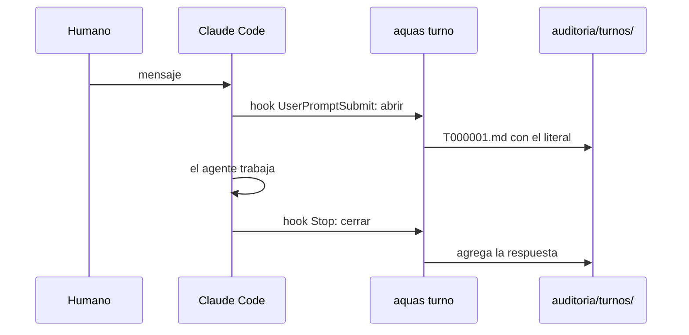

# S001 · Auditoría de turnos

[Inicio](../../README.md) › [E001](../README.md) › [F002](README.md) › S001

[Slice](../../glosario.md#slice) que guarda cada turno: tu mensaje tal cual y la respuesta del [agente](../../glosario.md#agente). Lo escriben dos [hooks](../../glosario.md#hook), no el agente.

## En una frase

Cada mensaje tuyo queda guardado con su respuesta, sin que el agente pueda cambiarlo.

## Para qué existe

**El problema.** Lo que pediste se perdía. Solo quedaba lo que el agente entendió, y eso puede estar mal. No había forma de comparar lo pedido con lo hecho.

**La solución.** Un turno es un mensaje tuyo más la respuesta del agente. Al llegar tu mensaje, un hook abre un archivo del turno con el texto exacto. Al terminar, otro hook agrega la respuesta. El agente no escribe ahí: la guardia lo bloquea.

Contrato del slice:

| Campo | Valor |
|---|---|
| Objetivo | Guardar el literal y la respuesta de cada turno, sin pasar por el agente |
| Incluye | `aquas turno abrir`, `aquas turno cerrar`, sus dos hooks, guardia de `auditoria/` |
| Excluye | El pedido refinado, la diferencia entre lo pedido y lo hecho, y los turnos de los workers |
| Prueba | `go test ./internal/turno/ ./internal/guardia/ ./internal/entorno/ ./cmd/aquas/` |

Decisión del [canónico](../../glosario.md#canónico) E001: la carpeta `auditoria/` queda fuera de Git. Todo se guarda, sensible o no, y el respaldo lo haces tú.

## Analogía

Piensa en la **caja negra de un avión**.

- Graba lo que se dijo en cabina, palabra por palabra.
- El piloto no puede editarla.

Límite de la analogía: aquí no hay accidente que esperar. El registro sirve para comparar lo pedido con lo hecho cuando haga falta.

## Diagrama

Secuencia de un turno:

## Ejemplo de punta a punta

continúa: [EJ-E001-F002](README.md#EJ-E001-F002)

Escribes «haz X» con un bloque de código dentro.

1. El hook de entrada crea `auditoria/turnos/2026-10/T000001.md`.
2. El archivo trae tu texto exacto, dentro de una cerca más larga que tus propias comillas invertidas.
3. Termina el turno y el hook de cierre agrega la respuesta.
4. Si otro hook frena el cierre, el cierre se repite. Gana la última respuesta, sin duplicarse.

## Paso a paso

1. Leer en la documentación oficial qué recibe cada hook. VERIFICADO el 2026-10-21 en `code.claude.com/docs/en/hooks`.
2. Escribir las siete pruebas y verlas en rojo con un paquete vacío.
3. Escribir `internal/turno/turno.go`: numeración, archivo del turno y estado por sesión.
4. Cablear el CLI, la plantilla de hooks, la guardia y el `.gitignore`.

## Cómo se usa

- No se usa a mano. Los hooks corren solos en cada turno.
- Para leer un turno, abre su archivo en `auditoria/turnos/AAAA-MM/`.
- Los números nunca se reutilizan: si borras uno, el siguiente sigue la cuenta.

## Contrato y evidencia

<!-- GENERADO por aquas desde trabajo/: no editar a mano; `aquas compilar` lo rehace. -->

| Prueba | Valida | Rojo cuando | Verde cuando | Rojo | Verde |
|---|---|---|---|---|---|
| `TestAbrirGuardaLiteralIntacto` | el mensaje del humano se guarda tal cual | el literal pierde backticks, sangría o su cerca | el turno trae el literal en cerca larga y la respuesta en «—» | 2026-10-21 | 2026-10-21 |
| `TestNumeracionSinReutilizar` | el número de turno no se reutiliza ni al cambiar de mes | un turno repite número o reutiliza un hueco borrado | T000001 a T000003 entre meses y tras borrar sigue T000004 | 2026-10-21 | 2026-10-21 |
| `TestCerrarGuardaRespuesta` | cerrar guarda la respuesta en su turno | la respuesta cae en otro turno o se duplica al repetir | la respuesta y la hora de cierre quedan; la última reemplaza | 2026-10-21 | 2026-10-21 |
| `TestCerrarSinTurnoAbierto` | sin turno abierto de esa sesión el cierre no escribe | cerrar crea auditoria/ o escribe en el turno de otra sesión | devuelve vacío sin error y no crea ni toca archivos | 2026-10-21 | 2026-10-21 |
| `TestGuardiaProtegeAuditoria` | solo aquas escribe en auditoria/ | Write o Bash a auditoria/ pasa, o un nombre parecido se bloquea | Write y Bash bloquean con «auditoría»; docs/auditoria.md pasa | 2026-10-21 | 2026-10-21 |
| `TestSettingsRealTraeHooksDeTurno` | la plantilla abre y cierra turno por hooks | falta UserPromptSubmit turno abrir o Stop turno cerrar | trae turno abrir, turno cerrar y memoria cierre | 2026-10-21 | 2026-10-21 |
| `TestTurnoCLIDePuntaAPunta` | por el CLI real un turno se abre, se cierra y queda fuera de Git | abrir o cerrar escriben stdout, el literal se altera, la entrada rota no da exit 1 o auditoria/ entra en Git | abrir y cerrar salen 0 sin stdout y guardan el literal; entrada rota sale 1; auditoria/ ignorada | 2026-10-21 | 2026-10-21 |

### Código

| Archivo | Función | Parámetros | Qué hace |
|---|---|---|---|
| [cmd/aquas/main.go](../../../cmd/aquas/main.go) | `main` | `()` | main despacha el subcomando de aquas (compilar, verificar, backlog, hooks…) y sale con su código. |
| [cmd/aquas/main.go](../../../cmd/aquas/main.go) | `hook` | `(raiz string)` | hook: exit 0 = nada que reportar; exit 2 = stderr se muestra a Claude. |
| [cmd/aquas/main.go](../../../cmd/aquas/main.go) | `compilarSettings` | `(w io.Writer)` | compilarSettings regenera .claude/settings.json; sin entorno declarado no inventa uno. |
| [cmd/aquas/main.go](../../../cmd/aquas/main.go) | `reportar` | `(w io.Writer, inf compilador.Informe)` | reportar imprime qué derivados escribió la compilación, o que todo estaba al día. |
| [cmd/aquas/main.go](../../../cmd/aquas/main.go) | `listar` | `(titulo string, problemas []string)` | listar imprime en stderr un título y cada problema en su viñeta. |
| [cmd/aquas/main.go](../../../cmd/aquas/main.go) | `lista` | `(xs []string) string` | lista une los textos con comas, o «—» si no hay ninguno. |
| [cmd/aquas/main.go](../../../cmd/aquas/main.go) | `fallar` | `(codigo int, err error)` | fallar imprime el error en stderr y termina con el código dado. |
| [cmd/aquas/main.go](../../../cmd/aquas/main.go) | `memoriaCLI` | `(raiz string, args []string)` | memoriaCLI: `ver` imprime la memoria; `fijar campo=valor…` la actualiza y la sella. |
| [cmd/aquas/main.go](../../../cmd/aquas/main.go) | `memoriaArchivada` | `(raiz, id string) error` | memoriaArchivada: CERRADO exige el archivo de memoria del slice, apunte o no la memoria a él (E001/F002/S009, X01). |
| [cmd/aquas/main.go](../../../cmd/aquas/main.go) | `focoEnBacklog` | `(raiz string, f memoria.Foco) error` | focoEnBacklog: la memoria solo fija el slice que el backlog tiene en curso (S003). |
| [cmd/aquas/main.go](../../../cmd/aquas/main.go) | `backlogCLI` | `(raiz string, args []string)` | backlogCLI: nuevo \\| ver [id] \\| prioridad \\| estado \\| siguiente \\| pruebas \\| rojo \\| verde. |
| [cmd/aquas/main.go](../../../cmd/aquas/main.go) | `turnoCLI` | `(raiz string, args []string)` | turnoCLI: auditoría de turnos (E001/F002/S001). Lee el JSON del hook por stdin. No imprime nada |
| [cmd/aquas/main.go](../../../cmd/aquas/main.go) | `defectoCLI` | `(raiz string, args []string) error` | defectoCLI: nuevo \\| ocurre \\| ver (E001/F004/S001). |
| [cmd/aquas/main.go](../../../cmd/aquas/main.go) | `versionBinario` | `() string` | versionBinario: versión del módulo con que se compiló el binario (= versión del gobierno embebido). |
| [internal/guardia/guardia.go](../../../internal/guardia/guardia.go) | `Revisar` | `(raiz string, entrada []byte) string` | Revisar recibe el JSON del hook PreToolUse; "" = permitido, si no, el motivo del bloqueo. |
| [internal/guardia/guardia.go](../../../internal/guardia/guardia.go) | `RevisarArchivo` | `(raiz, p string) string` | RevisarArchivo valida una ruta de Write/Edit (absoluta o relativa a la raíz). |
| [internal/guardia/guardia.go](../../../internal/guardia/guardia.go) | `protegida` | `(raiz, abs, p string) string` | protegida: carpetas que solo escribe `aquas` (E001/F005, E001/F002). Las rutas salen de los |
| [internal/guardia/guardia.go](../../../internal/guardia/guardia.go) | `resolver` | `(base, p string) (string, bool)` | resolver lleva p a ruta absoluta del sistema. Entiende ~, /c/… (Git Bash) y relativas a base. |
| [internal/guardia/guardia.go](../../../internal/guardia/guardia.go) | `dentro` | `(raiz, abs string) bool` | dentro: la ruta absoluta queda dentro de la raíz del repo. |
| [internal/guardia/guardia.go](../../../internal/guardia/guardia.go) | `sinHeredocs` | `(c string) string` | sinHeredocs quita el cuerpo de cada heredoc: su contenido es texto, no comandos. |
| [internal/guardia/guardia.go](../../../internal/guardia/guardia.go) | `lexear` | `(c string) []palabra` | lexear parte un comando de shell en palabras, respetando comillas y operadores. |
| [internal/guardia/guardia.go](../../../internal/guardia/guardia.go) | `variable` | `(r []rune, i int) (string, int)` | variable reconoce $NOMBRE, ${NOMBRE}, $(…), `…` y %NOMBRE%; devuelve nombre ("?" = desconocida) y largo. |
| [internal/guardia/guardia.go](../../../internal/guardia/guardia.go) | `esNombre` | `(c rune) bool` | esNombre: el carácter vale en un nombre de variable de shell. |
| [internal/guardia/guardia.go](../../../internal/guardia/guardia.go) | `RevisarBash` | `(raiz, cwd, comando string) string` | RevisarBash analiza un comando de Bash; cwd es el directorio donde arranca. |
| [internal/guardia/guardia.go](../../../internal/guardia/guardia.go) | `segmento` | `(raiz string, cwd *string, cwdOK *bool, vars map[string]string, ps []palabra) string` | segmento revisa un comando simple: sigue cd y variables y devuelve el primer destino fuera del repo. |
| [internal/guardia/guardia.go](../../../internal/guardia/guardia.go) | `posicionales` | `(args []string) []string` | posicionales: argumentos que no son opciones (los que empiezan con «-», salvo «-» solo). |
| [internal/guardia/guardia.go](../../../internal/guardia/guardia.go) | `revisarDestino` | `(raiz, cwd string, cwdOK bool, vars map[string]string, d string) string` | revisarDestino: motivo de bloqueo si la ruta no se resuelve o cae fuera del repo; vacío si vale. |
| [internal/guardia/guardia.go](../../../internal/guardia/guardia.go) | `expandir` | `(s string, vars map[string]string, cwd string) (string, bool)` | expandir sustituye variables conocidas; HOME/USERPROFILE/TEMP/TMP salen del entorno real. |
| [internal/guardia/guardia.go](../../../internal/guardia/guardia.go) | `legible` | `(s string) string` | legible muestra las variables internas como $NOMBRE en los mensajes. |
| [internal/turno/turno.go](../../../internal/turno/turno.go) | `siguiente` | `(raiz string) (int, error)` | siguiente: el mayor número existente + 1; un hueco no se rellena (los ID no se reutilizan). |
| [internal/turno/turno.go](../../../internal/turno/turno.go) | `leerEstado` | `(raiz string) (map[string]abierto, error)` | leerEstado carga los turnos abiertos; vacío si el archivo no existe. |
| [internal/turno/turno.go](../../../internal/turno/turno.go) | `escribir` | `(raiz, rel string, b []byte) error` | escribir guarda bytes en la ruta relativa, creando sus carpetas. |
| [internal/turno/turno.go](../../../internal/turno/turno.go) | `cerca` | `(s string) string` | cerca: bloque de código cuya cerca es más larga que cualquier racha de backticks del texto, |
| [internal/turno/turno.go](../../../internal/turno/turno.go) | `render` | `(a abierto, respuesta, cerrado string) []byte` | render arma el Markdown del registro de un turno: literal del humano y respuesta. |
| [internal/turno/turno.go](../../../internal/turno/turno.go) | `Abrir` | `(raiz, sesion, literal string, ahora time.Time) (string, error)` | Abrir crea el turno siguiente con el literal y lo deja como el abierto de la sesión. |
| [internal/turno/turno.go](../../../internal/turno/turno.go) | `Cerrar` | `(raiz, sesion, respuesta string, ahora time.Time) (string, error)` | Cerrar guarda la respuesta en el último turno de la sesión; sin turno abierto, no escribe. |

<!-- /GENERADO -->

Estado: hecho.

Límites:

- El hook de entrada también corre con mensajes que no escribiste tú, como los avisos de otras sesiones. También se guardan.
- Cada hook compila `aquas` antes de correr, igual que los demás. Eso suma unos segundos por turno.

## Navegación

- ↑ Subir: [F002 · Turnos, backlog y sello](README.md)
