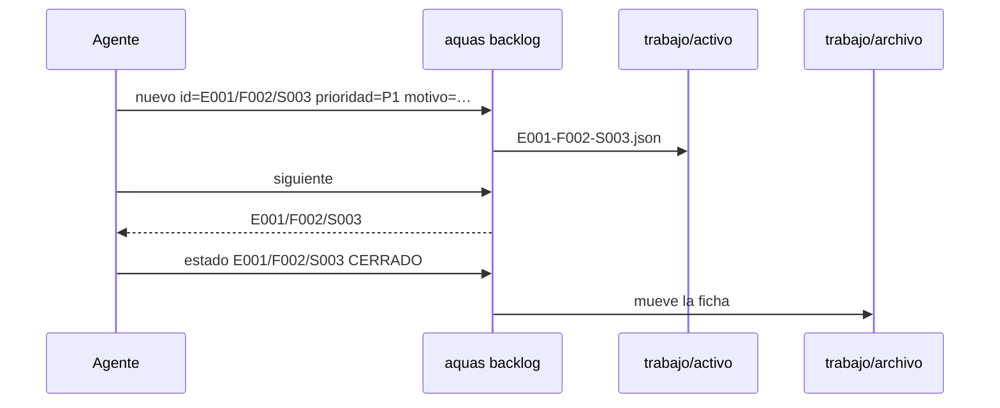
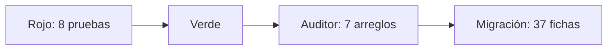

# S002 · Backlog en JSON

[Inicio](../../README.md) › [E001](../README.md) › [F002](README.md) › S002

[Slice](../../glosario.md#slice) que crea el [backlog](../../glosario.md#backlog) en JSON. Trae una ficha por elemento, cinco comandos y una guardia contra la edición a mano.

## En una frase

Cada tarea tiene su ficha, y solo el encargado puede escribir en ella.

## Para qué existe

**El problema.** El orden del trabajo estaba en un texto largo. El [agente](../../glosario.md#agente) lo leía, elegía y lo reescribía a mano. Un error ahí no lo veía ningún programa.

**La solución.** El paquete `internal/backlog` y el comando `aquas backlog`:

- Una ficha JSON por elemento: id, tipo, título, estado, prioridad, motivo, padre, bloqueado_por y secuencia.
- `nuevo`, `ver`, `prioridad`, `estado` y `siguiente`.
- Una ficha cerrada o cancelada pasa sola de `trabajo/activo/` a `trabajo/archivo/`.
- La guardia bloquea escribir en `trabajo/` sin `aquas`.
- El [gate](../../glosario.md#gate) valida cada ficha.

Todo el backlog viejo pasa a fichas. Lo cerrado entra y se archiva al momento, para que quede la traza.

Contrato del slice:

| Campo | Valor |
|---|---|
| Objetivo | Guardar el backlog en fichas JSON que solo escribe `aquas`, con orden fijo para elegir el siguiente |
| Incluye | Paquete `internal/backlog`, cinco comandos, archivo automático, guardia de `trabajo/`, validación en el gate, migración del backlog del canónico |
| Excluye | Rojo y verde (S003), sello (S004), mapas generados (S005), defectos `D000001` (F004), reglas de paso entre estados |
| Prueba | `go test ./internal/backlog/ ./internal/guardia/ ./cmd/aquas/` |

## Analogía

Piensa en un **fichero de biblioteca**.

- Cada libro tiene una ficha con sus datos.
- El bibliotecario ordena las fichas siempre igual.
- Un libro dado de baja va al archivo, con su ficha intacta.

Límite de la analogía: el fichero no sabe qué libro conviene leer. Aquí `siguiente` sí elige, con una regla fija.

## Diagrama

Datos: una ficha y dónde vive.

## Ejemplo de punta a punta

continúa: [EJ-E001-F002](README.md#EJ-E001-F002)

En la [feature](../../glosario.md#feature), el pedido ya tiene slice. Así entra a la cola.

1. El agente corre `aquas backlog nuevo id=E001/F002/S003 titulo="Rojo y verde" prioridad=P1 motivo="sigue al backlog"`.
2. `aquas` deriva el padre, `E001/F002`, y comprueba que existe.
3. `aquas backlog siguiente` responde `E001/F002/S003`.
4. Al terminar, `aquas backlog estado E001/F002/S003 CERRADO` mueve la ficha al archivo.

## Paso a paso

1. Página del slice y pruebas en rojo.
2. Paquete `internal/backlog`.
3. Comandos en `aquas` y validación en el gate.
4. Guardia de `trabajo/`.
5. Migración: todo el backlog del [canónico](../../glosario.md#canónico) a fichas; lo cerrado, al archivo.

## Cómo se usa

- `aquas backlog nuevo id=… titulo=… prioridad=P1 motivo=… [bloqueado_por=A,B]`. Desde [S003](S003.md) exige además `prueba=./paquete:TestNombre=intención`.
- `aquas backlog ver [id]`: sin id, lista lo activo en el orden de `siguiente`.
- `aquas backlog prioridad <id> <P0|P1|P2|P3|SIN_TRIAGE> motivo=…`.
- `aquas backlog estado <id> <ESTADO>`.
- `aquas backlog siguiente`: el slice que toca.

## Contrato y evidencia

<!-- GENERADO por aquas desde trabajo/: no editar a mano; `aquas compilar` lo rehace. -->

| Prueba | Valida | Rojo cuando | Verde cuando | Rojo | Verde |
|---|---|---|---|---|---|
| — | ficha anterior al registro de pruebas | — | — | — | — |

### Código

| Archivo | Función | Parámetros | Qué hace |
|---|---|---|---|
| [cmd/aquas/main.go](../../../cmd/aquas/main.go) | `main` | `()` | main despacha el subcomando de aquas (compilar, verificar, backlog, hooks…) y sale con su código. |
| [cmd/aquas/main.go](../../../cmd/aquas/main.go) | `hook` | `(raiz string)` | hook: exit 0 = nada que reportar; exit 2 = stderr se muestra a Claude. |
| [cmd/aquas/main.go](../../../cmd/aquas/main.go) | `compilarSettings` | `(w io.Writer)` | compilarSettings regenera .claude/settings.json; sin entorno declarado no inventa uno. |
| [cmd/aquas/main.go](../../../cmd/aquas/main.go) | `reportar` | `(w io.Writer, inf compilador.Informe)` | reportar imprime qué derivados escribió la compilación, o que todo estaba al día. |
| [cmd/aquas/main.go](../../../cmd/aquas/main.go) | `listar` | `(titulo string, problemas []string)` | listar imprime en stderr un título y cada problema en su viñeta. |
| [cmd/aquas/main.go](../../../cmd/aquas/main.go) | `lista` | `(xs []string) string` | lista une los textos con comas, o «—» si no hay ninguno. |
| [cmd/aquas/main.go](../../../cmd/aquas/main.go) | `fallar` | `(codigo int, err error)` | fallar imprime el error en stderr y termina con el código dado. |
| [cmd/aquas/main.go](../../../cmd/aquas/main.go) | `memoriaCLI` | `(raiz string, args []string)` | memoriaCLI: `ver` imprime la memoria; `fijar campo=valor…` la actualiza y la sella. |
| [cmd/aquas/main.go](../../../cmd/aquas/main.go) | `memoriaArchivada` | `(raiz, id string) error` | memoriaArchivada: CERRADO exige el archivo de memoria del slice, apunte o no la memoria a él (E001/F002/S009, X01). |
| [cmd/aquas/main.go](../../../cmd/aquas/main.go) | `focoEnBacklog` | `(raiz string, f memoria.Foco) error` | focoEnBacklog: la memoria solo fija el slice que el backlog tiene en curso (S003). |
| [cmd/aquas/main.go](../../../cmd/aquas/main.go) | `backlogCLI` | `(raiz string, args []string)` | backlogCLI: nuevo \\| ver [id] \\| prioridad \\| estado \\| siguiente \\| pruebas \\| rojo \\| verde. |
| [cmd/aquas/main.go](../../../cmd/aquas/main.go) | `turnoCLI` | `(raiz string, args []string)` | turnoCLI: auditoría de turnos (E001/F002/S001). Lee el JSON del hook por stdin. No imprime nada |
| [cmd/aquas/main.go](../../../cmd/aquas/main.go) | `defectoCLI` | `(raiz string, args []string) error` | defectoCLI: nuevo \\| ocurre \\| ver (E001/F004/S001). |
| [cmd/aquas/main.go](../../../cmd/aquas/main.go) | `versionBinario` | `() string` | versionBinario: versión del módulo con que se compiló el binario (= versión del gobierno embebido). |
| [cmd/aquas/main.go](../../../cmd/aquas/main.go) | `registrarCierre` | `(raiz, tipo, transcript, primera, resultado string)` | registrarCierre (E001/F004/S005, D000068) anota cada llamada del gancho cierre-agente en .tmp/hooks/cierre-agente.jsonl. |
| [internal/backlog/backlog.go](../../../internal/backlog/backlog.go) | `terminal` | `(estado string) bool` | terminal: el estado ya no cambia (CERRADO o CANCELADO). |
| [internal/backlog/backlog.go](../../../internal/backlog/backlog.go) | `esta` | `(xs []string, x string) bool` | esta: x figura en la lista. |
| [internal/backlog/backlog.go](../../../internal/backlog/backlog.go) | `tipoYPadre` | `(id string) (tipo, padre string)` | tipoYPadre deriva del id: E001 → iniciativa; E001/F002 → feature de E001; E001/F002/S002 → slice. |
| [internal/backlog/backlog.go](../../../internal/backlog/backlog.go) | `nombre` | `(id string) string` | nombre: archivo JSON de una ficha, con «/» del ID cambiadas por «-». |
| [internal/backlog/backlog.go](../../../internal/backlog/backlog.go) | `todas` | `(raiz string) (act, arc map[string]Ficha, err error)` | todas lee activo y archivo. Una ficha ilegible es error: Validar la detalla. |
| [internal/backlog/backlog.go](../../../internal/backlog/backlog.go) | `Todas` | `(raiz string) ([]Ficha, error)` | Todas: las fichas de activo y archivo, ordenadas por id. Para quien solo lee (wiki, E001/F002/S010). |
| [internal/backlog/backlog.go](../../../internal/backlog/backlog.go) | `leer` | `(ruta string) (Ficha, error)` | leer carga una ficha desde su archivo JSON. |
| [internal/backlog/backlog.go](../../../internal/backlog/backlog.go) | `escribir` | `(raiz, dir string, f Ficha) error` | escribir guarda la ficha como JSON en trabajo/<dir>/, con listas vacías en vez de null. |
| [internal/backlog/backlog.go](../../../internal/backlog/backlog.go) | `Nuevo` | `(raiz string, campos []string) (Ficha, error)` | Nuevo crea una ficha desde campos id=… titulo=… prioridad=… motivo=… relacion=… [bloqueado_por=A,B]. |
| [internal/backlog/backlog.go](../../../internal/backlog/backlog.go) | `Ver` | `(raiz, id string) (Ficha, bool, error)` | Ver busca la ficha en activo y luego en archivo. |
| [internal/backlog/backlog.go](../../../internal/backlog/backlog.go) | `activa` | `(raiz, id string) (Ficha, error)` | activa: la ficha a cambiar; una archivada no cambia. |
| [internal/backlog/backlog.go](../../../internal/backlog/backlog.go) | `Prioridad` | `(raiz, id, prioridad, motivo string) (Ficha, error)` | Prioridad cambia la prioridad; el motivo es obligatorio. |
| [internal/backlog/backlog.go](../../../internal/backlog/backlog.go) | `Estado` | `(raiz, id, estado string) (Ficha, error)` | Estado cambia el estado. CERRADO o CANCELADO mueve la ficha al archivo. |
| [internal/backlog/backlog.go](../../../internal/backlog/backlog.go) | `sinHijosActivos` | `(act map[string]Ficha, f Ficha) error` | sinHijosActivos: cerrar o cancelar una feature o iniciativa exige sus hijos directos ya archivados. |
| [internal/backlog/backlog.go](../../../internal/backlog/backlog.go) | `ordenar` | `(fs []Ficha, arc map[string]Ficha)` | orden de `siguiente`: en curso → desbloqueado → prioridad → secuencia → id. |
| [internal/backlog/backlog.go](../../../internal/backlog/backlog.go) | `Activas` | `(raiz string) ([]Ficha, error)` | Activas: slices en el orden de `siguiente`; después iniciativas y features por secuencia. |
| [internal/backlog/backlog.go](../../../internal/backlog/backlog.go) | `Siguiente` | `(raiz string) (Ficha, bool, error)` | Siguiente: el primer slice del orden fijo que esté en curso o desbloqueado. |
| [internal/backlog/backlog.go](../../../internal/backlog/backlog.go) | `sinDefinir` | `(act map[string]Ficha) (Ficha, bool)` | sinDefinir (E001/F002/S008, regla del humano 2026-10-21): iniciativa o feature activa sin hijos |
| [internal/backlog/backlog.go](../../../internal/backlog/backlog.go) | `Definir` | `(raiz string, f Ficha) string` | Definir: qué hacer con lo que `siguiente` saca sin definir; "" para un slice. |
| [internal/backlog/backlog.go](../../../internal/backlog/backlog.go) | `libre` | `(f Ficha, arc map[string]Ficha) bool` | libre: no está BLOQUEADO y cada bloqueador ya terminó (archivado: CERRADO o CANCELADO). |
| [internal/backlog/backlog.go](../../../internal/backlog/backlog.go) | `Validar` | `(raiz string) []string` | Validar: problemas de las fichas en disco (gate). Sin carpeta trabajo/ no hay problemas. |
| [internal/backlog/backlog.go](../../../internal/backlog/backlog.go) | `Texto` | `(f Ficha) string` | Texto: una línea por ficha, para el agente. |
| [internal/guardia/guardia.go](../../../internal/guardia/guardia.go) | `Revisar` | `(raiz string, entrada []byte) string` | Revisar recibe el JSON del hook PreToolUse; "" = permitido, si no, el motivo del bloqueo. |
| [internal/guardia/guardia.go](../../../internal/guardia/guardia.go) | `RevisarArchivo` | `(raiz, p string) string` | RevisarArchivo valida una ruta de Write/Edit (absoluta o relativa a la raíz). |
| [internal/guardia/guardia.go](../../../internal/guardia/guardia.go) | `protegida` | `(raiz, abs, p string) string` | protegida: carpetas que solo escribe `aquas` (E001/F005, E001/F002). Las rutas salen de los |
| [internal/guardia/guardia.go](../../../internal/guardia/guardia.go) | `resolver` | `(base, p string) (string, bool)` | resolver lleva p a ruta absoluta del sistema. Entiende ~, /c/… (Git Bash) y relativas a base. |
| [internal/guardia/guardia.go](../../../internal/guardia/guardia.go) | `dentro` | `(raiz, abs string) bool` | dentro: la ruta absoluta queda dentro de la raíz del repo. |
| [internal/guardia/guardia.go](../../../internal/guardia/guardia.go) | `sinHeredocs` | `(c string) string` | sinHeredocs quita el cuerpo de cada heredoc: su contenido es texto, no comandos. |
| [internal/guardia/guardia.go](../../../internal/guardia/guardia.go) | `lexear` | `(c string) []palabra` | lexear parte un comando de shell en palabras, respetando comillas y operadores. |
| [internal/guardia/guardia.go](../../../internal/guardia/guardia.go) | `variable` | `(r []rune, i int) (string, int)` | variable reconoce $NOMBRE, ${NOMBRE}, $(…), `…` y %NOMBRE%; devuelve nombre ("?" = desconocida) y largo. |
| [internal/guardia/guardia.go](../../../internal/guardia/guardia.go) | `esNombre` | `(c rune) bool` | esNombre: el carácter vale en un nombre de variable de shell. |
| [internal/guardia/guardia.go](../../../internal/guardia/guardia.go) | `RevisarBash` | `(raiz, cwd, comando string) string` | RevisarBash analiza un comando de Bash; cwd es el directorio donde arranca. |
| [internal/guardia/guardia.go](../../../internal/guardia/guardia.go) | `segmento` | `(raiz string, cwd *string, cwdOK *bool, vars map[string]string, ps []palabra) string` | segmento revisa un comando simple: sigue cd y variables y devuelve el primer destino fuera del repo. |
| [internal/guardia/guardia.go](../../../internal/guardia/guardia.go) | `posicionales` | `(args []string) []string` | posicionales: argumentos que no son opciones (los que empiezan con «-», salvo «-» solo). |
| [internal/guardia/guardia.go](../../../internal/guardia/guardia.go) | `revisarDestino` | `(raiz, cwd string, cwdOK bool, vars map[string]string, d string) string` | revisarDestino: motivo de bloqueo si la ruta no se resuelve o cae fuera del repo; vacío si vale. |
| [internal/guardia/guardia.go](../../../internal/guardia/guardia.go) | `expandir` | `(s string, vars map[string]string, cwd string) (string, bool)` | expandir sustituye variables conocidas; HOME/USERPROFILE/TEMP/TMP salen del entorno real. |
| [internal/guardia/guardia.go](../../../internal/guardia/guardia.go) | `legible` | `(s string) string` | legible muestra las variables internas como $NOMBRE en los mensajes. |

<!-- /GENERADO -->

Estado: hecho.

Pruebas del slice, en `internal/backlog/backlog_test.go`, `internal/guardia/trabajo_test.go` y `cmd/aquas/backlog_test.go`:

| Prueba | Qué demuestra |
|---|---|
| `TestNuevoCreaFicha` | La ficha nace en `trabajo/activo/`, con padre derivado, estado BORRADOR y secuencia creciente |
| `TestNuevoRechaza` | Id mal formado, padre inexistente, id repetido o usado, prioridad inválida o campos vacíos |
| `TestEstadoTerminalArchiva` | CERRADO y CANCELADO mueven la ficha al archivo; una archivada no cambia |
| `TestPrioridadConMotivo` | Cambiar prioridad exige motivo y lo guarda |
| `TestSiguienteOrdenFijo` | En curso primero; luego desbloqueado, prioridad, secuencia e id |
| `TestValidarDetectaFichasMalas` | El gate ve JSON roto, campo extra, nombre que no cuadra, cerrada en activo o padre perdido |
| `TestTrabajoSoloPorAquas` | La guardia bloquea escribir en `trabajo/` a mano y deja leer |
| `TestBacklogCLI` | Los cinco comandos reales; un uso malo da exit 64 |

Decisiones de Jesús (2026-10-21):

- Todo el backlog pasa a fichas; lo cerrado se archiva al momento, por la traza.
- Cinco comandos y nueve campos.
- La guardia protege `trabajo/` desde este slice.
- El canónico queda con decisiones y diseño; el estado vive en las fichas.

Rojo visto: sí. Las ocho fallaron con un esqueleto vacío.

El auditor halló ocho puntos y se corrigieron siete:

- Un bloqueador cancelado dejaba la ficha trabada para siempre. Ahora libera.
- El gate exige los nueve campos, rechaza `bloqueado_por` nulo y texto después de la ficha.
- Un campo repetido en `nuevo` da error.
- Las pruebas cubren lo bloqueado en el listado, VERIFICANDO y los chequeos de Validar que faltaban.
- El canónico y la [wiki](../../glosario.md#wiki) dicen lo mismo que el código.

Esos casos nuevos se escribieron después del arreglo: su rojo no se vio.

Migración: 37 fichas creadas con el propio `aquas`, sin errores. Quedaron 23 en el archivo y 14 activas.

Decisión del agente: archivado no es un estado, es la carpeta `trabajo/archivo/`.

Límite: si falla borrar la ficha de activo tras copiarla al archivo, queda en las dos carpetas. El gate lo detecta como id repetido.

## Navegación

- ↑ Subir: [F002 · Turnos, backlog y sello](README.md)
