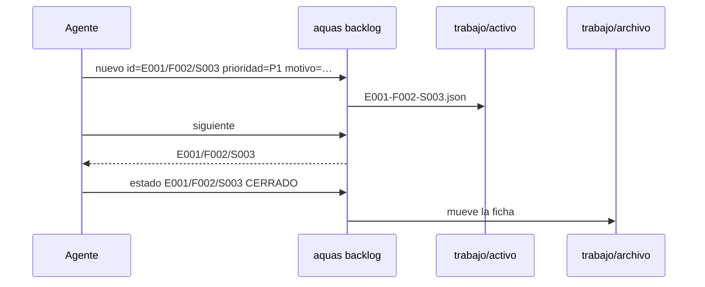
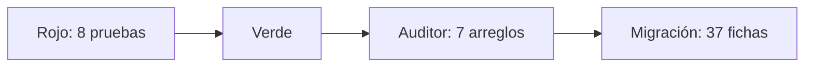

# S002 · Backlog en JSON

[Inicio](../../README.md) › [E001](../README.md) › [F002](README.md) › S002

[Slice](../../glosario.md#slice) que crea el [backlog](../../glosario.md#backlog) en JSON. Trae una ficha por elemento, cinco comandos y una guardia contra la edición a mano.

## En una frase

Cada tarea tiene su ficha, y solo el encargado puede escribir en ella.

## Para qué existe

**El problema.** El orden del trabajo estaba en un texto largo. El [agente](../../glosario.md#agente) lo leía, elegía y lo reescribía a mano. Un error ahí no lo veía ningún programa.

**La solución.** El paquete `internal/backlog` y el comando `aquas backlog`:

- Una ficha JSON por elemento: id, tipo, título, estado, prioridad, motivo, padre, bloqueado_por y secuencia.
- `nuevo`, `ver`, `prioridad`, `estado` y `siguiente`.
- Una ficha cerrada o cancelada pasa sola de `trabajo/activo/` a `trabajo/archivo/`.
- La guardia bloquea escribir en `trabajo/` sin `aquas`.
- El [gate](../../glosario.md#gate) valida cada ficha.

Todo el backlog viejo pasa a fichas. Lo cerrado entra y se archiva al momento, para que quede la traza.

Contrato del slice:

| Campo | Valor |
|---|---|
| Objetivo | Guardar el backlog en fichas JSON que solo escribe `aquas`, con orden fijo para elegir el siguiente |
| Incluye | Paquete `internal/backlog`, cinco comandos, archivo automático, guardia de `trabajo/`, validación en el gate, migración del backlog del canónico |
| Excluye | Rojo y verde (S003), sello (S004), mapas generados (S005), defectos `D000001` (F004), reglas de paso entre estados |
| Prueba | `go test ./internal/backlog/ ./internal/guardia/ ./cmd/aquas/` |

## Analogía

Piensa en un **fichero de biblioteca**.

- Cada libro tiene una ficha con sus datos.
- El bibliotecario ordena las fichas siempre igual.
- Un libro dado de baja va al archivo, con su ficha intacta.

Límite de la analogía: el fichero no sabe qué libro conviene leer. Aquí `siguiente` sí elige, con una regla fija.

## Diagrama

Datos: una ficha y dónde vive.

## Ejemplo de punta a punta

continúa: [EJ-E001-F002](README.md#EJ-E001-F002)

En la [feature](../../glosario.md#feature), el pedido ya tiene slice. Así entra a la cola.

1. El agente corre `aquas backlog nuevo id=E001/F002/S003 titulo="Rojo y verde" prioridad=P1 motivo="sigue al backlog"`.
2. `aquas` deriva el padre, `E001/F002`, y comprueba que existe.
3. `aquas backlog siguiente` responde `E001/F002/S003`.
4. Al terminar, `aquas backlog estado E001/F002/S003 CERRADO` mueve la ficha al archivo.

## Paso a paso

1. Página del slice y pruebas en rojo.
2. Paquete `internal/backlog`.
3. Comandos en `aquas` y validación en el gate.
4. Guardia de `trabajo/`.
5. Migración: todo el backlog del [canónico](../../glosario.md#canónico) a fichas; lo cerrado, al archivo.

## Cómo se usa

- `aquas backlog nuevo id=… titulo=… prioridad=P1 motivo=… [bloqueado_por=A,B]`.
- `aquas backlog ver [id]`: sin id, lista lo activo en el orden de `siguiente`.
- `aquas backlog prioridad <id> <P0|P1|P2|P3|SIN_TRIAGE> motivo=…`.
- `aquas backlog estado <id> <ESTADO>`.
- `aquas backlog siguiente`: el slice que toca.

## Contrato y evidencia

Estado: hecho.

Pruebas del slice, en `internal/backlog/backlog_test.go`, `internal/guardia/trabajo_test.go` y `cmd/aquas/backlog_test.go`:

| Prueba | Qué demuestra |
|---|---|
| `TestNuevoCreaFicha` | La ficha nace en `trabajo/activo/`, con padre derivado, estado BORRADOR y secuencia creciente |
| `TestNuevoRechaza` | Id mal formado, padre inexistente, id repetido o usado, prioridad inválida o campos vacíos |
| `TestEstadoTerminalArchiva` | CERRADO y CANCELADO mueven la ficha al archivo; una archivada no cambia |
| `TestPrioridadConMotivo` | Cambiar prioridad exige motivo y lo guarda |
| `TestSiguienteOrdenFijo` | En curso primero; luego desbloqueado, prioridad, secuencia e id |
| `TestValidarDetectaFichasMalas` | El gate ve JSON roto, campo extra, nombre que no cuadra, cerrada en activo o padre perdido |
| `TestTrabajoSoloPorAquas` | La guardia bloquea escribir en `trabajo/` a mano y deja leer |
| `TestBacklogCLI` | Los cinco comandos reales; un uso malo da exit 64 |

Decisiones de Jesús (2026-10-21):

- Todo el backlog pasa a fichas; lo cerrado se archiva al momento, por la traza.
- Cinco comandos y nueve campos.
- La guardia protege `trabajo/` desde este slice.
- El canónico queda con decisiones y diseño; el estado vive en las fichas.

Rojo visto: sí. Las ocho fallaron con un esqueleto vacío.

El auditor halló ocho puntos y se corrigieron siete:

- Un bloqueador cancelado dejaba la ficha trabada para siempre. Ahora libera.
- El gate exige los nueve campos, rechaza `bloqueado_por` nulo y texto después de la ficha.
- Un campo repetido en `nuevo` da error.
- Las pruebas cubren lo bloqueado en el listado, VERIFICANDO y los chequeos de Validar que faltaban.
- El canónico y la [wiki](../../glosario.md#wiki) dicen lo mismo que el código.

Esos casos nuevos se escribieron después del arreglo: su rojo no se vio.

Migración: 37 fichas creadas con el propio `aquas`, sin errores. Quedaron 23 en el archivo y 14 activas.

Decisión del agente: archivado no es un estado, es la carpeta `trabajo/archivo/`.

Límite: si falla borrar la ficha de activo tras copiarla al archivo, queda en las dos carpetas. El gate lo detecta como id repetido.

## Navegación

- ↑ Subir: [F002 · Turnos, backlog y sello](README.md)
