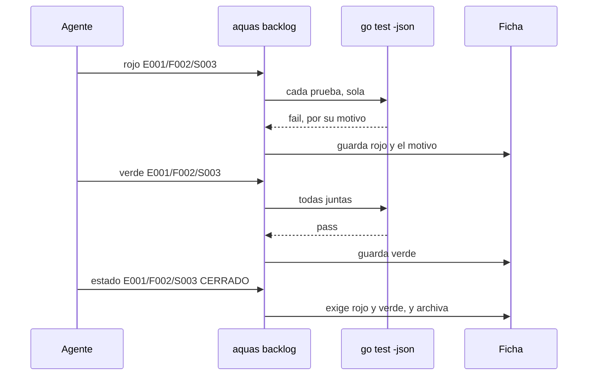
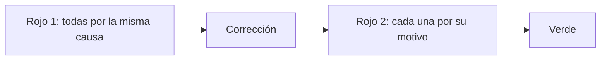

# S003 · Rojo y verde

[Inicio](../../README.md) › [E001](../README.md) › [F002](README.md) › S003

[Slice](../../glosario.md#slice) que impide cerrar trabajo sin pruebas. Cada ficha del [backlog](../../glosario.md#backlog) nombra sus pruebas. `aquas` comprueba que fallan antes y pasan después.

## En una frase

Antes de arreglar algo, hay que mostrar que está roto; después, que quedó bien.

## Para qué existe

**El problema.** El [agente](../../glosario.md#agente) decía «vi el rojo» y nadie lo comprobaba. Una revisión halló 15 pruebas, de 92, que no protegían lo que decían. Una fallaba por otra causa: le faltaba un dato de su configuración.

Además, al mover el backlog a `trabajo/`, la memoria siguió apuntando al lugar viejo. Ninguna prueba lo vio.

**La solución.** Cada ficha guarda sus pruebas y sus resultados:

- `pruebas`: cada prueba con su nombre y su intención, es decir, qué demuestra. Toda ficha nueva nace con ellas. El código de la prueba se escribe cuando arranca ese trabajo.
- `rojo`: `aquas` corre cada prueba sola con `go test -json`. Cada una debe fallar por sí misma.
- `verde`: después del rojo, `aquas` corre las pruebas juntas. Todas deben pasar.
- Cerrar una ficha exige rojo y luego verde.

Y dos reglas que fijó Jesús:

- Un solo slice en curso. Mientras hay uno, los demás slices no cambian de estado.
- La memoria caliente no acepta un slice distinto del que está en curso.

Contrato del slice:

| Campo | Valor |
|---|---|
| Objetivo | Que ninguna ficha cierre sin pruebas que fallaron antes y pasaron después |
| Incluye | Campos `pruebas`, `rojo` y `verde`; comandos `pruebas`, `rojo` y `verde`; un solo slice en curso; memoria según el backlog; ruta del backlog en la memoria |
| Excluye | Arreglar las 15 pruebas débiles (E000/F005), lista de revisión al cerrar (S004), archivos según el alcance (S007) |
| Prueba | `go test ./internal/backlog/ ./internal/memoria/ ./cmd/aquas/` |

## Analogía

Piensa en un **mecánico** con una falla en el carro.

- Primero prende el carro y oye el ruido, frente a ti.
- Luego cambia la pieza.
- Al final lo prende de nuevo, y el ruido ya no está.

Si nunca oíste el ruido, no sabes si el cambio sirvió.

Límite de la analogía: el mecánico prueba el carro entero. Aquí cada prueba se corre sola, para que una no tape a otra.

## Diagrama

Secuencia: del rojo al cierre.

## Ejemplo de punta a punta

continúa: [EJ-E001-F002](README.md#EJ-E001-F002)

En la [feature](../../glosario.md#feature), el slice ya está en la cola. Ahora debe probar su trabajo.

1. El slice nace con `prueba=./p:TestBandera=pide el arreglo`.
2. Pasa a `EN_CURSO`. Ningún otro slice puede cambiar de estado mientras tanto.
3. `aquas backlog rojo` corre `TestBandera` sola. Falla con «falta el arreglo». Queda escrito en la ficha.
4. El agente hace el arreglo.
5. `aquas backlog verde` corre la prueba. Pasa.
6. `aquas backlog estado … CERRADO` ve rojo y verde. La ficha se va al archivo.

Qué no cuenta como rojo:

- Una prueba que no compila.
- Una prueba que no existe.
- Una prueba que se salta.
- Una prueba que falla solo cuando otra corre antes.

## Paso a paso

1. Página del slice y pruebas en rojo.
2. Campos `pruebas`, `rojo` y `verde` en la ficha.
3. Comandos `pruebas`, `rojo` y `verde`.
4. Cierre que exige rojo y verde.
5. Un solo slice en curso.
6. Memoria según el backlog, y ruta corregida.
7. Revisión del [gate](../../glosario.md#gate) sobre los campos nuevos.

## Cómo se usa

- `aquas backlog nuevo … prueba=./paquete:TestA=qué demuestra prueba=./otro:TestB=qué demuestra`. El campo se repite, uno por prueba.
- `aquas backlog pruebas <id> ./paquete:TestA=qué demuestra …`: cambia la lista y borra rojo y verde.
- `aquas backlog ver <id>`: muestra cada prueba con su intención, y el motivo de su rojo.
- `aquas backlog rojo <id>`: solo con el slice en curso.
- `aquas backlog verde <id>`: solo después del rojo.

## Contrato y evidencia

<!-- GENERADO por aquas desde trabajo/: no editar a mano; `aquas compilar` lo rehace. -->

| Prueba | Valida | Rojo cuando | Verde cuando | Rojo | Verde |
|---|---|---|---|---|---|
| `TestNuevoExigePruebas` | una ficha nueva sin pruebas o con nombre o intención malos no se crea | Nuevo crea una ficha sin pruebas, sin intención, con nombre mal formado o con prueba repetida | cada caso malo da error con su motivo y las pruebas buenas se guardan en orden, sin rojo ni verde | 2026-10-21 | 2026-10-21 |
| `TestPruebasReiniciaRojoYVerde` | cambiar la lista de pruebas borra el rojo y el verde viejos | Pruebas cambia la lista y deja el rojo o verde viejos, o acepta lista vacía, formato malo o ficha archivada | la lista nueva queda guardada sin rojo ni verde y los casos malos dan error | 2026-10-21 | 2026-10-21 |
| `TestRojoExigeQueCadaPruebaFalle` | si una prueba pasa o se salta no hay rojo; el motivo del fallo queda guardado | Rojo se registra con una prueba que pasa o se salta, o sin slice en curso | Rojo falla nombrando solo la prueba que pasa; con todas fallando guarda fecha y motivo de cada una | 2026-10-21 | 2026-10-21 |
| `TestRojoNoCuentaCompilacionNiAusencia` | no compilar o no existir no cuenta como rojo | Rojo acepta como fallo una prueba que no compila, no existe o está en un paquete ausente | Rojo se niega diciendo no compila, no existe o paquete no existe, según el caso | 2026-10-21 | 2026-10-21 |
| `TestRojoPruebaAislada` | una prueba que falla solo por culpa de otra no cuenta como rojo | Rojo da por buena una prueba que falla junta pero pasa sola | Rojo corre cada prueba sola y rechaza la que no falla aislada, nombrándola | 2026-10-21 | 2026-10-21 |
| `TestVerdeDespuesDelRojo` | no hay verde sin rojo ni con una prueba fallando | Verde se registra sin rojo previo o mientras la prueba sigue fallando | Verde falla pidiendo rojo, luego nombrando la prueba; con la prueba arreglada se registra después del rojo | 2026-10-21 | 2026-10-21 |
| `TestCerrarExigeRojoYVerde` | cerrar exige pruebas, rojo y verde; cancelar no | Estado deja cerrar un slice sin rojo, sin verde o sin pruebas, o impide cancelarlo | cerrar falla pidiendo rojo, luego verde, luego pruebas; con todo cierra y cancelar siempre se puede | 2026-10-21 | 2026-10-21 |
| `TestUnSoloSliceEnCurso` | con un slice en curso ningún otro slice cambia de estado; la prioridad sí | Estado deja a un segundo slice pasar a EN_CURSO o LISTO con otro en curso, o bloquea prioridad o features | el segundo slice recibe error nombrando al primero; prioridad y features cambian; libre el turno, entra | 2026-10-21 | 2026-10-21 |
| `TestValidarRojoYVerde` | el gate ve verde sin rojo, verde antes del rojo, dos en curso y pruebas mal escritas | Validar deja pasar verde sin rojo, verde antes del rojo, dos en curso o una prueba mal escrita | cada ficha defectuosa sale en su línea con el motivo esperado | 2026-10-21 | 2026-10-21 |
| `TestRutaBacklogEsTrabajo` | la memoria apunta al backlog en trabajo/activo | la ruta del backlog no es trabajo/activo o no existe | Backlog es trabajo/activo y es una carpeta del repo | 2026-10-21 | 2026-10-21 |
| `TestMemoriaSegunBacklog` | la memoria acepta solo el slice en curso del backlog y guía a vaciarla si está archivado | se fija memoria sin slice en curso, con otro foco o con slice archivado, o no dice cómo salir | memoria solo fija con foco igual al slice en curso; si no, sale 1 nombrándolo; vaciada vuelve a fijar | 2026-10-21 | 2026-10-21 |
| `TestCerrarSliceDePuntaAPunta` | un slice nace con prueba, pasa por rojo y verde y se archiva con el programa real | el cierre no exige rojo y verde, o la ficha archivada pierde el rojo con motivo o el verde | archivada queda con rojo (motivo) y verde guardados; uso malo sale 64 | 2026-10-21 | 2026-10-21 |

### Código

| Archivo | Función | Parámetros | Qué hace |
|---|---|---|---|
| [cmd/aquas/main.go](../../../cmd/aquas/main.go) | `main` | `()` | main despacha el subcomando de aquas (compilar, verificar, backlog, hooks…) y sale con su código. |
| [cmd/aquas/main.go](../../../cmd/aquas/main.go) | `hook` | `(raiz string)` | hook: exit 0 = nada que reportar; exit 2 = stderr se muestra a Claude. |
| [cmd/aquas/main.go](../../../cmd/aquas/main.go) | `compilarSettings` | `(w io.Writer)` | compilarSettings regenera .claude/settings.json; sin entorno declarado no inventa uno. |
| [cmd/aquas/main.go](../../../cmd/aquas/main.go) | `reportar` | `(w io.Writer, inf compilador.Informe)` | reportar imprime qué derivados escribió la compilación, o que todo estaba al día. |
| [cmd/aquas/main.go](../../../cmd/aquas/main.go) | `listar` | `(titulo string, problemas []string)` | listar imprime en stderr un título y cada problema en su viñeta. |
| [cmd/aquas/main.go](../../../cmd/aquas/main.go) | `lista` | `(xs []string) string` | lista une los textos con comas, o «—» si no hay ninguno. |
| [cmd/aquas/main.go](../../../cmd/aquas/main.go) | `fallar` | `(codigo int, err error)` | fallar imprime el error en stderr y termina con el código dado. |
| [cmd/aquas/main.go](../../../cmd/aquas/main.go) | `memoriaCLI` | `(raiz string, args []string)` | memoriaCLI: `ver` imprime la memoria; `fijar campo=valor…` la actualiza y la sella. |
| [cmd/aquas/main.go](../../../cmd/aquas/main.go) | `memoriaArchivada` | `(raiz, id string) error` | memoriaArchivada: CERRADO exige el archivo de memoria del slice, apunte o no la memoria a él (E001/F002/S009, X01). |
| [cmd/aquas/main.go](../../../cmd/aquas/main.go) | `focoEnBacklog` | `(raiz string, f memoria.Foco) error` | focoEnBacklog: la memoria solo fija el slice que el backlog tiene en curso (S003). |
| [cmd/aquas/main.go](../../../cmd/aquas/main.go) | `backlogCLI` | `(raiz string, args []string)` | backlogCLI: nuevo \\| ver [id] \\| tabla \\| prioridad \\| estado \\| siguiente \\| pruebas \\| rojo \\| verde. |
| [cmd/aquas/main.go](../../../cmd/aquas/main.go) | `turnoCLI` | `(raiz string, args []string)` | turnoCLI: auditoría de turnos (E001/F002/S001). Lee el JSON del hook por stdin. No imprime nada |
| [cmd/aquas/main.go](../../../cmd/aquas/main.go) | `defectoCLI` | `(raiz string, args []string) error` | defectoCLI: nuevo \\| ocurre \\| ver (E001/F004/S001). |
| [cmd/aquas/main.go](../../../cmd/aquas/main.go) | `versionBinario` | `() string` | versionBinario: versión del módulo con que se compiló el binario (= versión del gobierno embebido). |
| [cmd/aquas/main.go](../../../cmd/aquas/main.go) | `registrarCierre` | `(raiz, tipo, transcript, primera, resultado string)` | registrarCierre (E001/F004/S005, D000068) anota cada llamada del gancho cierre-agente en .tmp/hooks/cierre-agente.jsonl. |
| [internal/backlog/backlog.go](../../../internal/backlog/backlog.go) | `terminal` | `(estado string) bool` | terminal: el estado ya no cambia (CERRADO o CANCELADO). |
| [internal/backlog/backlog.go](../../../internal/backlog/backlog.go) | `esta` | `(xs []string, x string) bool` | esta: x figura en la lista. |
| [internal/backlog/backlog.go](../../../internal/backlog/backlog.go) | `tipoYPadre` | `(id string) (tipo, padre string)` | tipoYPadre deriva del id: E001 → iniciativa; E001/F002 → feature de E001; E001/F002/S002 → slice. |
| [internal/backlog/backlog.go](../../../internal/backlog/backlog.go) | `nombre` | `(id string) string` | nombre: archivo JSON de una ficha, con «/» del ID cambiadas por «-». |
| [internal/backlog/backlog.go](../../../internal/backlog/backlog.go) | `todas` | `(raiz string) (act, arc map[string]Ficha, err error)` | todas lee activo y archivo. Una ficha ilegible es error: Validar la detalla. |
| [internal/backlog/backlog.go](../../../internal/backlog/backlog.go) | `Todas` | `(raiz string) ([]Ficha, error)` | Todas: las fichas de activo y archivo, ordenadas por id. Para quien solo lee (wiki, E001/F002/S010). |
| [internal/backlog/backlog.go](../../../internal/backlog/backlog.go) | `leer` | `(ruta string) (Ficha, error)` | leer carga una ficha desde su archivo JSON. |
| [internal/backlog/backlog.go](../../../internal/backlog/backlog.go) | `escribir` | `(raiz, dir string, f Ficha) error` | escribir guarda la ficha como JSON en trabajo/<dir>/, con listas vacías en vez de null. |
| [internal/backlog/backlog.go](../../../internal/backlog/backlog.go) | `Nuevo` | `(raiz string, campos []string) (Ficha, error)` | Nuevo crea una ficha desde campos id=… titulo=… que_hace=… prioridad=… motivo=… relacion=… [bloqueado_por=A,B]. |
| [internal/backlog/backlog.go](../../../internal/backlog/backlog.go) | `Ver` | `(raiz, id string) (Ficha, bool, error)` | Ver busca la ficha en activo y luego en archivo. |
| [internal/backlog/backlog.go](../../../internal/backlog/backlog.go) | `activa` | `(raiz, id string) (Ficha, error)` | activa: la ficha a cambiar; una archivada no cambia. |
| [internal/backlog/backlog.go](../../../internal/backlog/backlog.go) | `Prioridad` | `(raiz, id, prioridad, motivo string) (Ficha, error)` | Prioridad cambia la prioridad; el motivo es obligatorio. |
| [internal/backlog/backlog.go](../../../internal/backlog/backlog.go) | `Estado` | `(raiz, id, estado string) (Ficha, error)` | Estado cambia el estado. CERRADO o CANCELADO mueve la ficha al archivo. |
| [internal/backlog/backlog.go](../../../internal/backlog/backlog.go) | `sinHijosActivos` | `(act map[string]Ficha, f Ficha) error` | sinHijosActivos: cerrar o cancelar una feature o iniciativa exige sus hijos directos ya archivados. |
| [internal/backlog/backlog.go](../../../internal/backlog/backlog.go) | `ordenar` | `(fs []Ficha, arc map[string]Ficha)` | orden de `siguiente`: en curso → desbloqueado → prioridad → secuencia → id. |
| [internal/backlog/backlog.go](../../../internal/backlog/backlog.go) | `Activas` | `(raiz string) ([]Ficha, error)` | Activas: slices en el orden de `siguiente`; después iniciativas y features por secuencia. |
| [internal/backlog/backlog.go](../../../internal/backlog/backlog.go) | `Siguiente` | `(raiz string) (Ficha, bool, error)` | Siguiente: el primer slice del orden fijo que esté en curso o desbloqueado. |
| [internal/backlog/backlog.go](../../../internal/backlog/backlog.go) | `sinDefinir` | `(act map[string]Ficha) (Ficha, bool)` | sinDefinir (E001/F002/S008, regla del humano 2026-10-21): iniciativa o feature activa sin hijos |
| [internal/backlog/backlog.go](../../../internal/backlog/backlog.go) | `Definir` | `(raiz string, f Ficha) string` | Definir: qué hacer con lo que `siguiente` saca sin definir; "" para un slice. |
| [internal/backlog/backlog.go](../../../internal/backlog/backlog.go) | `libre` | `(f Ficha, arc map[string]Ficha) bool` | libre: no está BLOQUEADO y cada bloqueador ya terminó (archivado: CERRADO o CANCELADO). |
| [internal/backlog/backlog.go](../../../internal/backlog/backlog.go) | `Validar` | `(raiz string) []string` | Validar: problemas de las fichas en disco (gate). Sin carpeta trabajo/ no hay problemas. |
| [internal/backlog/backlog.go](../../../internal/backlog/backlog.go) | `Texto` | `(f Ficha) string` | Texto: una línea por ficha, para el agente. |
| [internal/backlog/rojo.go](../../../internal/backlog/rojo.go) | `problemaPrueba` | `(p Prueba) string` | problemaPrueba: por qué una prueba de la ficha está mal escrita ("" si está bien). |
| [internal/backlog/rojo.go](../../../internal/backlog/rojo.go) | `listaPruebas` | `(xs []string) ([]Prueba, error)` | listaPruebas convierte "./paquete:TestNombre=intención" en pruebas válidas, sin repetidas. |
| [internal/backlog/rojo.go](../../../internal/backlog/rojo.go) | `corriendo` | `(f Ficha) bool` | corriendo: la ficha está EN_CURSO o VERIFICANDO. |
| [internal/backlog/rojo.go](../../../internal/backlog/rojo.go) | `sliceEnCurso` | `(act map[string]Ficha) (string, bool)` | sliceEnCurso: el primer slice EN_CURSO o VERIFICANDO entre las activas, por id. |
| [internal/backlog/rojo.go](../../../internal/backlog/rojo.go) | `SliceEnCurso` | `(raiz string) (string, bool, error)` | SliceEnCurso: el único slice EN_CURSO o VERIFICANDO, si hay. |
| [internal/backlog/rojo.go](../../../internal/backlog/rojo.go) | `Pruebas` | `(raiz, id string, lista []string) (Ficha, error)` | Pruebas fija las pruebas de la ficha; cambiarlas borra rojo y verde. |
| [internal/backlog/rojo.go](../../../internal/backlog/rojo.go) | `corrible` | `(raiz, id string) (Ficha, error)` | corrible: ficha activa con pruebas; un slice además debe estar en curso. |
| [internal/backlog/rojo.go](../../../internal/backlog/rojo.go) | `Rojo` | `(raiz, id string, ahora time.Time) (Ficha, error)` | Rojo corre cada prueba sola con `go test -json`; exige que cada una falle por sí misma. |
| [internal/backlog/rojo.go](../../../internal/backlog/rojo.go) | `rojoHeredado` | `(raiz string, f Ficha) *Registro` | rojoHeredado (X02): rojo que un slice cerrado de la feature registró para todas sus pruebas |
| [internal/backlog/rojo.go](../../../internal/backlog/rojo.go) | `Verde` | `(raiz, id string, ahora time.Time) (Ficha, error)` | Verde corre las pruebas juntas tras el rojo; exige que todas pasen. |
| [internal/backlog/rojo.go](../../../internal/backlog/rojo.go) | `resultado.motivo` | `(siPasa string) string` | motivo: texto que explica el resultado de una prueba; siPasa se usa cuando pasó. |
| [internal/backlog/rojo.go](../../../internal/backlog/rojo.go) | `correr` | `(raiz string, ps []Prueba) (map[string]resultado, error)` | correr: `go test -json -count=1 -run ^(A\\|B)$ ./paquete` por paquete; resultado por prueba. |
| [internal/backlog/rojo.go](../../../internal/backlog/rojo.go) | `motivoDelFallo` | `(ls []string) string` | motivoDelFallo: la última línea «archivo.go:N: …» (la que hizo fallar); si no hay, la primera. |
| [internal/backlog/rojo.go](../../../internal/backlog/rojo.go) | `head` | `(raiz string) string` | head: commit actual del repo, o "" fuera de Git. |
| [internal/backlog/rojo.go](../../../internal/backlog/rojo.go) | `cierre` | `(raiz string, f Ficha) error` | cierre: CERRADO exige pruebas, rojo, verde y, si el verde trae huella, el mismo código Go. |
| [internal/backlog/rojo.go](../../../internal/backlog/rojo.go) | `problemasRojoVerde` | `(rel string, f Ficha) []string` | problemasRojoVerde: chequeos del gate sobre pruebas, rojo y verde de una ficha. |
| [internal/backlog/rojo.go](../../../internal/backlog/rojo.go) | `Detalle` | `(f Ficha) string` | Detalle: pruebas con su intención, y rojo y verde, para `ver <id>`, `pruebas`, `rojo` y `verde`. |
| [internal/guardia/guardia.go](../../../internal/guardia/guardia.go) | `Revisar` | `(raiz string, entrada []byte) string` | Revisar recibe el JSON del hook PreToolUse; "" = permitido, si no, el motivo del bloqueo. |
| [internal/guardia/guardia.go](../../../internal/guardia/guardia.go) | `RevisarArchivo` | `(raiz, p string) string` | RevisarArchivo valida una ruta de Write/Edit (absoluta o relativa a la raíz). |
| [internal/guardia/guardia.go](../../../internal/guardia/guardia.go) | `protegida` | `(raiz, abs, p string) string` | protegida: carpetas que solo escribe `aquas` (E001/F005, E001/F002). Las rutas salen de los |
| [internal/guardia/guardia.go](../../../internal/guardia/guardia.go) | `resolver` | `(base, p string) (string, bool)` | resolver lleva p a ruta absoluta del sistema. Entiende ~, /c/… (Git Bash) y relativas a base. |
| [internal/guardia/guardia.go](../../../internal/guardia/guardia.go) | `dentro` | `(raiz, abs string) bool` | dentro: la ruta absoluta queda dentro de la raíz del repo. |
| [internal/guardia/guardia.go](../../../internal/guardia/guardia.go) | `sinHeredocs` | `(c string) string` | sinHeredocs quita el cuerpo de cada heredoc: su contenido es texto, no comandos. |
| [internal/guardia/guardia.go](../../../internal/guardia/guardia.go) | `lexear` | `(c string) []palabra` | lexear parte un comando de shell en palabras, respetando comillas y operadores. |
| [internal/guardia/guardia.go](../../../internal/guardia/guardia.go) | `variable` | `(r []rune, i int) (string, int)` | variable reconoce $NOMBRE, ${NOMBRE}, $(…), `…` y %NOMBRE%; devuelve nombre ("?" = desconocida) y largo. |
| [internal/guardia/guardia.go](../../../internal/guardia/guardia.go) | `esNombre` | `(c rune) bool` | esNombre: el carácter vale en un nombre de variable de shell. |
| [internal/guardia/guardia.go](../../../internal/guardia/guardia.go) | `RevisarBash` | `(raiz, cwd, comando string) string` | RevisarBash analiza un comando de Bash; cwd es el directorio donde arranca. |
| [internal/guardia/guardia.go](../../../internal/guardia/guardia.go) | `segmento` | `(raiz string, cwd *string, cwdOK *bool, vars map[string]string, ps []palabra) string` | segmento revisa un comando simple: sigue cd y variables y devuelve el primer destino fuera del repo. |
| [internal/guardia/guardia.go](../../../internal/guardia/guardia.go) | `posicionales` | `(args []string) []string` | posicionales: argumentos que no son opciones (los que empiezan con «-», salvo «-» solo). |
| [internal/guardia/guardia.go](../../../internal/guardia/guardia.go) | `revisarDestino` | `(raiz, cwd string, cwdOK bool, vars map[string]string, d string) string` | revisarDestino: motivo de bloqueo si la ruta no se resuelve o cae fuera del repo; vacío si vale. |
| [internal/guardia/guardia.go](../../../internal/guardia/guardia.go) | `expandir` | `(s string, vars map[string]string, cwd string) (string, bool)` | expandir sustituye variables conocidas; HOME/USERPROFILE/TEMP/TMP salen del entorno real. |
| [internal/guardia/guardia.go](../../../internal/guardia/guardia.go) | `legible` | `(s string) string` | legible muestra las variables internas como $NOMBRE en los mensajes. |
| [internal/memoria/memoria.go](../../../internal/memoria/memoria.go) | `Fijar` | `(raiz string, pares []string, ahora time.Time) (Memoria, error)` | Fijar aplica pares campo=valor sobre la memoria actual y la sella. |
| [internal/memoria/memoria.go](../../../internal/memoria/memoria.go) | `FijarCon` | `(raiz string, pares []string, ahora time.Time, validar func(Foco) error) (Memoria, error)` | FijarCon: como Fijar, pero validar (si no es nil) revisa el foco resultante antes de escribir. |
| [internal/memoria/memoria.go](../../../internal/memoria/memoria.go) | `Leer` | `(raiz string) (Memoria, error)` | Leer carga la memoria y comprueba su sello. |
| [internal/memoria/memoria.go](../../../internal/memoria/memoria.go) | `decodificar` | `(b []byte) (Memoria, error)` | decodificar: campos fijos y sello sobre los bytes tal como se escribieron. |
| [internal/memoria/memoria.go](../../../internal/memoria/memoria.go) | `Rutas` | `(f Foco) Mapa` | Rutas: páginas wiki de la iniciativa, feature y slice del foco, más el backlog. |
| [internal/memoria/memoria.go](../../../internal/memoria/memoria.go) | `Texto` | `(m Memoria) string` | Texto: lo que imprime `aquas memoria ver` (y, en S002, el hook de inicio de sesión). |
| [internal/memoria/memoria.go](../../../internal/memoria/memoria.go) | `guion` | `(s string) string` | guion devuelve «—» si el texto está vacío. |
| [internal/memoria/memoria.go](../../../internal/memoria/memoria.go) | `lista` | `(b *strings.Builder, titulo string, xs []string)` | lista escribe un título y sus viñetas, o «—» si no hay ninguna. |
| [internal/memoria/memoria.go](../../../internal/memoria/memoria.go) | `codificar` | `(m Memoria) []byte` | codificar serializa la memoria como JSON indentado con salto final. |
| [internal/memoria/memoria.go](../../../internal/memoria/memoria.go) | `huella` | `(m Memoria) string` | huella: SHA-256 de la memoria codificada; detecta cambios. |
| [internal/memoria/memoria.go](../../../internal/memoria/memoria.go) | `escribir` | `(raiz string, m Memoria) error` | escribir: archivo temporal + rename, para no dejar una memoria a medias. |
| [internal/memoria/memoria.go](../../../internal/memoria/memoria.go) | `HuellaGit` | `(raiz string) string` | HuellaGit resume el estado del repo: HEAD + cada ruta de `git status` con el contenido de su |
| [internal/memoria/memoria.go](../../../internal/memoria/memoria.go) | `mismaCarpeta` | `(a, b string) bool` | mismaCarpeta: las dos rutas apuntan a la misma carpeta en disco. |
| [internal/memoria/memoria.go](../../../internal/memoria/memoria.go) | `Cierre` | `(raiz string, stopHookActive bool) string` | Cierre decide el hook Stop: "" deja cerrar el turno; si no, el motivo para seguir. |
| [internal/memoria/memoria.go](../../../internal/memoria/memoria.go) | `Inicio` | `(raiz string) string` | Inicio: texto que el hook SessionStart agrega al contexto. Nunca bloquea. |

### Arreglos

| Arreglo | Qué arregla | Por qué | Pruebas | Fecha | Rojo | Verde |
|---|---|---|---|---|---|---|
| X01 | Un slice no arranca si la integral de su feature no tiene rojo | D000023: la integral de E001/F008 llegó tarde y ya no pudo quedar en rojo | `TestArranqueExigeRojoDeLaIntegral` | 2026-10-23 | 2026-10-23 | 2026-10-23 |
| X02 | Una feature hereda el rojo de su integral desde un slice cerrado | D000023 deja sin rojo posible a features cuya integral ya pasó en un slice, como E000/F006 | `TestFeatureHeredaRojoDeSuSlice` | 2026-10-23 | 2026-10-23 | 2026-10-23 |
| X03 | backlog pruebas no pisa la prueba de un arreglo | D000028: pruebas sobre un arreglo existente le cambió su prueba sin avisar | `TestPruebasNoPisaArregloAjeno` | 2026-10-23 | 2026-10-23 | 2026-10-23 |

<!-- /GENERADO -->

Estado: hecho ([commit](../../glosario.md#commit) 2487d9b). Rojo y verde registrados por `aquas`; la ficha cerró con la regla nueva.

Pruebas del slice, en `internal/backlog/rojo_test.go`, `internal/memoria/memoria_test.go` y `cmd/aquas/rojo_test.go`:

| Prueba | Qué demuestra |
|---|---|
| `TestNuevoExigePruebas` | Una ficha nueva sin pruebas, o con un nombre mal escrito, no se crea |
| `TestPruebasReiniciaRojoYVerde` | Cambiar la lista borra el rojo y el verde viejos |
| `TestRojoExigeQueCadaPruebaFalle` | Si una prueba pasa o se salta, no hay rojo; el motivo del fallo queda guardado |
| `TestRojoNoCuentaCompilacionNiAusencia` | No compilar o no existir no cuenta como rojo |
| `TestRojoPruebaAislada` | Una prueba que falla solo por culpa de otra no cuenta |
| `TestVerdeDespuesDelRojo` | No hay verde sin rojo, ni con una prueba fallando |
| `TestCerrarExigeRojoYVerde` | Cerrar pide rojo y verde; cancelar no |
| `TestUnSoloSliceEnCurso` | Con un slice en curso, otro no cambia de estado; la prioridad sí |
| `TestValidarRojoYVerde` | El gate ve verde sin rojo, verde antes del rojo, dos en curso y nombres malos |
| `TestRutaBacklogEsTrabajo` | La memoria apunta a `trabajo/activo`, y esa carpeta existe |
| `TestMemoriaSegunBacklog` | La memoria rechaza un slice que no está en curso |
| `TestCerrarSliceDePuntaAPunta` | Prueba integral de F002: nace, rojo, verde y archivo, con el programa real |

Datos de juguete: `rojo_test.go` arma un módulo pequeño con `TestFalla`, `TestPasa`, `TestSalta`, `TestEnsucia`, `TestDepende` y `TestBandera`. No protegen el repo: cada una ilustra un caso del rojo.

Rojo visto: sí, el 2026-10-21, registrado en la ficha por `aquas backlog rojo`. Cada prueba corrió sola y falló por su propio motivo. Verde: registrado por `aquas backlog verde`.

Dos rojos no valían al principio, y se corrigieron:

- Las doce fallaban porque `nuevo` aún no aceptaba pruebas. El esqueleto pasó a aceptarlas sin validarlas.
- El aviso del esqueleto decía «rojo». Eso hacía pasar una revisión que buscaba esa palabra.

El auditor halló seis puntos, y se corrigieron todos:

- Grave: si el slice se cerraba sin archivar la memoria, `memoria fijar` quedaba trabado. Ahora el error dice cómo vaciar el slice.
- La ruta del backlog vivía en dos sitios. Ahora la memoria usa la del paquete `backlog`.
- Páginas, la guardia y el [orquestador](../../glosario.md#orquestador) nombraban comandos viejos.
- El gate no tenía caso para «cerrada sin rojo». Dos revisiones del CLI pasaban por un texto fijo.
- El motivo guardado era la primera línea, no la del fallo. Un paquete ausente salía como «no compila».

Esos casos nuevos se escribieron después del arreglo: su rojo no se vio.

Decisiones de Jesús (2026-10-21):

- Un solo slice en curso; solo él cambia de estado. Es parte de la constitución de la metodología.
- La memoria rechaza un foco distinto del backlog.
- El rojo cuenta prueba por prueba, no por el código de salida.
- Toda [iniciativa](../../glosario.md#iniciativa), feature y slice nace con sus pruebas, y su ficha guarda rojo y verde.
- Cada prueba en la ficha lleva su intención, no solo el nombre. El código se escribe al arrancar ese trabajo.
- Las fichas viejas no se migran. Una activa recibe sus pruebas con `aquas backlog pruebas` antes de cerrar.
- Los comandos son `aquas backlog pruebas`, `rojo` y `verde`.
- Con un slice en curso, los demás slices no cambian de estado. Iniciativas y features sí; la prioridad cambia en cualquiera.

Cómo se registró el rojo de S003: el comando `rojo` no existía mientras sus pruebas fallaban. Se compiló `aquas` con el código nuevo. Luego el repo volvió al estado rojo, con las pruebas y los esqueletos. Ahí corrió `aquas backlog rojo` de verdad, y después se restauró el código.

Un slice no arranca si la integral de su feature no tiene rojo: `TestArranqueExigeRojoDeLaIntegral` (D000023).

Una feature cuya integral ya pasó hereda el rojo de un slice cerrado suyo, con su origen: `TestFeatureHeredaRojoDeSuSlice`.

`backlog pruebas` no cambia la prueba que un arreglo ya declara: `TestPruebasNoPisaArregloAjeno` (D000028).

## Navegación

- ↑ Subir: [F002 · Turnos, backlog y sello](README.md)
