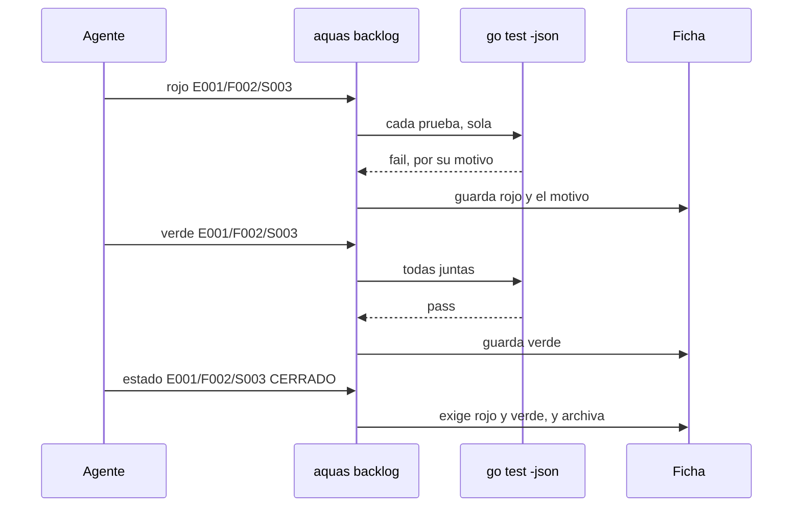
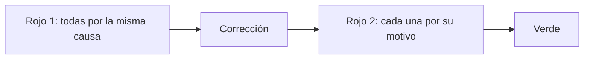

# S003 · Rojo y verde

[Inicio](../../README.md) › [E001](../README.md) › [F002](README.md) › S003

[Slice](../../glosario.md#slice) que impide cerrar trabajo sin pruebas. Cada ficha del [backlog](../../glosario.md#backlog) nombra sus pruebas. `aquas` comprueba que fallan antes y pasan después.

## En una frase

Antes de arreglar algo, hay que mostrar que está roto; después, que quedó bien.

## Para qué existe

**El problema.** El [agente](../../glosario.md#agente) decía «vi el rojo» y nadie lo comprobaba. Una revisión halló 15 pruebas, de 92, que no protegían lo que decían. Una fallaba por otra causa: le faltaba un dato de su configuración.

Además, al mover el backlog a `trabajo/`, la memoria siguió apuntando al lugar viejo. Ninguna prueba lo vio.

**La solución.** Cada ficha guarda sus pruebas y sus resultados:

- `pruebas`: cada prueba con su nombre y su intención, es decir, qué demuestra. Toda ficha nueva nace con ellas. El código de la prueba se escribe cuando arranca ese trabajo.
- `rojo`: `aquas` corre cada prueba sola con `go test -json`. Cada una debe fallar por sí misma.
- `verde`: después del rojo, `aquas` corre las pruebas juntas. Todas deben pasar.
- Cerrar una ficha exige rojo y luego verde.

Y dos reglas que fijó Jesús:

- Un solo slice en curso. Mientras hay uno, los demás slices no cambian de estado.
- La memoria caliente no acepta un slice distinto del que está en curso.

Contrato del slice:

| Campo | Valor |
|---|---|
| Objetivo | Que ninguna ficha cierre sin pruebas que fallaron antes y pasaron después |
| Incluye | Campos `pruebas`, `rojo` y `verde`; comandos `pruebas`, `rojo` y `verde`; un solo slice en curso; memoria según el backlog; ruta del backlog en la memoria |
| Excluye | Arreglar las 15 pruebas débiles (E000/F005), lista de revisión al cerrar (S004), archivos según el alcance (S007) |
| Prueba | `go test ./internal/backlog/ ./internal/memoria/ ./cmd/aquas/` |

## Analogía

Piensa en un **mecánico** con una falla en el carro.

- Primero prende el carro y oye el ruido, frente a ti.
- Luego cambia la pieza.
- Al final lo prende de nuevo, y el ruido ya no está.

Si nunca oíste el ruido, no sabes si el cambio sirvió.

Límite de la analogía: el mecánico prueba el carro entero. Aquí cada prueba se corre sola, para que una no tape a otra.

## Diagrama

Secuencia: del rojo al cierre.

## Ejemplo de punta a punta

continúa: [EJ-E001-F002](README.md#EJ-E001-F002)

En la [feature](../../glosario.md#feature), el slice ya está en la cola. Ahora debe probar su trabajo.

1. El slice nace con `prueba=./p:TestBandera=pide el arreglo`.
2. Pasa a `EN_CURSO`. Ningún otro slice puede cambiar de estado mientras tanto.
3. `aquas backlog rojo` corre `TestBandera` sola. Falla con «falta el arreglo». Queda escrito en la ficha.
4. El agente hace el arreglo.
5. `aquas backlog verde` corre la prueba. Pasa.
6. `aquas backlog estado … CERRADO` ve rojo y verde. La ficha se va al archivo.

Qué no cuenta como rojo:

- Una prueba que no compila.
- Una prueba que no existe.
- Una prueba que se salta.
- Una prueba que falla solo cuando otra corre antes.

## Paso a paso

1. Página del slice y pruebas en rojo.
2. Campos `pruebas`, `rojo` y `verde` en la ficha.
3. Comandos `pruebas`, `rojo` y `verde`.
4. Cierre que exige rojo y verde.
5. Un solo slice en curso.
6. Memoria según el backlog, y ruta corregida.
7. Revisión del [gate](../../glosario.md#gate) sobre los campos nuevos.

## Cómo se usa

- `aquas backlog nuevo … prueba=./paquete:TestA=qué demuestra prueba=./otro:TestB=qué demuestra`. El campo se repite, uno por prueba.
- `aquas backlog pruebas <id> ./paquete:TestA=qué demuestra …`: cambia la lista y borra rojo y verde.
- `aquas backlog ver <id>`: muestra cada prueba con su intención, y el motivo de su rojo.
- `aquas backlog rojo <id>`: solo con el slice en curso.
- `aquas backlog verde <id>`: solo después del rojo.

## Contrato y evidencia

Estado: en curso. Rojo y verde registrados por `aquas`; falta la auditoría y el cierre.

Pruebas del slice, en `internal/backlog/rojo_test.go`, `internal/memoria/memoria_test.go` y `cmd/aquas/rojo_test.go`:

| Prueba | Qué demuestra |
|---|---|
| `TestNuevoExigePruebas` | Una ficha nueva sin pruebas, o con un nombre mal escrito, no se crea |
| `TestPruebasReiniciaRojoYVerde` | Cambiar la lista borra el rojo y el verde viejos |
| `TestRojoExigeQueCadaPruebaFalle` | Si una prueba pasa o se salta, no hay rojo; el motivo del fallo queda guardado |
| `TestRojoNoCuentaCompilacionNiAusencia` | No compilar o no existir no cuenta como rojo |
| `TestRojoPruebaAislada` | Una prueba que falla solo por culpa de otra no cuenta |
| `TestVerdeDespuesDelRojo` | No hay verde sin rojo, ni con una prueba fallando |
| `TestCerrarExigeRojoYVerde` | Cerrar pide rojo y verde; cancelar no |
| `TestUnSoloSliceEnCurso` | Con un slice en curso, otro no cambia de estado; la prioridad sí |
| `TestValidarRojoYVerde` | El gate ve verde sin rojo, verde antes del rojo, dos en curso y nombres malos |
| `TestRutaBacklogEsTrabajo` | La memoria apunta a `trabajo/activo`, y esa carpeta existe |
| `TestMemoriaSegunBacklog` | La memoria rechaza un slice que no está en curso |
| `TestCerrarSliceDePuntaAPunta` | Prueba integral de F002: nace, rojo, verde y archivo, con el programa real |

Datos de juguete: `rojo_test.go` arma un módulo pequeño con `TestFalla`, `TestPasa`, `TestSalta`, `TestEnsucia`, `TestDepende` y `TestBandera`. No protegen el repo: cada una ilustra un caso del rojo.

Rojo visto: sí, el 2026-10-21, registrado en la ficha por `aquas backlog rojo`. Cada prueba corrió sola y falló por su propio motivo. Verde: registrado por `aquas backlog verde`.

Dos rojos no valían al principio, y se corrigieron:

- Las doce fallaban porque `nuevo` aún no aceptaba pruebas. El esqueleto pasó a aceptarlas sin validarlas.
- El aviso del esqueleto decía «rojo». Eso hacía pasar una revisión que buscaba esa palabra.

El auditor halló seis puntos, y se corrigieron todos:

- Grave: si el slice se cerraba sin archivar la memoria, `memoria fijar` quedaba trabado. Ahora el error dice cómo vaciar el slice.
- La ruta del backlog vivía en dos sitios. Ahora la memoria usa la del paquete `backlog`.
- Páginas, la guardia y el [orquestador](../../glosario.md#orquestador) nombraban comandos viejos.
- El gate no tenía caso para «cerrada sin rojo». Dos revisiones del CLI pasaban por un texto fijo.
- El motivo guardado era la primera línea, no la del fallo. Un paquete ausente salía como «no compila».

Esos casos nuevos se escribieron después del arreglo: su rojo no se vio.

Decisiones de Jesús (2026-10-21):

- Un solo slice en curso; solo él cambia de estado. Es parte de la constitución de la metodología.
- La memoria rechaza un foco distinto del backlog.
- El rojo cuenta prueba por prueba, no por el código de salida.
- Toda [iniciativa](../../glosario.md#iniciativa), feature y slice nace con sus pruebas, y su ficha guarda rojo y verde.
- Cada prueba en la ficha lleva su intención, no solo el nombre. El código se escribe al arrancar ese trabajo.
- Las fichas viejas no se migran. Una activa recibe sus pruebas con `aquas backlog pruebas` antes de cerrar.
- Los comandos son `aquas backlog pruebas`, `rojo` y `verde`.
- Con un slice en curso, los demás slices no cambian de estado. Iniciativas y features sí; la prioridad cambia en cualquiera.

Cómo se registró el rojo de S003: el comando `rojo` no existía mientras sus pruebas fallaban. Se compiló `aquas` con el código nuevo. Luego el repo volvió al estado rojo, con las pruebas y los esqueletos. Ahí corrió `aquas backlog rojo` de verdad, y después se restauró el código.

## Navegación

- ↑ Subir: [F002 · Turnos, backlog y sello](README.md)
