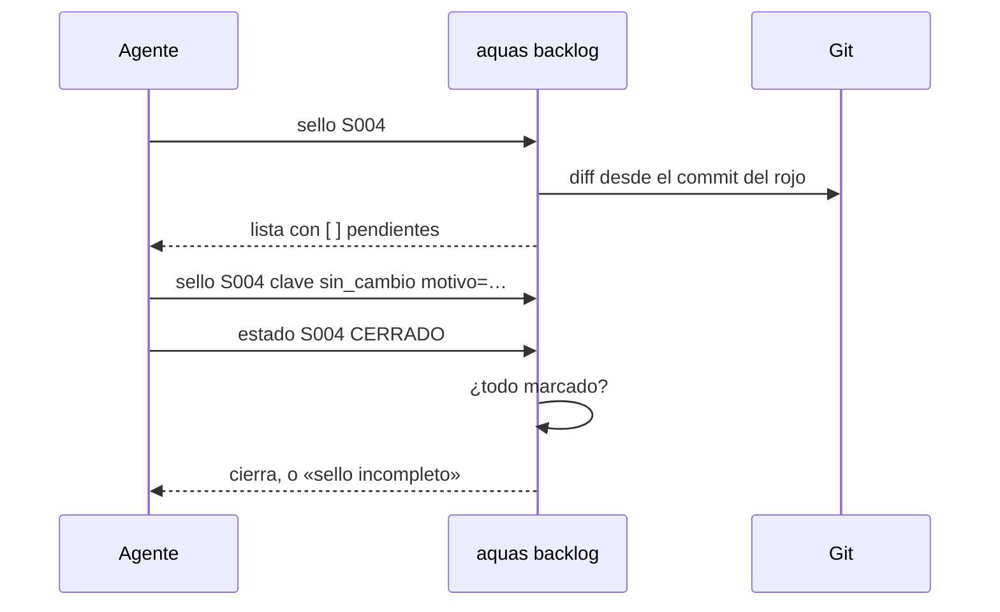

# S004 · Sello de cierre

[Inicio](../../README.md) › [E001](../README.md) › [F002](README.md) › S004

[Slice](../../glosario.md#slice) que obliga a revisar lo que pudo quedar desfasado antes de cerrar un slice. La lista la arma un programa, no el [agente](../../glosario.md#agente). Esa revisión se llama [sello](../../glosario.md#sello).

## En una frase

Antes de cerrar, `aquas` te da la lista de lo que pudo romperse, y no deja cerrar hasta revisarla.

## Para qué existe

**El problema.** Al cerrar un slice nadie revisaba qué más quedó viejo. Pasó de verdad: S002 mudó el [backlog](../../glosario.md#backlog) a `trabajo/`, y la memoria siguió apuntando a la ruta vieja. Nada lo detectó.

**La solución.** `aquas backlog sello <id>` arma la lista. `backlog estado <id> CERRADO` se niega mientras un ítem no tenga marca y motivo.

Contrato del slice:

| Campo | Valor |
|---|---|
| Objetivo | Cierre bloqueado hasta revisar lo que pudo quedar desfasado |
| Incluye | Nivel árbol (padre, iniciativa, dependientes, páginas) y nivel archivos (quién nombra o importa lo tocado) |
| Excluye | Nivel trabajo, en S012; sello de features e iniciativas |
| Prueba | `go test ./internal/backlog/ ./cmd/aquas/` |

Decisión humana: un hermano es solo parentesco. Entra al sello si depende de este slice (`bloqueado_por`) o si comparte archivos.

## Analogía

Piensa en la **lista de chequeo de un piloto** antes de despegar.

- La lista no la inventa el piloto: viene impresa.
- Cada punto se marca, aunque sea «sin cambio».

Límite de la analogía: aquí la lista cambia según lo que tocaste. Si tocas otro archivo, aparecen puntos nuevos.

## Diagrama

Secuencia de un cierre:

## Ejemplo de punta a punta

continúa: [EJ-E001-F002](README.md#EJ-E001-F002)

Este mismo slice fue el primero en cerrar con sello.

1. El sello listó 5 ítems del árbol más los archivos que nombran o importan lo tocado.
2. Por ejemplo, `internal/wiki/hijos.go` importa el paquete del backlog, que este slice cambió.
3. Cada ítem recibió su marca: `sin_cambio` o `actualizado`, con motivo.
4. Recién entonces `CERRADO` pasó.

## Paso a paso

1. Escribir las cinco pruebas y verlas en rojo con funciones vacías.
2. Escribir `internal/backlog/sello.go`: árbol, archivos, marcas y chequeo del cierre.
3. Agregar `aquas backlog sello` al CLI.
4. Ajustar la prueba vieja de cierre: ahora marca el sello antes de cerrar.

## Cómo se usa

- Ver la lista: `aquas backlog sello E001/F002/S004`.
- Marcar: `aquas backlog sello E001/F002/S004 ficha:E001 sin_cambio motivo=no cambia`.
- `[ ]` es pendiente; `[x]` está marcado.

## Contrato y evidencia

<!-- GENERADO por aquas desde trabajo/: no editar a mano; `aquas compilar` lo rehace. -->

| Prueba | Qué demuestra | Rojo | Verde |
|---|---|---|---|
| `TestSelloArmaListaDelArbol` | el sello lista padre, abuelo, dependientes abiertos y páginas; un hermano independiente no entra | 2026-10-21 | 2026-10-21 |
| `TestSelloArmaListaDeArchivos` | el sello lista quién nombra o importa lo tocado desde el rojo, con la línea; excluye datos | 2026-10-21 | 2026-10-21 |
| `TestCierreSinSelloCompletoSeNiega` | CERRADO se niega con un ítem sin marca; la marca exige sin_cambio o actualizado y motivo | 2026-10-21 | 2026-10-21 |
| `TestSelloSeVuelveAArmarSiCambiaAlgo` | tocar otro archivo tras marcar agrega ítems sin marca y frena el cierre | 2026-10-21 | 2026-10-21 |
| `TestSelloCLIDePuntaAPunta` | por el CLI real, el sello se lista, frena el cierre y se marca | 2026-10-21 | 2026-10-21 |

<!-- /GENERADO -->

Estado: hecho.

Límites:

- Sin [commit](../../glosario.md#commit) base en el rojo no hay con qué comparar, y el sello no se exige.
- «Nombra» es la ruta exacta. Un archivo que menciona solo el nombre corto no aparece.

## Navegación

- ↑ Subir: [F002 · Turnos, backlog y sello](README.md)
