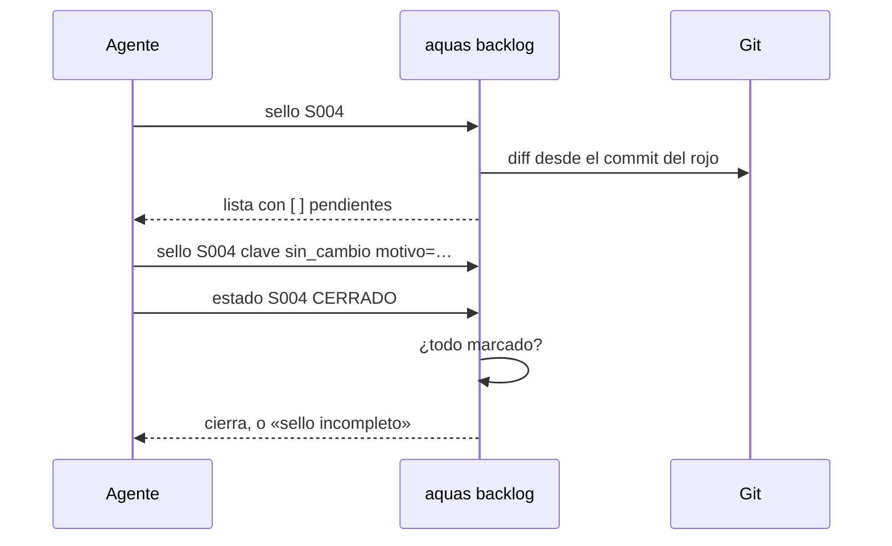

# S004 · Sello de cierre

[Inicio](../../README.md) › [E001](../README.md) › [F002](README.md) › S004

[Slice](../../glosario.md#slice) que obliga a revisar lo que pudo quedar desfasado antes de cerrar un slice. La lista la arma un programa, no el [agente](../../glosario.md#agente). Esa revisión se llama [sello](../../glosario.md#sello).

## En una frase

Antes de cerrar, `aquas` te da la lista de lo que pudo romperse, y no deja cerrar hasta revisarla.

## Para qué existe

**El problema.** Al cerrar un slice nadie revisaba qué más quedó viejo. Pasó de verdad: S002 mudó el [backlog](../../glosario.md#backlog) a `trabajo/`, y la memoria siguió apuntando a la ruta vieja. Nada lo detectó.

**La solución.** `aquas backlog sello <id>` arma la lista. `backlog estado <id> CERRADO` se niega mientras un ítem no tenga marca y motivo.

Contrato del slice:

| Campo | Valor |
|---|---|
| Objetivo | Cierre bloqueado hasta revisar lo que pudo quedar desfasado |
| Incluye | Nivel árbol (padre, iniciativa, dependientes, páginas) y nivel archivos (quién nombra o importa lo tocado) |
| Excluye | Nivel trabajo, en S012; sello de features e iniciativas |
| Prueba | `go test ./internal/backlog/ ./cmd/aquas/` |

Decisión humana: un hermano es solo parentesco. Entra al sello si depende de este slice (`bloqueado_por`) o si comparte archivos.

## Analogía

Piensa en la **lista de chequeo de un piloto** antes de despegar.

- La lista no la inventa el piloto: viene impresa.
- Cada punto se marca, aunque sea «sin cambio».

Límite de la analogía: aquí la lista cambia según lo que tocaste. Si tocas otro archivo, aparecen puntos nuevos.

## Diagrama

Secuencia de un cierre:

## Ejemplo de punta a punta

continúa: [EJ-E001-F002](README.md#EJ-E001-F002)

Este mismo slice fue el primero en cerrar con sello.

1. El sello listó 5 ítems del árbol más los archivos que nombran o importan lo tocado.
2. Por ejemplo, `internal/wiki/hijos.go` importa el paquete del backlog, que este slice cambió.
3. Cada ítem recibió su marca: `sin_cambio` o `actualizado`, con motivo.
4. Recién entonces `CERRADO` pasó.

## Paso a paso

1. Escribir las cinco pruebas y verlas en rojo con funciones vacías.
2. Escribir `internal/backlog/sello.go`: árbol, archivos, marcas y chequeo del cierre.
3. Agregar `aquas backlog sello` al CLI.
4. Ajustar la prueba vieja de cierre: ahora marca el sello antes de cerrar.

## Cómo se usa

- Ver la lista: `aquas backlog sello E001/F002/S004`.
- Marcar: `aquas backlog sello E001/F002/S004 ficha:E001 sin_cambio motivo=no cambia`.
- `[ ]` es pendiente; `[x]` está marcado.

## Contrato y evidencia

<!-- GENERADO por aquas desde trabajo/: no editar a mano; `aquas compilar` lo rehace. -->

| Prueba | Valida | Rojo cuando | Verde cuando | Rojo | Verde |
|---|---|---|---|---|---|
| `TestSelloArmaListaDelArbol` | el sello lista padre, abuelo, dependientes abiertos y páginas; un hermano independiente no entra | Sello omite el padre, el abuelo, un dependiente abierto o una página, o mete un hermano independiente | el sello trae esas fichas y páginas, sin el hermano sin relación | 2026-10-21 | 2026-10-21 |
| `TestSelloArmaListaDeArchivos` | el sello lista quién nombra o importa lo tocado desde el rojo, con la línea; excluye datos | Sello omite quien nombra o importa un archivo tocado, o incluye registro, trabajo u otros archivos ajenos | salen los ítems nombra e importa con la línea relevante y nada de datos ni archivos no tocados | 2026-10-21 | 2026-10-21 |
| `TestCierreSinSelloCompletoSeNiega` | CERRADO se niega con un ítem sin marca; la marca exige sin_cambio o actualizado y motivo | Estado cierra con ítems del sello sin marcar, o Marcar acepta marca inválida, sin motivo o clave ajena | cerrar falla con sello incompleto; con todo marcado cierra y la ficha guarda la última marca | 2026-10-21 | 2026-10-21 |
| `TestSelloSeVuelveAArmarSiCambiaAlgo` | tocar otro archivo tras marcar agrega ítems sin marca y frena el cierre | cerrar pasa tras tocar otro archivo, porque el sello no se rearma | el cierre falla nombrando el ítem nuevo sin marca | 2026-10-21 | 2026-10-21 |
| `TestSelloCLIDePuntaAPunta` | por el CLI real el sello se lista, frena el cierre y se marca | el sello no lista pendientes, el cierre no se niega sin marcas o con todo marcado no cierra | pendientes con [ ]; sin marcas el cierre se niega; marcado con [x], marca y motivo; cierra | 2026-10-21 | 2026-10-21 |

### Código

| Archivo | Función | Parámetros | Qué hace |
|---|---|---|---|
| [cmd/aquas/main.go](../../../cmd/aquas/main.go) | `main` | `()` | main despacha el subcomando de aquas (compilar, verificar, backlog, hooks…) y sale con su código. |
| [cmd/aquas/main.go](../../../cmd/aquas/main.go) | `hook` | `(raiz string)` | hook: exit 0 = nada que reportar; exit 2 = stderr se muestra a Claude. |
| [cmd/aquas/main.go](../../../cmd/aquas/main.go) | `compilarSettings` | `(w io.Writer)` | compilarSettings regenera .claude/settings.json; sin entorno declarado no inventa uno. |
| [cmd/aquas/main.go](../../../cmd/aquas/main.go) | `reportar` | `(w io.Writer, inf compilador.Informe)` | reportar imprime qué derivados escribió la compilación, o que todo estaba al día. |
| [cmd/aquas/main.go](../../../cmd/aquas/main.go) | `listar` | `(titulo string, problemas []string)` | listar imprime en stderr un título y cada problema en su viñeta. |
| [cmd/aquas/main.go](../../../cmd/aquas/main.go) | `lista` | `(xs []string) string` | lista une los textos con comas, o «—» si no hay ninguno. |
| [cmd/aquas/main.go](../../../cmd/aquas/main.go) | `fallar` | `(codigo int, err error)` | fallar imprime el error en stderr y termina con el código dado. |
| [cmd/aquas/main.go](../../../cmd/aquas/main.go) | `memoriaCLI` | `(raiz string, args []string)` | memoriaCLI: `ver` imprime la memoria; `fijar campo=valor…` la actualiza y la sella. |
| [cmd/aquas/main.go](../../../cmd/aquas/main.go) | `memoriaArchivada` | `(raiz, id string) error` | memoriaArchivada: CERRADO exige el archivo de memoria del slice, apunte o no la memoria a él (E001/F002/S009, X01). |
| [cmd/aquas/main.go](../../../cmd/aquas/main.go) | `focoEnBacklog` | `(raiz string, f memoria.Foco) error` | focoEnBacklog: la memoria solo fija el slice que el backlog tiene en curso (S003). |
| [cmd/aquas/main.go](../../../cmd/aquas/main.go) | `backlogCLI` | `(raiz string, args []string)` | backlogCLI: nuevo \\| ver [id] \\| prioridad \\| estado \\| siguiente \\| pruebas \\| rojo \\| verde. |
| [cmd/aquas/main.go](../../../cmd/aquas/main.go) | `turnoCLI` | `(raiz string, args []string)` | turnoCLI: auditoría de turnos (E001/F002/S001). Lee el JSON del hook por stdin. No imprime nada |
| [cmd/aquas/main.go](../../../cmd/aquas/main.go) | `defectoCLI` | `(raiz string, args []string) error` | defectoCLI: nuevo \\| ocurre \\| ver (E001/F004/S001). |
| [cmd/aquas/main.go](../../../cmd/aquas/main.go) | `versionBinario` | `() string` | versionBinario: versión del módulo con que se compiló el binario (= versión del gobierno embebido). |
| [cmd/aquas/main.go](../../../cmd/aquas/main.go) | `registrarCierre` | `(raiz, tipo, transcript, primera, resultado string)` | registrarCierre (E001/F004/S005, D000068) anota cada llamada del gancho cierre-agente en .tmp/hooks/cierre-agente.jsonl. |
| [internal/backlog/backlog.go](../../../internal/backlog/backlog.go) | `terminal` | `(estado string) bool` | terminal: el estado ya no cambia (CERRADO o CANCELADO). |
| [internal/backlog/backlog.go](../../../internal/backlog/backlog.go) | `esta` | `(xs []string, x string) bool` | esta: x figura en la lista. |
| [internal/backlog/backlog.go](../../../internal/backlog/backlog.go) | `tipoYPadre` | `(id string) (tipo, padre string)` | tipoYPadre deriva del id: E001 → iniciativa; E001/F002 → feature de E001; E001/F002/S002 → slice. |
| [internal/backlog/backlog.go](../../../internal/backlog/backlog.go) | `nombre` | `(id string) string` | nombre: archivo JSON de una ficha, con «/» del ID cambiadas por «-». |
| [internal/backlog/backlog.go](../../../internal/backlog/backlog.go) | `todas` | `(raiz string) (act, arc map[string]Ficha, err error)` | todas lee activo y archivo. Una ficha ilegible es error: Validar la detalla. |
| [internal/backlog/backlog.go](../../../internal/backlog/backlog.go) | `Todas` | `(raiz string) ([]Ficha, error)` | Todas: las fichas de activo y archivo, ordenadas por id. Para quien solo lee (wiki, E001/F002/S010). |
| [internal/backlog/backlog.go](../../../internal/backlog/backlog.go) | `leer` | `(ruta string) (Ficha, error)` | leer carga una ficha desde su archivo JSON. |
| [internal/backlog/backlog.go](../../../internal/backlog/backlog.go) | `escribir` | `(raiz, dir string, f Ficha) error` | escribir guarda la ficha como JSON en trabajo/<dir>/, con listas vacías en vez de null. |
| [internal/backlog/backlog.go](../../../internal/backlog/backlog.go) | `Nuevo` | `(raiz string, campos []string) (Ficha, error)` | Nuevo crea una ficha desde campos id=… titulo=… prioridad=… motivo=… relacion=… [bloqueado_por=A,B]. |
| [internal/backlog/backlog.go](../../../internal/backlog/backlog.go) | `Ver` | `(raiz, id string) (Ficha, bool, error)` | Ver busca la ficha en activo y luego en archivo. |
| [internal/backlog/backlog.go](../../../internal/backlog/backlog.go) | `activa` | `(raiz, id string) (Ficha, error)` | activa: la ficha a cambiar; una archivada no cambia. |
| [internal/backlog/backlog.go](../../../internal/backlog/backlog.go) | `Prioridad` | `(raiz, id, prioridad, motivo string) (Ficha, error)` | Prioridad cambia la prioridad; el motivo es obligatorio. |
| [internal/backlog/backlog.go](../../../internal/backlog/backlog.go) | `Estado` | `(raiz, id, estado string) (Ficha, error)` | Estado cambia el estado. CERRADO o CANCELADO mueve la ficha al archivo. |
| [internal/backlog/backlog.go](../../../internal/backlog/backlog.go) | `sinHijosActivos` | `(act map[string]Ficha, f Ficha) error` | sinHijosActivos: cerrar o cancelar una feature o iniciativa exige sus hijos directos ya archivados. |
| [internal/backlog/backlog.go](../../../internal/backlog/backlog.go) | `ordenar` | `(fs []Ficha, arc map[string]Ficha)` | orden de `siguiente`: en curso → desbloqueado → prioridad → secuencia → id. |
| [internal/backlog/backlog.go](../../../internal/backlog/backlog.go) | `Activas` | `(raiz string) ([]Ficha, error)` | Activas: slices en el orden de `siguiente`; después iniciativas y features por secuencia. |
| [internal/backlog/backlog.go](../../../internal/backlog/backlog.go) | `Siguiente` | `(raiz string) (Ficha, bool, error)` | Siguiente: el primer slice del orden fijo que esté en curso o desbloqueado. |
| [internal/backlog/backlog.go](../../../internal/backlog/backlog.go) | `sinDefinir` | `(act map[string]Ficha) (Ficha, bool)` | sinDefinir (E001/F002/S008, regla del humano 2026-10-21): iniciativa o feature activa sin hijos |
| [internal/backlog/backlog.go](../../../internal/backlog/backlog.go) | `Definir` | `(raiz string, f Ficha) string` | Definir: qué hacer con lo que `siguiente` saca sin definir; "" para un slice. |
| [internal/backlog/backlog.go](../../../internal/backlog/backlog.go) | `libre` | `(f Ficha, arc map[string]Ficha) bool` | libre: no está BLOQUEADO y cada bloqueador ya terminó (archivado: CERRADO o CANCELADO). |
| [internal/backlog/backlog.go](../../../internal/backlog/backlog.go) | `Validar` | `(raiz string) []string` | Validar: problemas de las fichas en disco (gate). Sin carpeta trabajo/ no hay problemas. |
| [internal/backlog/backlog.go](../../../internal/backlog/backlog.go) | `Texto` | `(f Ficha) string` | Texto: una línea por ficha, para el agente. |
| [internal/backlog/sello.go](../../../internal/backlog/sello.go) | `excluida` | `(p string) bool` | excluida: la ruta cae bajo una carpeta que el sello no revisa. |
| [internal/backlog/sello.go](../../../internal/backlog/sello.go) | `gitLineas` | `(raiz string, args ...string) ([]string, error)` | gitLineas corre git en la raíz y devuelve su salida línea por línea. |
| [internal/backlog/sello.go](../../../internal/backlog/sello.go) | `pagina` | `(id string) string` | pagina: ruta de la página wiki de una ficha según su nivel en el ID. |
| [internal/backlog/sello.go](../../../internal/backlog/sello.go) | `arbol` | `(raiz string, f Ficha) ([]Item, error)` | arbol: padre, abuelo, dependientes abiertos y páginas. |
| [internal/backlog/sello.go](../../../internal/backlog/sello.go) | `moduloGo` | `(raiz string) string` | moduloGo: ruta del módulo declarada en go.mod, o vacío si no hay. |
| [internal/backlog/sello.go](../../../internal/backlog/sello.go) | `lineaCon` | `(c, s string) string` | lineaCon: primera línea de c que contiene s, recortada; sirve de evidencia en el sello. |
| [internal/backlog/sello.go](../../../internal/backlog/sello.go) | `derivados` | `(raiz string) map[string]bool` | derivados: salidas del compilador según su archivo de sellos, más ese archivo (S014). Ya los vigila |
| [internal/backlog/sello.go](../../../internal/backlog/sello.go) | `archivos` | `(raiz, head string) ([]Item, error)` | archivos: quién nombra o importa lo tocado desde el HEAD del rojo. |
| [internal/backlog/sello.go](../../../internal/backlog/sello.go) | `Sello` | `(raiz, id string) ([]Item, error)` | Sello arma la lista del slice y le pega las marcas guardadas en su ficha. |
| [internal/backlog/sello.go](../../../internal/backlog/sello.go) | `sello` | `(raiz string, f Ficha) ([]Item, error)` | sello arma la lista de piezas que el cambio de un slice obliga a revisar. |
| [internal/backlog/sello.go](../../../internal/backlog/sello.go) | `selloCompleto` | `(raiz string, f Ficha) error` | selloCompleto: CERRADO exige marca en cada ítem, haya o no commit base (S013). |
| [internal/backlog/sello.go](../../../internal/backlog/sello.go) | `Marcar` | `(raiz, id, clave, marca, motivo string) (Ficha, error)` | Marcar guarda la revisión de un ítem del sello de un slice activo. |
| [internal/backlog/sello.go](../../../internal/backlog/sello.go) | `TextoSello` | `(xs []Item) string` | TextoSello: una línea por ítem; [ ] pendiente, [x] marcado con su marca y motivo. |

<!-- /GENERADO -->

Estado: hecho.

Límites:

- Sin [commit](../../glosario.md#commit) base en el rojo se omite el nivel archivos; el árbol se exige igual (corregido en S013).
- «Nombra» es la ruta exacta. Un archivo que menciona solo el nombre corto no aparece.

## Navegación

- ↑ Subir: [F002 · Turnos, backlog y sello](README.md)
