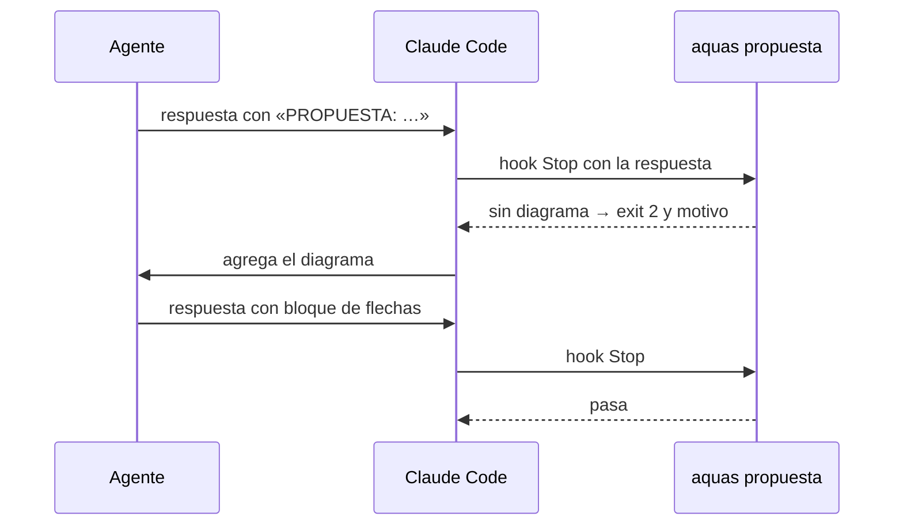

# S006 · Propuesta con diagrama

[Inicio](../../README.md) › [E001](../README.md) › [F002](README.md) › S006

[Slice](../../glosario.md#slice) que obliga al [agente](../../glosario.md#agente) a dibujar en texto cada propuesta de proceso o diseño que hace en el chat. Lo vigila un [hook](../../glosario.md#hook) al cierre del turno.

## En una frase

Si el agente te propone cómo funciona algo, tiene que mostrártelo con un dibujo, no solo con palabras.

## Para qué existe

**El problema.** Las propuestas llegaban en prosa. El humano tenía que armar el flujo en su cabeza. Pasó de verdad: «no veo los ejemplos, no entiendo qué sucede».

**La solución.** El agente marca cada propuesta con una línea `PROPUESTA: …`. Al terminar el turno, el hook lee la respuesta completa. Si una propuesta no trae después un bloque de código con flechas o cajas, frena el cierre. Entonces el agente lo agrega.

Contrato del slice:

| Campo | Valor |
|---|---|
| Objetivo | Toda propuesta marcada lleva diagrama en texto |
| Incluye | `internal/propuesta/`, `aquas propuesta`, hook de cierre, regla en la comunicación del [orquestador](../../glosario.md#orquestador) |
| Excluye | Detectar propuestas sin marca: eso es criterio |
| Prueba | `go test ./internal/propuesta/` |

## Analogía

Piensa en un **arquitecto** que te explica una casa.

- Con palabras, imaginas otra casa.
- Con el plano, ves la misma que él.

Límite de la analogía: aquí el plano es texto simple, porque el chat no dibuja [Mermaid](../../glosario.md#mermaid).

## Diagrama

Secuencia de un cierre con propuesta:

## Ejemplo de punta a punta

continúa: [EJ-E001-F002](README.md#EJ-E001-F002)

El agente propone el [sello](../../glosario.md#sello) en prosa: «aquas arma una lista y frena el cierre».

1. Lo marca con `PROPUESTA: el sello arma la lista`.
2. Termina el turno sin dibujo. El hook responde «PROPUESTA sin diagrama: «el sello arma la lista»».
3. El agente agrega un bloque como `cerrar ──► ¿todo marcado? ──sí──► CERRADO`.
4. El hook deja pasar el turno.

## Paso a paso

1. Escribir las cinco pruebas. Para el rojo, el esqueleto frenaba siempre. Uno que nunca frena deja en verde las pruebas contra el freno de más.
2. Escribir `internal/propuesta/propuesta.go`.
3. Sumar el hook a la plantilla y la regla a la comunicación del [orquestador](../../glosario.md#orquestador).

## Cómo se usa

- Al proponer, escribir `PROPUESTA: …` y después un bloque de código con flechas (`→`, `->`, `─►`) o cajas (`┌`, `│`).
- Un bloque con un comando no cuenta, ni una flecha suelta en la prosa.

## Contrato y evidencia

<!-- GENERADO por aquas desde trabajo/: no editar a mano; `aquas compilar` lo rehace. -->

| Prueba | Valida | Rojo cuando | Verde cuando | Rojo | Verde |
|---|---|---|---|---|---|
| `TestPropuestaSinDiagramaFrena` | una línea PROPUESTA sin diagrama después frena el cierre y nombra la propuesta | — | — | 2026-10-21 | 2026-10-21 |
| `TestPropuestaConDiagramaPasa` | con un bloque de código con flechas o cajas pasa | — | — | 2026-10-21 | 2026-10-21 |
| `TestBloqueSinFlechasNoEsDiagrama` | un bloque sin flechas ni cajas, o una flecha en prosa, no es diagrama | — | — | 2026-10-21 | 2026-10-21 |
| `TestSinMarcaPasa` | sin línea PROPUESTA el mensaje pasa, aunque nombre la palabra | — | — | 2026-10-21 | 2026-10-21 |
| `TestPlantillaTraeHookDePropuesta` | la plantilla real trae el hook en el cierre | — | — | 2026-10-21 | 2026-10-21 |

<!-- /GENERADO -->

Estado: hecho.

Límite: si el agente no escribe `PROPUESTA:`, el hook no se entera. La auditoría de turnos guarda cada respuesta, así que el humano puede revisarlo.

## Navegación

- ↑ Subir: [F002 · Turnos, backlog y sello](README.md)
