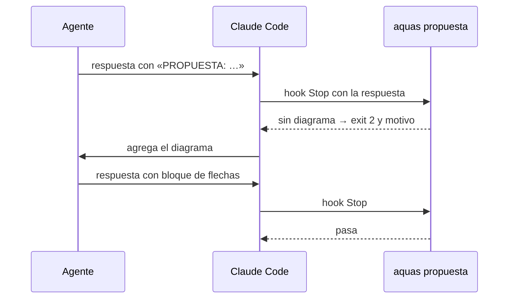

# S006 · Propuesta con diagrama

[Inicio](../../README.md) › [E001](../README.md) › [F002](README.md) › S006

[Slice](../../glosario.md#slice) que obliga al [agente](../../glosario.md#agente) a dibujar en texto cada propuesta de proceso o diseño que hace en el chat. Lo vigila un [hook](../../glosario.md#hook) al cierre del turno.

## En una frase

Si el agente te propone cómo funciona algo, tiene que mostrártelo con un dibujo, no solo con palabras.

## Para qué existe

**El problema.** Las propuestas llegaban en prosa. El humano tenía que armar el flujo en su cabeza. Pasó de verdad: «no veo los ejemplos, no entiendo qué sucede».

**La solución.** El agente marca cada propuesta con una línea `PROPUESTA: …`. Al terminar el turno, el hook lee la respuesta completa. Si una propuesta no trae después un bloque de código con flechas o cajas, frena el cierre. Entonces el agente lo agrega.

Contrato del slice:

| Campo | Valor |
|---|---|
| Objetivo | Toda propuesta marcada lleva diagrama en texto |
| Incluye | `internal/propuesta/`, `aquas propuesta`, hook de cierre, regla en la comunicación del [orquestador](../../glosario.md#orquestador) |
| Excluye | Detectar propuestas sin marca: eso es criterio |
| Prueba | `go test ./internal/propuesta/` |

## Analogía

Piensa en un **arquitecto** que te explica una casa.

- Con palabras, imaginas otra casa.
- Con el plano, ves la misma que él.

Límite de la analogía: aquí el plano es texto simple, porque el chat no dibuja [Mermaid](../../glosario.md#mermaid).

## Diagrama

Secuencia de un cierre con propuesta:



## Ejemplo de punta a punta

<a id="EJ-E001-F002-S006"></a>

continúa: [EJ-E001-F002](README.md#EJ-E001-F002)

El agente propone el [sello](../../glosario.md#sello) en prosa: «aquas arma una lista y frena el cierre».

1. Lo marca con `PROPUESTA: el sello arma la lista`.
2. Termina el turno sin dibujo. El hook responde «PROPUESTA sin diagrama: «el sello arma la lista»».
3. El agente agrega un bloque como `cerrar ──► ¿todo marcado? ──sí──► CERRADO`.
4. El hook deja pasar el turno.

## Paso a paso

1. Escribir las cinco pruebas. Para el rojo, el esqueleto frenaba siempre. Uno que nunca frena deja en verde las pruebas contra el freno de más.
2. Escribir `internal/propuesta/propuesta.go`.
3. Sumar el hook a la plantilla y la regla a la comunicación del [orquestador](../../glosario.md#orquestador).

## Cómo se usa

- Al proponer, escribir `PROPUESTA: …` y después un bloque de código con flechas (`→`, `->`, `─►`) o cajas (`┌`, `│`).
- Un bloque con un comando no cuenta, ni una flecha suelta en la prosa.

## Contrato y evidencia

<!-- GENERADO por aquas desde trabajo/: no editar a mano; `aquas compilar` lo rehace. -->

| Prueba | Valida | Rojo cuando | Verde cuando | Rojo | Verde |
|---|---|---|---|---|---|
| `TestPropuestaSinDiagramaFrena` | una PROPUESTA sin diagrama frena el cierre | una propuesta sin dibujo pasa o una tapa a la siguiente | frena nombrando la propuesta, también con negritas y la 2.ª | 2026-10-21 | 2026-10-21 |
| `TestPropuestaConDiagramaPasa` | una PROPUESTA con diagrama pasa | un bloque con flechas o cajas se rechaza | las cuatro formas de diagrama pasan sin mensaje | 2026-10-21 | 2026-10-21 |
| `TestBloqueSinFlechasNoEsDiagrama` | un bloque sin flechas ni cajas no es diagrama | un bloque bash o una flecha en prosa cuenta como diagrama | ambos casos frenan con «PROPUESTA sin diagrama» | 2026-10-21 | 2026-10-21 |
| `TestSinMarcaPasa` | sin línea PROPUESTA el mensaje pasa | frena un mensaje que solo nombra la palabra o la trae en bloque | los cuatro mensajes sin línea PROPUESTA pasan | 2026-10-21 | 2026-10-21 |
| `TestPlantillaTraeHookDePropuesta` | la plantilla trae el hook de propuesta en el cierre | falta el hook de Stop con orden propuesta en la plantilla | la plantilla incluye ese hook de Stop | 2026-10-21 | 2026-10-21 |

### Código

| Archivo | Función | Parámetros | Qué hace |
|---|---|---|---|
| [cmd/aquas/main.go](../../../cmd/aquas/main.go) | `main` | `()` | main despacha el subcomando de aquas (compilar, verificar, backlog, hooks…) y sale con su código. |
| [cmd/aquas/main.go](../../../cmd/aquas/main.go) | `hook` | `(raiz string)` | hook: exit 0 = nada que reportar; exit 2 = stderr se muestra a Claude. |
| [cmd/aquas/main.go](../../../cmd/aquas/main.go) | `compilarSettings` | `(w io.Writer)` | compilarSettings regenera .claude/settings.json; sin entorno declarado no inventa uno. |
| [cmd/aquas/main.go](../../../cmd/aquas/main.go) | `reportar` | `(w io.Writer, inf compilador.Informe)` | reportar imprime qué derivados escribió la compilación, o que todo estaba al día. |
| [cmd/aquas/main.go](../../../cmd/aquas/main.go) | `listar` | `(titulo string, problemas []string)` | listar imprime en stderr un título y cada problema en su viñeta. |
| [cmd/aquas/main.go](../../../cmd/aquas/main.go) | `lista` | `(xs []string) string` | lista une los textos con comas, o «—» si no hay ninguno. |
| [cmd/aquas/main.go](../../../cmd/aquas/main.go) | `fallar` | `(codigo int, err error)` | fallar imprime el error en stderr y termina con el código dado. |
| [cmd/aquas/main.go](../../../cmd/aquas/main.go) | `memoriaCLI` | `(raiz string, args []string)` | memoriaCLI: `ver` imprime la memoria; `fijar campo=valor…` la actualiza y la sella. |
| [cmd/aquas/main.go](../../../cmd/aquas/main.go) | `memoriaArchivada` | `(raiz, id string) error` | memoriaArchivada: CERRADO exige el archivo de memoria del slice, apunte o no la memoria a él (E001/F002/S009, X01). |
| [cmd/aquas/main.go](../../../cmd/aquas/main.go) | `focoEnBacklog` | `(raiz string, f memoria.Foco) error` | focoEnBacklog: la memoria solo fija el slice que el backlog tiene en curso (S003). |
| [cmd/aquas/main.go](../../../cmd/aquas/main.go) | `backlogCLI` | `(raiz string, args []string)` | backlogCLI: nuevo \\| ver [id] \\| prioridad \\| estado \\| siguiente \\| pruebas \\| rojo \\| verde. |
| [cmd/aquas/main.go](../../../cmd/aquas/main.go) | `turnoCLI` | `(raiz string, args []string)` | turnoCLI: auditoría de turnos (E001/F002/S001). Lee el JSON del hook por stdin. No imprime nada |
| [cmd/aquas/main.go](../../../cmd/aquas/main.go) | `defectoCLI` | `(raiz string, args []string) error` | defectoCLI: nuevo \\| ocurre \\| ver (E001/F004/S001). |
| [cmd/aquas/main.go](../../../cmd/aquas/main.go) | `versionBinario` | `() string` | versionBinario: versión del módulo con que se compiló el binario (= versión del gobierno embebido). |
| [cmd/aquas/main.go](../../../cmd/aquas/main.go) | `registrarCierre` | `(raiz, tipo, transcript, primera, resultado string)` | registrarCierre (E001/F004/S005, D000068) anota cada llamada del gancho cierre-agente en .tmp/hooks/cierre-agente.jsonl. |
| [gobierno/config/claude_settings.json](../../../gobierno/config/claude_settings.json) | — | — | — |
| [internal/propuesta/propuesta.go](../../../internal/propuesta/propuesta.go) | `marca` | `(l string) (string, bool)` | marca: texto de la propuesta si la línea empieza con PROPUESTA: (admite viñeta, título, cita o negrita). |
| [internal/propuesta/propuesta.go](../../../internal/propuesta/propuesta.go) | `diagrama` | `(c string) bool` | diagrama: el texto trae algún trazo de diagrama (flechas o cajas). |
| [internal/propuesta/propuesta.go](../../../internal/propuesta/propuesta.go) | `cercaDe` | `(t string) (byte, int)` | cercaDe: el carácter y el largo de una cerca de bloque (``` o ~~~), o largo 0 si no es cerca. |
| [internal/propuesta/propuesta.go](../../../internal/propuesta/propuesta.go) | `Revisar` | `(msg string) string` | Revisar devuelve "" si pasa; si no, el motivo del freno con las propuestas sin diagrama. |

<!-- /GENERADO -->

Estado: hecho.

Límite: si el agente no escribe `PROPUESTA:`, el hook no se entera. La auditoría de turnos guarda cada respuesta, así que el humano puede revisarlo.

## Navegación

- ↑ Subir: [F002 · Turnos, backlog y sello](README.md)
