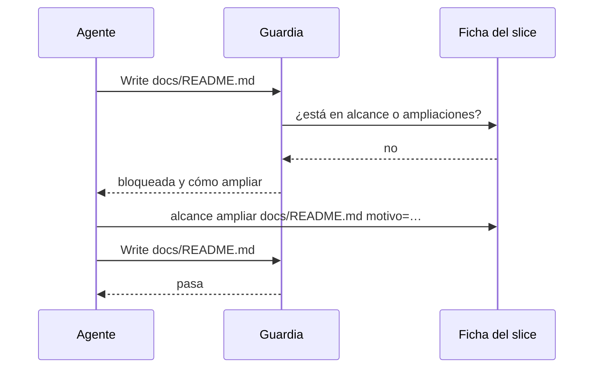

# S007 · Archivos solo dentro del alcance del slice

[Inicio](../../README.md) › [E001](../README.md) › [F002](README.md) › S007

Cada [slice](../../glosario.md#slice) declara al arrancar qué rutas va a tocar. Si el [agente](../../glosario.md#agente) intenta escribir en otra, la guardia lo frena y le dice cómo ampliar el alcance, con motivo.

## En una frase

El agente solo toca lo que dijo que iba a tocar. Si necesita algo más, explica por qué.

## Para qué existe

**El problema.** El alcance de un slice era solo texto en su página. Nada impedía tocar otros archivos, y los desvíos no dejaban rastro. Una regla ya pedía mandar los hallazgos ajenos al [backlog](../../glosario.md#backlog), pero dependía de la memoria del agente.

**La solución, opción B (decisión humana).** El slice declara sus rutas. Tocar otra exige ampliar el alcance con un motivo de una línea, que queda en la ficha. Los [derivados](../../glosario.md#derivado) del [compilador](../../glosario.md#compilador) y los datos que escribe `aquas` siempre pasan.

Se descartaron dos opciones:

- Bloqueo duro: trabaría el trabajo, porque hay archivos que no se pueden prever. S001 terminó tocando `.gitignore` y la guardia.
- Solo aviso al cerrar: deja el desvío a la vista, pero no lo previene.

Contrato del slice:

| Campo | Valor |
|---|---|
| Objetivo | Escribir fuera del alcance del slice en curso exige ampliarlo con motivo |
| Incluye | `internal/backlog/alcance.go`, la guardia, `aquas backlog alcance` |
| Excluye | Escrituras que la guardia no ve, como un programa que escribe por su cuenta |
| Prueba | `go test ./internal/backlog/ ./internal/guardia/` |

## Analogía

Piensa en un **permiso de obra**.

- Dice qué partes de la casa vas a tocar.
- Si descubres que hay que tocar otra pared, pides la ampliación y queda escrita.

Límite de la analogía: aquí el inspector revisa cada escritura, no solo al final.

## Diagrama

Secuencia de una escritura fuera del alcance:

## Ejemplo de punta a punta

continúa: [EJ-E001-F002](README.md#EJ-E001-F002)

Este mismo slice fue el primero con alcance vigilado.

1. Declaró `internal/backlog/**`, `internal/guardia/**`, `cmd/aquas/**`, `docs/E001/F002/**` y `gobierno/canonico/**`.
2. Una escritura a `docs/README.md` salió bloqueada con el comando para ampliar.
3. Esta página, dentro de `docs/E001/F002/`, pasó.

## Paso a paso

1. Escribir las cuatro pruebas y ver el rojo con un esqueleto que frenaba siempre.
2. Escribir `internal/backlog/alcance.go` y conectarlo a la guardia.
3. Agregar `aquas backlog alcance` al comando.
4. Declarar el alcance de este slice antes de seguir escribiendo.

## Cómo se usa

- Declarar: `aquas backlog alcance E001/F002/S007 "internal/backlog/**" docs/x.md`.
- Ampliar: `aquas backlog alcance E001/F002/S007 ampliar docs/README.md motivo=el inicio nombra el slice`.
- `dir/**` cubre todo lo de dentro de `dir`.

## Contrato y evidencia

<!-- GENERADO por aquas desde trabajo/: no editar a mano; `aquas compilar` lo rehace. -->

| Prueba | Qué demuestra | Rojo | Verde |
|---|---|---|---|
| `TestAlcanceSeDeclaraYAmplia` | rutas declaradas, ampliadas con motivo, derivados y datos de aquas pasan; lo demás frena y dice cómo ampliar | 2026-10-22 | 2026-10-22 |
| `TestSinAlcanceDeclaradoBloquea` | slice en curso sin alcance frena y dice cómo declararlo | 2026-10-22 | 2026-10-22 |
| `TestSinSliceEnCursoNoRestringe` | sin slice en curso no hay restricción | 2026-10-22 | 2026-10-22 |
| `TestGuardiaBloqueaFueraDelAlcance` | la guardia aplica el alcance a Write y a Bash | 2026-10-22 | 2026-10-22 |

<!-- /GENERADO -->

Estado: hecho.

Límites:

- Un slice en curso sin alcance declarado frena toda escritura hasta declararlo.
- La guardia ve Write, Edit y los destinos de Bash que sabe leer. Un programa que escribe por su cuenta no pasa por ella.

## Navegación

- ↑ Subir: [F002 · Turnos, backlog y sello](README.md)
