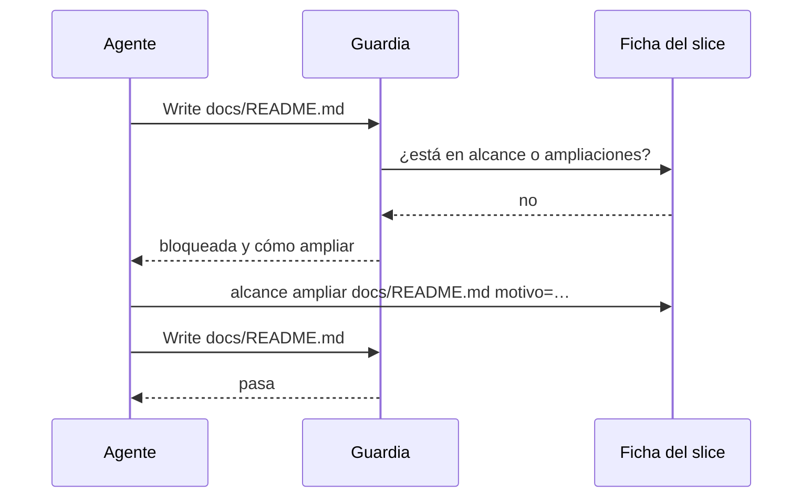

# S007 · Archivos solo dentro del alcance del slice

[Inicio](../../README.md) › [E001](../README.md) › [F002](README.md) › S007

Cada [slice](../../glosario.md#slice) declara al arrancar qué rutas va a tocar. Si el [agente](../../glosario.md#agente) intenta escribir en otra, la guardia lo frena y le dice cómo ampliar el alcance, con motivo.

## En una frase

El agente solo toca lo que dijo que iba a tocar. Si necesita algo más, explica por qué.

## Para qué existe

**El problema.** El alcance de un slice era solo texto en su página. Nada impedía tocar otros archivos, y los desvíos no dejaban rastro. Una regla ya pedía mandar los hallazgos ajenos al [backlog](../../glosario.md#backlog), pero dependía de la memoria del agente.

**La solución, opción B (decisión humana).** El slice declara sus rutas. Tocar otra exige ampliar el alcance con un motivo de una línea, que queda en la ficha. Los [derivados](../../glosario.md#derivado) del [compilador](../../glosario.md#compilador) y los datos que escribe `aquas` siempre pasan.

Se descartaron dos opciones:

- Bloqueo duro: trabaría el trabajo, porque hay archivos que no se pueden prever. S001 terminó tocando `.gitignore` y la guardia.
- Solo aviso al cerrar: deja el desvío a la vista, pero no lo previene.

Contrato del slice:

| Campo | Valor |
|---|---|
| Objetivo | Escribir fuera del alcance del slice en curso exige ampliarlo con motivo |
| Incluye | `internal/backlog/alcance.go`, la guardia, `aquas backlog scope` |
| Excluye | Escrituras que la guardia no ve, como un programa que escribe por su cuenta |
| Prueba | `go test ./internal/backlog/ ./internal/guardia/` |

## Analogía

Piensa en un **permiso de obra**.

- Dice qué partes de la casa vas a tocar.
- Si descubres que hay que tocar otra pared, pides la ampliación y queda escrita.

Límite de la analogía: aquí el inspector revisa cada escritura, no solo al final.

## Diagrama

Secuencia de una escritura fuera del alcance:

## Ejemplo de punta a punta

continúa: [EJ-E001-F002](README.md#EJ-E001-F002)

Este mismo slice fue el primero con alcance vigilado.

1. Declaró `internal/backlog/**`, `internal/guardia/**`, `cmd/aquas/**`, `docs/E001/F002/**` y `gobierno/canonico/**`.
2. Una escritura a `docs/README.md` salió bloqueada con el comando para ampliar.
3. Esta página, dentro de `docs/E001/F002/`, pasó.

## Paso a paso

1. Escribir las cuatro pruebas y ver el rojo con un esqueleto que frenaba siempre.
2. Escribir `internal/backlog/alcance.go` y conectarlo a la guardia.
3. Agregar `aquas backlog scope` al comando.
4. Declarar el alcance de este slice antes de seguir escribiendo.

## Cómo se usa

- Declarar: `aquas backlog scope E001/F002/S007 "internal/backlog/**" docs/x.md`.
- Ampliar: `aquas backlog scope E001/F002/S007 extend docs/README.md motivo=el inicio nombra el slice`.
- `dir/**` cubre todo lo de dentro de `dir`.

## Contrato y evidencia

<!-- GENERADO por aquas desde trabajo/: no editar a mano; `aquas compile` lo rehace. -->

| Prueba | Valida | Rojo cuando | Verde cuando | Rojo | Verde |
|---|---|---|---|---|---|
| `TestAlcanceSeDeclaraYAmplia` | rutas declaradas, ampliadas, derivados y datos de aquas pasan; lo demás frena y dice cómo ampliar | FueraDeAlcance frena una ruta declarada, ampliada, derivada o de datos, o deja pasar una ajena | las permitidas dan vacío; las ajenas dan mensaje con el comando de ampliar; la ampliación guarda su motivo | 2026-10-22 | 2026-10-22 |
| `TestSinAlcanceDeclaradoBloquea` | slice en curso sin alcance frena y dice cómo declararlo | FueraDeAlcance deja editar con un slice en curso que no declaró alcance | devuelve mensaje que pide declarar el alcance con el comando aquas backlog alcance | 2026-10-22 | 2026-10-22 |
| `TestSinSliceEnCursoNoRestringe` | sin slice en curso no hay restricción | FueraDeAlcance frena una ruta cuando no hay ningún slice en curso | FueraDeAlcance devuelve vacío para cualquier ruta | 2026-10-22 | 2026-10-22 |
| `TestGuardiaBloqueaFueraDelAlcance` | la guardia aplica el alcance del slice en curso | Write o Bash fuera del alcance pasa, o dentro se bloquea | fuera bloquea con «fuera del alcance»; dentro pasa | 2026-10-22 | 2026-10-22 |

### Código

| Archivo | Función | Parámetros | Qué hace |
|---|---|---|---|
| [cmd/aquas/main.go](../../../cmd/aquas/main.go) | `main` | `()` | main despacha el subcomando de aquas (compilar, verificar, backlog, hooks…) y sale con su código. |
| [cmd/aquas/main.go](../../../cmd/aquas/main.go) | `hook` | `(raiz string)` | hook: exit 0 = nada que reportar; exit 2 = stderr se muestra a Claude. |
| [cmd/aquas/main.go](../../../cmd/aquas/main.go) | `compilarSettings` | `(w io.Writer)` | compilarSettings regenera .claude/settings.json; sin entorno declarado no inventa uno. |
| [cmd/aquas/main.go](../../../cmd/aquas/main.go) | `reportar` | `(w io.Writer, inf compilador.Informe)` | reportar imprime qué derivados escribió la compilación, o que todo estaba al día. |
| [cmd/aquas/main.go](../../../cmd/aquas/main.go) | `listar` | `(titulo string, problemas []string)` | listar imprime en stderr un título y cada problema en su viñeta. |
| [cmd/aquas/main.go](../../../cmd/aquas/main.go) | `lista` | `(xs []string) string` | lista une los textos con comas, o «—» si no hay ninguno. |
| [cmd/aquas/main.go](../../../cmd/aquas/main.go) | `fallar` | `(codigo int, err error)` | fallar imprime el error en stderr y termina con el código dado. |
| [cmd/aquas/main.go](../../../cmd/aquas/main.go) | `memoriaCLI` | `(raiz string, args []string)` | memoriaCLI: `ver` imprime la memoria; `fijar campo=valor…` la actualiza y la sella. |
| [cmd/aquas/main.go](../../../cmd/aquas/main.go) | `memoriaArchivada` | `(raiz, id string) error` | memoriaArchivada: CERRADO exige el archivo de memoria del slice, apunte o no la memoria a él (E001/F002/S009, X01). |
| [cmd/aquas/main.go](../../../cmd/aquas/main.go) | `focoEnBacklog` | `(raiz string, f memoria.Foco) error` | focoEnBacklog: la memoria solo fija el slice que el backlog tiene en curso (S003). |
| [cmd/aquas/main.go](../../../cmd/aquas/main.go) | `backlogCLI` | `(raiz string, args []string)` | backlogCLI: nuevo \\| ver [id] \\| tabla \\| prioridad \\| estado \\| siguiente \\| pruebas \\| rojo \\| verde. |
| [cmd/aquas/main.go](../../../cmd/aquas/main.go) | `turnoCLI` | `(raiz string, args []string)` | turnoCLI: auditoría de turnos (E001/F002/S001). Lee el JSON del hook por stdin. No imprime nada |
| [cmd/aquas/main.go](../../../cmd/aquas/main.go) | `defectoCLI` | `(raiz string, args []string) error` | defectoCLI: nuevo \\| ocurre \\| ver (E001/F004/S001). |
| [cmd/aquas/main.go](../../../cmd/aquas/main.go) | `versionBinario` | `() string` | versionBinario: versión del módulo con que se compiló el binario (= versión del gobierno embebido). |
| [cmd/aquas/main.go](../../../cmd/aquas/main.go) | `registrarCierre` | `(raiz, tipo, transcript, primera, resultado string)` | registrarCierre (E001/F004/S005, D000068) anota cada llamada del gancho cierre-agente en .tmp/hooks/cierre-agente.jsonl. |
| [internal/backlog/alcance.go](../../../internal/backlog/alcance.go) | `limpia` | `(r string) string` | limpia normaliza una ruta: barras «/», sin «./» inicial ni segmentos redundantes. |
| [internal/backlog/alcance.go](../../../internal/backlog/alcance.go) | `Alcance` | `(raiz, id string, rutas []string) (Ficha, error)` | Alcance declara (reemplaza) las rutas del slice. |
| [internal/backlog/alcance.go](../../../internal/backlog/alcance.go) | `Ampliar` | `(raiz, id, ruta, motivo string) (Ficha, error)` | Ampliar agrega una ruta al alcance; el motivo es obligatorio y de una línea. |
| [internal/backlog/alcance.go](../../../internal/backlog/alcance.go) | `cubre` | `(patron, rel string) bool` | cubre: «dir/**» cubre todo lo de dentro; si no, patrón de path.Match o ruta exacta. |
| [internal/backlog/alcance.go](../../../internal/backlog/alcance.go) | `FueraDeAlcance` | `(raiz, rel string) string` | FueraDeAlcance: "" si rel (relativa a la raíz) se puede tocar; si no, el motivo y cómo seguir. |
| [internal/backlog/backlog.go](../../../internal/backlog/backlog.go) | `terminal` | `(estado string) bool` | terminal: el estado ya no cambia (CERRADO o CANCELADO). |
| [internal/backlog/backlog.go](../../../internal/backlog/backlog.go) | `esta` | `(xs []string, x string) bool` | esta: x figura en la lista. |
| [internal/backlog/backlog.go](../../../internal/backlog/backlog.go) | `tipoYPadre` | `(id string) (tipo, padre string)` | tipoYPadre deriva del id: E001 → iniciativa; E001/F002 → feature de E001; E001/F002/S002 → slice. |
| [internal/backlog/backlog.go](../../../internal/backlog/backlog.go) | `nombre` | `(id string) string` | nombre: archivo JSON de una ficha, con «/» del ID cambiadas por «-». |
| [internal/backlog/backlog.go](../../../internal/backlog/backlog.go) | `todas` | `(raiz string) (act, arc map[string]Ficha, err error)` | todas lee activo y archivo. Una ficha ilegible es error: Validar la detalla. |
| [internal/backlog/backlog.go](../../../internal/backlog/backlog.go) | `Todas` | `(raiz string) ([]Ficha, error)` | Todas: las fichas de activo y archivo, ordenadas por id. Para quien solo lee (wiki, E001/F002/S010). |
| [internal/backlog/backlog.go](../../../internal/backlog/backlog.go) | `leer` | `(ruta string) (Ficha, error)` | leer carga una ficha desde su archivo JSON. |
| [internal/backlog/backlog.go](../../../internal/backlog/backlog.go) | `escribir` | `(raiz, dir string, f Ficha) error` | escribir guarda la ficha como JSON en trabajo/<dir>/, con listas vacías en vez de null. |
| [internal/backlog/backlog.go](../../../internal/backlog/backlog.go) | `Nuevo` | `(raiz string, campos []string) (Ficha, error)` | Nuevo crea una ficha desde campos id=… titulo=… que_hace=… prioridad=… motivo=… relacion=… [bloqueado_por=A,B]. |
| [internal/backlog/backlog.go](../../../internal/backlog/backlog.go) | `Ver` | `(raiz, id string) (Ficha, bool, error)` | Ver busca la ficha en activo y luego en archivo. |
| [internal/backlog/backlog.go](../../../internal/backlog/backlog.go) | `activa` | `(raiz, id string) (Ficha, error)` | activa: la ficha a cambiar; una archivada no cambia. |
| [internal/backlog/backlog.go](../../../internal/backlog/backlog.go) | `Prioridad` | `(raiz, id, prioridad, motivo string) (Ficha, error)` | Prioridad cambia la prioridad; el motivo es obligatorio. |
| [internal/backlog/backlog.go](../../../internal/backlog/backlog.go) | `Estado` | `(raiz, id, estado string) (Ficha, error)` | Estado cambia el estado. CERRADO o CANCELADO mueve la ficha al archivo. |
| [internal/backlog/backlog.go](../../../internal/backlog/backlog.go) | `sinHijosActivos` | `(act map[string]Ficha, f Ficha) error` | sinHijosActivos: cerrar o cancelar una feature o iniciativa exige sus hijos directos ya archivados. |
| [internal/backlog/backlog.go](../../../internal/backlog/backlog.go) | `ordenar` | `(fs []Ficha, arc map[string]Ficha)` | orden de `siguiente`: en curso → desbloqueado → prioridad → secuencia → id. |
| [internal/backlog/backlog.go](../../../internal/backlog/backlog.go) | `Activas` | `(raiz string) ([]Ficha, error)` | Activas: slices en el orden de `siguiente`; después iniciativas y features por secuencia. |
| [internal/backlog/backlog.go](../../../internal/backlog/backlog.go) | `Siguiente` | `(raiz string) (Ficha, bool, error)` | Siguiente: el primer slice del orden fijo que esté en curso o desbloqueado. |
| [internal/backlog/backlog.go](../../../internal/backlog/backlog.go) | `sinDefinir` | `(act map[string]Ficha) (Ficha, bool)` | sinDefinir (E001/F002/S008, regla del humano 2026-10-21): iniciativa o feature activa sin hijos |
| [internal/backlog/backlog.go](../../../internal/backlog/backlog.go) | `Definir` | `(raiz string, f Ficha) string` | Definir: qué hacer con lo que `siguiente` saca sin definir; "" para un slice. |
| [internal/backlog/backlog.go](../../../internal/backlog/backlog.go) | `libre` | `(f Ficha, arc map[string]Ficha) bool` | libre: no está BLOQUEADO y cada bloqueador ya terminó (archivado: CERRADO o CANCELADO). |
| [internal/backlog/backlog.go](../../../internal/backlog/backlog.go) | `Validar` | `(raiz string) []string` | Validar: problemas de las fichas en disco (gate). Sin carpeta trabajo/ no hay problemas. |
| [internal/backlog/backlog.go](../../../internal/backlog/backlog.go) | `Texto` | `(f Ficha) string` | Texto: una línea por ficha, para el agente. |
| [internal/guardia/guardia.go](../../../internal/guardia/guardia.go) | `Revisar` | `(raiz string, entrada []byte) string` | Revisar recibe el JSON del hook PreToolUse; "" = permitido, si no, el motivo del bloqueo. |
| [internal/guardia/guardia.go](../../../internal/guardia/guardia.go) | `RevisarArchivo` | `(raiz, p string) string` | RevisarArchivo valida una ruta de Write/Edit (absoluta o relativa a la raíz). |
| [internal/guardia/guardia.go](../../../internal/guardia/guardia.go) | `protegida` | `(raiz, abs, p string) string` | protegida: carpetas que solo escribe `aquas` (E001/F005, E001/F002). Las rutas salen de los |
| [internal/guardia/guardia.go](../../../internal/guardia/guardia.go) | `resolver` | `(base, p string) (string, bool)` | resolver lleva p a ruta absoluta del sistema. Entiende ~, /c/… (Git Bash) y relativas a base. |
| [internal/guardia/guardia.go](../../../internal/guardia/guardia.go) | `dentro` | `(raiz, abs string) bool` | dentro: la ruta absoluta queda dentro de la raíz del repo. |
| [internal/guardia/guardia.go](../../../internal/guardia/guardia.go) | `sinHeredocs` | `(c string) string` | sinHeredocs quita el cuerpo de cada heredoc: su contenido es texto, no comandos. |
| [internal/guardia/guardia.go](../../../internal/guardia/guardia.go) | `lexear` | `(c string) []palabra` | lexear parte un comando de shell en palabras, respetando comillas y operadores. |
| [internal/guardia/guardia.go](../../../internal/guardia/guardia.go) | `variable` | `(r []rune, i int) (string, int)` | variable reconoce $NOMBRE, ${NOMBRE}, $(…), `…` y %NOMBRE%; devuelve nombre ("?" = desconocida) y largo. |
| [internal/guardia/guardia.go](../../../internal/guardia/guardia.go) | `esNombre` | `(c rune) bool` | esNombre: el carácter vale en un nombre de variable de shell. |
| [internal/guardia/guardia.go](../../../internal/guardia/guardia.go) | `RevisarBash` | `(raiz, cwd, comando string) string` | RevisarBash analiza un comando de Bash; cwd es el directorio donde arranca. |
| [internal/guardia/guardia.go](../../../internal/guardia/guardia.go) | `segmento` | `(raiz string, cwd *string, cwdOK *bool, vars map[string]string, ps []palabra) string` | segmento revisa un comando simple: sigue cd y variables y devuelve el primer destino fuera del repo. |
| [internal/guardia/guardia.go](../../../internal/guardia/guardia.go) | `posicionales` | `(args []string) []string` | posicionales: argumentos que no son opciones (los que empiezan con «-», salvo «-» solo). |
| [internal/guardia/guardia.go](../../../internal/guardia/guardia.go) | `revisarDestino` | `(raiz, cwd string, cwdOK bool, vars map[string]string, d string) string` | revisarDestino: motivo de bloqueo si la ruta no se resuelve o cae fuera del repo; vacío si vale. |
| [internal/guardia/guardia.go](../../../internal/guardia/guardia.go) | `expandir` | `(s string, vars map[string]string, cwd string) (string, bool)` | expandir sustituye variables conocidas; HOME/USERPROFILE/TEMP/TMP salen del entorno real. |
| [internal/guardia/guardia.go](../../../internal/guardia/guardia.go) | `legible` | `(s string) string` | legible muestra las variables internas como $NOMBRE en los mensajes. |

<!-- /GENERADO -->

Estado: hecho.

Límites:

- Un slice en curso sin alcance declarado frena toda escritura hasta declararlo.
- La guardia ve Write, Edit y los destinos de Bash que sabe leer. Un programa que escribe por su cuenta no pasa por ella.

## Navegación

- ↑ Subir: [F002 · Turnos, backlog y sello](README.md)
